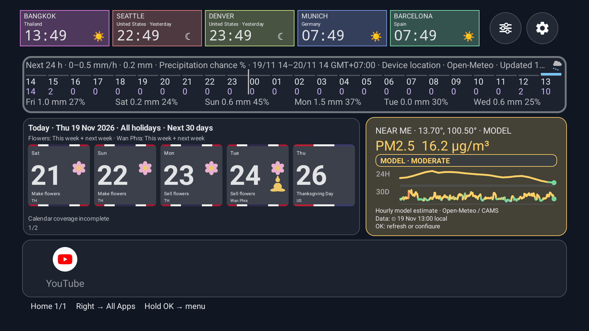
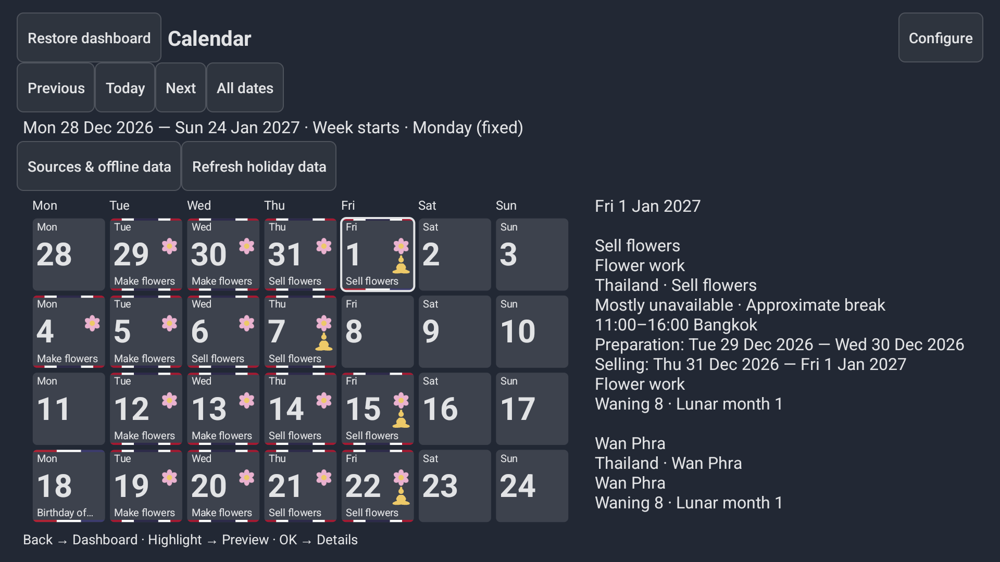
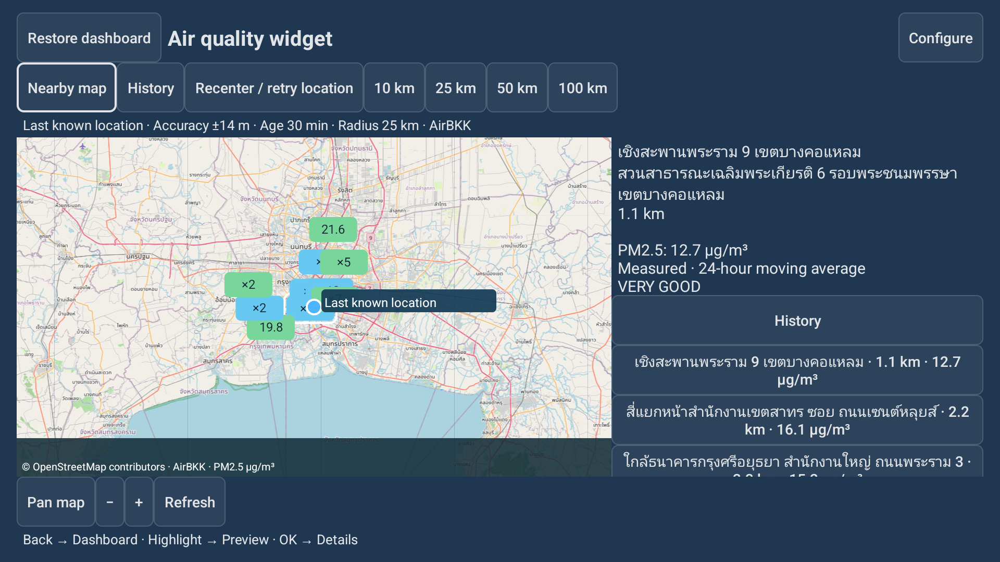
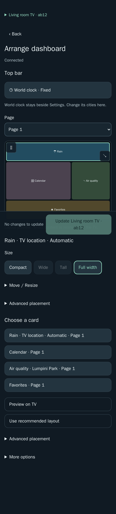

# Homeboard TV

A customizable home screen for Android TV and Google TV. See the rain ahead,
upcoming dates, air quality and world clocks, with your favorite apps within reach.
Arrange and resize widgets with the remote or your phone browser.

[Download & install](https://biohack.net/homeboard/) ·
[Quick start](docs/how-to/quick-start.md) ·
[Printable manual](docs/how-to/quick-start-print.pdf) ·
[A4 promotional sheet](docs/promo/homeboard-tv-one-sheet.pdf)



*Actual Cast1 capture, 0.1.74, using fresh test settings. YouTube is seeded when
installed; existing favorite lists are preserved. [Screenshot evidence](docs/testing/2026-11-19-youtube-dashboard-images.md).*

| On your dashboard | What you can do |
|---|---|
| Rain | See the next 24 hours by hour and six daily forecasts; use TV location or choose a city, address or coordinates. |
| Calendar | Browse holidays, locally calculated Wan Phra and flower-work dates; check offline coverage and refresh sources. |
| Air quality | View nearby hourly PM2.5 model estimates or Bangkok station averages, with 24-hour and 30-day trends. |
| Favorites | Keep apps in a scrolling row; fresh dashboards start with YouTube when installed. All Apps is to the right. |
| Timers & alarms | Run named cooking timers together or set one-off date/time alarms; manage them from TV or paired phone. |
| Android app widgets (0.1.95+) | Host widgets from installed apps; Chromecast requires one-time permission setup. Provider remote support varies. [Setup and limits](docs/how-to/android-app-widgets.md). |
| World clock | Choose cities and compare times in the full-screen meeting planner. |

**Press OK** for a bigger widget view. **Hold OK** to configure, move or resize.
**Hold Back for one second** on Home or All Apps to undo a saved change.

## A closer look

<table>
<tr>
<th>Calendar · four weeks and day details</th>
<th>Air quality · nearby stations and map</th>
</tr>
<tr>
<td><a href="docs/testing/2026-11-19-calendar-data/offline-boundary-en.png"></a></td>
<td><a href="docs/promo/pm25-expanded.png"></a></td>
</tr>
</table>

*Actual TV captures: Calendar 0.1.69 with controlled offline test dates; air-quality
map from an earlier build. Click either image to inspect it at full size.*

[Timers & alarms](docs/how-to/timers-and-alarms.md) ·
[Calendar & offline data](docs/how-to/calendar-data.md) ·
[Full-screen widget controls](docs/how-to/widgets-full-screen.md) ·
[World clock & meeting planner](docs/how-to/world-clock.md)

Native widgets need no Home Assistant, MagicMirror, dashboard server or API key.
Wallpaper providers are optional separate apps. Homeboard is an independent,
MIT-licensed project based on CleanYourTV's Java launcher; scheduled scenes and
broader dashboard integrations remain future work.

## Home interaction

The fixed [World clock](docs/how-to/world-clock.md) sits beside Settings on Home
and All Apps, with configurable colored city cards and a full-screen meeting
planner, 24-hour comparison and offline map. Its settings use named time zones
and the TV system clock. [Phone shortcuts](docs/how-to/phone-tv-shortcuts.md) can
open each TV’s controller from a separate named home-screen icon.

**Short OK/click expands a widget; hold OK opens widget settings/actions.** Expanded
views add four-week Calendar detail, Rain amount/probability charts, nearby air
stations on a geographic map with device location, and a Favorites banner browser
with app details. Back restores the dashboard's original page, widget focus and
size. See [full-screen widget controls](docs/how-to/widgets-full-screen.md).

[Widgets-first Home plan and mockups](docs/plans/2026-11-15-widget-home.md):
custom widgets and app favorites, including an entirely empty dashboard; moving
right reveals All Apps. Hold OK offers Move, Favorite, Delete tile and Uninstall app.
The native implementation supports saved empty Home, app favorites, separate app ordering,
move previews, tile deletion/restoration, Android uninstall confirmation, palettes and reduced motion.
See the plan for device validation and remaining limits.

[Google TV app icons and glowing focus](docs/plans/2026-11-16-google-tv-app-focus.md)
documents the circular artwork, focus ring and halo reference, implementation
and device evidence. Use `task deploy` for a newly numbered APK deployment;
the About dialog displays the installed APK version.

The [provider directory](docs/how-to/provider-directory.md) offers Google Play links,
community publisher pages, phone QR links and explicit compatibility status.
Providers remain separate apps; Homeboard does not install or bundle their APKs.

Wallpaper-provider hosting, UI opacity and dense All Apps are described in the
[Projectivy wallpaper how-to](docs/how-to/projectivy-wallpapers.md). The host uses
the public v1 API; it does not need Projectivy Launcher. See the
[implementation plan](docs/plans/2026-11-16-projectivy-plugin-host.md) for
compatibility scope and validation status.

[Home favorite sizes and dense layouts](docs/plans/2026-11-16-home-favorite-app-sizes.md)
adds **Home settings → Appearance → Icons → Home favorites → Small icons / Banners**.
Home and All Apps each use a compact icon grid or a separate banner grid with
wider cards and taller rows. Their artwork settings are independent. Auto fits
the available space while retaining readable labels and focus clearance; Undo
restores Home's previous style and placement. Grid rows/columns selectors now
preview actual candidate grids, with vertical column or horizontal row emphasis.

The earlier combined **0.1.19** deployment includes wallpaper hosting, independent UI
background opacity, Home favorite sizes, dense icon/banner grids and English/Thai
language selection. Solid color opens the palette picker; Background status & credits
shows the saved source and live provider status. Retry refreshes a selected
provider. About links show a full address and phone QR code, plus a TV browser
action when available. All 53 menu regressions and 380 JVM tests passed. See the
[combined validation record](docs/testing/2026-11-16-projectivy-plugin-host.md).

**Home settings → Language / ภาษา** supports English, Thai and Follow device,
with independent persistence and Undo. Full bilingual UI and Thai copy acceptance
remain pending; see the [language plan](docs/plans/2026-11-16-language-setting-and-translations.md)
and [validation limits](docs/testing/2026-11-16-thai-language.md).

## Groceries

The [Groceries widget](docs/how-to/groceries.md) supports phone-first list entry,
reusable staples, saved products and confirmed quantities/packages. Optional
pantry tracking offers Need more / Enough / Unknown or reported stock with
replenishment suggestions. Short OK opens the complete list, notes and stock
details; Back restores Home. Changes use the phone controller’s reviewed draft,
Update TV and Undo. Purchase check-off and away-from-home synchronization remain
Phase 3. See the [design and app survey](docs/plans/2026-11-19-grocery-list-widget.md).

## Configure from a phone

**Home settings → More → Configure from phone** opens a temporary local web editor.
Scan the TV QR code, approve the matching connection code, and edit each widget,
Favorites or the layout in your phone browser. Tap a dashboard card, drag Favorite
rows to reorder, and review your shared draft before **Update TV**. One Undo
restores the complete update. No phone app or account is needed.
Keep Homeboard open on the TV and use your trusted home network.
The controller also offers a provider directory and [a phone shortcut per TV](docs/how-to/phone-tv-shortcuts.md).
See the [phone editor how-to](docs/how-to/phone-widget-editor.md).

<details>
<summary>See the phone layout editor</summary>

<p><a href="docs/images/phone-layout-editor.png"></a></p>

Browser-fixture capture in an Android Chrome phone viewport; this is not a
physical handset photo. [Controller verification](docs/testing/2026-11-17-phone-controller-design.md).

</details>


## Default dashboard

New installations start with Rain, Calendar, Air quality and Favorites. The revised
8×4 preset uses shallow full-width hourly Rain, Calendar beside compact Air quality
with 24-hour and 30-day sparklines, and one full-width Favorites row at the bottom.
See the [revised layout plan](docs/plans/2026-11-17-default-dashboard-hourly-rain.md).
 The layout
fits all four widgets on one screen, including short two-row grids. This correction
arranges existing nonempty dashboards once, with Undo; saved empty Home stays
empty. **Home settings → Widgets / Restore → Default dashboard** applies the
four-widget arrangement immediately, with Undo. Existing widget settings and favorite apps are
retained.

Right from an empty Home page advances normally to the next page or All Apps.
Up opens the settings row; Right from its last button also leaves an empty page.
See the [default dashboard and navigation plan](docs/plans/2026-11-17-default-dashboard-and-empty-page-navigation.md).

## Favorites on the first page

Fresh dashboards seed YouTube into Favorites when the installed app is discovered.
Existing lists and removals are preserved; missing YouTube creates no unavailable tile.

Rain and a resizable **Favorites** panel share Home page 1. Existing favorite apps
keep their order inside the panel; adding more apps scrolls within its fixed area.
Directional wedges show additional apps, with no scrollbars. One-row panels scroll
sideways; taller panels scroll vertically. Small panels open a larger Favorites
browser with OK.

OK launches the focused app. Back reaches the panel header; hold OK on an app for
app actions, or on the header for widget Move/Resize and artwork options. Removing
the panel keeps its app list for re-adding. The first arrangement is saved once and
supports Undo. See the [layout and interaction plan](docs/plans/2026-11-16-first-page-rain-and-favorites-container.md)
and [validation record](docs/testing/2026-11-17-favorites-container.md).

## Rain forecast widget

Add **Home settings → Widgets / Restore → Add widget → Rain**. Rain defaults to
device location and uses an existing location permission automatically. Hold OK →
Location to choose a fixed city, coordinates or street address, or return to
Device location · Automatic. The default is the next 24 hours by hour followed by six daily forecasts;
both ranges, units, label and cloud animation are configurable per widget.

Hold OK for configuration and size presets. The default dashboard uses a shallow
full-width Rain row; **4×3** is an option for a larger standalone card. The 1×1 glance,
compact, tall, wide and Fill Home layouts adapt to available space. OK opens exact
hourly/daily values and full-screen details. Animated clouds respect Reduced motion.
See the [rain plan and size gallery](docs/plans/2026-11-16-rain-widget.md) and
[validation record](docs/testing/2026-11-16-rain-widget.md).

## Current verification

The dashboard images above have [capture receipts and visual review](docs/testing/2026-11-19-youtube-dashboard-images.md).
The [default Favorites checks](docs/testing/2026-11-19-default-youtube-favorite.md)
cover one-time YouTube seeding. The standalone cleanup companion’s
[execution and recovery checks](docs/testing/2026-11-19-cleanup-execution.md)
use controlled fixtures; physical cleanup acceptance remains separate.

Groceries debug build **0.1.81** passed 510 JVM tests, Android lint,
Chromium/WebKit phone workflows and coordinator-owned Cast1 input/restoration/
stock-detail acceptance. The identical Cast2 install failed
`personal-install-in-use` and is unconfirmed. See the
[grocery verification record](docs/testing/2026-11-19-grocery-cooper.md) and
[Phase 3 offline shopping/sync plan](docs/plans/2026-11-19-grocery-shopping-sync.md).

The optional [TV cleanup companion](docs/how-to/tv-cleanup.md) connects standalone
TVs and provides coordinator-owned inspection for shared devices. Its standalone
review, execution and recovery workflow is fixture-tested; real cleanup requires
an exact approved device profile, a reviewed package selection and physical restore
acceptance. Selected CleanYourTV recovery code and original tests are separately
pinned and licensed.

Earlier build **0.1.69** added calculated offline Wan Phra/flower dates, persistent
current/next-year holiday storage, automatic checks and manual source refresh.
It passed 500 JVM tests, 7 calendar pipeline tests, 52 cleanup/recovery tests and
Android lint. For that build, Cast1 was installed and launch-verified. The identical Cast2 install
was submitted and admitted, but failed `personal-install-in-use`; installation
there is unconfirmed. See the [calendar data guide](docs/how-to/calendar-data.md)
and [calendar verification record](docs/testing/2026-11-19-calendar-data.md) for
source coverage, live-network limits and physical screenshot evidence.

Earlier English/Thai companion captures, real read-only Cast1 inspection and
native instructions verification remain in the
[cleanup verification record](docs/testing/2026-11-18-tv-cleanup.md).

Earlier directory/dashboard captures and provider baseline evidence remain in the
[provider verification record](docs/testing/2026-11-18-provider-directory.md).
Actual Play installation/return and backend/account-dependent provider checks
remain unverified.

On Home or All Apps, **hold Back for one second to Undo**. A short Back keeps
normal navigation. See the [Undo guide](docs/how-to/undo.md).

## Start here

- [Download Homeboard TV and get started](https://biohack.net/homeboard/) · public early releases for Android TV / Google TV, Android 8.0+

- [Product direction: our brand and the CleanYourTV community](docs/product-direction.md)

- [Quick start and user guide](docs/how-to/quick-start-print.html) · [A4 PDF](docs/how-to/quick-start-print.pdf)
- [User quick start with illustrations](docs/how-to/quick-start.md)

- [Existing dashboard integration comparison](docs/investigations/2026-11-15-dashboard-systems-for-homeboard.md)

- [Project plan and mockups](docs/plans/2026-11-15-project-foundation.md)
- [Investigation and community strategy](docs/investigations/2026-11-15-tv-dashboard-launcher-comparison.md)
- [Build instructions](docs/how-to/build.md)
- [Shared Chromecast workflow](docs/how-to/chromecast.md)
- [Upstream source and contribution strategy](docs/upstream/README.md)
- [Bridge boundary](bridge/README.md)

```sh
task build-image
task check
task build
task --list
```

Docker with Compose and Task are the host requirements. Java 17 and Android SDK
platform 34/build-tools 34.0.0 live in `Dockerfile.build`; compilation, tests and
packaging run in that container locally and in CI. Dependencies persist in a named
volume. See the build how-to for image overrides and rootless Docker behavior.

The application ID is `net.biohack.homeboard`; debug builds use
`net.biohack.homeboard.debug`. The imported Java namespace remains `com.gathin.tvhome`
to keep upstream diffs focused. `task release` builds and verifies the public APK
using a private durable signing key; `task deploy VARIANT=release` freezes and
submits the identical numbered APK to both TVs. See the build guide for key
storage and the distinction between public and debug installations.

## Community contributions

Keep Homeboard-specific features here. Contribute independently reproducible launcher
fixes upstream; prepare a showcase entry once a public, usable project is ready.
The Hebrew-layout correction fixes our card addition and needs no upstream patch.
See the [contribution strategy](docs/upstream/README.md).

## License

The imported CleanYourTV source is MIT-licensed, copyright 2026 Gathin; see [LICENSE](LICENSE).
New Homeboard TV code is offered under the same MIT terms. Bundled font terms and other notices
remain in their original files; see [third-party notices](THIRD_PARTY_NOTICES.md).
