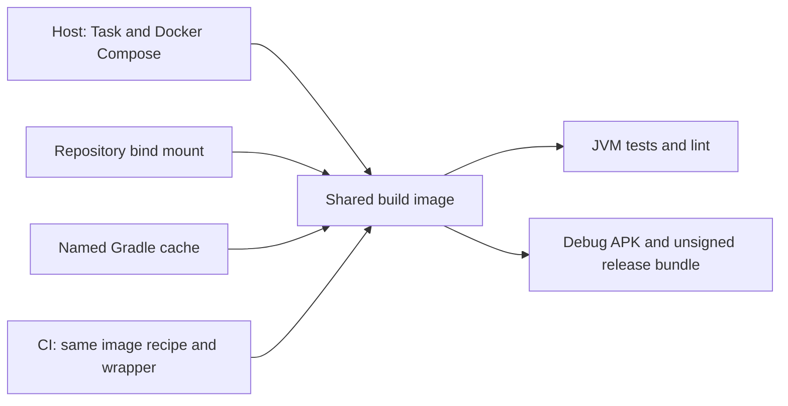

# Building Homeboard TV in containers

All compilation, JVM tests, Android lint and packaging run in the same Docker
build image locally and in CI. The host needs Docker with Compose, Git and Task.
This follows the [workspace container standard](/home/will/docs/howtos/containerized-build-environment.md).

## Commands

Run `task build-image` once, and again after changing `Dockerfile.build`.
Then use `task check` for tests/lint, `task build` for the debug APK, and
`task bundle` for the unsigned release App Bundle. `task dev-shell` opens an
interactive container shell; `task run -- COMMAND ARGS` runs an ad-hoc container command.
No build task installs an APK or changes a device's launcher.

The image contains JDK 17, Android command-line tools 12.0 (archive 11076708,
SHA-256 checked), SDK platform 34 and build-tools 34.0.0, plus Android platform-tools. The repository pins
Gradle 8.9 and AGP 8.5.2. Android's build tools require the Linux amd64 image;
other host architectures need Docker emulation.

## Files, cache and identity

Compose mounts the repository at `/workspace`; artifacts remain under
`launcher/app/build/outputs/` and reports under `launcher/app/build/reports/`.
The Gradle dependency cache is a project-scoped named volume. Neither the host
JDK nor the host Android SDK is used. Do not create a `launcher/local.properties`
pointing to a host SDK; the image supplies `ANDROID_HOME`.

The wrapper detects rootless Docker and uses container UID/GID 0, which map to
the invoking host user. On rootful Docker it uses the host user's UID/GID.
`BUILD_UID` and `BUILD_GID` are optional explicit overrides; the variables avoid
reassigning Bash's reserved `UID`. This keeps bind-mounted artifacts owned by Will.
The named cache directory is initialized writable for either mode.

Copy `.env.example` to `.env` for a `BUILD_IMAGE` override. A build server can pull
that image, then run the same wrapper with no toolchain installation. The current
CI builds the recipe because no shared registry image has been published yet.
Use an immutable registry digest when publishing a shared build image.
No Docker socket or cloud credentials are mounted inside the build container:
the Android build does not require nested Docker or cloud access.

## Verification and limits

The earlier host run passed 316 JVM tests (44 suites), debug lint (zero errors,
98 warnings and 96 informational findings), debug APK assembly and unsigned
release bundle packaging. That run preceded correction to the container workflow;
it is not evidence of container validation. The temporary host JDK was removed.

Container validation passed on 15 November 2026: 327 tests with zero failures,
debug lint with zero errors (179 warnings and 96 informational findings), debug APK
assembly and unsigned release bundle packaging. Many additional warnings concern
inherited resources unused by the new widget UI. JDK 17.0.21 and Gradle 8.9 ran
inside the image. CI is configured but has not run on a hosted repository. Tests
do not establish TV focus, rendering or performance; device testing uses the shared
Chromecast coordinator. `task fixture` builds a disposable app for testing app
launch and uninstall without removing an existing user app.
Production signing and Play distribution remain open work.
