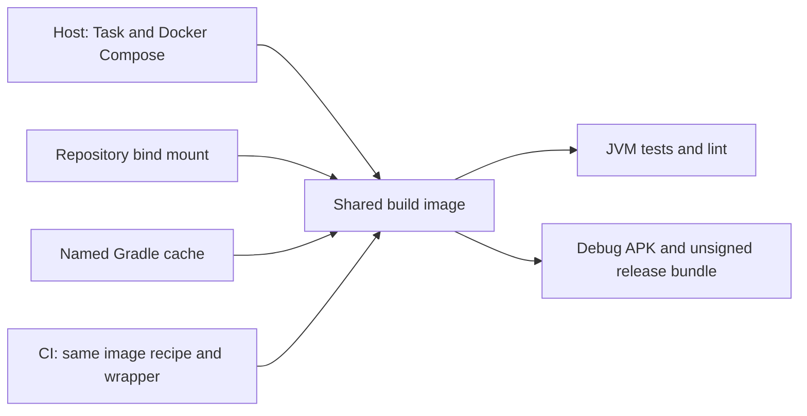

# Building Homeboard TV in containers

All compilation, JVM tests, Android lint and packaging run in the same Docker
build image locally and in CI. The host needs Docker with Compose, Git and Task.
This follows the [workspace container standard](/home/will/docs/howtos/containerized-build-environment.md).

## Commands

Run `task build-image` once, and again after changing `Dockerfile.build`.
Then use `task check` for tests/lint, `task build` for the debug APK, and
`task bundle` for the unsigned release App Bundle. `task dev-shell` opens an
interactive container shell; `task run -- COMMAND ARGS` runs an ad-hoc container command.
No build task installs an APK or changes a device's launcher.

`version.properties` stores `major`, `minor` and Android `version_code`.
Gradle generates the APK version name as `major.minor.version_code`, which the
About dialog reads from the installed package. `task bump` increments the code
in the build container. Use `task deploy` for each new deployment: it bumps,
checks, builds and freezes a distinct numbered APK before submitting the
coordinator job. A failed attempt may consume a number; never roll it back.

The image contains JDK 17, Android command-line tools 12.0 (archive 11076708,
SHA-256 checked), SDK platform 34 and build-tools 34.0.0, plus Android platform-tools. The repository pins
Gradle 8.9 and AGP 8.5.2. Android's build tools require the Linux amd64 image;
other host architectures need Docker emulation.



## Files, cache and identity

Compose mounts the repository at `/workspace`; artifacts remain under
`launcher/app/build/outputs/` and reports under `launcher/app/build/reports/`.
The Gradle dependency cache is a project-scoped named volume. Neither the host
JDK nor the host Android SDK is used. Do not create a `launcher/local.properties`
pointing to a host SDK; the image supplies `ANDROID_HOME`.

The wrapper detects rootless Docker and uses container UID/GID 0, which map to
the invoking host user. On rootful Docker it uses the host user's UID/GID.
`BUILD_UID` and `BUILD_GID` are optional explicit overrides; the variables avoid
reassigning Bash's reserved `UID`. This keeps bind-mounted artifacts owned by Will.
The named cache directory is initialized writable for either mode.

Copy `.env.example` to `.env` for a `BUILD_IMAGE` override. A build server can pull
that image, then run the same wrapper with no toolchain installation. The current
CI builds the recipe because no shared registry image has been published yet.
Use an immutable registry digest when publishing a shared build image.
No Docker socket or cloud credentials are mounted inside the build container:
the Android build does not require nested Docker or cloud access.

## Verification and limits

The earlier host run passed 316 JVM tests (44 suites), debug lint (zero errors,
98 warnings and 96 informational findings), debug APK assembly and unsigned
release bundle packaging. That run preceded correction to the container workflow;
it is not evidence of container validation. The temporary host JDK was removed.

Container validation passed on 15 November 2026: 327 tests with zero failures,
debug lint with zero errors (179 warnings and 96 informational findings), debug APK
assembly and unsigned release bundle packaging. Many additional warnings concern
inherited resources unused by the new widget UI. JDK 17.0.21 and Gradle 8.9 ran
inside the image. CI is configured but has not run on a hosted repository. Tests
do not establish TV focus, rendering or performance; device testing uses the shared
Chromecast coordinator. `task fixture` builds a disposable app for testing app
launch and uninstall without removing an existing user app.
Google Play distribution remains future work. Public APK signing is described below.

## Shared worktree debug signing

The deployed debug key lives outside Docker and Gradle caches at
`~/.local/share/homeboard-tv/debug-signing/debug.keystore`, with a separate copy at
`~/.local/share/homeboard-tv/debug-signing-backup/debug.keystore`. Preserve an
additional protected off-machine backup. `HOMEBOARD_DEBUG_SIGNING_DIR` can select
another existing directory. Compose mounts it read-only, and the app's debug
signing configuration explicitly requires that file. A missing key fails the build;
it must never silently generate a replacement. All deployment worktrees must use
this identity. Cache recreation and Docker daemon changes must not rotate it.

The key created on November 20 has SHA-256 certificate fingerprint
`dbb3446edcf5f2a66e810c266ee9195dce842e95d618d75529fc26c0d6caf3ff`.
It replaces a lost development identity with Will's explicit authorization to reset
both TV installations. Ordinary deployments must preserve app data: if a later
update reports `INSTALL_FAILED_UPDATE_INCOMPATIBLE`, compare certificates and recover
the saved key instead of uninstalling. Do not regenerate it during setup or repair.
The standard Android debug password/alias are used; this is development signing,
separate from the private public-release identity.

CI explicitly generates an ephemeral key in its own directory. CI APKs are not
deployment candidates. The named `homeboard-tv_gradle-cache` remains shared for
dependencies, but it no longer determines the app's deployed debug signing key.

## Public signed APK and publication

`task signing:init` provisions a durable RSA release key and password in
`~/.local/share/homeboard-tv/signing` and a separate private local backup in
`~/.local/share/homeboard-tv/signing-backup`. It refuses to replace existing key
material. Preserve both files and keep an additional protected off-machine backup;
losing this key prevents ordinary updates to existing public installations.
`HOMEBOARD_SIGNING_DIR` and `HOMEBOARD_SIGNING_BACKUP_DIR` override those paths.
Never put their contents in Git, build logs, a published source archive or site assets.

`task release` mounts the private signing directory read-only using
`docker-compose.signing.yaml`, builds/lints a signed release APK and verifies its
identity, signature, non-debuggable status, version and absence of test fixtures.
It writes non-secret metadata to `artifacts/release-verification.json`.
Ordinary `task build` and the unsigned `task bundle` workflow are unchanged when
run without the signing override.

Use `task deploy VARIANT=release` for public device acceptance. It performs the
normal bump/check/build/freeze/coordinator sequence, uses a distinct
`homeboard-tv-public` catalog entry and installs the identical artifact on both TVs.
The release package is `net.biohack.homeboard`; `.debug` remains separate, so
existing test-app preferences do not transfer. Both installs retain their data.
The frozen deployment includes exact app build inputs and license/provenance records in `source.tar.gz`,
APK hash, signing-certificate fingerprint and per-device receipts.

`task guide` regenerates the download-page QR and two-page A4 PDF in the browser
container. It uses the existing pinned Playwright dependencies in
`artifacts/phone-browser` (prepare with `task phone:setup` if missing) and biohack.net's
existing QR dependency. After freezing the public APK, export it to the site:

```sh
docker run --rm -v "$PWD:/workspace" -v "$PWD/../biohack.net:/site" \
  homeboard-tv-build:local python3 /workspace/dev/export-publication.py \
  --deployment /workspace/artifacts/deployments/0.1.NUMBER --site /site
```

The exporter checks frozen bytes, refuses to overwrite different versioned APKs,
copies the guides and all images, and generates the Astro page/release metadata.
The site validates APK/source hashes during build and tests. Run its tests, build
and link checks in a Node container, review the result, then use the existing
site publication workflow. See the [publication plan](../plans/2026-11-19-biohack-apk-publication.md).
