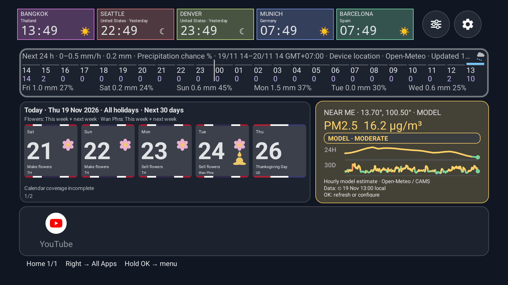
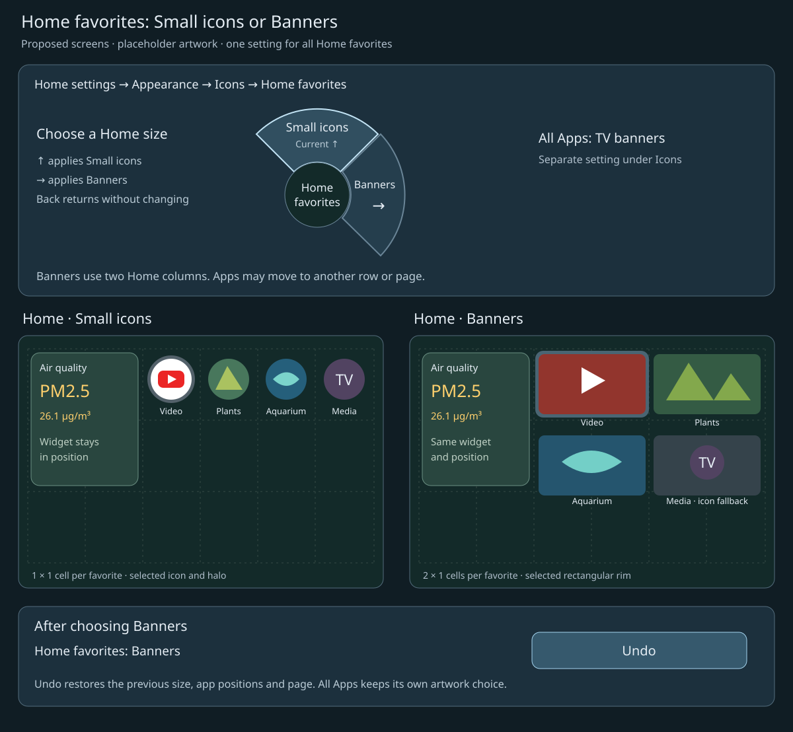
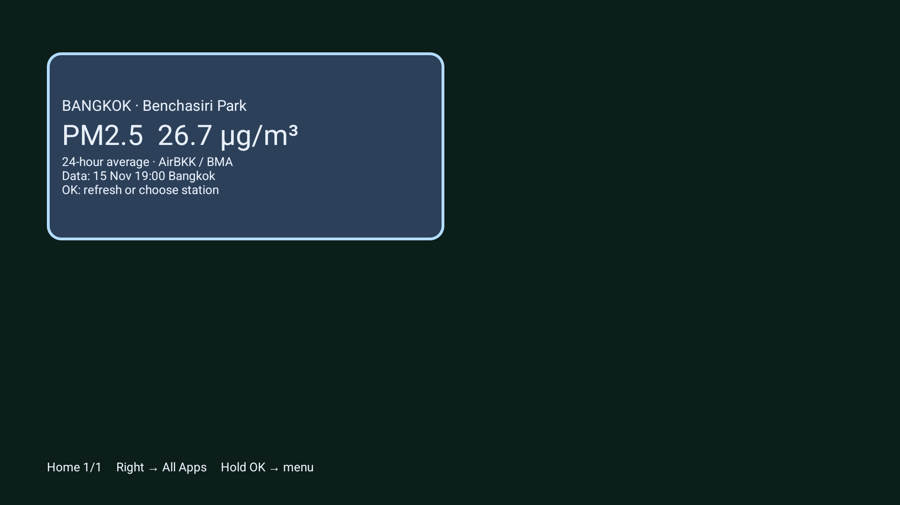

# Homeboard TV quick start

For a compact new-TV guide, use the [printable quick start](quick-start-print.html)
or [A4 PDF](quick-start-print.pdf). The illustrated reference follows below.

Homeboard opens on **Home**, your space for widgets and favorite apps. **All Apps**
is one screen to the right. Home can be completely empty if you prefer.

The current dashboard puts hourly Rain across the top, Calendar beside compact
Air quality, and one row of Favorites across the bottom. The fixed World clock
sits left of the Settings buttons.

This capture uses fresh test preferences, with the installed YouTube app seeded into Favorites.
Other screenshots below are historical and may show older arrangements; design
illustrations are labeled. See the [current screenshot proof](../testing/2026-11-19-youtube-dashboard-images.md).

## Cooking timers and household alarms

Add **Timers & alarms** from Home settings → Widgets / Restore → Add widget.
A **2×1** widget is a useful starting size. Press OK for the full controls.
Choose a minute preset or enter a dish name, minutes and seconds; run several
cooking timers together, Pause/Resume, add one minute or Stop each one.
Switch to **Event alarm** for a one-off date and time, such as calling a ride
or leaving the house. The TV timezone is shown on both TV and phone.

Grant **Alarms & reminders** access when needed. Alarms can sound over another
app; the TV must be on and audible. Stop alert sound silences the current alert;
Done remains until acknowledged. Cooking timers interrupted by a TV reboot need
an explicit restart. Future event alarms are restored; missed ones are labeled.
Paired phone timer controls take effect immediately, separately from layout Undo.
See [Timers & alarms](timers-and-alarms.md) for setup, recovery and limits.

## Widgets from other Android apps

In Homeboard **0.1.95 or newer**, install a widget provider on the same device, then choose **Home settings →
Widgets / Restore → Add widget → Android app widgets**. Finish Android/provider
setup and review **Add to Home**. On Chromecast, **Widget permission setup**
explains the one-time developer connection needed because its Android approval
screen is missing. Built-in widgets work without that setup.

Press OK for the live widget and provider details; choose **Interact with widget**
for its controls. Back or **Restore dashboard** returns to the original place.
Hold OK to move, resize or remove; Undo retains the configured instance while it
remains in history. Providers may require touch. The phone browser arranges
configured widgets; adding and provider setup happen on the host device.
See [Android app widgets](android-app-widgets.md) for permission setup and limits.

## Install on your own TV

Open **[biohack.net/homeboard](https://biohack.net/homeboard/)** on your phone or
computer and choose **Download APK**. Homeboard supports Android TV / Google TV
with Android 8.0 or newer. Transfer the APK to the TV using a USB drive (where supported) or
a TV file-transfer app, then open it in a TV file manager. If Android prompts,
allow **Install unknown apps** for that file manager and choose **Install**.
Turn that permission off afterward. Menu names and available transfer methods
vary by TV. This setup does not require developer mode, wireless debugging,
a computer service or device enrollment.

For updates, download a newer public APK from the same page and install it over the existing public app;
uninstalling first removes its saved data. A differently signed APK cannot update
the existing installation. If Android rejects an update, keep the installed app
to preserve its dashboard and settings. Check that you downloaded a newer public
release, rather than the separate debug build. A matching update can resolve a
version or signing mismatch without deleting your data.

Earlier test builds use a separate debug app. The public release installs alongside
that app; its dashboard settings do not transfer automatically. Keep the test app
and its data if you still use it.

Android documents its [APK installation permission](https://developer.android.com/distribute/marketing-tools/alternative-distribution).

## Open Homeboard

Open **Homeboard TV** from your TV's app list. It does not have to be the default
launcher to try it. The test installation does not change your default Home app.
No account, API key, Home Assistant or dashboard server is needed for air quality.

## Use the remote

| Button | What it does |
|---|---|
| Arrows | Move focus between tiles |
| Right beyond the last widget page | Slide into All Apps from the right |
| Left at the first All Apps column | Slide back to Home |
| Back in All Apps | Return to Home |
| Short OK | Expand a widget full screen, or launch the selected app |
| Hold OK | Open widget settings/actions, or the selected app's menu |
| Back in a full-screen widget | Restore its dashboard page, focus and size; nested details close first |
| Back in a menu | Close the menu or cancel its draft |
| Hold Back for one second on Home / All Apps | Undo the latest saved change, once per hold |
| Menu button, if your remote has one | Open Home settings |

The remote's Home button opens your TV's own launcher until you change it in
**Home settings → Home button**; see [The Home button](#the-home-button) below.

## Add a favorite app

1. Move right into All Apps.
2. Focus an app and **hold OK**.
3. Choose **Favorite**.
4. Return left to Home. The app is inside the **Favorites** panel.

The “AAA Homeboard Test” app in these historical screenshots is a disposable test app.

Choose **Unfavorite** to remove that dashboard shortcut. The app remains installed
and is still available in All Apps. Favoriting twice does not create duplicate tiles.

## Browse and size Favorites

The default Favorites panel spans the bottom of Home as one row. Arrows browse apps
inside Favorites; more rows scroll vertically, while a one-row panel scrolls
sideways. Down/right wedges show more apps; up/left wedges show a return direction.
There are no scrollbars. Reaching a list edge lets focus move to another widget.

OK launches an app. Back focuses the Favorites header; hold OK there for widget
Move/Resize. Hold OK on an app for internal reorder, Unfavorite, or **Favorites
widget actions**. A 1×1 panel opens a larger Favorites browser with OK. Removing
Favorites keeps its list, and re-adding the widget restores it.

To restore all four default widgets on one screen, use **Home settings → Widgets /
Restore → Default dashboard**. Undo restores the prior arrangement. For the optional
Rain-and-Favorites arrangement, use **Favorites widget
actions → More → Arrange Rain and Favorites on page 1**, choose a Rain widget,
and review the preview. OK saves; Back cancels.

## Choose app density and artwork

Open **Home settings → Appearance → Icons**. The two branches are independent:

- **Home favorites → Small icons / Banners** changes all favorite apps on Home.
  Small icons use a compact grid; Banners use wider cards and taller rows.
  Apps reflow **inside the Favorites panel**; its saved outer size and other
  widgets do not change. **Undo** restores the previous artwork choice.
  Selecting the current size changes nothing.
- **All Apps → Launcher icons / TV banners** changes the app library. Launcher icons
  use a dense icon grid; TV banners use their own responsive grid with wider
  cards and taller rows. Changing artwork keeps All Apps open.

Banner artwork keeps its 16:9 proportions, with a rounded rectangular focus ring
and a label below. Apps without a banner show their icon centered on a neutral
plate. Small circular icons retain their round ring and halo; the icon shape
choice affects small icons only. Artwork fits the configured grid and text size.
Each installed app appears once, even when it publishes multiple launcher
activities. Log utility entries are filtered out of All Apps.

For the densest automatic dashboard, open **Home settings → Home behavior**
and set both **Grid columns** and **Grid rows** to **Auto**. Explicit grid choices
remain respected, within the readable fit for the selected style. A typical
960 × 540 dp TV can fit 11 × 4 small icons or six banners across three taller
rows; larger text can reduce those counts. Favorites artwork reflows within its panel; it does not change the outer Home
grid. Changing All Apps artwork alone does not change the dashboard.

To check the installed version, open **Home settings**, press **OK** to show the
second menu page, then choose **About Homeboard TV**. About reads the installed
APK version. Screenshots in this guide come from several versions; use About
to identify the build actually installed on your device.

### Check whether the dashboard is rendering at 4K

In **About Homeboard TV**, read **Dashboard rendering** and **TV output** separately.
**Dashboard rendering: 3840 × 2160 (4K)** means the dashboard itself is drawn at
4K. **TV output** reports the signal sent to the television; a 4K output can still
carry a dashboard drawn at 1920 × 1080.

The separate **Homeboard 4K Dashboard Test** app also shows **Rendering surface**;
both its dashboard and surface should read **3840 × 2160 (4K)**. Native 4K remains
an engineering test in that separate app; the normal launcher does not yet
automatically enable it. See the [Android 4K HOWTO](android-4k.md) for details.

The current 4K test keeps widgets at their familiar apparent size. It adds detail,
but does not automatically give you four times the space for widgets. A dashboard
scale control for a larger workspace is planned and is not available yet.

The two top-right buttons are separate: the sliders button opens **Homeboard
settings**, which includes **About Homeboard TV**, and the gear opens **Android device Settings**. System Settings is not
a tile in the app grid. Homeboard settings are also available by holding OK on a
Home tile or on the empty Home screen.

### The Home button

**Home settings → Home button** decides what a short press of Home opens, and says
what it opens now.

- **Google TV**, including the Chromecast with Google TV: choosing a different Home
  app does not move the Home button, so Homeboard offers **Home button opens
  Homeboard**. Turned on, a short press of Home opens Homeboard from any app, and if
  Google TV's home screen appears Homeboard replaces it. Holding Home still opens
  Google TV's quick settings and home panel, the remote's YouTube and Netflix
  buttons keep working, and Google TV stays installed and enabled. It works through
  Homeboard's **Home button** helper, an Android accessibility service. Homeboard
  shows **Home button · Homeboard TV (test)** for the debug build, so choose that
  entry when public and test copies are both installed. Homeboard can turn the
  helper on itself after the same one-time setup command the
  screensaver's **Use everywhere** uses; otherwise the screen opens Android's
  accessibility settings for you to turn it on. The screen shows whether the helper
  is actually running. If Android stops it, the recovery action depends on its
  state and whether the one-time permission was granted: **Start it again** may
  be offered; without that permission you may need to enable the helper again in
  Android accessibility settings.
- **Other TVs**, where Android honours the choice: **Make Homeboard the Home app**
  asks Android for the Home role, with no helper. If Homeboard already is the Home
  app, the screen says so.

Turning the setting on or off saves at once and can be undone by holding Back. To
give Home back at any time, turn the setting off, hold Home and turn off **Home
button** (or the labelled test helper) in Android's accessibility settings, or
uninstall Homeboard.

## Clock and meeting planner

The fixed World clock starts with Bangkok, Seattle, Denver, Munich and Barcelona.
Short OK opens its full-screen clocks, meeting comparison and map; hold OK edits
cities and display settings. Back or **Restore dashboard** returns to the calling
screen. The clock stays in the top bar. [World clock guide](world-clock.md).

## Configure from your phone

Open **Home settings → More → Configure from phone**, scan the QR code and approve
the matching code on the TV. Tap a widget to edit it, drag list grips to reorder,
and review the draft before **Update TV**. Choose the fixed clock under **Top bar**.
Each TV keeps independent settings.

The TV-name menu offers **Add TV to home screen** for a phone shortcut per TV.
A shortcut still needs a fresh editing session and approval on its TV.
**Get wallpaper providers** opens the provider directory; its links do not edit
or apply the dashboard draft. [Phone guide](phone-widget-editor.md) ·
[TV shortcuts](phone-tv-shortcuts.md).

## Undo a saved change

On Home or All Apps, hold **Back for one second**, then release. Each hold undoes
one change; a short Back keeps normal navigation. Inside a menu, Back cancels or
closes it first. You can also focus the visible Undo button or use **Homeboard
Settings → Undo history**. [Undo guide](undo.md).

## Color palette

Open **Home settings → Appearance → Background → Solid color** to choose a
palette. The focused color previews immediately; the current selection is marked.
The palette sets surface colors, text tones and focus highlights.

For images or video, open **Background → Get providers**. Install a separate
provider using its Google Play link or phone QR code, return to Homeboard, then
**Configure → Preview → Use background**. Installation alone never changes the
background. **Images & videos · Projectivy** lists installed providers.
[Provider installation guide](provider-directory.md).

New layouts and the opacity control’s **Reset** use **65%**; existing saved
opacity choices are kept.

**Appearance → Widget background opacity** adjusts card fills from transparent to
opaque. It leaves text, controls and wallpaper/video brightness alone. Wallpaper
rotation and dimming are separate provider options. Back cancels a preview;
**Done** saves one undoable change. [Wallpaper controls](projectivy-wallpapers.md).

## Air quality

Each Air Quality widget independently shows either a nearby **hourly PM2.5 model
estimate** or a selected Bangkok monitoring station's **24-hour average PM2.5**,
in µg/m³. The card labels its source, location and timestamp. Model estimates use
the nearest available Open-Meteo/CAMS grid; station measurements come from AirBKK.
Neither is an indoor sensor reading.

Press OK on the widget for the full-screen **Nearby map**, station details and history.
See [full-screen widget controls](widgets-full-screen.md).
Map tiles can briefly load when you first open the map, zoom or pan. Once loaded,
the visible map should remain complete as you change station selection. The fix
for repeatedly disappearing map pieces is included in Homeboard **0.1.158 and
newer** and 4K Dashboard Test **0.1.159 and newer**. Back or **Restore dashboard**
returns to the widget on Home.
Hold OK for **Configure location and source**, **Move**, **Resize**, **Delete widget** or
**Home settings**. In Resize, Left and Up reduce width and height by one grid
cell; Right makes the panel wider, and Down makes it taller. The dashboard
repacks as a live preview. Press **OK to save** or **Back to cancel**. Home
settings → Home behavior sets the default size for panels added later.

The value uses Thailand's PCD 24-hour PM2.5 condition bands. Orange and red
conditions add an outlined triangle badge and a plain-language outdoor-activity
cue. The card and interface surfaces follow the selected palette. Each segment
in both sparklines uses the condition color for its sample. For model estimates,
the **24H** and **30D** trends use the provider's hourly model data; for AirBKK
stations they use the official report history and its 24-hour moving averages. A
720-slot circular buffer keeps the latest 30 days of samples for each widget.

The widget checks automatically while visible. Manual refresh has a 30-second
cooldown. Saved readings remain visible during an outage; refresh failures and data
older than three hours are labeled. Internet is needed to obtain new readings.

## Move a tile

1. Hold OK on the tile and choose **Move**.
2. Use arrows to reposition the preview.
3. Press **OK to save**, or **Back to cancel**.

Home placement and All Apps ordering are independent. Moving an app in All Apps
does not move its favorite on Home. A tile can cross widget-page boundaries during
move preview; the view follows it.

## Delete is different from Uninstall

| Choice | Result |
|---|---|
| Delete widget / Delete tile on Home | Removes that Home tile only |
| Delete tile in All Apps | Hides the tile from Homeboard; the app stays installed |
| Uninstall app | Opens Android's uninstall confirmation |

Delete asks you to confirm the local tile removal. Uninstall is controlled by
Android: canceling keeps the app and its tiles. Some system apps cannot be uninstalled.

The uninstall handoff is implemented, but confirmation/cancellation still awaits
device validation with a coordinator workflow that supports switching apps.

To restore a deleted app tile, open **Home settings → Manage deleted app tiles**.
To add another air widget, choose **Home settings → Add widget → Air quality widget**.
To restore a removed favorite, favorite the app again in All Apps.

## Keep Home empty

Delete all its widgets and favorite tiles. Homeboard saves the empty layout and
shows only the background; it will not add tiles back automatically.

**Right still opens All Apps. Up from the first app row returns to the previous
All Apps page; Up on the first page focuses Homeboard settings.** Hold OK on the
empty background also opens Home settings. The sliders button opens Homeboard
settings; the gear opens Android device Settings. Appearance offers a color palette
and circular icon mask; Reduced motion switches pages without the sliding
animation.

## If something is unavailable

An unavailable favorite can be removed using its hold-OK menu. Deleting a tile never
uninstalls its app. If a station feed is unavailable, check the timestamp and status
on the saved reading; a missing value is shown as a dash, not zero.

## App language

Open **Home settings → Language / ภาษา**.
Press Up for **English**, Right for **ไทย**, or Down for **Follow device**.
The directional choice applies immediately. Left or Back returns without a new
choice. The saved choice has a current marker; explicit English/Thai remains
selected across restarts independently of the TV's system language.

A change returns to Home settings in the selected language. Use **Undo** to
restore the previous language mode. Follow device chooses the first supported
English/Thai device preference, with English as the fallback. This setting changes
Homeboard's interface; Thai uses Buddhist Era years (2569 for 2026 CE), while
English uses CE. Dates keep the same actual day and city time zone. Supporting
timestamp labels use ⏲ and elapsed/age labels use ⏱ with localized units; the
clock itself stays undecorated. Installed apps and Android-owned screens retain their own
language settings. Thai copy and TV rendering still require the acceptance checks
listed in the [worktree validation record](../testing/2026-11-16-thai-language.md).

## Source links on a TV

Home settings → About Homeboard TV lists the project, CleanYourTV, Outfit font
and AndroidX sources. Select one with the remote to show its exact web address
and a QR code. Scan with a phone camera to open it there. When Android finds a
web-link handler, Open on this TV is also available. A TV without a browser keeps
the QR code and address visible. Back to About returns to the source list; Back
from About returns to Home settings.

### Rain location

Rain uses device location automatically when Homeboard has location permission.
If permission is missing, focus Rain and press OK to allow it. If the TV cannot
provide a usable fix, OK retries; hold OK → Location offers a fixed city, street
address or coordinates. Existing fixed places remain fixed. Choose **Device
location · Automatic** to follow the TV again. Automatic lookups run only while
Homeboard is active and do not add Undo entries.

### Default dashboard and empty Home

New installations include Rain, Calendar, Air quality and Favorites. To arrange
those widgets on an existing dashboard, choose **Home settings → Widgets / Restore
→ Default dashboard**. The four widgets are arranged on one screen immediately;
Undo restores the prior arrangement. This correction arranges an existing nonempty
dashboard once on update. Later customizations and Undo are respected. Additional
widget instances and their settings are retained.

An empty Home stays empty until you add widgets or apply the preset. Right still
advances to the next Home page or All Apps. Up reaches the settings buttons; Down
returns to the empty canvas. Right from the last settings button also advances.
