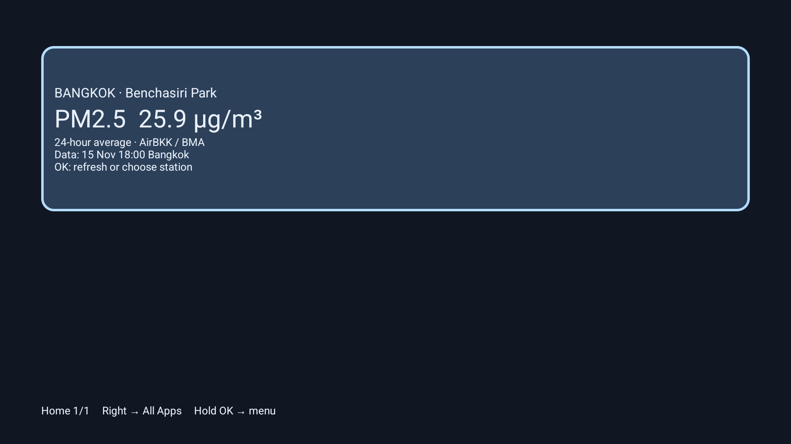
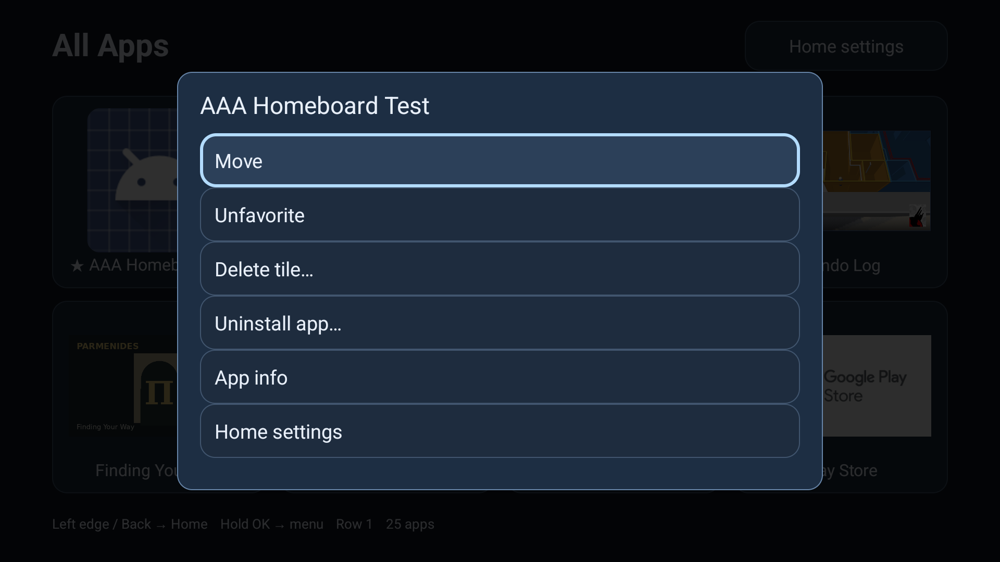
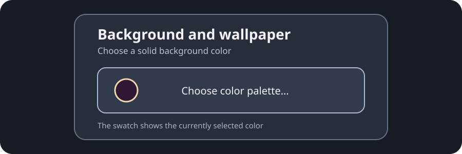
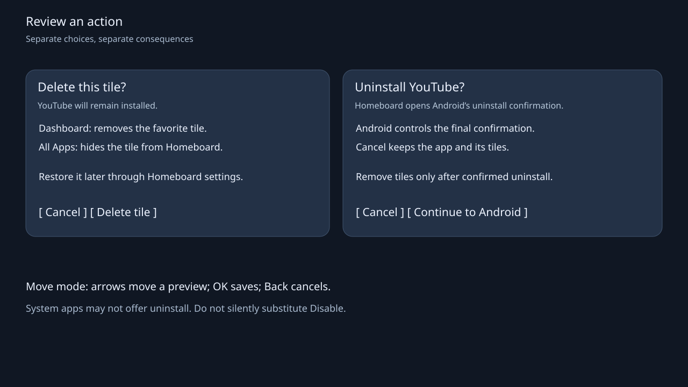

# Homeboard TV quick start

Homeboard opens on **Home**, your space for widgets and favorite apps. **All Apps**
is one screen to the right. Home can be completely empty if you prefer.

Screenshots below come from earlier Chromecast builds. The Favorites container
changes described here are in candidate 0.1.23; its Cast1 installation and visual
review remain pending. Design illustrations are labeled; weather values are examples.

## Open Homeboard

Open **Homeboard TV** from your TV's app list. It does not have to be the default
launcher to try it. The test installation does not change your default Home app.
No account, API key, Home Assistant or dashboard server is needed for air quality.

## Use the remote

| Button | What it does |
|---|---|
| Arrows | Move focus between tiles |
| Right beyond the last widget page | Slide into All Apps from the right |
| Left at the first All Apps column | Slide back to Home |
| Back in All Apps | Return to Home |
| Short OK | Open the selected app or widget |
| Hold OK | Open the selected tile's menu |
| Back in a menu | Close the menu |
| Menu button, if your remote has one | Open Home settings |

If Homeboard is your default launcher, pressing Home returns to its widget dashboard.
Otherwise the remote's Home button still opens your currently selected launcher.

## Add a favorite app

1. Move right into All Apps.
2. Focus an app and **hold OK**.
3. Choose **Favorite**.
4. Return left to Home. The app is inside the **Favorites** panel.

The “AAA Homeboard Test” app in these historical screenshots is a disposable test app.

Choose **Unfavorite** to remove that dashboard shortcut. The app remains installed
and is still available in All Apps. Favoriting twice does not create duplicate tiles.

## Browse and size Favorites

Rain and Favorites are placed together on Home page 1 once. Arrows browse apps
inside Favorites; more rows scroll vertically, while a one-row panel scrolls
sideways. Down/right wedges show more apps; up/left wedges show a return direction.
There are no scrollbars. Reaching a list edge lets focus move to another widget.

OK launches an app. Back focuses the Favorites header; hold OK there for widget
Move/Resize. Hold OK on an app for internal reorder, Unfavorite, or **Favorites
widget actions**. A 1×1 panel opens a larger Favorites browser with OK. Removing
Favorites keeps its list, and re-adding the widget restores it.

The initial layout supports Undo. To rearrange it later, use **Favorites widget
actions → More → Arrange Rain and Favorites on page 1**, choose a Rain widget,
and review the preview. OK saves; Back cancels.

## Choose app density and artwork

Open **Home settings → Appearance → Icons**. The two branches are independent:

- **Home favorites → Small icons / Banners** changes all favorite apps on Home.
  Small icons use a compact grid; Banners use wider cards and taller rows.
  Apps reflow **inside the Favorites panel**; its saved outer size and other
  widgets do not change. **Undo** restores the previous artwork choice.
  Selecting the current size changes nothing.
- **All Apps → Launcher icons / TV banners** changes the app library. Launcher icons
  use a dense icon grid; TV banners use their own responsive grid with wider
  cards and taller rows. Changing artwork keeps All Apps open.

Banner artwork keeps its 16:9 proportions, with a rounded rectangular focus ring
and a label below. Apps without a banner show their icon centered on a neutral
plate. Small circular icons retain their round ring and halo; the icon shape
choice affects small icons only. Artwork fits the configured grid and text size.
Each installed app appears once, even when it publishes multiple launcher
activities. Log utility entries are filtered out of All Apps.

For the densest automatic dashboard, open **Home settings → Home behavior**
and set both **Grid columns** and **Grid rows** to **Auto**. Explicit grid choices
remain respected, within the readable fit for the selected style. A typical
960 × 540 dp TV can fit 11 × 4 small icons or six banners across three taller
rows; larger text can reduce those counts. Favorites artwork reflows within its panel; it does not change the outer Home
grid. Changing All Apps artwork alone does not change the dashboard.

To check the installed version, open **Home settings**, press **OK** to show the
second menu page, then choose **About Homeboard TV**. About reads the installed
APK version. A higher version number alone does not establish which branch's
features it contains: the separate Projectivy 0.1.9 build lacked the Home changes
present in 0.1.8. See the [build validation record](../testing/2026-11-16-home-favorite-app-sizes.md)
for the combined-merge status and what has actually been verified on the TV.

The two top-right buttons are separate: the sliders button opens **Homeboard
settings**, which includes **About Homeboard TV**, and the gear opens **Android device Settings**. System Settings is not
a tile in the app grid. Homeboard settings are also available by holding OK on a
Home tile or on the empty Home screen.
Choose **Default Home app** in Homeboard settings to request Android's Home role;
select **Homeboard TV** in the system prompt. Homeboard reports whether Android
accepted the choice. Standard Android Home intents should then open Homeboard, but
some Google TV remotes or firmware route their physical Home button directly to
Google TV. If the role is accepted and that button still opens Google TV, the device
does not honor the default Home app for that key.

## Color palette

On `main`, open **Home settings → Appearance → Background** to choose from twenty
colors arranged in five rows on one screen. The focused color previews immediately;
the current selection is marked. The selected color generates the launcher
surfaces, text tones, and focus highlight.
Projectivy wallpaper controls are a separate workstream pending the combined merge.

## Air quality

Each Air Quality widget independently shows either a nearby **hourly PM2.5 model
estimate** or a selected Bangkok monitoring station's **24-hour average PM2.5**,
in µg/m³. The card labels its source, location and timestamp. Model estimates use
the nearest available Open-Meteo/CAMS grid; station measurements come from AirBKK.
Neither is an indoor sensor reading.

Press OK on the widget for **Refresh reading** or **Configure location and source**.
Hold OK for **Configure location and source**, **Move**, **Resize**, **Delete widget** or
**Home settings**. In Resize, Left and Up reduce width and height by one grid
cell; Right makes the panel wider, and Down makes it taller. The dashboard
repacks as a live preview. Press **OK to save** or **Back to cancel**. Home
settings → Home behavior sets the default size for panels added later.

The value uses Thailand's PCD 24-hour PM2.5 condition bands. Orange and red
conditions add an outlined triangle badge and a plain-language outdoor-activity
cue. The card and interface surfaces follow the selected palette. Each segment
in both sparklines uses the condition color for its sample. For model estimates,
the **24H** and **30D** trends use the provider's hourly model data; for AirBKK
stations they use the official report history and its 24-hour moving averages. A
720-slot circular buffer keeps the latest 30 days of samples for each widget.

The widget checks automatically while visible. Manual refresh has a 30-second
cooldown. Saved readings remain visible during an outage; refresh failures and data
older than three hours are labeled. Internet is needed to obtain new readings.

## Move a tile

1. Hold OK on the tile and choose **Move**.
2. Use arrows to reposition the preview.
3. Press **OK to save**, or **Back to cancel**.

Home placement and All Apps ordering are independent. Moving an app in All Apps
does not move its favorite on Home. A tile can cross widget-page boundaries during
move preview; the view follows it.

## Delete is different from Uninstall

| Choice | Result |
|---|---|
| Delete widget / Delete tile on Home | Removes that Home tile only |
| Delete tile in All Apps | Hides the tile from Homeboard; the app stays installed |
| Uninstall app | Opens Android's uninstall confirmation |

Delete asks you to confirm the local tile removal. Uninstall is controlled by
Android: canceling keeps the app and its tiles. Some system apps cannot be uninstalled.

The uninstall handoff is implemented, but confirmation/cancellation still awaits
device validation with a coordinator workflow that supports switching apps.

To restore a deleted app tile, open **Home settings → Manage deleted app tiles**.
To add another air widget, choose **Home settings → Add widget → Air quality widget**.
To restore a removed favorite, favorite the app again in All Apps.

## Keep Home empty

Delete all its widgets and favorite tiles. Homeboard saves the empty layout and
shows only the background; it will not add tiles back automatically.

**Right still opens All Apps. Up from the first app row returns to the previous
All Apps page; Up on the first page focuses Homeboard settings.** Hold OK on the
empty background also opens Home settings. The sliders button opens Homeboard
settings; the gear opens Android device Settings. Appearance offers a color palette
and circular icon mask; Reduced motion switches pages without the sliding
animation.

## If something is unavailable

An unavailable favorite can be removed using its hold-OK menu. Deleting a tile never
uninstalls its app. If a station feed is unavailable, check the timestamp and status
on the saved reading; a missing value is shown as a dash, not zero.

## App language

In the Thai-language implementation, open **Home settings → Language / ภาษา**.
Press Up for **English**, Right for **ไทย**, or Down for **Follow device**.
The directional choice applies immediately. Left or Back returns without a new
choice. The saved choice has a current marker; explicit English/Thai remains
selected across restarts independently of the TV's system language.

A change returns to Home settings in the selected language. Use **Undo** to
restore the previous language mode. Follow device chooses the first supported
English/Thai device preference, with English as the fallback. This setting changes
Homeboard's interface; installed apps and Android-owned screens retain their own
language settings. Thai copy and TV rendering still require the acceptance checks
listed in the [worktree validation record](../testing/2026-11-16-thai-language.md).

## Source links on a TV

Home settings → About Homeboard TV lists the project, CleanYourTV, Outfit font
and AndroidX sources. Select one with the remote to show its exact web address
and a QR code. Scan with a phone camera to open it there. When Android finds a
web-link handler, Open on this TV is also available. A TV without a browser keeps
the QR code and address visible. Back to About returns to the source list; Back
from About returns to Home settings.

### Rain location

Rain uses device location automatically when Homeboard has location permission.
If permission is missing, focus Rain and press OK to allow it. If the TV cannot
provide a usable fix, OK retries; hold OK → Location offers a fixed city, street
address or coordinates. Existing fixed places remain fixed. Choose **Device
location · Automatic** to follow the TV again. Automatic lookups run only while
Homeboard is active and do not add Undo entries.

### Default dashboard and empty Home

New installations include Rain, Calendar, Air quality and Favorites. To arrange
those widgets on an existing dashboard, choose **Home settings → Widgets / Restore
→ Default dashboard**. The four widgets are arranged on one screen immediately;
Undo restores the prior arrangement. This correction arranges an existing nonempty
dashboard once on update. Later customizations and Undo are respected. Additional
widget instances and their settings are retained.

An empty Home stays empty until you add widgets or apply the preset. Right still
advances to the next Home page or All Apps. Up reaches the settings buttons; Down
returns to the empty canvas. Right from the last settings button also advances.
