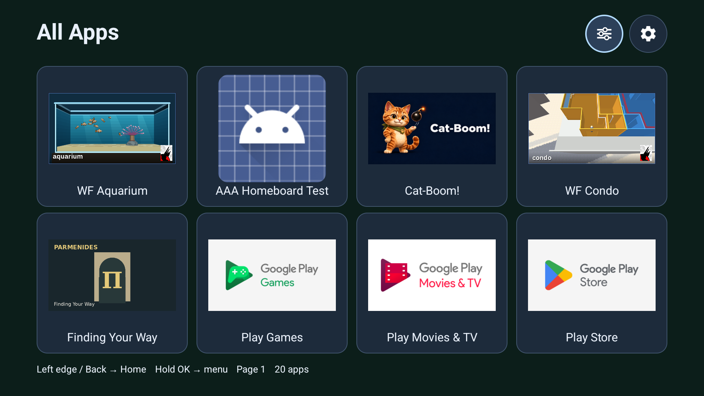
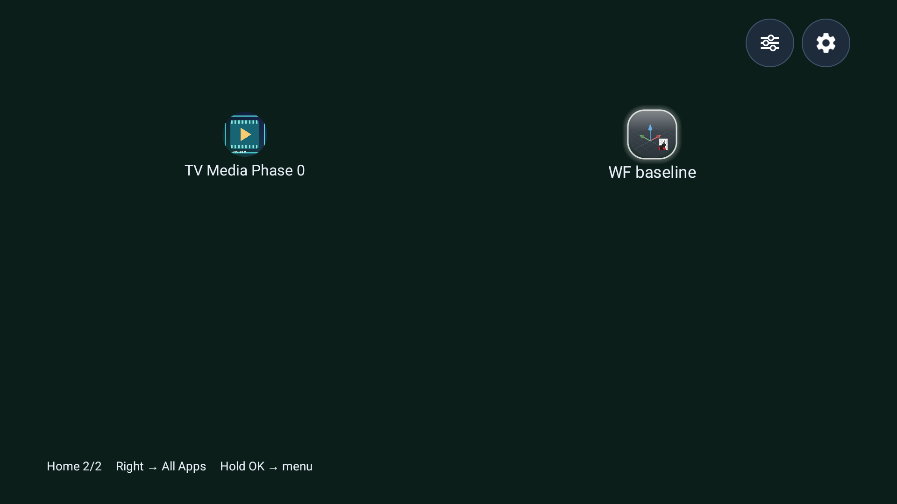
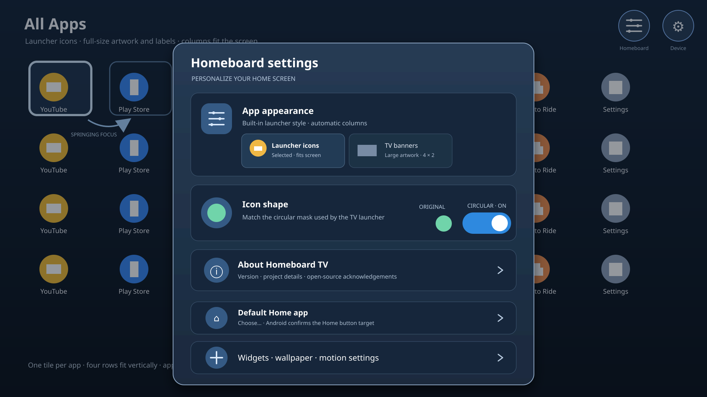
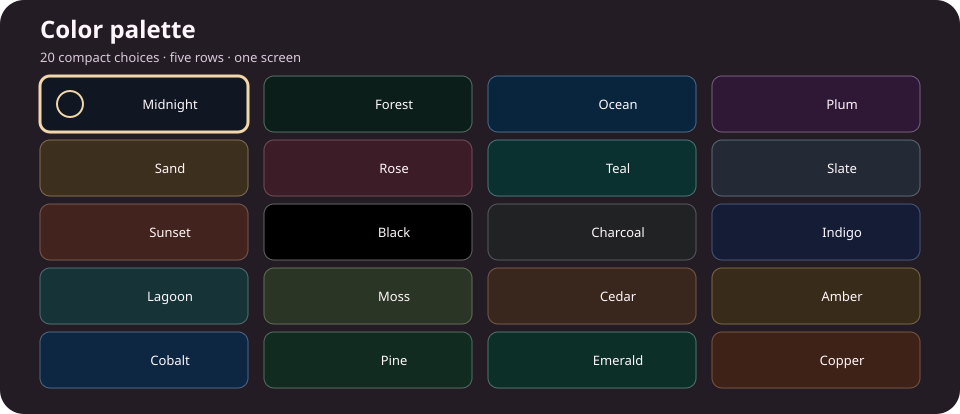
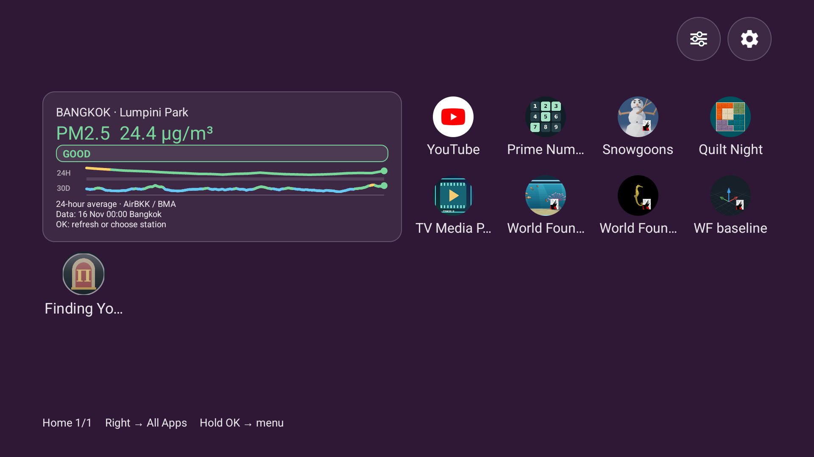
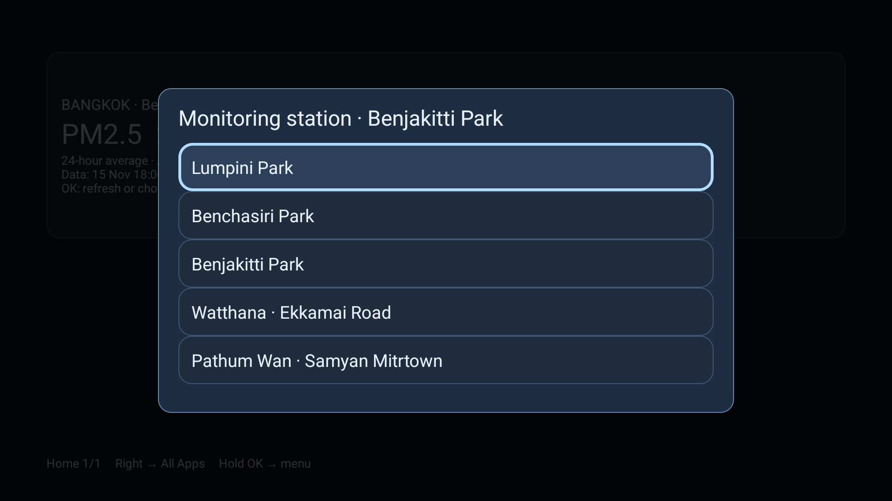
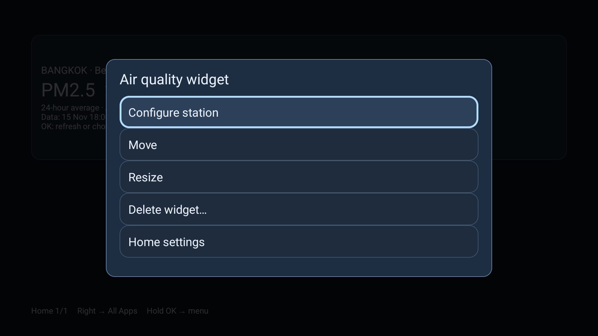

# Homeboard TV quick start

Homeboard opens on **Home**, your space for widgets and favorite apps. **All Apps**
is one screen to the right. Home can be completely empty if you prefer.

Screenshots below come from the running Chromecast build. Any remaining design
illustrations are explicitly labeled. Air-quality values shown are historical examples.

## Open Homeboard

Open **Homeboard TV** from your TV's app list. It does not have to be the default
launcher to try it. The test installation does not change your default Home app.
No account, API key, Home Assistant or dashboard server is needed for air quality.

## Use the remote

| Button | What it does |
|---|---|
| Arrows | Move focus between tiles |
| Right beyond the last widget page | Slide into All Apps from the right |
| Left at the first All Apps column | Slide back to Home |
| Back in All Apps | Return to Home |
| Short OK | Open the selected app or widget |
| Hold OK | Open the selected tile's menu |
| Back in a menu | Close the menu |
| Menu button, if your remote has one | Open Home settings |

If Homeboard is your default launcher, pressing Home returns to its widget dashboard.
Otherwise the remote's Home button still opens your currently selected launcher.

## Add a favorite app

1. Move right into All Apps.
2. Focus an app and **hold OK**.
3. Choose **Favorite**.
4. Return left to Home. The app now has a tile there.

The “AAA Homeboard Test” app in these screenshots is a disposable test app.

Choose **Unfavorite** to remove that dashboard shortcut. The app remains installed
and is still available in All Apps. Favoriting twice does not create duplicate tiles.

## Choose app density and artwork

Open **Home settings → App artwork** and choose **Launcher icons** or **TV banners**.
**Launcher icons** keeps 48 dp circular launcher icons and 16 sp labels, with four rows
and as many columns as fit the screen. The glass highlight springs between tiles
and the focused card grows slightly; the other icons sit directly on the background
without separate blue tile backgrounds. That gives more than six columns on common
TV resolutions without shrinking the artwork. Each installed app appears once,
even when it publishes multiple launcher activities. **TV banners** uses the
larger 4 × 2 layout in All Apps; banners without artwork fall back to the normal
icon. Home favorites always stay compact: the same 48 dp launcher icon and 16 sp
label as compact All Apps, with the optional circular mask and small animated glass
highlight. This prevents a favorite from expanding into a banner-sized dashboard
tile. The separate **Circular icon mask** choice clips launcher icons to a circle
without changing their displayed size. TV banners remain rectangular. Log utility
entries are filtered out of All Apps.

The two top-right buttons are separate: the sliders button opens **Homeboard
settings**, which includes **About Homeboard TV**, and the gear opens **Android device Settings**. System Settings is not
a tile in the app grid. Homeboard settings are also available by holding OK on a
Home tile or on the empty Home screen.
Choose **Default Home app** in Homeboard settings to request Android's Home role;
select **Homeboard TV** in the system prompt. Homeboard reports whether Android
accepted the choice. Standard Android Home intents should then open Homeboard, but
some Google TV remotes or firmware route their physical Home button directly to
Google TV. If the role is accepted and that button still opens Google TV, the device
does not honor the default Home app for that key.

## Color palette

Open **Home settings → Appearance → Background and wallpaper**. Its only action,
**Choose color palette…**, shows the currently selected color as a swatch. Open it
to choose from twenty compact colors arranged in five rows on one screen. The
selected color generates the launcher surfaces, text tones, and focus highlight.
Photo selection and theme wallpaper actions are not offered.

## Air quality

Each Air Quality widget independently shows either a nearby **hourly PM2.5 model
estimate** or a selected Bangkok monitoring station's **24-hour average PM2.5**,
in µg/m³. The card labels its source, location and timestamp. Model estimates use
the nearest available Open-Meteo/CAMS grid; station measurements come from AirBKK.
Neither is an indoor sensor reading.

Press OK on the widget for **Refresh reading** or **Configure location and source**.
Hold OK for **Configure location and source**, **Move**, **Resize**, **Delete widget** or
**Home settings**. In Resize, Left and Up reduce width and height by one grid
cell; Right makes the panel wider, and Down makes it taller. The dashboard
repacks as a live preview. Press **OK to save** or **Back to cancel**. Home
settings → Home behavior sets the default size for panels added later.

The value uses Thailand's PCD 24-hour PM2.5 condition bands. Orange and red
conditions add an outlined triangle badge and a plain-language outdoor-activity
cue. The card and interface surfaces follow the selected palette. Each segment
in both sparklines uses the condition color for its sample. For model estimates,
the **24H** and **30D** trends use the provider's hourly model data; for AirBKK
stations they use the official report history and its 24-hour moving averages. A
720-slot circular buffer keeps the latest 30 days of samples for each widget.

The widget checks automatically while visible. Manual refresh has a 30-second
cooldown. Saved readings remain visible during an outage; refresh failures and data
older than three hours are labeled. Internet is needed to obtain new readings.

## Move a tile

1. Hold OK on the tile and choose **Move**.
2. Use arrows to reposition the preview.
3. Press **OK to save**, or **Back to cancel**.

Home placement and All Apps ordering are independent. Moving an app in All Apps
does not move its favorite on Home. A tile can cross widget-page boundaries during
move preview; the view follows it.

## Delete is different from Uninstall

| Choice | Result |
|---|---|
| Delete widget / Delete tile on Home | Removes that Home tile only |
| Delete tile in All Apps | Hides the tile from Homeboard; the app stays installed |
| Uninstall app | Opens Android's uninstall confirmation |

Delete asks you to confirm the local tile removal. Uninstall is controlled by
Android: canceling keeps the app and its tiles. Some system apps cannot be uninstalled.

The uninstall handoff is implemented, but confirmation/cancellation still awaits
device validation with a coordinator workflow that supports switching apps.

To restore a deleted app tile, open **Home settings → Manage deleted app tiles**.
To add another air widget, choose **Home settings → Add widget → Air quality widget**.
To restore a removed favorite, favorite the app again in All Apps.

## Keep Home empty

Delete all its widgets and favorite tiles. Homeboard saves the empty layout and
shows only the background; it will not add tiles back automatically.

**Right still opens All Apps. Up from the first app row returns to the previous
All Apps page; Up on the first page focuses Homeboard settings.** Hold OK on the
empty background also opens Home settings. The sliders button opens Homeboard
settings; the gear opens Android device Settings. Appearance offers a color palette
and circular icon mask; Reduced motion switches pages without the sliding
animation.

## If something is unavailable

An unavailable favorite can be removed using its hold-OK menu. Deleting a tile never
uninstalls its app. If a station feed is unavailable, check the timestamp and status
on the saved reading; a missing value is shown as a dash, not zero.
