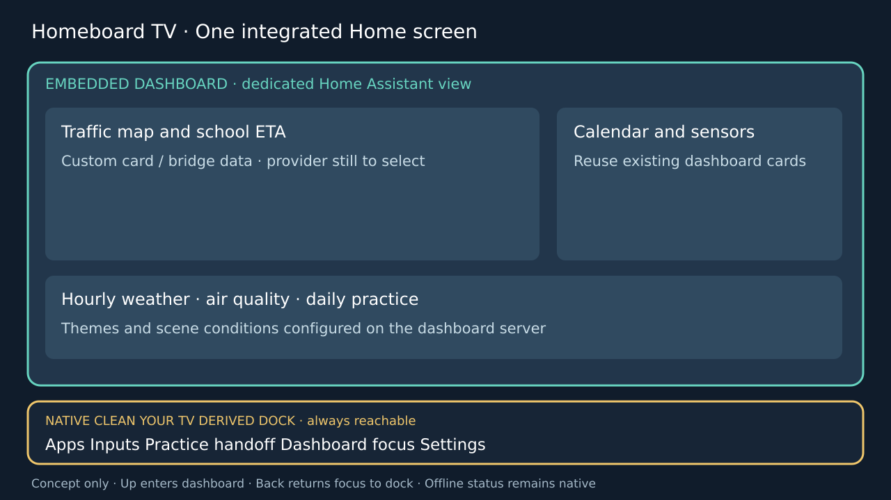
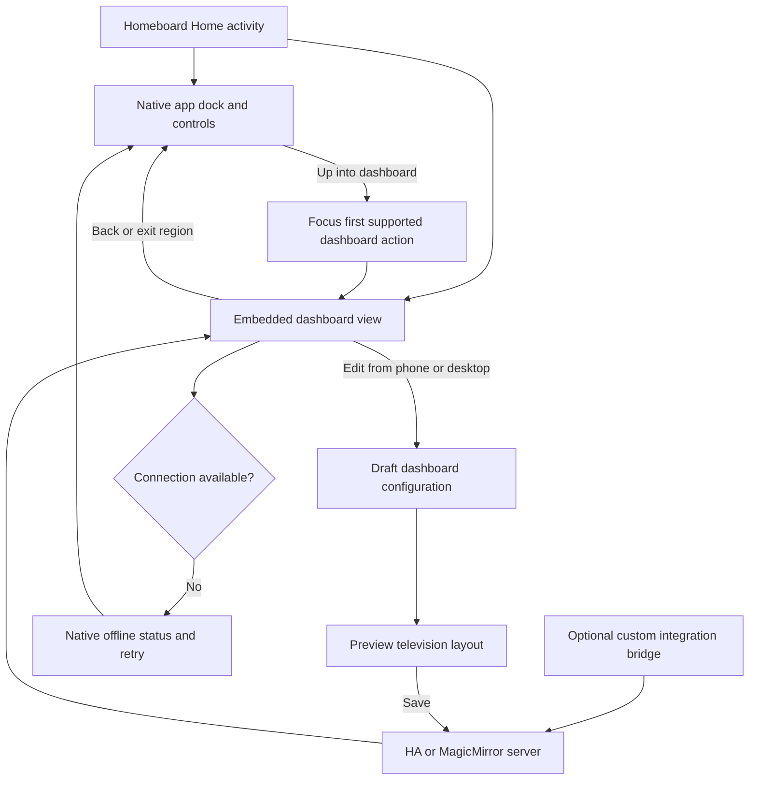

# Dashboard systems to integrate into Homeboard TV

**15 November 2026 · Revised direction after clarifying that Kotlin is a language, not a dashboard app**

## Recommendation

**Latest decision:** start with a native Bangkok air-quality card inside CleanYourTV,
fetching a public feed directly. No Home Assistant, MagicMirror or separate bridge
is required for this first feature. The system comparison below is retained for
later architectural choices; no dashboard engine has been selected.

**Compare MagicMirror² and Home Assistant as new installations before selecting the embedded dashboard.** Home Assistant is not currently set up; references to future Home Assistant sensors describe an intended integration, not an existing service. MagicMirror² is the first display-focused prototype candidate; Home Assistant remains the strongest candidate for a future dashboard tightly coupled to household devices and controls. Installing and maintaining either server is part of the comparison.

Keep CleanYourTV's native app dock, app launching, input controls and launcher lifecycle. Reuse the chosen dashboard's modules/cards and customize presentation and missing features. Neither server is a prerequisite already satisfied on Will's network.

This means one visible home screen, not a shortcut that opens another dashboard app. Homeboard TV would contain a native launcher region and an embedded web dashboard region. The server can run on Will's existing infrastructure; it need not run inside the APK. A custom integration bridge remains available for services the chosen dashboard does not already handle.

The recommendation is based on documented capabilities and integration architecture. No candidate dashboard has been installed or tested on Will's TV, and no claim of smooth D-pad navigation or memory use is made yet. **Kotlin is not required for this experiment:** Java can host Android WebView. The provisional Kotlin module was removed from the project.

## What integration into CleanYourTV actually means

| Approach | What is reused | What we must build | Fit |
|---|---|---|---|
| Embed an existing dashboard UI in Home | Its actual web cards, layouts, themes and interactions | A WebView host, controlled navigation, focus handoff, lifecycle, authentication and failure screen | Best first experiment |
| Extract selected dashboard components | Specific web components and their dependencies | Their expected application/data context, styling and navigation | Possible, but not automatically simpler than embedding a dedicated view |
| Reuse its backend only | Data integrations, subscriptions and automation | All visible native cards, layout and interactions | A fallback if web rendering fails the TV experience |
| Launch its separate Android app | Almost all of that app | App launch shortcut | Does not satisfy the requested integrated home screen |

Web components cannot simply be pasted into a Java layout as native Android views. A WebView renders web UI inside the Android app. Copying the Home Assistant frontend into a project also does not remove its expectation of a Home Assistant server and state/authentication context. Android documents WebView as the embedding mechanism; the TV-specific behavior still needs testing. [Android WebView](https://developer.android.com/develop/ui/views/layout/webapps/webview), [Home Assistant custom-card API](https://contributors.home-assistant.io/frontend/custom-ui/card/)

## Candidate comparison

| System | Existing strengths | Integration into Homeboard | Main remaining work | Assessment |
|---|---|---|---|---|
| Home Assistant dashboards | Sensors, calendar cards, hourly weather, layouts, themes, conditional visibility, custom cards | Load a dedicated dashboard view as the WebView's top-level page; retain native dock outside it | D-pad interaction, TV layout, route/traffic card, practice handoff, sign-in and offline experience | Strong integration fit; requires new HA setup |
| MagicMirror² | Ambient information layout, calendar/weather modules, broad module customization | Run its server separately; embed its rendered dashboard in the launcher | TV input, authenticated deployment, HA module/bridge, schedule/module selection, interactive detail screens | First display-focused prototype candidate |
| HADashboard through AppDaemon | Home Assistant widgets designed for distant wall displays | Serve dashboard from AppDaemon and load it in the Home panel | Richer calendar/route/market experiences, TV input and custom widgets | Useful control-panel alternative |
| Glance | Configurable columns, weather, markets, custom API/extension widgets, themes | Embed its server-rendered web UI and customize widgets | Calendar agenda, HA controls, scheduled scenes, TV interaction | Useful for information feeds; weaker complete fit |
| DAKboard | Ready-made calendar/weather/photo display and an Android TV app | Potential hosted screen display; app launch alone is insufficient | Confirm permitted embedding/customization; source-level integration rights not established | Benchmark/service option, not the preferred source base |
| TV Air Dashboard | Existing CleanYourTV-derived native weather/particle/sensor work | Review and port narrow changes directly into launcher source | General dashboard model, HA/Calendar/route/schedules; device/source assumptions | Valuable native prior art, not a complete dashboard engine |

Sources: [Home Assistant dashboard cards](https://www.home-assistant.io/dashboards/cards), [MagicMirror² source](https://github.com/MagicMirrorOrg/MagicMirror), [HADashboard documentation](https://appdaemon.readthedocs.io/en/latest/DASHBOARD_INSTALL.html), [Glance configuration](https://github.com/glanceapp/glance/blob/main/docs/configuration.md), [DAKboard TV application](https://dakboard.freshdesk.com/support/solutions/articles/35000190191), [TV Air Dashboard](https://github.com/srykar/tv-air-dashboard).

## Home Assistant dashboard embedded in Home

Use a separate dashboard/view designed for the television, rather than displaying the administrator's entire default interface. Home Assistant provides sections and visibility controls; its calendar card provides month, day and list views. The weather card can show hourly forecasts when the weather entity supplies them. Indoor sensors, outdoor PM and forecast data must remain labeled distinctly. [Sections](https://www.home-assistant.io/dashboards/sections/), [calendar](https://www.home-assistant.io/dashboards/calendar/), [weather](https://www.home-assistant.io/dashboards/weather-forecast/)

Day/time rules can use visibility conditions and Home Assistant state/automation. Add a household scene selector for manual override and schedule exceptions; do not let a scheduled switch move focus while Will is interacting. The existing conditional-card documentation includes state and time conditions, but complete school/weekend behavior is configuration and customization work. [Conditional visibility](https://www.home-assistant.io/dashboards/conditional/)

Home Assistant's standard map card displays located entities; that is not evidence that it supplies route ETA and live traffic. A route/traffic card and provider selection remain separate work. Google Calendar can be integrated at the server or through Will's custom bridge, keeping the TV out of the standard Google device-authorization flow. [Map card](https://www.home-assistant.io/dashboards/map/), [Google Calendar integration](https://www.home-assistant.io/integrations/google/)

For the first test, load the dedicated dashboard as the WebView page, not as an iframe inside an unrelated site. This avoids introducing an unnecessary framing boundary, though login, cookies, TLS and supported WebView versions still need validation. Use supported dashboard/custom-card interfaces before forking the full frontend; arbitrary DOM/CSS injection into internal components is likely to be expensive to maintain.

WallPanel is an optional Home Assistant frontend extension for wall-panel presentation and a photo screensaver. It is not the native Android system screensaver. We should choose whether Homeboard or the embedded page owns idle presentation, so two idle timers do not compete. Its key-wake and media behavior on a TV need testing. [WallPanel source and documentation](https://github.com/j-a-n/lovelace-wallpanel)

A native app-action interface can expose a small set of configured actions such as opening the practice handoff. It must not allow any arbitrary web page to invoke arbitrary Android intents. Prefer native action buttons outside the web surface for the first prototype; add a narrowly scoped trusted-origin interface only when needed.

## MagicMirror² inside the launcher

MagicMirror² is a modular web dashboard originally made for screens behind two-way mirrors.
An ordinary TV works as well. Default modules include a clock, calendar, weather and news;
JavaScript/CSS modules provide customization. Its traditional layout places information in
screen regions rather than offering HA's device-oriented card editor. It is strongest for
readable ambient information; interactive TV controls need deliberate implementation.
[Project introduction](https://docs.magicmirror.builders/)

For Will, running it in server-only mode means a container on household/server infrastructure
serves the dashboard, while Homeboard's WebView displays it on the TV. No Home Assistant
installation is required for the clock/calendar/weather display. Later sensor data can arrive
through HA if installed, or through a custom bridge where a device exposes a suitable API.
This does not guarantee support for any particular sensor before its protocol is known.

MagicMirror² has a server-only mode, so the Android device can display its web UI without running Electron or Node on the TV. Its package explicitly separates the Electron application from the server command. We would host the server on controlled infrastructure and embed its page inside Homeboard. [Package scripts](https://github.com/MagicMirrorOrg/MagicMirror/blob/master/package.json), [installation documentation](https://github.com/MagicMirrorOrg/MagicMirror-Documentation/blob/master/getting-started/installation.md)

The default calendar module consumes calendar feeds. A Google Calendar feed can work for display where available, while a custom bridge can provide an appropriate feed when richer authorization is needed. Feed URLs may be credentials and must not be committed. Weather supports provider extension. A third-party module, MMM-ModuleScheduler, schedules module visibility and notifications; that is useful prior art for different weekdays and times, not a tested Homeboard scene engine. [Calendar module](https://github.com/MagicMirrorOrg/MagicMirror-Documentation/blob/master/modules/calendar.md), [weather providers](https://github.com/MagicMirrorOrg/MagicMirror-Documentation/blob/master/module-development/weather-provider.md), [module scheduler](https://github.com/ianperrin/MMM-ModuleScheduler)

This is attractive if most cards are for reading and occasional actions can sit in the native dock. It becomes less attractive if every module needs a bespoke D-pad interaction model. Community modules must be reviewed individually for maintenance, licenses, credentials and dependencies. Treat native launcher app navigation and module interactions as separate focus regions.

## Other useful alternatives

**HADashboard:** intentionally optimized for distance viewing and depends on AppDaemon. It offers a straightforward path to a large Home Assistant control panel in WebView. Its suitability for the requested rich agenda, traffic map and hourly multi-variable forecasts is less established than its basic wall-control role. Evaluate only if HA's standard frontend proves too heavy or awkward. [HADashboard](https://appdaemon.readthedocs.io/en/latest/DASHBOARD_INSTALL.html)

**Glance:** weather, markets, custom API widgets and themes are already available. The documented built-in calendar is a date grid, not a Google Calendar agenda; do not count it as satisfying the calendar requirement. Custom API widgets could consume the bridge. It is a good candidate for a market/information scene, but using a different engine per scene adds authentication, focus and lifecycle complexity. [Configuration reference](https://github.com/glanceapp/glance/blob/main/docs/configuration.md)

**DAKboard:** its official app supports Android TV, and its screen model already covers several desired display blocks. That does not give us its Android application as an embeddable library or establish permission to redistribute its hosted UI inside our own Play product. Use it as a UX reference or an optional user-configured service only after verifying applicable terms. [Android app documentation](https://dakboard.freshdesk.com/support/solutions/articles/35000190191), [screen and block model](https://dakboard.freshdesk.com/support/solutions/articles/35000242832)

**TV Air Dashboard:** this is especially relevant because it is already a CleanYourTV fork. Its published description includes optional weather, regional particle observations and local purifier readings. Review its rendering changes as native integration examples. Do not assume its regional air-data sources or device-specific sensor client suit Bangkok or Home Assistant. Its showcase acceptance supports the community route discussed in the earlier investigation. [Source](https://github.com/srykar/tv-air-dashboard), [accepted showcase listing](https://github.com/Gathin23/cleanyourtv/pull/2953)

## Proposed screen and focus behavior

The illustration describes ownership, not a new theme requirement. The web dashboard occupies the main card area inside the same Android activity. The native launcher dock remains reachable if the server fails. A visible focus outline and a predictable key boundary are essential.

Proposed actions: Up from the dock enters the dashboard at a predictable item; Back exits dashboard interaction to the dock before leaving the Home experience; OK activates the focused action. A D-pad can move native focus but cannot automatically make every third-party web card remote-friendly. Nested controls, dialogs, shadow DOM and scrolling need a representative test. Avoid a simulated mouse as the default interaction model.

Keep native app launching usable before login and during a server outage. Pause animated web/media work when another Android app is foreground; restore focus and the selected scene on return. Do not install a WebView in every card: one dashboard surface is the initial design. Test maps and moving backgrounds together because they can compete for memory/GPU time.

The planned editor/review screen from the foundation plan remains relevant, but should reuse the selected dashboard's own editor where possible. Configuration on a phone/desktop is acceptable; everyday navigation and app launching must remain remote-operable.

## Licensing and Play distribution

Home Assistant frontend uses Apache 2.0, MagicMirror² uses MIT, and Glance uses AGPL-3.0. Preserve applicable notices and assess the actual modifications/distribution boundary before copying code. Serving an independently deployed dashboard to a client and bundling a modified dashboard into the APK are different release designs. Glance's network-copyleft terms merit specific review if modified or redistributed; they are not a reason to claim all interacting code automatically changes license. [HA license](https://github.com/home-assistant/frontend/blob/dev/LICENSE.md), [MagicMirror license](https://github.com/MagicMirrorOrg/MagicMirror/blob/master/LICENSE.md), [Glance license](https://github.com/glanceapp/glance/blob/main/LICENSE)

The Homeboard APK would contain the launcher and dashboard host, while a user-configured server supplies the dashboard. That is a plausible product architecture, not a Play approval guarantee. Provide a useful native Home/app experience and clear setup; do not claim a thin arbitrary website wrapper is sufficient. TV navigation, data handling, permissions, reliable account setup and external-provider terms still apply. [TV app quality](https://developer.android.com/develop/adaptive-apps/quality-guidelines/tv-app-quality)

This networked WebView addition belongs in Homeboard's independent fork under CleanYourTV's current scope policy. Narrow launcher fixes discovered during integration can be contributed upstream. The larger project can participate through the showcase without requiring the core maintainer to accept the dashboard itself.

## Contribution decision after the first native card

The Bangkok air-quality feature remains in Homeboard. The missing card in the
Hebrew layout was introduced by this feature; sharing the card layout corrects
Homeboard's own omission. No upstream patch is appropriate for that correction.
Contribute general launcher bugs only when independently reproduced upstream.
A showcase entry is the intended first community contribution once a public,
usable release is ready; no submission or outreach has happened.

## What to test before choosing

- [ ] Compare a server-only MagicMirror display and a new HA dashboard using sample calendar/weather/sensor data; include server setup and upkeep in the assessment.
- [ ] Embed the leading candidate inside a Homeboard development screen, retaining the native dock.
- [ ] Exercise D-pad focus, OK, Back, scrolling, dialogs and app-launch/return with real remote input through the shared coordinator.
- [ ] Test login/session persistence, bridge/server outages and recovery without losing native Home controls.
- [ ] Measure startup, RAM and frame timing with map and background animation enabled and disabled.
- [ ] Confirm configurable weekday/weekend/class scenes without changing layout during interaction.
- [ ] Compare both candidates with the same focus, lifecycle and performance tests before committing to one.
- [ ] Choose a UI/data boundary only after those tests; Kotlin or Compose remain implementation choices, not dashboard candidates.

No dashboard framework, server or WebView integration has been installed by this investigation. The current Homeboard project retains only the CleanYourTV-derived launcher scaffold, distinct identity, documentation, build/CI definitions and shared coordinator adapter.
