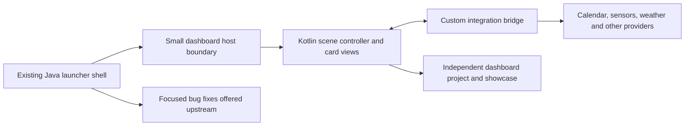
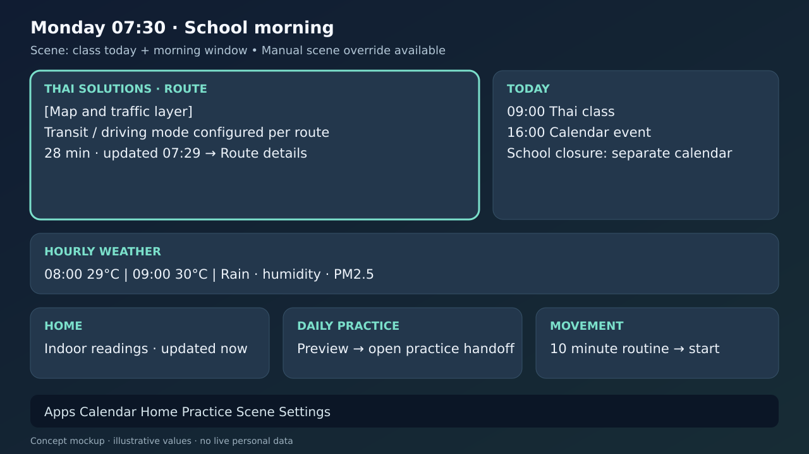
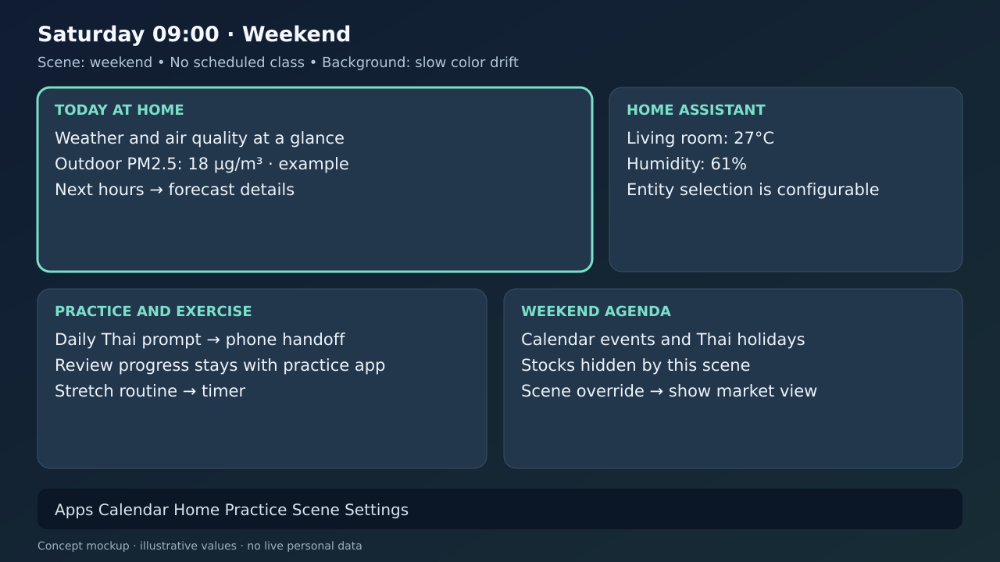
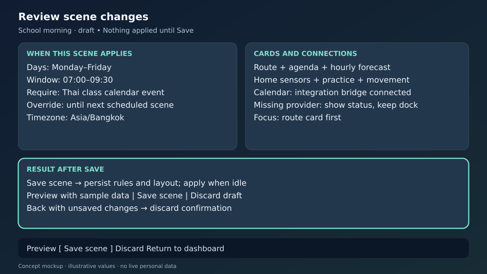
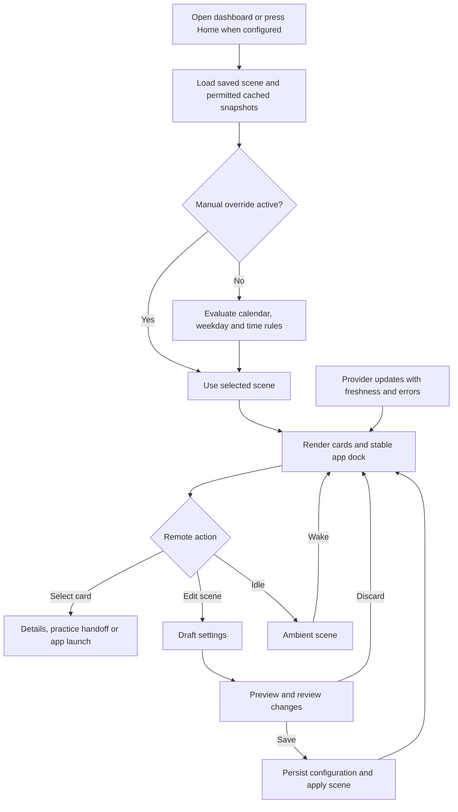
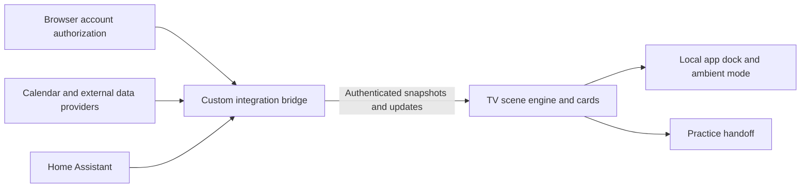

# Google TV dashboard launcher foundation comparison

**Prepared for Will · 15 November 2026 · Source review and proposed design**

**Direction update:** Kotlin is a programming language, not an existing dashboard app. Will has chosen to compare existing dashboard systems for integration directly into CleanYourTV before selecting custom UI. See [the dashboard integration investigation](2026-11-15-dashboard-systems-for-homeboard.md). The mixed-language prototype below is an option, not the current implementation commitment.

## Recommendation

**Pursue the CleanYourTV ecosystem first, and evaluate an existing dashboard embedded in its Home screen.** Luncher remains the cleaner full-fork candidate on code structure alone, but CleanYourTV has vastly stronger current community momentum. Given Will's interest in collaboration and positive interactions, that opportunity changes the overall recommendation.

The best-supported route is an independently owned dashboard project or fork that contributes focused improvements upstream and participates through the project's add-on/showcase channels. **Do not make the product depend on the whole dashboard being merged into CleanYourTV's core:** the maintainer has explicitly declined closely related scope expansions while welcoming their independent projects.

Kotlin could be introduced alongside Java if later implementation needs justify it; it supplies no dashboard features by itself. Keep the existing Java launcher while evaluating dashboard reuse. Native Views or Compose are fallback rendering options, not the current commitment. A complete language conversion is unnecessary. The first prototype should show whether preserving CleanYourTV's shell saves enough work to justify maintaining a fork; a separate dashboard app with a module-card entry is the lower-coupling alternative, but it does not put live cards directly on the existing Home screen.

### What the missing dashboard infrastructure means

There are three jobs, which the earlier recommendation blurred together:

| Job | Example | Where it comes from |
|---|---|---|
| TV launcher shell | Press Home, move focus, launch an app, return from playback, open inputs | Existing CleanYourTV code supplies substantial behavior |
| Data integration | Read Calendar, subscribe to Home Assistant, fetch weather and ETA | Will's custom integration bridge can supply this |
| Dashboard presentation and rules | Draw live cards at different sizes, update them without losing focus, select a school-morning layout | New code, which can be built **inside a CleanYourTV fork** |

For example: the bridge sends the next class and a travel-time estimate; a new Kotlin card displays them; the existing Java launcher keeps the app dock and handles app launches. At the scheduled time, a Kotlin scene controller changes which cards appear. None of this requires throwing away CleanYourTV.

“Neither launcher supplies the dashboard” means there is development work to do. It does **not** mean those launchers cannot be a good foundation, or that starting from scratch is automatically cheaper. The earlier “weakest foundation” verdict weighted code structure too heavily and did not account for community opportunity. The source findings below remain useful, but do not by themselves decide the project strategy.

## Evidence and scope

The review inspected source, manifests, build configuration, extension contracts, architecture documentation and test structure in shallow checkouts of these exact commits:

| Candidate | Inspected revision | Scope |
|---|---|---|
| CleanYourTV | [`ddc3b2c`](https://github.com/Gathin23/cleanyourtv/tree/ddc3b2cdce299a5f30aa2da2437edc40f3cf6f2e), 15 November 2026 | Launcher, module contract, theme and screensaver implementation, build and permissions |
| Luncher | [`77bb62d`](https://github.com/CVasilakis/luncher/tree/77bb62d31240290954a86bf2136cf0db8a1eb3d0), 8 November 2026 | Domain/platform/UI boundaries, home activity, app discovery, appearance, build and tests |
| New Kotlin application | Proposed architecture | Compose for TV is Google's recommended starting point; implementation and performance remain to be demonstrated |

This was a static source review, not an exhaustive audit. No candidate was built or run, no benchmark was performed, and no Chromecast device state was changed. Counts below are source inventory observations, not measures of reliability. API and distribution guidance was checked against linked official documentation on the report date.

## Popularity and community momentum

GitHub API snapshot collected on **15 November 2026 at approximately 17:16 Asia/Bangkok**. Counts can change. The snapshot and queries are retained in [the evidence file](2026-11-15-tv-dashboard-launcher-comparison/community-evidence.json).

| Measure | CleanYourTV | Luncher | What it tells us |
|---|---:|---:|---|
| Stars | 58,030 | 46 | Much greater visible interest in CleanYourTV |
| Forks | 7,552 | 9 | Much larger pool of derivative work and experimentation |
| Subscribers | 159 | 3 | Repository notification subscribers, not active users |
| Open issues plus PRs | 233 | 3 | GitHub's combined counter; not a bug count |
| Created | 17 October 2026 | 8 October 2026 | Both projects are young; age alone does not explain the gap |
| Most recent push | 15 November 2026 | 8 November 2026 | Recent repository activity, not a support guarantee |
| Merged PRs since 8 November, through collection time | 316 | 0 | Recent contribution throughput; includes docs, showcases and device lists |

Sources: [CleanYourTV repository API](https://api.github.com/repos/Gathin23/cleanyourtv), [Luncher repository API](https://api.github.com/repos/CVasilakis/luncher), [CleanYourTV merged-PR query](https://github.com/Gathin23/cleanyourtv/pulls?q=is%3Apr+is%3Amerged+merged%3A%3E%3D2026-11-08), [Luncher merged-PR query](https://github.com/CVasilakis/luncher/pulls?q=is%3Apr+is%3Amerged+merged%3A%3E%3D2026-11-08).

**Will's assessment that CleanYourTV is attracting exceptional attention is supported.** It offers a far larger visible audience for feedback, device testing, related projects and contributor relationships. These are reasons to engage, not promises that a new fork inherits its audience. Stars/forks do not establish installations, retention, code quality or the number of active maintainers. The PR count also does not mean 316 launcher features landed.

A single snapshot does not measure a growth rate or predict how long attention will last. The unusually high recent PR throughput is stronger evidence of current interaction than stars alone. Luncher's smaller audience does not negate its good internal architecture; it changes the social opportunity.

## What CleanYourTV wants in its core

The project's documented model is a small core with a hub of related work. It accepts fixes, TV lists, translations, themes and small optional switches. Separate add-on apps can be listed or contributed, and larger launcher changes go into independent repositories linked from the showcase. The maintainer policy also routes new core network access and substantial rewrites away from the reference launcher. Its stated APK gate is 589,824 bytes. [Contribution guide](https://github.com/Gathin23/cleanyourtv/blob/ddc3b2cdce299a5f30aa2da2437edc40f3cf6f2e/CONTRIBUTING.md), [maintainer policy](https://github.com/Gathin23/cleanyourtv/blob/ddc3b2cdce299a5f30aa2da2437edc40f3cf6f2e/.github/maintainer/MAINTAINER.md)

This is a product boundary, not just an architectural shortcoming waiting to be fixed. A large personalized dashboard is currently a better fit for the ecosystem than for the default launcher. A small reusable extension seam might fit after maintainer agreement, but being optional is not sufficient evidence of acceptance.

### Actual contribution decisions

| Precedent | Verified disposition | Implication for our work |
|---|---|---|
| [Companion bridge PR 618](https://github.com/Gathin23/cleanyourtv/pull/618) | Closed unmerged; maintainer closed the broader series as beyond the small debloat-plus-launcher scope and invited a showcased fork | Even a default-disabled bridge without new core network permission can exceed the intended scope |
| [Live task-manager panel PR 1473](https://github.com/Gathin23/cleanyourtv/pull/1473) | Closed unmerged; maintainer explicitly welcomed an add-on or showcased fork | Small line count and default-off behavior do not automatically make a feature a core fit |
| [TV Air Dashboard showcase PR 2953](https://github.com/Gathin23/cleanyourtv/pull/2953) | Merged 2 November 2026 | Weather/PM dashboard forks have a concrete route into the community's directory |
| [Today dashboard showcase PR 2298](https://github.com/Gathin23/cleanyourtv/pull/2298) | Merged 28 October 2026 | Calendar/weather/screensaver work can participate as an independent app |
| [Kotlin/Compose Chill showcase PR 2510](https://github.com/Gathin23/cleanyourtv/pull/2510) | Merged 29 October 2026 | Participation is not restricted to the core launcher's Java stack |

These are verified PR dispositions and maintainer comments. Feature/testing descriptions in those PRs are the contributors' claims; their applications were not audited here. A showcase merge means acceptance of the listing, not a code audit or endorsement of the application.

Existing in-repository add-ons include weather, calendar and screensaver apps. The directory explicitly keeps them separate from the launcher build and size checks. That is useful prior art, although a module-card launch action is still not an embedded live weather tile. [Add-on directory](https://github.com/Gathin23/cleanyourtv/blob/ddc3b2cdce299a5f30aa2da2437edc40f3cf6f2e/addons/README.md)

### Where contributing would be productive

- **High alignment:** reproduce and fix focus/return-to-Home bugs, improve device-specific behavior with evidence, contribute themes or isolated screensaver/add-on work, improve documentation and tests.
- **Needs an early scope discussion:** a narrowly bounded extension API, a behavior-preserving extraction that simplifies the launcher, or a small general-purpose scheduling primitive. Explain the direct benefit to core users and its size/lifecycle cost.
- **Own in the dashboard project:** rich live card layout, Calendar/HA integration, the integration bridge, complex scene scheduling, account handling and dashboard-specific settings.

A useful discussion would show a concrete screen and propose the smallest integration boundary. It should explicitly acknowledge the companion-series precedent and ask whether any shared seam is desirable before preparing a large upstream patch. No maintainer has been contacted in this investigation, and acceptance is not assumed.

## Adding Kotlin to CleanYourTV

**Yes: Java and Kotlin can coexist in the same Android project.** Add Kotlin compilation support compatible with the project's Gradle/Android Gradle Plugin versions; keep bytecode targets consistent; introduce Kotlin files or modules incrementally. Java code can call a suitable Kotlin facade. Do not bulk-convert the existing launcher merely to use Kotlin. [Android Kotlin integration guidance](https://developer.android.com/kotlin/add-kotlin)

Kotlin, Compose and networking are separate decisions. Kotlin can create ordinary Android Views. Compose can be introduced later through a separate screen or `ComposeView`, but adds dependencies and lifecycle/focus integration work. It is not necessary for the first dashboard card. [Compose and Views interoperability](https://developer.android.com/develop/ui/compose/migrate/interoperability-apis/compose-in-views)

| Mixed-language component | Proposed responsibility | Boundary |
|---|---|---|
| Existing Java launcher | App dock, app discovery/launch, remote and input behavior | Retain working behavior; extract only what the prototype actually needs |
| Kotlin dashboard controller | Scene selection, card state, local override | Expose ordinary Java-callable methods and immutable models |
| Kotlin card host | Layout and live updates | Start with Views if retaining the current UI; evaluate Compose separately |
| Custom bridge client | Pairing and normalized snapshot/update transport | No provider secrets in themes; lifecycle-aware subscriptions |
| External integration bridge | Calendar authorization, data adapters, optional shared practice state | Independently deployable; local or controlled server |

With network access in the fork, the launcher can call the bridge directly. Keeping the reference launcher offline instead requires a companion process/app plus a deliberately designed local IPC boundary; the existing static module-card contract does not supply that transport. Such a boundary may be worthwhile, but it is more work and is not automatically an upstream fit.

The inspected build already uses Java 17, AndroidX dependencies and resource shrinking. Adding Kotlin means reviewing its packaging exclusions and shrinker behavior against the actual new dependencies, measuring the release APK/memory cost and testing focus/lifecycle behavior. Kotlin alone does not untangle `MainActivity`, and no claim is made that Kotlin or Compose fits the upstream size gate. Fork builds can adopt an explicit independent budget.

## Fit for the requested product

| Requirement | CleanYourTV fork | Luncher fork | New Kotlin application |
|---|---|---|---|
| Traffic map and school ETA | New network provider and rich card UI | New provider and card UI | Designed into card/provider boundary |
| Google Calendar | New authentication and event handling | Same | Same; choose authorization path explicitly |
| Home Assistant sensors | New authenticated connection and subscription lifecycle | Add ports/adapters, plus connection lifecycle | Dedicated optional provider |
| Stock details | New provider, charts and market-time rules | Same | Same; distribution rights remain independent |
| Thai holidays | New calendar source and observed-day handling | Same | Same; school closures remain separate |
| Hourly weather, PM and humidity | New forecast and air-quality presentation | Same | Shared time-series card model |
| Day/weekend and event-based layouts | Existing decorative time/date behavior is insufficient | New scene model | Core scene model from the start |
| Moving background and theme | Existing ambient effects and image rotation; richer motion needs work | Existing theme and still-image infrastructure; motion needs work | New theme and bounded animation layer |
| Screensaver | Existing `DreamService` to study/reuse | New implementation | Separate ambient mode and optional system dream |
| Flashcard preview and launch | New integration with existing web/Cast system | Same | Same; do not duplicate review progress |
| Exercise | New configurable routine/timer/launch card | Same | Same; precise behavior remains open |
| Google Play | Significant packaging and permission cleanup | Better starting separation; still requires release work | Release identity and permissions designed for distribution |

All three require the same difficult service integrations. A fork principally saves launcher shell and appearance work, not the dashboard itself.

## CleanYourTV source findings

The launcher uses Java, Android platform views, AndroidX RecyclerView and DynamicAnimation. The inspected build sets minimum API 26, compile/target API 34 and Java 17. It signs release builds with the debug signing configuration, explicitly describing them as sideloaded rather than published. A product fork needs its own application ID, release signing and update ownership. [Build configuration](https://github.com/Gathin23/cleanyourtv/blob/ddc3b2cdce299a5f30aa2da2437edc40f3cf6f2e/launcher/app/build.gradle)

The main package contains 74 Java files totaling 15,342 lines, including comments and blank lines. `MainActivity.java` alone is 4,113 lines. Its lifecycle coordinates configuration, app tiles, inputs, wallpaper, animation and several device-specific behaviors. This is useful accumulated compatibility knowledge, but a substantial surface to change when replacing a grid with heterogeneous live cards. The size of the APK should not be confused with simplicity of the source. [Main activity](https://github.com/Gathin23/cleanyourtv/blob/ddc3b2cdce299a5f30aa2da2437edc40f3cf6f2e/launcher/app/src/main/java/com/gathin/tvhome/MainActivity.java)

**The module interface does not provide live widgets.** Spec 1 reads literal XML metadata from installed apps: label, caption and accent color. Labels/captions use a restricted Latin-character set, and resource references are not resolved. There is no contract for updated sensor values, a map surface, variable card sizes or Thai flashcard text. Rich cards require a new contract and renderer, not simply another module APK. [Card specification](https://github.com/Gathin23/cleanyourtv/blob/ddc3b2cdce299a5f30aa2da2437edc40f3cf6f2e/docs/specs/card.md)

The launcher has no `INTERNET` permission, but “offline” does not mean “no permissions”: the manifest includes network/Wi-Fi state, location, secure-settings-related declarations and accessibility services. Some paths assume grants supplied by installation tooling. These must be separated from the minimum app needed for Play distribution. [Manifest](https://github.com/Gathin23/cleanyourtv/blob/ddc3b2cdce299a5f30aa2da2437edc40f3cf6f2e/launcher/app/src/main/AndroidManifest.xml)

Useful components include lifecycle-managed local image rotation and a clock `DreamService`. `WallpaperPlayer` rotates decoded local images; its name does not imply video playback. `ClockDream` starts/stops its scene with the dream lifecycle and wakes on input. [Wallpaper implementation](https://github.com/Gathin23/cleanyourtv/blob/ddc3b2cdce299a5f30aa2da2437edc40f3cf6f2e/launcher/app/src/main/java/com/gathin/tvhome/WallpaperPlayer.java), [screensaver](https://github.com/Gathin23/cleanyourtv/blob/ddc3b2cdce299a5f30aa2da2437edc40f3cf6f2e/launcher/app/src/main/java/com/gathin/tvhome/ClockDream.java)

There are 45 files under the launcher's JVM test tree, plus repository tooling tests. That is evidence of test infrastructure, not proof that dashboard changes would be covered. Upstream explicitly directs network access, new permissions and major restyling into an independent repository. Expect a product fork, rather than a small extension maintained upstream. [Contribution boundaries](https://github.com/Gathin23/cleanyourtv/blob/ddc3b2cdce299a5f30aa2da2437edc40f3cf6f2e/AGENTS.md)

**Best use under Will's priorities:** a mixed Java/Kotlin dashboard fork participating in the CleanYourTV ecosystem, with a small, tested boundary around the new dashboard. Its community and existing TV behavior justify evaluating that path despite the restructuring cost.

## Luncher source findings

Luncher is Kotlin with platform Views. It has separate `domain`, `platform`, `ui`, `feature:home`, `feature:settings` and `app` modules. Android-free rules live in the domain; platform adapters implement interfaces; `AppGraph` constructs them lazily. This is a genuine reusable boundary, visible in the implementation as well as the documentation. [Architecture](https://github.com/CVasilakis/luncher/blob/77bb62d31240290954a86bf2136cf0db8a1eb3d0/docs/ARCHITECTURE.md), [AppGraph](https://github.com/CVasilakis/luncher/blob/77bb62d31240290954a86bf2136cf0db8a1eb3d0/app/src/main/java/com/luncher/launcher/AppGraph.kt)

The app-discovery adapter listens for package changes only while it has listeners and batches nearby changes before refreshing. Its home activity subscribes to state while visible, and appearance settings are represented as typed domain values. These are good patterns for a dashboard that must remain responsive as providers change. [App discovery](https://github.com/CVasilakis/luncher/blob/77bb62d31240290954a86bf2136cf0db8a1eb3d0/platform/src/main/java/com/luncher/launcher/apps/PackageManagerInstalledApps.kt), [home activity](https://github.com/CVasilakis/luncher/blob/77bb62d31240290954a86bf2136cf0db8a1eb3d0/feature/home/src/main/java/com/luncher/launcher/home/HomeActivity.kt)

The limits are deliberate: no runtime frameworks beyond platform APIs and Kotlin, an offline design, minimum API 22, and a custom view/layout system centered on app tiles. Existing background jobs primarily serve local work such as image processing. Network waits and long-lived WebSocket subscriptions need their own bounded, cancellable execution; they should not block the image job queue. A fork should explicitly permit the dependencies needed for authentication, networking and rich cards instead of reimplementing all of them to preserve an unrelated minimalism goal.

The inspected build convention uses compile SDK 36 and the application convention applies target SDK 36, with Java/Kotlin bytecode level 17. The source includes JVM, screenshot and device-test infrastructure; the inventory found 138 test-named files under test directories, not 138 executed tests. [Build conventions](https://github.com/CVasilakis/luncher/tree/77bb62d31240290954a86bf2136cf0db8a1eb3d0/build-logic/src/main/kotlin), [testing guide](https://github.com/CVasilakis/luncher/blob/77bb62d31240290954a86bf2136cf0db8a1eb3d0/docs/TESTING.md)

**Best use:** the full fork if a lightweight Views-based renderer is preferred. Add scene rules to the domain, provider interfaces/adapters, dashboard screens and a screensaver. Preserve the useful app/settings infrastructure. If most of the home view and settings UI will be replaced with Compose, selective reuse is clearer than maintaining the entire fork.

Both projects use MIT licenses. Preserve applicable copyright and permission notices when copying code; inspect bundled assets and dependency licenses separately. Neither license requires publishing the new application's source. [CleanYourTV license](https://github.com/Gathin23/cleanyourtv/blob/ddc3b2cdce299a5f30aa2da2437edc40f3cf6f2e/LICENSE), [Luncher license](https://github.com/CVasilakis/luncher/blob/77bb62d31240290954a86bf2136cf0db8a1eb3d0/LICENSE)

## New Kotlin application and selective reuse

Use Kotlin with Compose for TV as the initial UI candidate. Google recommends Compose for TV applications, but recommendation is not evidence that it will meet the chosen Chromecast's memory and frame-time budget. A representative dashboard prototype must settle that. [Android TV application guidance](https://developer.android.com/training/tv/get-started/create)

| Decision | Proposed approach | Reason |
|---|---|---|
| Distribution | One signed TV app, ordinary app entry plus optional HOME entry | Useful even when firmware keeps the stock launcher |
| Domain | Scene definitions, scheduling rules, card configuration and typed snapshots | Independent of Android UI and data vendors |
| Providers | Calendar, route, weather, air quality, stocks, Home Assistant, practice | Authentication and refresh failures stay isolated |
| Storage | Scene settings and permitted cached snapshots; credentials stored separately | Restore a useful screen before network requests finish |
| UI | Built-in card types and explicit D-pad focus order | More predictable than arbitrary third-party embedded UI |
| Backgrounds | Static image first; bounded animation or local video as optional capabilities | Keep a low-cost fallback and stop work offscreen |
| Idle behavior | In-app ambient scene plus optional `DreamService` integration | OS screensaver selection and in-app idle are distinct |
| Configuration | TV controls for ordinary changes; phone pairing for lengthy authorization | Avoid passwords and complex forms on a remote |

Preserve a stable app dock and focused card while data updates. Switching a scene should wait until the user is idle; manual overrides need a visible expiry such as “until 12:00” or “until next scheduled scene.” Evaluate time rules again on resume and after clock/time-zone changes. Use Asia/Bangkok for the household schedule and exchange time zones for market sessions.

Each snapshot needs source, units, observation/forecast time and freshness state. A failed connection should leave a labeled stale value where permitted, not silently display it as current. Provider caching must follow its terms; a generic cache policy cannot override map or market-data restrictions.

## Concrete interface proposals

These are illustrative layouts and sample values, not live traffic, calendar or sensor observations. The mockups show the proposed product independently of which code base supplies it.

### School morning

The selected route card opens route details. The daily practice card opens the practice handoff. The dock remains available in every scene. Weather scrolls by hour rather than rotating away automatically while being read.

### Weekend

Weekend rules change the card mix and emphasis. An actual class event can still select the school scene; public-holiday status alone must not suppress a scheduled class. Stocks appear only when their configured rule or a manual selection calls for them.

### Scene editor and review

Editing creates a draft. Preview uses sample or explicitly selected real data; Save applies the reviewed configuration. Back offers discard when the draft changed. Each provider can be connected or removed independently. The review explicitly shows affected days, cards and override behavior.

## Integration decisions that matter more than the fork

**Home Assistant.** Use an optional authenticated provider, with explicit entity selection and reconnection handling. Its WebSocket API supplies state and subscriptions. A display-only UI does not make its credential intrinsically read-only; minimize credential exposure and keep tokens out of exported scene files. Calendar can initially be bridged through Home Assistant if configured there. A public edition can use the custom bridge without requiring Home Assistant for unrelated features. [WebSocket API](https://contributors.home-assistant.io/core/internals/websocket-api/), [Google Calendar integration](https://www.home-assistant.io/integrations/google/)

**Google Calendar.** A custom integration bridge solves the TV authorization mismatch: authorize Calendar in a normal browser flow, keep refresh tokens on the bridge, and pair the TV with that bridge. The TV consumes a scoped agenda feed rather than performing Google device authorization. Google's standard TV device-flow scope list excludes Calendar; that is a limitation of that particular flow, not a barrier to this product. For Will's installation, use a personally controlled bridge or Home Assistant. For public distribution, choose between self-hosted bridges and a managed service; a managed service introduces account isolation, operation costs and Google's applicable verification requirements. [Device-flow scopes](https://developers.google.com/identity/protocols/oauth2/limited-input-device#allowedscopes), [Calendar authorization](https://developers.google.com/workspace/calendar/api/auth)

### Custom integration bridge

This is a credible default for Will's installation, not an exceptional workaround. It can run on a local server or other controlled host. Calendar, Home Assistant, weather, holidays and stocks can each have an adapter there. The TV receives typed snapshots and updates, with source, timestamps, units and permitted actions. Maps may still require a TV-side display SDK and its own restricted key.

| Responsibility | Bridge | TV application |
|---|---|---|
| Authorization | Browser-based account connection and provider credentials | Pair with the bridge; store only the credential needed to access its own data |
| Data | Fetch, normalize, throttle and cache where permitted | Render snapshots, freshness and provider errors |
| Live updates | Subscribe to Home Assistant; publish changed readings | Subscribe while visible; reconnect with bounded retries |
| Scenes | Supply events and optional suggested scene | Apply local schedule/override and preserve focused UI |
| Offline | Retain allowed data and report provider failures | Keep app dock and local scenes working without the bridge |
| Practice | Future shared-session/progress endpoint if implemented | Preview and hand off; no independent grading authority by default |

Start with a versioned, authenticated snapshot API plus updates, not remote executable UI. Keep credentials out of scene exports. A personally controlled bridge avoids requiring a hosted multi-user service for the first version; a public app can support user-configured bridge endpoints. Bridging does not remove provider attribution, quota or redistribution obligations.

**Effect on the comparison:** a bridge reduces networking/authentication code inside either fork and improves Luncher's case. It does not give CleanYourTV live card layouts, nor remove the need to replace either app-grid model. The bridge makes a mixed Java/Kotlin CleanYourTV fork practical without embedding every provider integration in the launcher. Luncher plus a bridge remains the structurally cleaner alternative; community participation now favors evaluating CleanYourTV first.

**Route and map.** Confirm the Thai Solutions destination and actual travel mode before choosing a provider. A map with traffic coloring and an ETA calculation are separate capabilities. Google's Routes API supports traffic-aware driving routes; map display, attribution and caching must follow its rules. In particular, Google route results plotted on a map require a Google Map under the cited policy. Do not casually combine Google route data with an unrelated map renderer. API cost and key protection need a product plan before public distribution. [Routes API](https://developers.google.com/maps/documentation/routes/), [display and caching policy](https://developers.google.com/maps/documentation/routes/policies)

**Weather and air quality.** Keep indoor sensor readings, outdoor observations, hourly forecasts and modeled pollution distinct. PM2.5 concentration and AQI are different fields; show units and the AQI scale. Select providers on Bangkok coverage, update cadence and redistribution terms. Open data licensing does not by itself establish free commercial access to a hosted API. [Example weather-provider licensing](https://open-meteo.com/en/licence)

**Stocks.** Choose exchanges, symbols, delayed versus real-time requirements and chart depth before procuring a feed. Personal access to quotes should not be assumed to include redistributing them inside a public app. The first prototype can use labeled sample data; provider selection and commercial rights remain open.

**Thai holidays.** Maintain a sourced holiday calendar with observed/substitute dates and updates. Distinguish public holidays, bank holidays and school-specific closures. Calendar exceptions override generic weekday rules. This investigation does not establish actual school dates or holiday closures.

**Existing flashcards.** The local implementation is in `biohack.net`, not an installed native Android app. Inspection of `src/components/languages/ThaiReviewer.astro` shows browser `localStorage` progress, a phone sender and Cast messages; `src/pages/languages/cast/receiver.astro` supplies the receiver. The existing plan keeps the phone authoritative for progress and grading. Therefore a TV WebView opening the same URL would have separate storage and would not inherit the phone's review state.

For the first integration, show a daily preview and a QR/link to the existing practice page, then let the phone start its existing Cast session. A true one-click TV continuation needs an explicit shared-session/progress design. The receiver alone is not a standalone review app. Reference: [existing Cast plan](/home/will/spanish/docs/plans/2026-08-01-thai-flashcards-google-cast.md), [review component](/home/will/biohack.net/src/components/languages/ThaiReviewer.astro). Local checkout inspected at `9f813cf239cd274b73ee57126751fb7d3ff1c7a8`; live deployment and account state were not checked.

**Exercise.** Start with a configurable routine/reminder card and timer or launch action. Video coaching, activity tracking and sensor-driven exercises are different scopes and should be chosen before introducing health-service integrations.

## Google Play feasibility

Distribution is feasible in principle, but neither source review nor existing competing launchers guarantees acceptance. Design the app to be useful without ADB, disabling system packages, or obtaining privileged permissions. Optional Home replacement is device-dependent and should be described accurately in onboarding and the listing.

| Area | Concrete implication |
|---|---|
| TV usability | Every core action works with D-pad/OK/Back; no touchscreen dependency; readable landscape layout, banner and TV app entry |
| Packaging | Produce an Android App Bundle, own the signing/update chain, and use a distinct application ID |
| SDK policy | As checked on 15 November 2026, Google's new-app/update requirement gives Android TV an API 34 minimum exception; CleanYourTV's target 34 is not automatically disqualifying. Prefer a supported modern target after behavior testing |
| Accessibility services | If included, usage must satisfy disclosure, declaration and approval requirements. Do not make automatic Home interception the only usable product mode |
| Google Calendar | Authorization scope verification and consent configuration are separate from Play distribution |
| Data handling | Privacy policy and Data safety declarations must match actual account, calendar, location and sensor handling |
| External data | Review map, weather and market-feed display/redistribution terms before shipping public integrations |

Sources: [TV app quality](https://developer.android.com/develop/adaptive-apps/quality-guidelines/tv-app-quality), [current target SDK requirements](https://developer.android.com/google/play/requirements/target-sdk), [AccessibilityService policy](https://support.google.com/googleplay/android-developer/answer/10964491), [Calendar authorization](https://developers.google.com/workspace/calendar/api/auth).

Keep CleanYourTV's debloat/install scripts outside the product. Its release debug signing and privileged installation assumptions are concrete changes required for a fork, not reasons to assume all custom launchers are barred from Play.

## Decision and next validation

| Choice | Initial advantage | Main remaining cost | Verdict |
|---|---|---|---|
| CleanYourTV with new Kotlin dashboard modules | Strong community opportunity, existing launcher behavior and ambient work | Extract dashboard boundary; own a fork and bridge; separate Play packaging | First prototype under Will's priorities |
| Luncher fork | Strong boundaries, app/settings behavior and relevant tests | Rich dashboard layout and bridge client; smaller community | Best architecture if social opportunity is secondary |
| New Kotlin app with selective reuse | Freedom to design scenes/cards; can still participate through a showcase | Build shell and settings; less direct reuse of CleanYourTV | Fallback if the fork boundary proves too costly |

First test the mixed Java/Kotlin path in an independent CleanYourTV-based prototype. Retain its Java app dock and add a Kotlin dashboard host backed by sample bridge snapshots. Before committing to the final renderer, implement one representative slice: app dock, calendar card, one Home Assistant sensor, hourly weather and a route-card placeholder. Exercise focus movement while values update, pause/resume, offline/stale states, scene switching and an optional moving background. Test the real map surface early because TV focus and rendering compatibility are not established by a phone SDK example.

The acceptance criteria should cover cold/warm startup, memory use, frame timing, input latency, reconnect behavior and return from another app. Set numerical budgets against the actual target device and its baseline; no performance numbers are claimed here. Begin with platform Views if that minimizes integration work. Evaluate Compose only when its benefits justify the dependency and integration cost. If the fork boundary requires rewriting most of the shell, compare a separate Kotlin app with the same slice; the CleanYourTV community route remains open through its showcase.

- [x] Compare source architecture and extension boundaries at pinned revisions.
- [x] Compare popularity and recent PR throughput using GitHub API snapshots.
- [x] Check actual upstream decisions on bridge/dashboard contributions.
- [x] Explain Java/Kotlin coexistence and distinguish language choice from UI framework.
- [ ] Discuss a narrowly scoped upstream contribution after preparing a concrete proposal; no outreach sent.
- [x] Inspect the existing flashcard handoff and progress ownership.
- [x] Identify Play distribution and provider constraints.
- [x] Provide scene mockups and a workflow diagram.
- [ ] Select target TV hardware and minimum Android version.
- [ ] Confirm commute mode/destination, calendar selection and initial sensor entities.
- [ ] Decide stock markets, feed freshness and exercise behavior.
- [ ] Prototype the representative dashboard slice and measure it.
- [ ] Validate Calendar authorization and map rendering on the intended TV platform.

Any future shared Chromecast testing must use the repository Taskfile adapter and shared coordinator: check devices and queue, submit one complete owned job, watch it and collect evidence. There is no direct-device fallback. Implementation and device validation remain future work.
