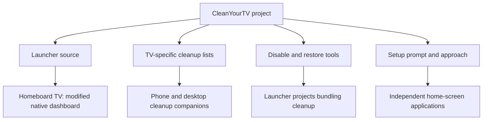

# CleanYourTV community projects: what they reuse and how they handle cleanup

**Researched: 18 November 2026.** This is a comparison of documented behavior in
seven representative community projects, using their own READMEs and upstream's
directory. It is not a census, a security audit or device acceptance testing.

## Finding

**Yes: several projects combine a custom home screen with CleanYourTV-derived
cleanup.** Others turn the cleanup knowledge into a phone or desktop management
application. The recurring pattern is review, reversible package disabling and
restore, with launcher installation handled as a separate concern. The examples
below establish those patterns; they do not establish that every derivative
includes cleanup or inherits every upstream feature.

Homeboard currently reuses the launcher source. Its import deliberately omitted
the cleanup and installation scripts. Calling it “built on CleanYourTV” accurately
describes that ancestry, but does not mean that cleanup comes with it. See our
[upstream notes](../upstream/README.md) and [import manifest](../upstream/provenance.json).

## What “built on” means

The phrase needs a specific object:

| Kind of reuse | What the relationship means | What it does not establish |
|---|---|---|
| Launcher source | Copy or fork the Android launcher and modify it. This is Homeboard's relationship. | Inclusion of the separate cleanup tools or all upstream launcher behavior. |
| Cleanup data | Reuse model-specific package lists in another application. | Reuse of the launcher or the original execution engine. |
| Cleanup implementation | Bundle upstream tools, or port their behavior into another language/application. | Automatic compatibility with every TV or every upstream restore format. |
| Prompt or design approach | Use upstream instructions or its launcher as a starting reference for a new app. | A source-code fork. |
| Add-on/theme | Supply a separate card application, settings or a visual theme for the upstream launcher. | A replacement launcher or TV cleanup application. |

Upstream's [showcase](https://github.com/Gathin23/cleanyourtv/blob/main/SHOWCASE.md)
intentionally includes source derivatives, independent apps and projects made
with its prompt. Its **“Built on” table column commonly names the TV hardware and
Android version used**, rather than the reused software components. Its listing
also does not constitute upstream maintenance or endorsement. The
[add-ons directory](https://cleanyour.tv/addons) separately groups themes, settings
and card apps.

These are possible relationships, not mutually exclusive categories. A project
can reuse lists, port the cleanup engine and supply its own launcher at once.

## Phone and desktop companions

The upstream [community-app page](https://cleanyour.tv/app) links the following
four independent applications. The comparison uses their own documentation
where it provides more current or specific behavior than the directory.

| Project and platform | What it reuses | What users get | Cleanup and restoration |
|---|---|---|---|
| [Clean Your TV app — udhaykumarbala](https://github.com/udhaykumarbala/cleanyourtv-app#readme), Android phone | Community TV profiles and the CleanYourTV home screen. | Wi-Fi connection, analysis and a proposed change list; launcher delivery depends on the TV. | Restore point before applying; individual or complete undo; exportable restore scripts. Its README explicitly offers cleanup-only behavior for Chromecast/TV Streamer and other models where home-screen replacement is restricted. |
| [Tellyscope](https://github.com/man15h/tellyscope#readme), Android phone | Adapted CleanYourTV profiles, maintained in a separate device-list repository. | Package management, app installation, file transfer, remote control, monitoring and launcher choices including Projectivy. | Users review and untick packages. Built-in apps are disabled and can be re-enabled; user-installed apps have a separate uninstall action. Cleanup does not require a CleanYourTV-derived launcher. |
| [TidyTV](https://github.com/jolan94/tidytv#readme), Android phone | CleanYourTV model lists. | Cleanup, remote, file sending and checks for packages re-enabled by a TV update. | Backup before changes, per-app choices, restore and change logs on phone and TV. Home-screen replacement is optional; Projectivy is obtained through the TV's Play Store. |
| [CleanMyTV](https://github.com/wingedpanther/cleanmytv#readme), Mac/Windows/Linux desktop | Upstream lists and a TypeScript port of the cleanup tools and launcher-handover approach. | Cleanup plus its own CleanMyTV Home, configurable from desktop or TV. | Records previous package state and provides restore. Its README documents recovery-record compatibility with upstream's restore tooling and a pinned-upstream update process. |

CleanMyTV is a particularly clear example of why provenance needs detail: its
README distinguishes the earlier versions that installed the upstream launcher
from later versions using its own home-screen implementation. Sharing cleanup
data and behavior does not require keeping the original launcher.
[CleanMyTV credits and upstream relationship](https://github.com/wingedpanther/cleanmytv#credits-and-upstream).

The current TidyTV and Tellyscope documentation also makes the launcher choice
more nuanced than the community directory's general statement that every listed
app installs its own CleanYourTV launcher copy. Evaluate the individual workflow;
do not assume a cleanup companion can be pointed at Homeboard without changes.
[TidyTV workflow](https://github.com/jolan94/tidytv#how-it-works),
[Tellyscope launcher choices](https://github.com/man15h/tellyscope#what-it-does).

## Home-screen projects that also include cleanup

| Project | Home-screen work | How cleanup is included | Scope documented by the project |
|---|---|---|---|
| [Chill TV](https://github.com/AlimangoStudio/chill-tv#readme) | Home and business-display variants, weather, animated dock and computer/browser remotes. | An explicitly optional preliminary cleanup step bundles CleanYourTV tools and lists, with a restore script. | The home-screen product and cleanup stage are documented separately. This is the closest example to the optional companion-stage recommendation for Homeboard. |
| [Cine Home](https://github.com/gabos4nchez/cine-home#readme) | A cinema-style Java launcher with app artwork and a hold-OK menu. | Credits upstream cleanup tools; supplies reviewed owner-specific package batches, launcher handover and restoration scripts. | Documents testing on an onn. 4K Streaming Box. Its cleanup list is for a particular owner's choices, not a universal preset. |
| [ambient-tv](https://github.com/HALtheWise/ambient-tv#readme) | Generative ambient scenes, a clock, status and app shelf; the upstream showcase says it started from the setup prompt. | Documents its TV's disabled packages, logging disable helper, full/individual restore and a separate device-owner app for its casting setup. | A particular TCL Google TV board in basic mode. This is a personal, device-specific configuration, not evidence that its package list should be applied to our Chromecasts. |

Sources: each linked project README; the
[upstream showcase](https://github.com/Gathin23/cleanyourtv/blob/main/SHOWCASE.md)
provides the prompt-origin description for ambient-tv. These are reported project
capabilities, not outcomes we have independently reproduced.

## What follows for Homeboard

The evidence supports **adding an optional cleanup experience**. It also changes
the implementation question: we can reuse upstream's profiles and restoration
knowledge while keeping Homeboard's native dashboard and identity. Cleanup does
not have to be implemented inside the TV launcher APK, and launcher installation
does not have to be part of every cleanup run. This is our inference from the
separate companion and launcher workflows above.

Three possible delivery approaches are worth distinguishing:

| Approach | Benefit | Work Homeboard would still own |
|---|---|---|
| Document an existing companion | Fast route to an already-developed review/restore interface. | Verify a cleanup-only path that preserves Homeboard, its settings and Home assignment. Existing apps' launcher choices are not evidence of Homeboard support. |
| Provide a Homeboard setup companion | One coherent setup experience with our own launcher as an explicit choice. | Authorized connection, package-state inventory, profile updates, change preview, durable recovery records, restoration and device acceptance. |
| Extend our existing phone controller | Familiar entry point for people already configuring widgets. | A defined privileged execution mechanism and recovery path: the current TV-served settings editor configures Homeboard and does not implement package cleanup. |

**Recommendation:** first investigate a cleanup-only integration that preserves
Homeboard, using a reviewed upstream profile and a durable change/restore record.
Evaluate an existing companion before creating a second complete device-management
product. If none provides the necessary integration, implement a focused setup
companion using reviewed upstream data and behavior.

For our shared Cast1/Cast2 testing, actual device mutations must be implemented as
coordinator-owned workflows. The coordinator is our shared-device development
infrastructure; requiring that household service for every public Homeboard user
would be a separate product decision. Admission remains operation-specific: a
cleanup stage changes device state and must be reviewed under its own contract;
the install-only permission does not grant package-disabling effects. See the
[shared-device how-to](../how-to/chromecast.md).

Before promising cleanup in the promotional sheet, acceptance should demonstrate:

- [ ] Exact device identity and applicable profile, with the profile revision recorded.
- [ ] A preview that explains each package choice and preserves the user's keep-list.
- [ ] Original enabled/disabled state saved before each change, including previously disabled apps.
- [ ] Homeboard's layout, favorites and Home assignment preserved through cleanup and reboot.
- [ ] Casting, streaming, remote controls, inputs and the network behavior the user chose to retain.
- [ ] Individual and complete restoration, including an interrupted connection and a changed TV address.
- [ ] Before/after screenshots and restoration evidence from complete coordinator jobs on Cast1 and Cast2.

This checklist describes proposed acceptance work. No cleanup integration or
cleanup run was performed for this investigation.

## Accurate project wording today

For provenance: **“Homeboard TV uses a modified version of CleanYourTV's native
launcher. CleanYourTV's separate TV-cleanup tooling is not currently included.”**

For a future implemented feature: name the reused cleanup data/tools and the
specific tested integration. Avoid “all CleanYourTV benefits,” because a source
relationship does not establish feature parity, interoperability or device coverage.

## Evidence limits

The linked READMEs were consulted on the research date; some fetched pages carried
older crawl dates. Live branches, release features and directory descriptions can
change. Counts, stars and “latest” version numbers are intentionally not used as
selection criteria. This report checks documentation and our import records; it
does not verify every source path, license obligation for a future integration,
APK, signing identity, platform claim or physical-device result.
