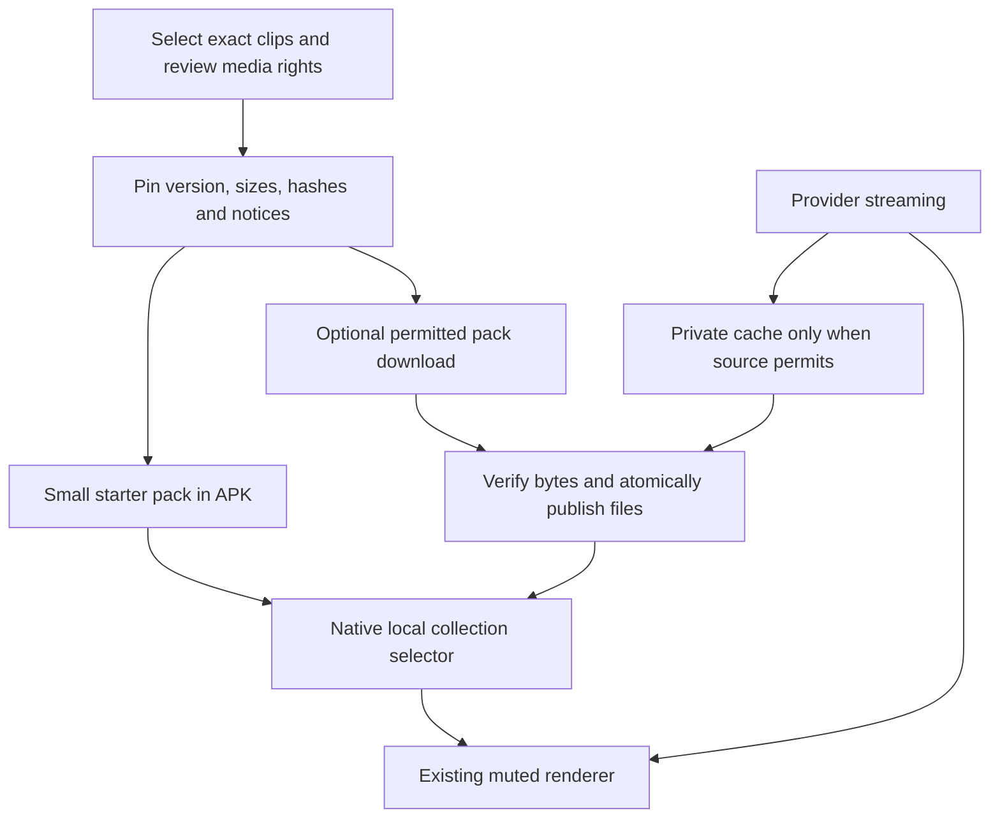

# Downloading and vendoring wallpaper videos

**Investigation date: 18 November 2026.** Scope: video backgrounds used through
Homeboard's wallpaper providers, especially Overflight, Aerial Views and Core
Motion. This report changes no app behavior and downloads no video files.

## Answer and recommendation

**Yes, we can vendor selected videos when their media license permits it. Core
Motion is a concrete candidate. We should not mirror the entire Apple/Aerial
catalog merely because its URLs are public or its player is open source.**

Recommend a small, reproducible **bundled starter pack**, initially targeting
3 clips and at most 15 MiB, plus optional downloadable packs for larger
collections. Keep ordinary provider streaming available. Treat private offline
storage and public redistribution as separate permissions, not interchangeable
ways around an unclear media license.

“Vendor” can mean several different things:

| Delivery | What the user gets | Offline behavior | Main cost |
|---|---|---|---|
| Small pack inside the APK | Videos on first launch, without installing a provider | Available immediately | Every app installation/update carries the media |
| Separate pinned media pack | User chooses a collection and downloads it once | Available after verified download | Pack hosting, download/storage UI and lifecycle |
| Private runtime cache | Previously fetched, eligible provider media | Best effort unless explicitly saved | Quotas, expiry, eviction and provider terms |
| User-owned USB/local collection | User supplies permitted media | Depends on storage access | Import/persisted permissions and removable storage |

The first two options can remove a third-party provider dependency for the
selected collection. Downloading files alone does not remove that dependency;
Homeboard still needs a native collection/selection path. Keep third-party
provider APKs separate, as the [installation decision](../plans/2026-11-18-provider-testing-spike-and-installation.md)
already specifies.

## What we can use

| Source | Evidence reviewed | Vendoring assessment |
|---|---|---|
| **Core Motion original loops** | Publisher explicitly includes original artwork under MIT, with third-party exceptions separately documented | **Viable candidate.** Select original clips, preserve copyright/license and pin exact files. Visually inspect selected clips before release. |
| **Apple aerials through Overflight** | Provider describes Apple-hosted footage; software is Apache-2.0 | **No redistribution clearance established.** A software license does not establish rights over linked Apple footage. |
| **Apple/other footage through Aerial Views** | Player is GPLv3 and supports offline/local media; footage has multiple owners | **Assess by clip/source.** Player licensing and download instructions do not grant Homeboard repackaging rights. |
| **Jetson Creative community/expansion videos** | Source manifest points to a media-specific license | **Do not vendor for Homeboard under the reviewed license.** Its stated personal screensaver use is limited to the Aerials Screen Saver context; obtain a grant covering this dashboard/wallpaper distribution. |
| **Robin Fourcade / other community contributors** | Listed as media sources, without a clip-specific Homeboard redistribution grant established here | **Unresolved.** Capture the applicable author's license before inclusion; “community” is not a universal license. |
| **Our own footage or procedural animations** | We control the original work and its dependencies | **Preferred alongside licensed Core Motion assets.** Record authorship and any included music/fonts/textures. |
| **Verified CC0 / CC BY media** | License must actually apply to each selected file | **Possible alternatives.** Preserve provenance and any attribution/change notices; no particular stock-library catalog is approved by this report. |

Core Builds' [license](https://github.com/brevityA/CoreBuildsApps/blob/f7c29360919ee0a802ad0e511fbcefb1353e832d/LICENSE)
expressly covers its original artwork. Its
[third-party notices](https://github.com/brevityA/CoreBuildsApps/blob/f7c29360919ee0a802ad0e511fbcefb1353e832d/THIRD_PARTY_NOTICES.md)
identify exceptions and reserve third-party trademark rights. This supports using
original motion artwork with the MIT notice, rather than assuming every asset in
the repository has identical rights. The [feed](https://github.com/brevityA/CoreBuildsApps/blob/f7c29360919ee0a802ad0e511fbcefb1353e832d/Motion/live-feed.json)
attributes its entries to Core Builds.

[Overflight's README](https://github.com/spocky/projectivy-plugin-wallpaper-overflight)
identifies its Apple aerial source and configurable media feeds. Apple's
[general website terms](https://www.apple.com/legal/internet-services/terms/site.html)
restrict publication/distribution of site content without an applicable grant.
Those general terms are not a clip-specific determination for every CDN URL;
the finding here is **absence of established redistribution permission**, not a
claim to have resolved all Apple licensing questions.

[Aerial Views' documentation](https://github.com/theothernt/AerialViews#where-to-download-videos-for-offlinelocal-playback)
provides local/offline download routes. Its
[GPLv3 license](https://github.com/theothernt/AerialViews/blob/master/LICENSE)
covers the licensed software, not automatically all separately hosted footage.
The [community source documentation](https://github.com/AerialScreensaver/AerialCommunity)
explicitly directs users to each source's license. Its
[manifest](https://github.com/AerialScreensaver/AerialCommunity/blob/master/manifest.json)
marks the Jetson source cacheable but links the
[Jetson media license](https://www.jetsoncreative.com/aeriallicense), which limits
its use. A `cacheable` flag is not permission to redistribute or to use footage
in a different product/context.

For new alternatives, [CC0](https://creativecommons.org/publicdomain/zero/1.0/)
permits copying/adaptation/distribution within its copyright dedication;
[CC BY 4.0](https://creativecommons.org/licenses/by/4.0/) adds attribution, license
link and change-notice duties. Neither eliminates unrelated privacy/trademark
rights or proves an uploader owned the footage.

## Measured Core Motion candidate set

Pinned upstream revision: **`f7c29360919ee0a802ad0e511fbcefb1353e832d`**.
Read the feed and GitHub file metadata at that revision:

- **48 feed entries, 48 distinct MP4 paths.**
- **152,562,928 bytes**, approximately **145.5 MiB**, for those MP4 files alone.
- Individual reported sizes span **556,693–11,070,133 bytes**.
- The three smallest entries total **2,801,635 bytes**, approximately **2.67 MiB**.

| Small candidate | Reported bytes | Filename |
|---|---:|---|
| Aisle Lights | 556,693 | `coremotion-live-54-cinema-aisle-lights.mp4` |
| Intermission | 1,094,118 | `coremotion-live-58-cinema-intermission.mp4` |
| Exit Sign | 1,150,824 | `coremotion-live-57-cinema-exit-sign.mp4` |

These are size candidates, **not a final aesthetic or codec selection**. Resolution
field names are publisher metadata; codec, duration, frame rate, audio and actual
pixel dimensions have not been probed. Thumbnails, manifests, notices, packaging
and temporary download space are additional.

The [saved metadata](2026-11-18-video-vendoring/core-motion-metadata.json) includes
per-file size, Git blob identity and pinned source URLs. Git blob IDs are **not
SHA-256 checksums of downloaded files**. The eventual acquisition step must
calculate SHA-256 from the actual bytes. Archived publisher
[license](2026-11-18-video-vendoring/core-motion-LICENSE) and
[notices](2026-11-18-video-vendoring/core-motion-THIRD_PARTY_NOTICES.md) preserve
the reviewed text. The plugin README still describes six loops; the pinned live
feed actually lists 48, so package contents must come from the pinned manifest.

Existing [Core Motion evidence](../testing/2026-11-18-provider-directory.md)
verifies a returned loop from the installed provider on Cast1. It does **not**
verify all 48 current assets or independent offline playback.

## What Homeboard currently does

The current renderer passes a remote/content/resource URI to Android
`MediaPlayer`. It has no application-managed video download store. The host's
`cacheMillis` holds a **descriptor batch**, not persistent video bytes.
Successful streaming therefore does not establish offline availability.

Local code reviewed:

- [WallpaperSurface.java](../../launcher/app/src/main/java/com/gathin/tvhome/WallpaperSurface.java): video source, first-frame readiness, mute/loop and release.
- [ProjectivyWallpaperHost.java](../../launcher/app/src/main/java/com/gathin/tvhome/ProjectivyWallpaperHost.java): descriptor cache lifetime and provider refresh.
- [MediaUris.java](../../launcher/app/src/main/java/com/gathin/tvhome/MediaUris.java): URI restrictions and scoped Apple HTTP handling.

A bundled clip can use an app resource URI, already accepted by the renderer.
Persistent downloads need a trusted internal file-descriptor path or private
content URI. Do not enable arbitrary `file://` provider URLs. Preserve the
existing first-frame timeout, resource release, muted playback and Reduced motion
behavior. Offline files still need a supported codec; they cannot fix unsupported
4K/HDR decoding on Cast1.

## Proposed delivery and storage design

**Start with the small bundled pack.** Acquire permitted originals once, outside
normal builds; pin bytes and licensing; verify checksums in the build container.
A normal build must not fetch changing provider feeds. Put original/derived file
hashes, creator, source revision, title, license and any conversion command in a
media manifest. Retain credits in About and the background detail screen.

A couple of small immutable assets can live in Git. For larger packs, keep the
manifest/notices in Git and distribute versioned archives separately. GitHub
[warns above 50 MiB and blocks ordinary Git files above 100 MiB](https://docs.github.com/en/repositories/working-with-files/managing-large-files/about-large-files-on-github).
Git LFS is a possible build-input mechanism, not an end-user downloader or a fix
for TV storage. Optional packs should not be required to build the basic APK.
Do not make Play-specific delivery a requirement for our coordinator/sideload flow.

**For downloadable packs, distinguish saved files from evictable cache.** Android
can remove cache files under storage pressure; explicit offline selections belong
in persistent app-private storage, with capacity checks and user deletion.
Uninstall removes app-specific files. Follow Android's
[app-specific storage guidance](https://developer.android.com/training/data-storage/app-specific).
A user-owned USB collection needs a separate persisted access/import design.

Suggested initial policies, to validate rather than present as measured device limits:

- Starter pack: 3 clips, target **≤15 MiB** total, prefer tested H.264 SDR MP4.
- Optional persistent packs: user-selected with declared size, Cancel and Remove.
- Best-effort cache: optional **256 MiB cap**, reduced automatically when free
  space is low; never evict a file while it is playing.
- Enforce byte limits while reading, not just from `Content-Length`. Use temporary
  files and atomic publication; reject truncated, oversized or hash-mismatched data.
- Preserve pinned offline choices across an app update. Honor source expiry and
  withdrawal requirements; do not put token-bearing URLs or private media into
  public manifests, build outputs or a shared household cache.

No new default playback or automatic bulk download is proposed. The eventual
selector should expose Built-in, downloaded collections and installed providers
without making users understand cache internals. A new workflow needs its own
plan/mockups before implementation.

## Acceptance checks before vendoring ships

1. Record a media license for **each selected file**, its pinned source and actual
   SHA-256. Preserve required notices; independently review exceptions.
2. Inspect the actual images and audio, then probe codec/duration/size in the build
   container. Any transcoding also runs there and records reproducible arguments.
3. Install one numbered APK on both TVs through the coordinator. Use Cast1 for
   routine foreground verification; allow Cast2 work to defer during personal use.
4. Capture the collection selector, credits and playing media. Prove initial
   playback after a fresh install without contacting the media host, then restart
   and replay offline. A still screenshot alone does not prove motion/offline use:
   retain renderer events plus coordinator-supported network-state evidence.
   Do not disable the transport needed by the coordinator to perform that test;
   a network-denial fixture is only fixture evidence, not physical offline proof.
5. Test full-disk/canceled/truncated downloads, hash mismatch, cache eviction and
   update persistence. Preserve original provider settings and dashboard layout.
6. Compare APK size, installed storage, first-frame time and decode stability with
   the current streaming baseline. Verify hide/resume, Reduced motion and no audio.

**Current outcome:** report and metadata only. No media pack was downloaded,
vendored, built, deployed or published, and no publisher was contacted.
