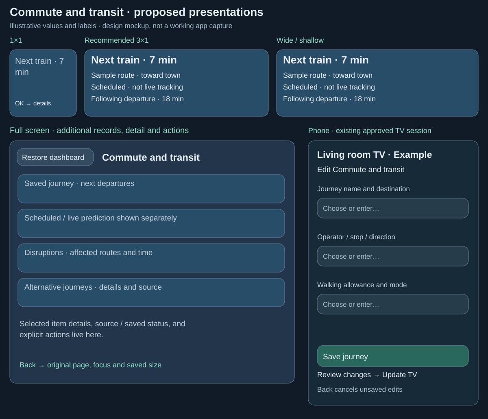
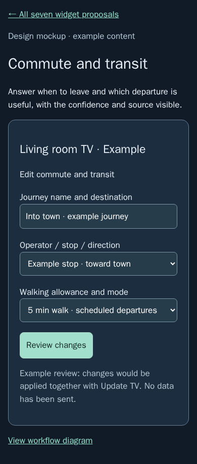
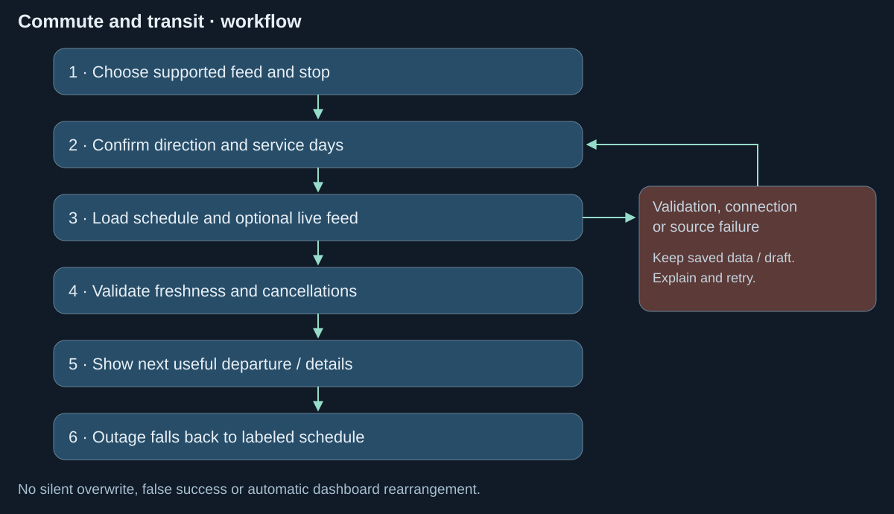

# Commute and transit: widget implementation proposal

**Purpose:** Answer when to leave and which departure is useful, with the confidence and source visible.

Data-access spike first; implementation waits for a usable local source. This is a separate implementation proposal, stored under
`docs/investigations/` as requested. All mockup values are illustrative. The proposed first release and follow-on
work are separated below.

[All seven proposals](2026-11-19-widget-proposals/index.html) ·
[Desktop preview](2026-11-19-widget-proposals/commute-and-transit.html) ·
[Phone preview](2026-11-19-widget-proposals/commute-and-transit.html?view=phone)

## Goals and first release

Begin with one verified operator/feed and a saved stop/direction. Scheduled departures are useful when explicitly labeled. Live journey times and traffic-aware arrival estimates are separate capabilities, not a promise attached to a timetable.

## Mockups and size behavior

| Presentation | Content and interaction |
|---|---|
| 1×1 | One headline: **Next train · 7 min**. A readable glance, never tiny body text or hidden controls. Short OK opens detail. |
| 2×1 / shallow | Headline plus one next item or context label; truncate only presentation. |
| Recommended 3×1 | Headline, the most useful few records/values and saved/source status. |
| Wide / tall | Wide adds comparison/trend or columns; tall adds records. Keep remote navigation predictable. |
| Fill Home | More visible records and context, with full-screen detail still available by short OK. |
| Full screen | Saved journey · next departures; additional records, selected-item detail and meaningful actions, not a magnified card. |

Add through the widget picker. Do not rearrange the default dashboard automatically.
Each instance keeps its own size, placement and configuration; shared records are
not duplicated per instance. Overflow uses directional wedges, never visible
scrollbars on TV. Minimum-size feasibility must be checked against the actual grid
and text scaling; do not claim 1×1 usability until demonstrated on-device.

Phone controls at a phone viewport

## Workflow and editing

Short OK/click opens the shared full-screen shell. A visible **Restore dashboard**
and short Back restore the originating Home page, focused widget, position and saved
size; nested detail closes first. Hold OK opens Configure / Move / Resize actions.
Do not overload short OK with a destructive or state-changing action.

The existing approved phone editor is the primary setup/edit surface. Its controls
are **Journey name and destination; Operator / stop / direction; Walking allowance and mode**. Review changes before **Update TV**. Cancel leaves
the TV untouched. Reuse stable widget IDs, generation/conflict checks, operation
receipts and composite Undo. Keep credentials out of ordinary draft exports.
Remote-accessible controls remain available for routine viewing and explicit actions.

## Data, persistence and integration

Investigate the actual city/operator before choosing an API. GTFS/GTFS-Realtime are candidate formats, not evidence of an available Bangkok feed. Verify permission, coverage, freshness, rate/cost and key handling with a real fixture. Never scrape a consumer map app as an assumed data source.

Feed/operator ID, service date/zone, stop and direction, trip ID, scheduled departure, optional predicted departure, update time, cancellation and alert validity. Walking allowance is user configuration, not observed travel time.

Use a native Java repository/presentation with small adapters. Reuse existing
location, formatting, cache and expansion code where the data contract matches;
do not introduce a dashboard framework or required household server for local widgets.
Persist accepted changes atomically. Last-good external data remains visible with
source/valid-time and retrieval status; missing data is never a numeric zero or a
claim that there is nothing scheduled.

## Domain rules and failure states

A scheduled countdown is not a live arrival prediction. Show source timestamp and service-day zone; account for trips after 24:00. Remove cancelled departures and expire old predictions while retaining a clearly labeled schedule if valid. No departures must distinguish end-of-service, missing coverage and failed retrieval.

Provide distinct first-use, empty, loading, offline/stale, partial and error states
where applicable. Local widgets distinguish an unsaved draft from a saved empty
list. In full screen, explain recovery and offer a specific retry/edit action.
Use English/Thai, BE date years for Thai, named time zones, existing time/duration
formatting and selective timestamp/age icons. Do not add clock icons to clock faces.
Support large text, Reduced motion, focus outlines and screen-reader labels.

## Implementation sequence

1. Perform a local operator/data-rights spike and save licensed representative fixtures; stop integration if no supported feed exists.
2. Implement schedule-only saved stop/direction with clear scheduled labeling.
3. Add bounded GTFS-Realtime predictions/alerts if an actual compatible feed is available.
4. Consider road-traffic estimates only after separate source, quota, credentials and terms review.

## Acceptance and screenshot proof

- Direction mistakes, overnight service dates, cancelled trips and stale per-trip predictions.
- Never display a stale live prediction as current; distinguish no service from no data.
- Visible scheduled/live labels, refresh age and origin/destination privacy across all sizes.
- Container tests cover the data model, persistence and domain edge cases; UI tests
  exercise actual controls and request failure/retry behavior, not only rendering.
- Capture and visually inspect 1×1, recommended 3×1, wide, tall, Fill Home and
  full-screen presentations. Record English/Thai and large-text cases with sample
  values labeled as fixtures when applicable.
- Capture phone overview/edit/review and one error/conflict state in Chromium and
  WebKit. Verify no horizontal page overflow and that long content remains reachable.
- On Cast1, prove short OK expansion, nested Back, visible Restore, original
  page/focus/size, and Undo after saved changes. Preserve household settings using
  isolated test preferences for proof captures.
- Store APK/source hashes, coordinator job/receipt, screenshots and native assertions
  in `docs/testing/`. Mockups are not device evidence. Every working APK uses a new
  version and is submitted to Cast1/Cast2 via `task deploy`; foreground verification
  remains separately subject to coordinator admission.

## Decisions and release gates

The recommendation above is a proposed default, not an instruction to replace an
existing layout. Confirm real-world use with a small prototype before expanding
scope. Network integrations require a verified actual source and a permission,
coverage, attribution and quota review. Choose the first-release boundary before coding; later integration work should
follow the domain-specific sequence above rather than expanding the initial widget.

## Evidence and source notes

- [GTFS Schedule reference](https://gtfs.org/documentation/schedule/reference/#stop_timestxt) — service days and stop times can extend past 24:00; this is a schedule convention, not a live prediction. Accessed 19 November 2026.

- [GTFS-Realtime reference](https://gtfs.org/documentation/realtime/reference/) — Defines TripUpdate, VehiclePosition and Alert; timestamps matter for freshness. This does not establish local feed access. Accessed 19 November 2026.

Repository design contracts: [full-screen widgets](../plans/2026-11-17-widget-full-screen.md),
[phone editor](../how-to/phone-widget-editor.md), [Undo](../how-to/undo.md) and
[local date/time work](../plans/2026-11-18-thai-years-and-time-presentation.md).
External capabilities above are source assertions; this proposal's UI, sizes,
refresh/error policy and implementation sequence are design decisions. Actual
provider access and physical acceptance are not inferred from API documentation.
