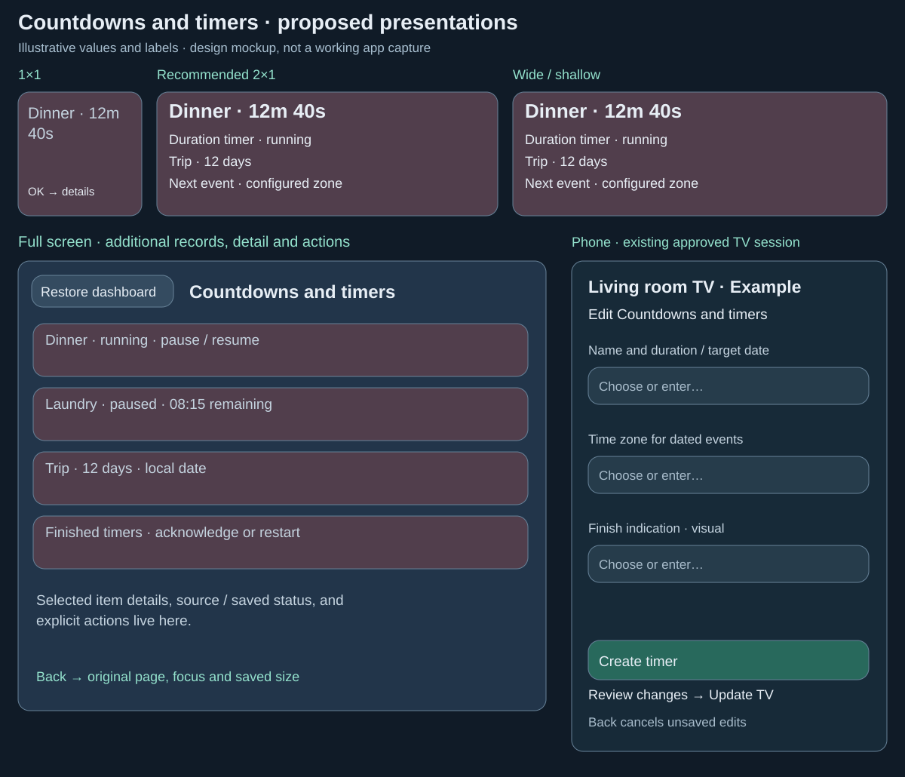
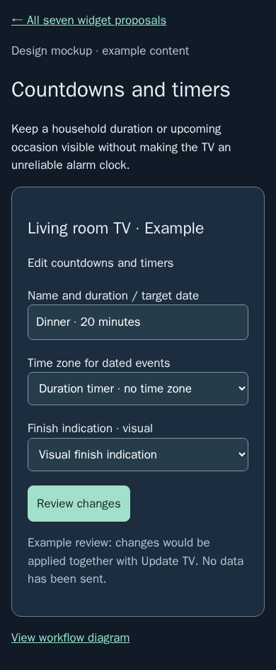
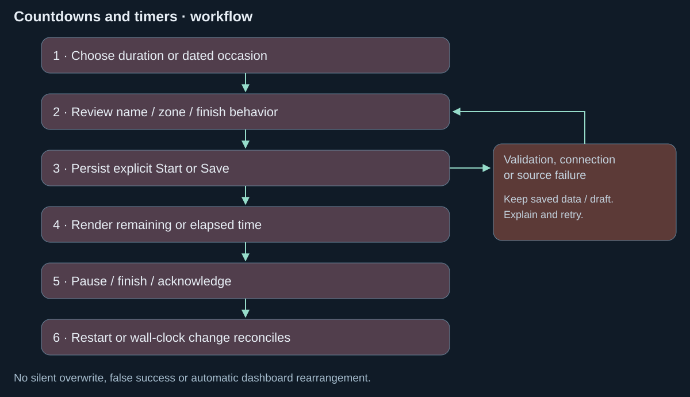

# Countdowns and timers: widget implementation proposal

**Current decision (19 November):** Will selected this widget next, prioritizing
cooking timers plus one-off household event alarms. Sound must work while another
app is open. The [cooking timers and event alarms implementation plan](../plans/2026-11-19-cooking-timers.md)
supersedes the first-release scope below, including its earlier visual-only alert
assumption. The generic stopwatch/occasion ideas remain follow-on proposals.

**Purpose:** Keep a household duration or upcoming occasion visible without making the TV an unreliable alarm clock.

Small local widget, with explicit lifecycle semantics before background alerts. This is a separate implementation proposal, stored under
`docs/investigations/` as requested. All mockup values are illustrative. The proposed first release and follow-on
work are separated below.

[All seven proposals](2026-11-19-widget-proposals/index.html) ·
[Desktop preview](2026-11-19-widget-proposals/countdowns-and-timers.html) ·
[Phone preview](2026-11-19-widget-proposals/countdowns-and-timers.html?view=phone)

## Goals and first release

Separate duration timers, elapsed stopwatches and calendar-date countdowns. Short OK opens the list/detail; explicit buttons start, pause, resume, acknowledge or reset. No unavoidable sound, wake-up or exact background alarm promise in phase one.

## Mockups and size behavior

| Presentation | Content and interaction |
|---|---|
| 1×1 | One headline: **Dinner · 12m 40s**. A readable glance, never tiny body text or hidden controls. Short OK opens detail. |
| 2×1 / shallow | Headline plus one next item or context label; truncate only presentation. |
| Recommended 2×1 | Headline, the most useful few records/values and saved/source status. |
| Wide / tall | Wide adds comparison/trend or columns; tall adds records. Keep remote navigation predictable. |
| Fill Home | More visible records and context, with full-screen detail still available by short OK. |
| Full screen | Dinner · running · pause / resume; additional records, selected-item detail and meaningful actions, not a magnified card. |

Add through the widget picker. Do not rearrange the default dashboard automatically.
Each instance keeps its own size, placement and configuration; shared records are
not duplicated per instance. Overflow uses directional wedges, never visible
scrollbars on TV. Minimum-size feasibility must be checked against the actual grid
and text scaling; do not claim 1×1 usability until demonstrated on-device.

Phone controls at a phone viewport

## Workflow and editing

Short OK/click opens the shared full-screen shell. A visible **Restore dashboard**
and short Back restore the originating Home page, focused widget, position and saved
size; nested detail closes first. Hold OK opens Configure / Move / Resize actions.
Do not overload short OK with a destructive or state-changing action.

The existing approved phone editor is the primary setup/edit surface. Its controls
are **Name and duration / target date; Time zone for dated events; Finish indication · visual**. Review changes before **Update TV**. Cancel leaves
the TV untouched. Reuse stable widget IDs, generation/conflict checks, operation
receipts and composite Undo. Keep credentials out of ordinary draft exports.
Remote-accessible controls remain available for routine viewing and explicit actions.

## Data, persistence and integration

No internet or account. Android elapsedRealtime is the candidate clock for active duration measurement because it includes deep sleep and is monotonic within a boot. Reboot resets that clock: retain a wall-clock checkpoint but require reconciliation rather than silently claiming exact elapsed time.

Timer UUID, kind, duration/remaining value, running/paused/finished state, monotonic anchor and boot identity. Dated occasions store a civil date/zone or explicit instant, never a fixed millisecond count disguised as calendar days. Persist state transitions with operation IDs.

Use a native Java repository/presentation with small adapters. Reuse existing
location, formatting, cache and expansion code where the data contract matches;
do not introduce a dashboard framework or required household server for local widgets.
Persist accepted changes atomically. Last-good external data remains visible with
source/valid-time and retrieval status; missing data is never a numeric zero or a
claim that there is nothing scheduled.

## Domain rules and failure states

Distinguish a clock-time deadline from a duration. Day counts use the event zone, including DST. Survive app recreation without restarting timers. After device reboot, show the recovered estimate or ask to resume the saved remaining time; the exact policy must be chosen before release. Background audible notifications are a later Android scheduling/permission design.

Provide distinct first-use, empty, loading, offline/stale, partial and error states
where applicable. Local widgets distinguish an unsaved draft from a saved empty
list. In full screen, explain recovery and offer a specific retry/edit action.
Use English/Thai, BE date years for Thai, named time zones, existing time/duration
formatting and selective timestamp/age icons. Do not add clock icons to clock faces.
Support large text, Reduced motion, focus outlines and screen-reader labels.

## Implementation sequence

1. Specify duration, stopwatch and dated-event behavior and reboot recovery with pure clock fixtures.
2. Implement persistent timer state and explicit reversible Start/Pause/Reset actions.
3. Add multi-timer full-screen detail, phone editing and reduced-motion visual finish state.
4. Investigate alarms/notifications separately if requested; do not wake the TV implicitly.

## Acceptance and screenshot proof

- Wall-clock jump, timezone change, deep sleep, process death, reboot and late resume.
- Repeated Start/Pause requests are idempotent; editing a running timer clearly previews its effect.
- No finish sound or wake-up unless explicitly configured and supported; no off-by-one civil-day countdown.
- Container tests cover the data model, persistence and domain edge cases; UI tests
  exercise actual controls and request failure/retry behavior, not only rendering.
- Capture and visually inspect 1×1, recommended 2×1, wide, tall, Fill Home and
  full-screen presentations. Record English/Thai and large-text cases with sample
  values labeled as fixtures when applicable.
- Capture phone overview/edit/review and one error/conflict state in Chromium and
  WebKit. Verify no horizontal page overflow and that long content remains reachable.
- On Cast1, prove short OK expansion, nested Back, visible Restore, original
  page/focus/size, and Undo after saved changes. Preserve household settings using
  isolated test preferences for proof captures.
- Store APK/source hashes, coordinator job/receipt, screenshots and native assertions
  in `docs/testing/`. Mockups are not device evidence. Every working APK uses a new
  version and is submitted to Cast1/Cast2 via `task deploy`; foreground verification
  remains separately subject to coordinator admission.

## Decisions and release gates

The recommendation above is a proposed default, not an instruction to replace an
existing layout. Confirm real-world use with a small prototype before expanding
scope. Network integrations require a verified actual source and a permission,
coverage, attribution and quota review. Choose the first-release boundary before coding; later integration work should
follow the domain-specific sequence above rather than expanding the initial widget.

## Evidence and source notes

- [Android SystemClock](https://developer.android.com/reference/android/os/SystemClock) — elapsedRealtime measures time since boot including deep sleep; it cannot be treated as a persistent clock across device reboots. Accessed 19 November 2026.

Repository design contracts: [full-screen widgets](../plans/2026-11-17-widget-full-screen.md),
[phone editor](../how-to/phone-widget-editor.md), [Undo](../how-to/undo.md) and
[local date/time work](../plans/2026-11-18-thai-years-and-time-presentation.md).
External capabilities above are source assertions; this proposal's UI, sizes,
refresh/error policy and implementation sequence are design decisions. Actual
provider access and physical acceptance are not inferred from API documentation.
