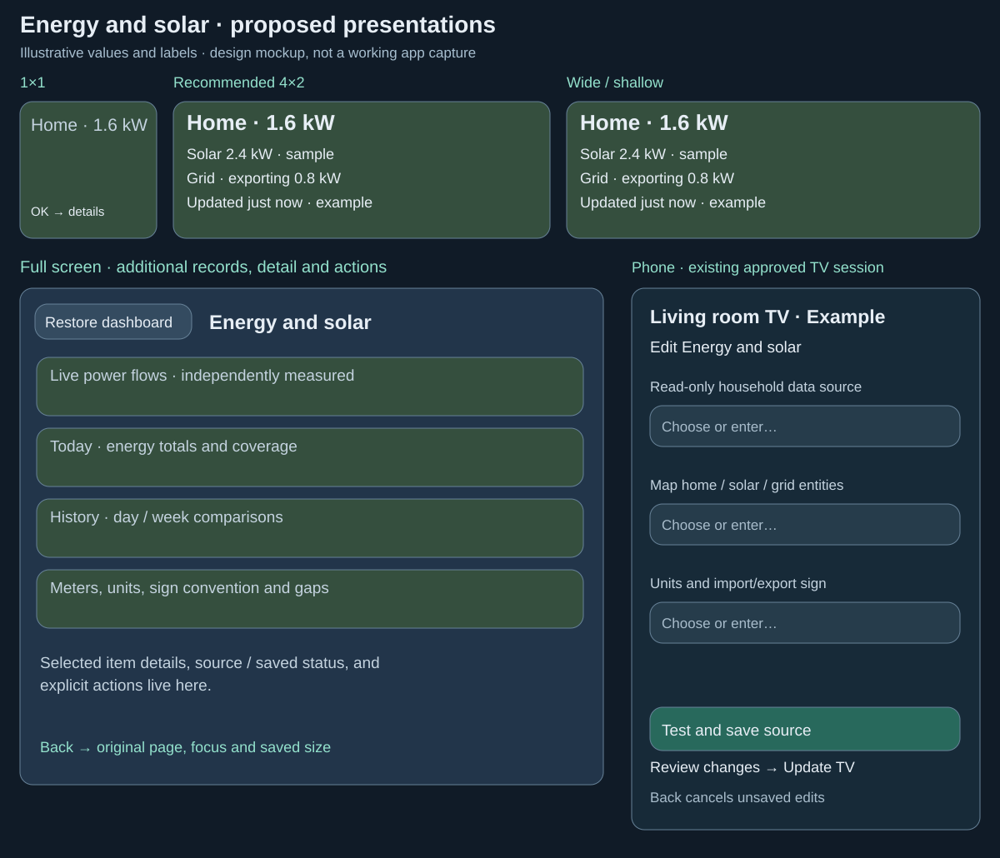
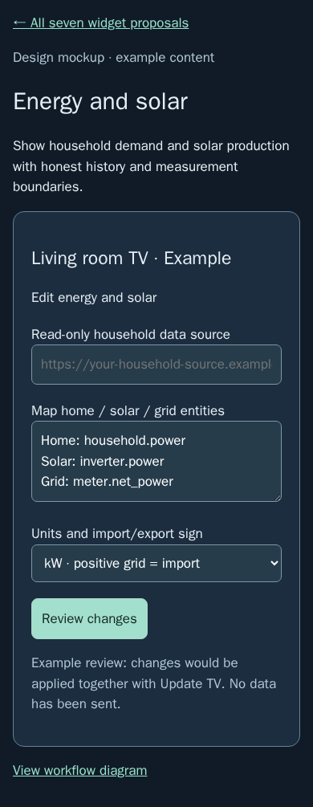
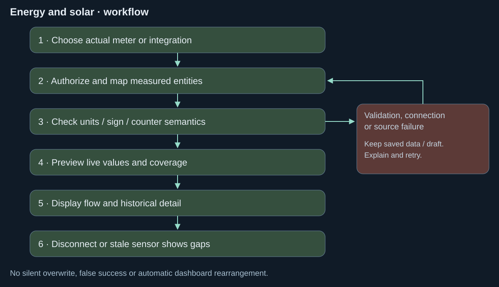

# Energy and solar: widget implementation proposal

**Purpose:** Show household demand and solar production with honest history and measurement boundaries.

Optional integration only when real household data is available. This is a separate implementation proposal, stored under
`docs/investigations/` as requested. All mockup values are illustrative. The proposed first release and follow-on
work are separated below.

[All seven proposals](2026-11-19-widget-proposals/index.html) ·
[Desktop preview](2026-11-19-widget-proposals/energy-and-solar.html) ·
[Phone preview](2026-11-19-widget-proposals/energy-and-solar.html?view=phone)

## Goals and first release

Read-only power/energy display and history. Require a configured meter/inverter/source; do not require Home Assistant for other widgets. No appliance control, automation or tariff-based savings claim in the initial widget.

## Mockups and size behavior

| Presentation | Content and interaction |
|---|---|
| 1×1 | One headline: **Home · 1.6 kW**. A readable glance, never tiny body text or hidden controls. Short OK opens detail. |
| 2×1 / shallow | Headline plus one next item or context label; truncate only presentation. |
| Recommended 4×2 | Headline, the most useful few records/values and saved/source status. |
| Wide / tall | Wide adds comparison/trend or columns; tall adds records. Keep remote navigation predictable. |
| Fill Home | More visible records and context, with full-screen detail still available by short OK. |
| Full screen | Live power flows · independently measured; additional records, selected-item detail and meaningful actions, not a magnified card. |

Add through the widget picker. Do not rearrange the default dashboard automatically.
Each instance keeps its own size, placement and configuration; shared records are
not duplicated per instance. Overflow uses directional wedges, never visible
scrollbars on TV. Minimum-size feasibility must be checked against the actual grid
and text scaling; do not claim 1×1 usability until demonstrated on-device.

Phone controls at a phone viewport

## Workflow and editing

Short OK/click opens the shared full-screen shell. A visible **Restore dashboard**
and short Back restore the originating Home page, focused widget, position and saved
size; nested detail closes first. Hold OK opens Configure / Move / Resize actions.
Do not overload short OK with a destructive or state-changing action.

The existing approved phone editor is the primary setup/edit surface. Its controls
are **Read-only household data source; Map home / solar / grid entities; Units and import/export sign**. Review changes before **Update TV**. Cancel leaves
the TV untouched. Reuse stable widget IDs, generation/conflict checks, operation
receipts and composite Undo. Keep credentials out of ordinary draft exports.
Remote-accessible controls remain available for routine viewing and explicit actions.

## Data, persistence and integration

Home Assistant REST/WebSocket is a candidate if a household already uses it; an inverter or meter API may be preferable when documented and accessible. Inspect actual installed equipment and authorization before choosing. Keep tokens private, out of exports/screenshots; API support is not a claim of a strictly read-only token.

Source/entity IDs, units, sample and reception timestamps, availability, power sign convention and cumulative energy state class. Preserve raw sample quality, counter resets and chart coverage. Store measurement and estimated/derived values distinctly.

Use a native Java repository/presentation with small adapters. Reuse existing
location, formatting, cache and expansion code where the data contract matches;
do not introduce a dashboard framework or required household server for local widgets.
Persist accepted changes atomically. Last-good external data remains visible with
source/valid-time and retrieval status; missing data is never a numeric zero or a
claim that there is nothing scheduled.

## Domain rules and failure states

kW is instantaneous power; kWh is energy. Never add them or treat one sample as a daily total. Import/export sign must be explicitly confirmed. A cumulative meter reset must not become negative usage or an invented production spike. Power integrations require interval weighting and gap rules. Do not infer home consumption from solar minus grid without verified topology and battery terms.

Provide distinct first-use, empty, loading, offline/stale, partial and error states
where applicable. Local widgets distinguish an unsaved draft from a saved empty
list. In full screen, explain recovery and offer a specific retry/edit action.
Use English/Thai, BE date years for Thai, named time zones, existing time/duration
formatting and selective timestamp/age icons. Do not add clock icons to clock faces.
Support large text, Reduced motion, focus outlines and screen-reader labels.

## Implementation sequence

1. Inventory actual equipment and select a documented read path; verify units and access before production coding.
2. Implement entity mapping, authenticated read transport and safe disconnect with no control endpoints.
3. Add power glance, full-screen flow/history and coverage-aware cumulative deltas.
4. Add tariffs or savings only with separately sourced, user-configured accounting assumptions.

## Acceptance and screenshot proof

- W versus kW, Wh versus kWh, import/export polarity, missing meters and unavailable state.
- Counter reset, duplicate/out-of-order samples, irregular intervals and DST daily totals.
- Disconnected source never becomes zero consumption; no control calls, leaked tokens or invented balanced flow.
- Container tests cover the data model, persistence and domain edge cases; UI tests
  exercise actual controls and request failure/retry behavior, not only rendering.
- Capture and visually inspect 1×1, recommended 4×2, wide, tall, Fill Home and
  full-screen presentations. Record English/Thai and large-text cases with sample
  values labeled as fixtures when applicable.
- Capture phone overview/edit/review and one error/conflict state in Chromium and
  WebKit. Verify no horizontal page overflow and that long content remains reachable.
- On Cast1, prove short OK expansion, nested Back, visible Restore, original
  page/focus/size, and Undo after saved changes. Preserve household settings using
  isolated test preferences for proof captures.
- Store APK/source hashes, coordinator job/receipt, screenshots and native assertions
  in `docs/testing/`. Mockups are not device evidence. Every working APK uses a new
  version and is submitted to Cast1/Cast2 via `task deploy`; foreground verification
  remains separately subject to coordinator admission.

## Decisions and release gates

The recommendation above is a proposed default, not an instruction to replace an
existing layout. Confirm real-world use with a small prototype before expanding
scope. Network integrations require a verified actual source and a permission,
coverage, attribution and quota review. Choose the first-release boundary before coding; later integration work should
follow the domain-specific sequence above rather than expanding the initial widget.

## Evidence and source notes

- [Home Assistant REST API](https://contributors.home-assistant.io/core/internals/rest-api/) — REST access uses authorization; select only required read endpoints for this widget. Accessed 19 November 2026.
- [Home Assistant WebSocket API](https://contributors.home-assistant.io/core/internals/websocket-api/) — Supports authenticated event access; subscription lifecycle and reconnection need explicit handling. Accessed 19 November 2026.
- [Home Assistant sensor semantics](https://www.home-assistant.io/integrations/sensor/) — Sensor state classes and units matter for cumulative energy and reset handling. Accessed 19 November 2026.

Repository design contracts: [full-screen widgets](../plans/2026-11-17-widget-full-screen.md),
[phone editor](../how-to/phone-widget-editor.md), [Undo](../how-to/undo.md) and
[local date/time work](../plans/2026-11-18-thai-years-and-time-presentation.md).
External capabilities above are source assertions; this proposal's UI, sizes,
refresh/error policy and implementation sequence are design decisions. Actual
provider access and physical acceptance are not inferred from API documentation.
