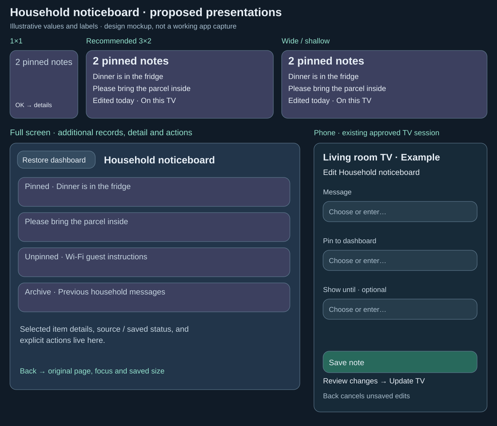
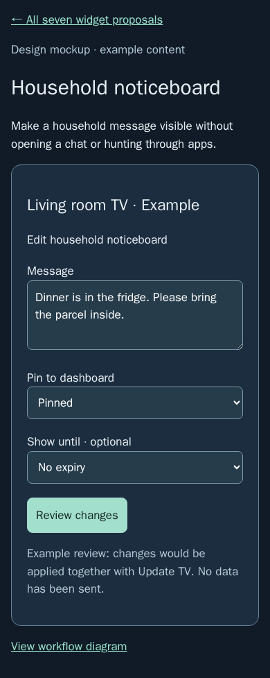
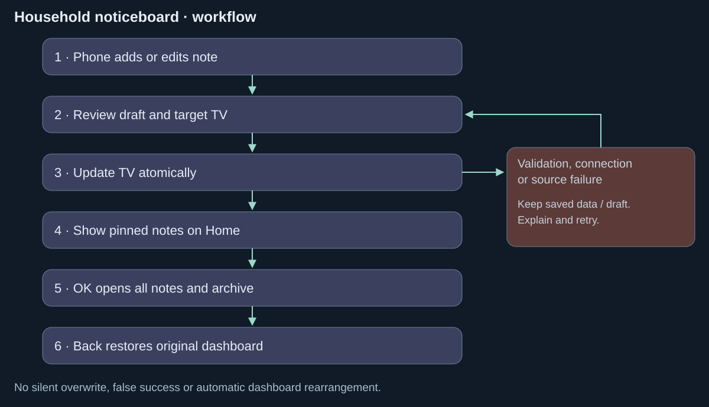

# Household noticeboard: widget implementation proposal

**Purpose:** Make a household message visible without opening a chat or hunting through apps.

First: useful offline, no external service. This is a separate implementation proposal, stored under
`docs/investigations/` as requested. All mockup values are illustrative. The proposed first release and follow-on
work are separated below.

[All seven proposals](2026-11-19-widget-proposals/index.html) ·
[Desktop preview](2026-11-19-widget-proposals/household-noticeboard.html) ·
[Phone preview](2026-11-19-widget-proposals/household-noticeboard.html?view=phone)

## Goals and first release

Create, edit, pin, reorder and archive plain-text notes. Optional expiry hides a note without destroying its archive. Keep free-form messages distinct from Tasks: a note has no completion semantics.

## Mockups and size behavior

| Presentation | Content and interaction |
|---|---|
| 1×1 | One headline: **2 pinned notes**. A readable glance, never tiny body text or hidden controls. Short OK opens detail. |
| 2×1 / shallow | Headline plus one next item or context label; truncate only presentation. |
| Recommended 3×2 | Headline, the most useful few records/values and saved/source status. |
| Wide / tall | Wide adds comparison/trend or columns; tall adds records. Keep remote navigation predictable. |
| Fill Home | More visible records and context, with full-screen detail still available by short OK. |
| Full screen | Pinned · Dinner is in the fridge; additional records, selected-item detail and meaningful actions, not a magnified card. |

Add through the widget picker. Do not rearrange the default dashboard automatically.
Each instance keeps its own size, placement and configuration; shared records are
not duplicated per instance. Overflow uses directional wedges, never visible
scrollbars on TV. Minimum-size feasibility must be checked against the actual grid
and text scaling; do not claim 1×1 usability until demonstrated on-device.

Phone controls at a phone viewport

## Workflow and editing

Short OK/click opens the shared full-screen shell. A visible **Restore dashboard**
and short Back restore the originating Home page, focused widget, position and saved
size; nested detail closes first. Hold OK opens Configure / Move / Resize actions.
Do not overload short OK with a destructive or state-changing action.

The existing approved phone editor is the primary setup/edit surface. Its controls
are **Message; Pin to dashboard; Show until · optional**. Review changes before **Update TV**. Cancel leaves
the TV untouched. Reuse stable widget IDs, generation/conflict checks, operation
receipts and composite Undo. Keep credentials out of ordinary draft exports.
Remote-accessible controls remain available for routine viewing and explicit actions.

## Data, persistence and integration

TV-owned local data, immediately available offline. The existing approved phone editor changes the TV copy; it does not create cloud sync or edit while away from the home network. Do not require accounts or a bridge.

Note UUID, body, pinned rank, created/edited timestamps, optional expiry instant and archive flag. Store text once; each widget selects pinned notes or a named board. Use deterministic ordering and an explicit maximum length. Unpinning and archiving are distinct reversible actions.

Use a native Java repository/presentation with small adapters. Reuse existing
location, formatting, cache and expansion code where the data contract matches;
do not introduce a dashboard framework or required household server for local widgets.
Persist accepted changes atomically. Last-good external data remains visible with
source/valid-time and retrieval status; missing data is never a numeric zero or a
claim that there is nothing scheduled.

## Domain rules and failure states

Expiry uses the saved zone and instant; a clock correction must not delete content. Save a note that expires while offline into the archive view with its original text. Preserve Thai combining characters and line breaks; truncate only the glance, never stored content.

Provide distinct first-use, empty, loading, offline/stale, partial and error states
where applicable. Local widgets distinguish an unsaved draft from a saved empty
list. In full screen, explain recovery and offer a specific retry/edit action.
Use English/Thai, BE date years for Thai, named time zones, existing time/duration
formatting and selective timestamp/age icons. Do not add clock icons to clock faces.
Support large text, Reduced motion, focus outlines and screen-reader labels.

## Implementation sequence

1. Implement local note repository, migration-free first schema and stable IDs.
2. Add pin/archive/order controls to the existing phone editor and named board selection to TV Configure.
3. Implement glance, list, selected-note detail and archive; add shared full-screen restoration.
4. Verify persistence, conflicts, Undo and screenshots before any optional household sync.

## Acceptance and screenshot proof

- Add, edit, unpin, archive and Undo after process restart; preserve exact Thai/English text.
- Expired, very long, empty and multiple pinned notes remain understandable at each size.
- A stale phone draft cannot overwrite another note edit silently; one Update TV has one composite Undo.
- Container tests cover the data model, persistence and domain edge cases; UI tests
  exercise actual controls and request failure/retry behavior, not only rendering.
- Capture and visually inspect 1×1, recommended 3×2, wide, tall, Fill Home and
  full-screen presentations. Record English/Thai and large-text cases with sample
  values labeled as fixtures when applicable.
- Capture phone overview/edit/review and one error/conflict state in Chromium and
  WebKit. Verify no horizontal page overflow and that long content remains reachable.
- On Cast1, prove short OK expansion, nested Back, visible Restore, original
  page/focus/size, and Undo after saved changes. Preserve household settings using
  isolated test preferences for proof captures.
- Store APK/source hashes, coordinator job/receipt, screenshots and native assertions
  in `docs/testing/`. Mockups are not device evidence. Every working APK uses a new
  version and is submitted to Cast1/Cast2 via `task deploy`; foreground verification
  remains separately subject to coordinator admission.

## Decisions and release gates

The recommendation above is a proposed default, not an instruction to replace an
existing layout. Confirm real-world use with a small prototype before expanding
scope. Network integrations require a verified actual source and a permission,
coverage, attribution and quota review. Choose the first-release boundary before coding; later integration work should
follow the domain-specific sequence above rather than expanding the initial widget.

## Evidence and source notes

No external service is required. This is a product proposal grounded in the existing local phone editor, Undo and widget expansion contracts.

Repository design contracts: [full-screen widgets](../plans/2026-11-17-widget-full-screen.md),
[phone editor](../how-to/phone-widget-editor.md), [Undo](../how-to/undo.md) and
[local date/time work](../plans/2026-11-18-thai-years-and-time-presentation.md).
External capabilities above are source assertions; this proposal's UI, sizes,
refresh/error policy and implementation sequence are design decisions. Actual
provider access and physical acceptance are not inferred from API documentation.
