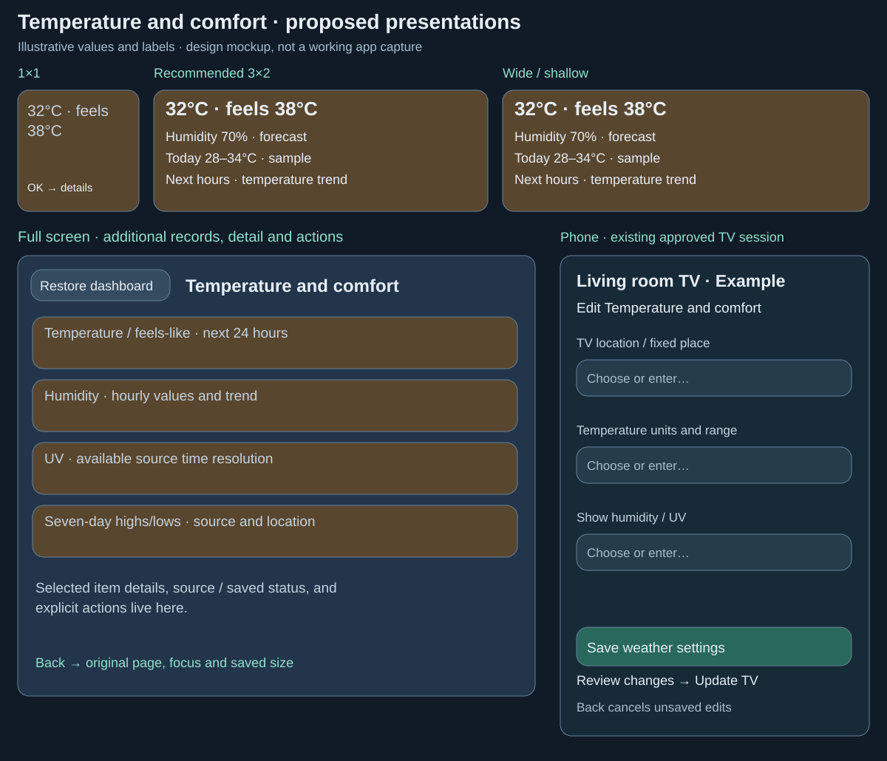
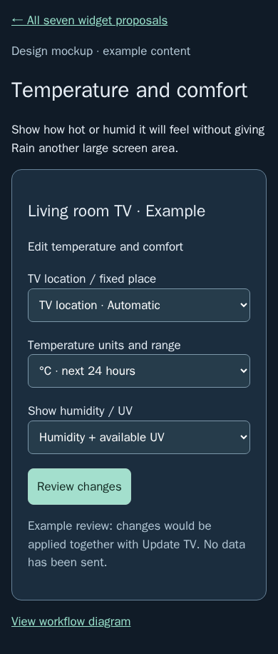
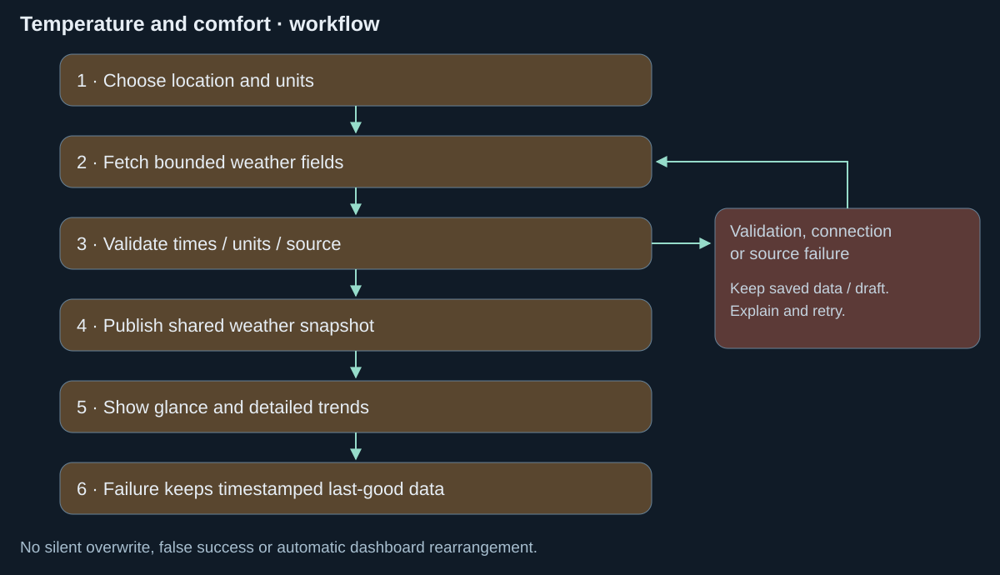

# Temperature and comfort: widget implementation proposal

**Purpose:** Show how hot or humid it will feel without giving Rain another large screen area.

After local widgets: share weather location and request caching with Rain. This is a separate implementation proposal, stored under
`docs/investigations/` as requested. All mockup values are illustrative. The proposed first release and follow-on
work are separated below.

[All seven proposals](2026-11-19-widget-proposals/index.html) ·
[Desktop preview](2026-11-19-widget-proposals/temperature-and-comfort.html) ·
[Phone preview](2026-11-19-widget-proposals/temperature-and-comfort.html?view=phone)

## Goals and first release

A separate configurable weather glance for temperature, apparent temperature and humidity, with UV only at the resolution the selected source provides. Keep rain probability/amount in Rain and air pollution in Air quality.

## Mockups and size behavior

| Presentation | Content and interaction |
|---|---|
| 1×1 | One headline: **32°C · feels 38°C**. A readable glance, never tiny body text or hidden controls. Short OK opens detail. |
| 2×1 / shallow | Headline plus one next item or context label; truncate only presentation. |
| Recommended 3×2 | Headline, the most useful few records/values and saved/source status. |
| Wide / tall | Wide adds comparison/trend or columns; tall adds records. Keep remote navigation predictable. |
| Fill Home | More visible records and context, with full-screen detail still available by short OK. |
| Full screen | Temperature / feels-like · next 24 hours; additional records, selected-item detail and meaningful actions, not a magnified card. |

Add through the widget picker. Do not rearrange the default dashboard automatically.
Each instance keeps its own size, placement and configuration; shared records are
not duplicated per instance. Overflow uses directional wedges, never visible
scrollbars on TV. Minimum-size feasibility must be checked against the actual grid
and text scaling; do not claim 1×1 usability until demonstrated on-device.

Phone controls at a phone viewport

## Workflow and editing

Short OK/click opens the shared full-screen shell. A visible **Restore dashboard**
and short Back restore the originating Home page, focused widget, position and saved
size; nested detail closes first. Hold OK opens Configure / Move / Resize actions.
Do not overload short OK with a destructive or state-changing action.

The existing approved phone editor is the primary setup/edit surface. Its controls
are **TV location / fixed place; Temperature units and range; Show humidity / UV**. Review changes before **Update TV**. Cancel leaves
the TV untouched. Reuse stable widget IDs, generation/conflict checks, operation
receipts and composite Undo. Keep credentials out of ordinary draft exports.
Remote-accessible controls remain available for routine viewing and explicit actions.

## Data, persistence and integration

Open-Meteo is a candidate because its forecast docs include apparent temperature and relative humidity. Verify requested fields, UV resolution, licensing, attribution, commercial use and request budgets for the intended release. Do not assume the existing Rain response already contains these values.

Location identity, source/model, forecast issue/retrieval time, valid-time samples, units and per-field availability. Multiple weather widgets with the same source/location share accepted responses while retaining separate display settings.

Use a native Java repository/presentation with small adapters. Reuse existing
location, formatting, cache and expansion code where the data contract matches;
do not introduce a dashboard framework or required household server for local widgets.
Persist accepted changes atomically. Last-good external data remains visible with
source/valid-time and retrieval status; missing data is never a numeric zero or a
claim that there is nothing scheduled.

## Domain rules and failure states

Label forecast/model values explicitly; they are not indoor measurements. Never fill a missing UV value with zero or infer indoor comfort from outdoor weather. Avoid medical claims and unsourced risk thresholds. A phase-one numeric presentation needs no subjective comfort score.

Provide distinct first-use, empty, loading, offline/stale, partial and error states
where applicable. Local widgets distinguish an unsaved draft from a saved empty
list. In full screen, explain recovery and offer a specific retry/edit action.
Use English/Thai, BE date years for Thai, named time zones, existing time/duration
formatting and selective timestamp/age icons. Do not add clock icons to clock faces.
Support large text, Reduced motion, focus outlines and screen-reader labels.

## Implementation sequence

1. Audit Rain request/caching/location code and verify provider fields and terms.
2. Extend a shared weather snapshot with independently available values and source timestamps.
3. Implement adaptive temperature/humidity glance and full-screen 24-hour/seven-day detail.
4. Add optional UV only after resolution and missing-data presentation are verified.

## Acceptance and screenshot proof

- Unit switching, model/location changes, timezone boundaries and partial-field responses.
- Forecast time versus retrieval time, stale cache, denied location and geocoding failure.
- No duplicated weather fetch for identical requests; UV gaps remain gaps and text remains readable at 1×1.
- Container tests cover the data model, persistence and domain edge cases; UI tests
  exercise actual controls and request failure/retry behavior, not only rendering.
- Capture and visually inspect 1×1, recommended 3×2, wide, tall, Fill Home and
  full-screen presentations. Record English/Thai and large-text cases with sample
  values labeled as fixtures when applicable.
- Capture phone overview/edit/review and one error/conflict state in Chromium and
  WebKit. Verify no horizontal page overflow and that long content remains reachable.
- On Cast1, prove short OK expansion, nested Back, visible Restore, original
  page/focus/size, and Undo after saved changes. Preserve household settings using
  isolated test preferences for proof captures.
- Store APK/source hashes, coordinator job/receipt, screenshots and native assertions
  in `docs/testing/`. Mockups are not device evidence. Every working APK uses a new
  version and is submitted to Cast1/Cast2 via `task deploy`; foreground verification
  remains separately subject to coordinator admission.

## Decisions and release gates

The recommendation above is a proposed default, not an instruction to replace an
existing layout. Confirm real-world use with a small prototype before expanding
scope. Network integrations require a verified actual source and a permission,
coverage, attribution and quota review. Choose the first-release boundary before coding; later integration work should
follow the domain-specific sequence above rather than expanding the initial widget.

## Evidence and source notes

- [Open-Meteo forecast documentation](https://open-meteo.com/en/docs) — Documents apparent_temperature and relative_humidity_2m and field-specific forecast options; availability and terms still need implementation-time validation. Accessed 19 November 2026.

Repository design contracts: [full-screen widgets](../plans/2026-11-17-widget-full-screen.md),
[phone editor](../how-to/phone-widget-editor.md), [Undo](../how-to/undo.md) and
[local date/time work](../plans/2026-11-18-thai-years-and-time-presentation.md).
External capabilities above are source assertions; this proposal's UI, sizes,
refresh/error policy and implementation sequence are design decisions. Actual
provider access and physical acceptance are not inferred from API documentation.
