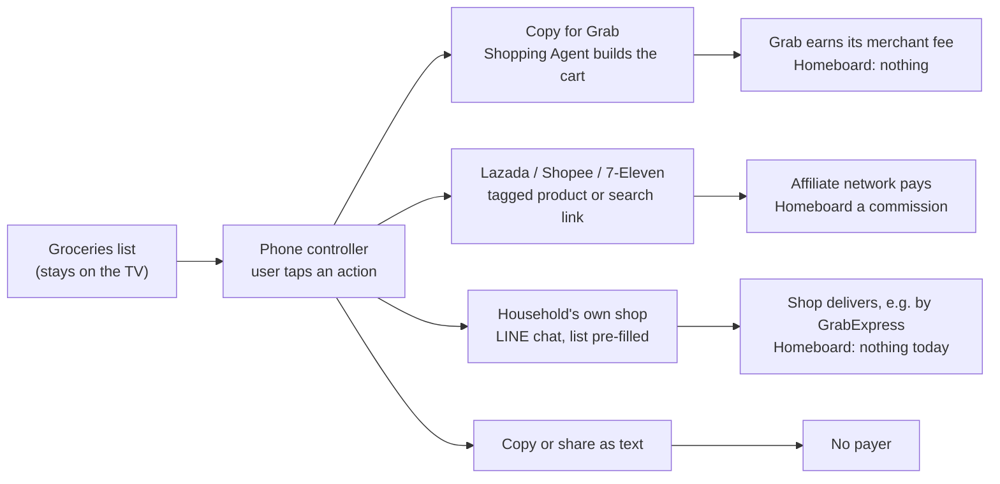
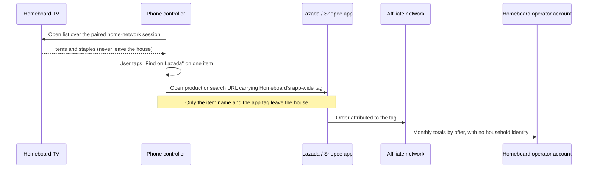
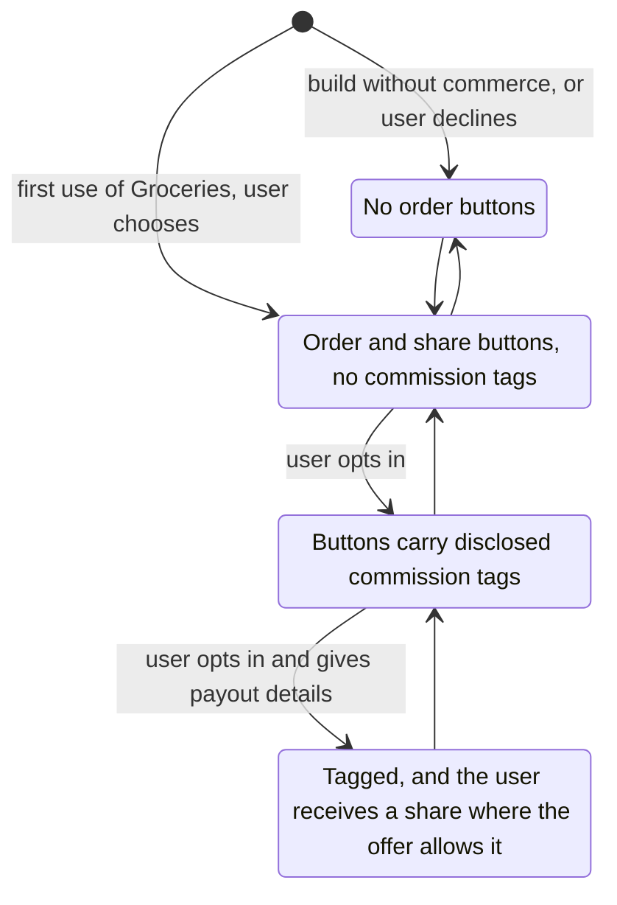

# Monetizing Homeboard widgets: Grab, delivery apps, sellers and affiliates

**Researched: 19 November 2026.** This report asks how Homeboard's widgets could earn money, with the Groceries list as the main case, while keeping Will's rule: **no ads, except opt-in ads that pay the user** (that exception is now a [TODO](../../TODO.md)). It covers Grab and the other Thai delivery apps, marketplaces and affiliate networks, selling to shops directly, overseas reference models, every current widget, and the policy and legal limits.

It is desk research only: no accounts were opened, no affiliate terms accepted and no code written. Every figure is a *listed* or *reported* rate as of today, not a quote. The sourced notes behind each section are in [research-notes/](2026-11-19-widget-monetization/research-notes/), and claims there carry confirmed, reported or unverified labels.

## Finding

- **Grab already turns lists into carts, inside its own app.** Since April 2026, including in Thailand, the [Grab Shopping Agent](https://www.grab.com/inside-grab/stories/grabx-ai-shopping-agent-grocery-list/) builds a GrabMart cart from a typed, spoken or photographed list. Grab is also [piloting](https://www.pymnts.com/earnings/2026/grab-gets-ai-assistance-as-revenues-rise-27percent/) Meta's assistant building GrabMart baskets in Singapore. So the list-to-Grab step that seems obvious is one Grab itself thinks matters. The free integration is for Homeboard to hand Grab the list text.
- **Grab cannot pay Homeboard today.** Grab's developer portal does have a GrabMart API, but it is for shops syncing menus and orders. It offers no way for an outside app to fill a customer's cart, no documented deep link and no affiliate or referral programme. With Grab, Homeboard can be a better shopping companion, not a paid one. Getting paid would take a negotiated deal like Meta's, and that needs usage numbers first. See [Grab first](#grab-first-because-that-is-where-the-groceries-come-from).
- **No Thai platform offers "send this list, get a filled cart".** The US has one, Instacart's Developer Platform, which pays 5% of the cart. In Thailand foodpanda closed in May 2025, HappyFresh left in 2022 and Robinhood is changing owners.
- **Commission exists where people shop on marketplaces:**
  - Lazada's Thai affiliate programme names app owners as eligible, at up to 12–13% and a 30‑day cookie.
  - Shopee's Thai programme runs through affiliate networks, at up to 25.9% headline and a 7‑day cookie; its grocery rate is behind a login.
  - 7‑Eleven ALL ONLINE pays 1% on supermarket items and 5% on health, beauty and home (rates from 2024).
  - The best-documented rates are travel and eSIM, which fit the Calendar and World clock widgets: Klook 5–6.5% (eSIM 20%), Agoda about 4–7%, Airalo from 10%.
- **The most Thai route earns nothing, but it is free and works today.** Sending the list to the household's own shop as a pre-filled LINE chat message needs no partner, key or fee, and the shop can deliver by GrabExpress. Charging shops comes later, if at all.
- **Expect small amounts.** An illustrative model gives a few thousand baht a month per 1,000 active households, about THB 8 per household. That can cover servers for Phase 3 sync, but it is not a business on its own.
- **Commission is only acceptable as a by-product of something the user chose to do.** Five rules follow:
  - Show offers only when the user asks.
  - Make the handoff on the phone, or by QR code from the TV.
  - Send only item names.
  - Disclose the commission next to the button.
  - Keep a build with no commerce code at all.

  Unprompted "rain is coming, order in" or "book a long weekend" cards are ads, so they are out.

## Ground rules this report assumes

| Allowed | Not allowed |
|---|---|
| A button the user taps on their own list item ("Find on Lazada", "Open Grab", "Send to my shop"), carrying a disclosed commission tag | Sponsored products, brand "suggestions" or retailer placement inside the list (the [Bring!](https://www.getbring.com/magazin/update-more-personalisation-and-new-advertising-format) / [Chicory](https://chicory.co/publishers) model) |
| A user-pulled action in a widget's full-screen detail ("Plan this long weekend") | Prompts on the Home card that the user did not ask for: weather-triggered "order in", travel nudges, app placement fees |
| Paid features (Phase 3 remote sync, Pro extras) and donations | Selling or sharing list, viewing or presence data (the [Telly](https://www.engadget.com/home/home-theater/telly-has-only-delivered-35000-of-its-free-televisions-with-always-on-ads-215033698.html) model) |
| Opt-in ads that pay the user, once that TODO is designed | Any other ad |

These rules also protect Homeboard's place in the CleanYourTV community, which exists to strip ads off TVs. See [the community investigation](2026-11-18-cleanyourtv-community-projects-and-cleanup.md).

## Grab first, because that is where the groceries come from

The first research pass could not read Grab's developer portal: it is rendered by JavaScript, so a plain fetch returns an empty page. The follow-up opened it in a real browser ([notes](2026-11-19-widget-monetization/research-notes/grab-deep-dive.md)).

### What Grab offers outside developers

| Grab API | Who it is for | What it means for Homeboard |
|---|---|---|
| [GrabMart API](https://developer.grab.com/docs/grabmart/api/v1-1-3/) | Shops selling on GrabMart: menu sync, order sync, store hours, campaigns | Not usable by a consumer app. It cannot put items into a household's cart. |
| [GrabExpress API](https://developer.grab.com/docs/grab-express/) | Businesses booking deliveries. Thailand is listed and production access comes through a Grab business contact | A local shop could deliver a Homeboard list with it. Grab does not pay the app that sends the order. |
| [Partner Apps](https://developer.grab.com/docs/partner-apps/) | Web apps that run *inside* the Grab super app, with Grab login, payments and GrabCoins (e.g. an eSIM seller, bike rental, buses) | A distribution channel for services that charge users. A list app is not the intended fit, and there is no payout. |
| [GrabRewards Points Earning API](https://developer.grab.com/assets/docs/grab-rewards/Rewards_Events_API.pdf) | Partner businesses that award GrabRewards points to Grab users they have enrolled by phone or email | A way to **pay users in points they already value**. That matters for the ads-that-pay-the-user TODO. The partner presumably funds the points, and access needs a deal. |
| Login with Grab, GrabPay, GrabGifts, Grab for Business | Identity, payments, corporate vouchers | Not a revenue route for Homeboard. |

**Not found:** an affiliate or referral programme, whether on Grab's Thai pages, the portal or the affiliate networks searched. Also no documented `grab://` scheme or search/store/cart prefill. Grab sells *to* brands through GrabAds and GrabGifts. Grab does not pay outside apps that send it customers.

### Is anyone already connecting shopping lists to Grab?

**Yes: Grab, and one partner.** No outside list app connecting to Grab turned up.

- **Grab Shopping Agent.** Launched 8 April 2026 and "now available in Indonesia, Malaysia, Philippines, Singapore, Thailand and Vietnam" ([Grab](https://www.grab.com/inside-grab/stories/grabx-ai-shopping-agent-grocery-list/)).
    1. Choose a merchant and tap the GrabMart shopping-list icon.
    2. Create or edit a list "by typing, speaking, or uploading a photo".
    3. Review the matches the agent suggests, add them to the cart and order.

  The wider Grab AI Assistant announced at GrabX 2026 builds "checkout-ready shopping carts from a photo, voice note, or typed list" ([The Paypers](https://thepaypers.com/payments/news/grab-launches-13-ai-powered-features-across-consumer-travel-and-merchant-services)).
- **Meta's Muse assistant.** A Singapore pilot lets customers "build GrabMart grocery baskets directly within chat interfaces before completing checkout inside the Grab app" ([PYMNTS](https://www.pymnts.com/earnings/2026/grab-gets-ai-assistance-as-revenues-rise-27percent/), 3 November 2026). It is the first evidence that Grab lets an *outside* assistant fill a GrabMart basket, though by private deal, not a public API.
- **Third-party list apps:** searches found none that hand lists to Grab.

**What this means for Homeboard:**

- Grab now owns the hard part, matching "milk" to a product in a particular shop. Homeboard should not build a Grab product matcher.
- Homeboard's value is what Grab does not have: one shared household list on the TV, with staples and stock. It should get that list into Grab's agent in one step.

### What Homeboard can build with Grab now, with no deal

1. **Copy for Grab.** On the phone, one button copies the list as plain text, one item per line with its quantity. The user pastes it into the Shopping Agent's list. Because the agent also reads photos, the TV's full-screen list is itself a valid input: point the phone camera at the TV. One test should check pasted multi-line Thai/English text and a photo of the TV screen.
2. **Shopping checklist on the phone.** While the household reviews the cart in the Grab app, the Homeboard phone page shows the list as a checklist to tick off. This is Phase 3's "check off at the shop", where the shop happens to be GrabMart.
3. **"Open Grab"** from the list. Launching the Grab app always works. Whether it can open straight to Mart or a search needs one test on an Android phone, by reading the app's intent filters with `adb shell dumpsys package com.grabtaxi.passenger`.
4. **Receipts close the loop.** GrabMart can email a full e‑Tax invoice listing the goods bought, without delivery fees, when it is requested at checkout ([Grab](https://www.grab.com/th/en/blog/grabmart-easy-e-receipt/)). Forwarded or read with permission, it could tick off purchased items and update a staple's reported stock without anyone typing. Two things need one real order to check: whether the invoice is offered outside tax-scheme campaigns, and what its format is.

### How Grab could ever pay

- **A negotiated partnership** with Grab's partnerships team, offering "household lists that become GrabMart baskets". The Meta pilot shows the shape: the basket is built outside Grab and checkout happens in Grab. It only makes sense once Homeboard can show how many baskets it sends; Meta brings billions of users.
- **Grab Partner App.** Putting Homeboard's phone list inside Grab would bring distribution, not revenue.
- **Indirectly**, by keeping the household's non-Grab purchases (Lazada, Shopee, 7‑Eleven, travel) on tagged links. If the household buys nearly everything through Grab, Homeboard's grocery revenue from that household is close to zero, and this report should say so plainly.

LINE MAN Wongnai is in the same position: brand advertising and coupons through partnership@lmwn.com, no developer API and no deep links ([LMWN](https://lmwn.com/be-our-partner-en/)). A LINE MAN Mart CPS offer of 14% for new and 3.5% for existing customers appeared on an affiliate network, but it is **paused** ([Cuelinks](https://www.cuelinks.com/campaigns/lineman-mart-th-cps-affiliate-program)). It shows that a Thai delivery platform has paid affiliates before, so it is worth watching.

## How a list becomes money



| Mechanism | Who pays | Available in Thailand? | Fit with the rules |
|---|---|---|---|
| Affiliate link on a list item | Marketplace, through an affiliate network | **Yes:** Lazada, Shopee, 7‑Eleven ALL ONLINE, travel and eSIM | Good if the user starts it and the commission is disclosed |
| List-to-cart API ([Instacart IDP](https://docs.instacart.com/developer_platform_api/api/products/create_shopping_list_page/), 5% of the cart) | Marketplace | **No** (US and Canada only; nothing equivalent found in Thailand) | Good, if it existed |
| Send to a shop's LINE | Nobody yet; later the shop could pay a subscription or lead fee | Works today; no Thai pricing precedent for a shop-side fee | Good |
| Brand-sponsored suggestions | Consumer brand | Not researched in Thailand; common abroad | **Ruled out:** it is an ad |
| Share of the commission with the user (cashback) | Marketplace, shared on to the user | Only on offers that allow "incentivised traffic"; see [Ads that pay the user](#ads-that-pay-the-user) | Good, and it needs no ads |
| Paid features and donations | User | Yes | Good |

## Thai platforms at a glance

| Platform | Operating, Nov 2026 | Usable by a third-party app | Pays the app |
|---|---|---|---|
| Grab (Mart, Food, Express) | Yes | Merchant and shipper APIs only | No programme found |
| LINE MAN Mart | Yes | Partnership email only | Affiliate offer paused |
| ShopeeFood | Yes | Nothing found | No |
| Robinhood | Yes, but SKY ICT/TTA are [reported](https://www.kaohooninternational.com/?p=594398) to take over in December 2026 | Nothing found | No |
| foodpanda / pandamart | **No**, closed 2025‑05‑23 ([report](https://www.thailand-business-news.com/companies/212648-foodpanda-to-cease-operations-in-thailand)) | — | — |
| HappyFresh | **No**, left in 2022 ([Bloomberg](https://www.bloomberg.com/news/articles/2022-09-23/happyfresh-exits-malaysia-and-thailand-after-strategic-review)) | — | — |
| 7‑Eleven ALL ONLINE | Yes | Product links or QR codes shared by members | **Yes:** 1% supermarket, 5% health, beauty and home (2024, [The Standard](https://thestandard.co/7-eleven-affiliate-marketing/)) |
| Makro PRO, Lotus's, Big C, Tops | Yes; Makro PRO leads Thai grocery e‑commerce ([Bangkok Post](https://bangkokpost.com/thailand/pr/2979876/makro-pro-crowned-thailands-top-grocery-e-commerce-platform-amid-small-business-boom-)) | Nothing found | No Thai programme found; Lotus's programme is Malaysia only |

## Marketplaces and affiliate networks

**Lazada Thailand** is the clearest fit for an app publisher:

- Its Thai pages invite "website or application" owners to join free.
- It lists up to 12% (another page says 13%), a cookie of up to 30 days with last-click attribution, and commission on orders placed in the Lazada app ([overview](https://pages.lazada.co.th/wow/i/th/corp/affiliate-overview?hybrid=1), [how it works](https://pages.lazada.co.th/wow/i/th/corp/affiliate-howitworks?hybrid=1)).
- No LazMart or grocery rate is published, and no official affiliate API was found.
- One network mirror lists cashback, rewards and incentives as **disallowed** for Lazada Thailand ([Cuelinks](https://www.cuelinks.com/campaigns/lazada-th-affiliate-program), snippet only). That would block sharing revenue with users on Lazada.

**Shopee Thailand** works through networks such as Involve Asia and Admitad:

- Admitad documents iOS and Android traffic and deep links to products ([Admitad](https://www.admitad.com/idn/blog/shopee-thailand-affiliate-program-admitad)).
- Headline terms are up to 25.9% with a 7‑day cookie ([Involve Asia](https://app.involve.asia/directory/shopee-thailand-cps-affiliate-program)).
- The category table, including supermarket and Mall, is behind a login. For scale, Shopee Mall FMCG sellers pay Shopee 14% in total ([Cube Asia](https://cube.asia/shopee-take-rate-tracker/)), so a grocery affiliate rate must sit well below that.
- Shopee has charged a service fee on affiliate earnings since 2025‑06‑01; the rate was not readable ([Shopee help](https://help.shopee.co.th/10/article/177422-%E0%B8%84%E0%B9%88%E0%B8%B2%E0%B8%9A%E0%B8%A3%E0%B8%B4%E0%B8%81%E0%B8%B2%E0%B8%A3%E0%B8%82%E0%B8%AD%E0%B8%87%E0%B9%82%E0%B8%9B%E0%B8%A3%E0%B9%81%E0%B8%81%E0%B8%A3%E0%B8%A1-Shopee-Affiliate-(Service-Fee))).
- A mirror lists "incentivised traffic / loyalty" as **allowed** for Shopee Thailand, from a snippet only.

**Involve Asia** is the most app-friendly network:

- Its [API](https://involve.asia/partners/api-overview/) names app and cashback publishers as intended users and creates up to 1,000 deep links a month.
- Its rules are set per offer: incentivised traffic is "only allowed if clearly stated in offer" ([help centre](https://helpcentre.involve.asia/portal/en/kb/articles/available-promotion-methods)).

**Cashback.** ShopBack Thailand is large and carries Lazada, Grab, Agoda, Trip.com and Klook ([Nation](https://www.nationthailand.com/business/30342787)). It has no public partner or white-label API, so a user revenue share would be Homeboard's own rebate, built on network conversion reports.

## Selling directly: the shop's LINE

Thai households already order from local shops by LINE. LINE's documented URL scheme opens the shop's Official Account chat with the text already typed. The user presses send ([LINE Developers](https://developers.line.biz/en/docs/messaging-api/using-line-url-scheme)):

```text
https://line.me/R/oaMessage/{shop's LINE ID, percent-encoded}/?{list text, percent-encoded}
```

- **What it needs:** no API key, no partner and no cost. It works on phone LINE (iOS and Android), not desktop LINE, and only for shops with an Official Account; a personal LINE account cannot receive it.
- **Group chat alternative:** LIFF `shareTargetPicker` can post a formatted list to any chat, but cannot pre-select the recipient ([LIFF reference](https://developers.line.biz/en/reference/liff/)).
- **Delivery:** the shop can deliver with GrabExpress, whose Thai API is open to businesses.
- **Earning from it:** only by charging the shop, through a subscription for a list-intake tool or a fee per order. No Thai precedent or pricing was found. Of all the routes, this is the only one that no platform's incentive rules can block.

## What the rest of the world does

| Model | How it pays | Lesson for Homeboard |
|---|---|---|
| [Instacart Developer Platform](https://docs.instacart.com/developer_platform_api/api/products/create_shopping_list_page/) | Server sends item names and gets back a hosted list page; partner earns **5% of the whole cart** over 7 days through Impact ([terms](https://company.instacart.ca/affiliate)) | The design to copy: list in, checkout page out, attribution carried in the URL. US and Canada only. |
| Amazon add-to-cart form; Walmart and Amazon grocery affiliates | URL or form carries a tag; grocery commission about **1%** | Open-web grocery affiliate rates are thin. |
| Bring! (Swiss Post) | Sponsored products, retailer flyers, an ad-free premium tier; cart forwarded to EDEKA's Bringmeister ([about](https://www.getbring.com/en/about-us)) | Leading list app whose revenue is ads. Not us. |
| AnyList, OurGroceries, Listonic | Subscription, or payment to remove ads | Paid convenience works for list apps. |
| Chicory | Consumer brands pay for in-recipe placement | Brand-paid placement is an ad. |
| Roku, Google TV, Fire TV, Echo Show | Sell home-screen rows, banners and tiles ([Roku](https://csimagazine.com/csi/roku-2025-results.php), [Google TV](https://9to5google.com/2024/12/13/google-tv-homescreen-ads-new-format/)); Echo Show owners report a backlash ([TechSpot](https://www.techspot.com/news/109829-echo-show-users-amazon-smart-displays-starting-feel.html)) | Works only with 90M+ homes, and is exactly what CleanYourTV removes. |
| Telly | Free TV paid for by an always-on ad screen plus viewing and presence data. 35,000 sets against a goal of 500,000 ([Engadget](https://www.engadget.com/home/home-theater/telly-has-only-delivered-35000-of-its-free-televisions-with-always-on-ads-215033698.html)) | A privacy backlash and the scale was never reached. |
| [Projectivy Launcher](https://www.androidauthority.com/projectivy-launcher-android-tv-3684205/) | Ad-free; one-time Premium upgrade | Closest Android TV analogue to Homeboard. |

## Every widget, assessed

| Widget | Moment the user is in | Possible route | Evidence | Verdict |
|---|---|---|---|---|
| **Groceries** (Phase 1) | "We need these" | Grab checklist; send to my shop by LINE; Lazada/Shopee/7‑Eleven search links | Above | **Build the handoff as a feature first.** Commission on marketplace links only. |
| **Staples** (Phase 2) | A known product with brand and size runs low | Product-level tagged link | Product links are commissionable on Lazada, Shopee and 7‑Eleven | **Best commission fit:** specific product, repeat purchase, user-confirmed. |
| **Calendar** | Long weekend ahead; Wan Phra flowers | Klook 5–6.5%, Agoda about 4–7% ([Klook](https://involve.asia/blog/klook-affiliate-program/), [Agoda](https://track360.io/blog/agoda-affiliate-program-operator-teardown-2026)); flowers from the household's own shop by LINE | Travel: documented. Flowers: no programme. | Only as a **user-pulled** action in full screen, never on the Home card. Flowers: use the LINE route, no commission. |
| **World clock** | Family abroad; a trip | eSIM: Airalo from 10% ([Travelpayouts](https://www.travelpayouts.com/en/offers/airalo-partner-program/)), Klook eSIM 20% | Documented. Wise's referral terms bar commercial use ([Wise](https://wise.com/gb/legal/referral-terms)). | Optional, user-pulled, low frequency. |
| **Air quality** | High PM2.5 | Masks and purifier filters on Lazada or Shopee | No dedicated programme | Don't nag from the widget. Let people keep "purifier filter" as a **staple** and buy it through the Groceries route. |
| **Rain** | Rain coming | "Order in" | Grab has no programme; LINE MAN offer paused | **Ruled out:** an unprompted prompt is an ad. |
| **Favorites** | Choosing an app | App placement fees, streaming referrals | Disney+ listing with no rate; Viu paused | **Ruled out:** placement fees are ads. |
| **Wallpapers** | Choosing a background | Paid wallpaper packs shared with creators | Not researched | Possible paid feature; separate question. |
| Market data (future) | Prices | Broker referral | Advice "for a fee or other remuneration" needs an SEC licence ([Tilleke](https://www.tilleke.com/insights/regulation-investment-advisors-thailand/)); whether referral fees count was not found | **No referral links** without Thai securities advice. |
| School travel (future) | Leaving for school | Open Grab for a ride | No ride affiliate | Convenience only. |

## Privacy-first handoff



- **Mint links on tap, on the phone.** Prefer a network's static deep-link template, where the app tag is the same for every household, so no list content goes to a server in advance. If a link has to be made through an API, send only the destination URL.
- **Convert off the TV, on the phone.** The Android TV quality guidelines say clickable ads must not open web URLs or other apps. From January 2027 they ask for "off-screen conversion mechanisms (such as QR codes)" ([guidelines](https://developer.android.com/docs/quality-guidelines/tv-app-quality)). A list button is arguably not an ad, but nobody orders groceries with a TV remote anyway. So: phone buttons, and a QR code in the TV's full-screen view.
- **Consent under the PDPA:** explicit, kept separate from other text and withdrawable ([DLA Piper](https://www.dlapiperdataprotection.com/index.html?t=law&c=TH)). A grocery list can reveal health or religion, so the design should send no list data to anyone unless the user taps. A cross-border transfer, for example to a Malaysian or US network, needs a legal basis ([Tilleke](https://www.tilleke.com/insights/thailand-unveils-regulations-for-cross-border-personal-data-transfer/)).

### The commerce setting



Ship a separate **no-commerce build flavour**, a build with the commerce code compiled out, alongside the normal APK. It is the version to list in the CleanYourTV gallery and to give anyone who wants certainty.

## Ads that pay the user

Will asked for this as a [TODO](../../TODO.md) (tier T4, plan first). What the research found:

| Model | Does it pay the user? | Usable by Homeboard in Thailand? |
|---|---|---|
| [Brave Ads](https://brave.com/brave-ads-launch/) | 70% of ad revenue to the user in BAT (still 70% in 2026 per [PPC Land](https://ppc.land/brave-blocks-your-ads-and-sells-its-own-and-its-working/)) | **No.** It exists only inside the Brave browser, has no third-party SDK, and Thailand payout is unconfirmed (community reports say it is unsupported). |
| AdMob rewarded ads | Only rewards inside the app. "Direct monetary items may not be offered as rewards under any circumstance"; gift cards count as monetary ([policy](https://support.google.com/admob/answer/7313578?hl=en)) | Cash cannot be paid out. "Watch to unlock a feature" can. Whether AdMob serves Android TV home screens is unknown. |
| [Google Opinion Rewards](https://support.google.com/opinionrewards/answer/6322274) | Play credit for surveys | Available in Thailand, but it is Google's app, not an SDK. |
| Telly | Pays the user in hardware, not cash | Not a model to follow. |
| [GrabRewards Points Earning API](https://developer.grab.com/assets/docs/grab-rewards/Rewards_Events_API.pdf) | Points in an app this household already uses | Needs a Grab partnership, and Homeboard would fund the points. |
| Homeboard's own sponsor slot plus revenue share | Whatever Homeboard sets | Homeboard would have to sell ads directly, which needs scale it does not have. |
| Commission share (cashback) | Part of the commission on the user's own purchases | **Closest to ready:** no ads at all. Permitted only on offers that allow incentives (Shopee Thailand reportedly yes, Lazada Thailand reportedly no). |

**What a user could earn.** No Thai CTV or rewarded CPM was found. A generous illustration ($2 eCPM, 100 views a day, 70% to the user) gives about **US$ 4 a month**, so single-digit dollars, not a meaningful income.

**What the plan has to settle:**

- **Payout without holding money.** A Homeboard wallet balance could need an e‑money licence ([KPMG](https://kpmg.com/th/en/home/insights/2023/03/legal-news-update-issue-23.html)). Paying out through PromptPay transfers or partner points avoids holding balances.
- **No chance element.** A random prize is a "lot drawing" that needs a Gambling Act permit ([Tilleke](https://www.tilleke.com/insights/legal-requirements-lucky-draws)).
- **Tax.** Withholding on fixed attention payments was not found.
- **Play review.** Play's Ads policy names "widgetized ad units" ([policy](https://play.google.com/about/monetization-ads/ads/ad-id)).
- **Consent and guarantee.** Strict opt-in under the PDPA, and a guarantee that nobody who declines ever sees an ad.

**Recommended order:** the commission share first, because it needs no ads. Real sponsor ads only if Homeboard reaches a scale where advertisers would care.

## Rules that constrain any of this

| Rule | What it means here |
|---|---|
| Google Play Ads policy | Ads only inside the serving app; "overlays, companion functionality, and widgetized ad units" are named. Rewarded ads must be explicitly opted into ([policy](https://play.google.com/about/monetization-ads/ads/ad-id)). |
| Play Billing | Groceries, food delivery and travel are exempt; commission on them is fine. A paid **digital** Pro tier sold through Play must use Play Billing ([Payments](https://support.google.com/googleplay/android-developer/answer/10281818?hl=en)). |
| Android TV quality criteria | TV‑AU, TV‑AA and TV‑AN: clickable ads must not open URLs or other apps; use QR codes (from January 2027) ([guidelines](https://developer.android.com/docs/quality-guidelines/tv-app-quality)). |
| Google TV home screen | No official way to make a third-party launcher the default; workarounds are fragile ([report](https://mustafa.net/2026/11/01/replace-google-tv-launcher-without-root/)). This limits reach, and so revenue. |
| PDPA | Explicit, separate, withdrawable consent; fines up to THB 5 million; rules for transfers abroad. |
| Consumer Protection Act draft (OCPB) | A disclosure duty for "affiliate marketers" was out for consultation from 2026‑09‑09 to 2026‑10‑10; enactment unknown ([Tilleke](https://www.tilleke.com/insights/thai-consumer-protection-overhaul-to-address-digital-commerce-and-influencer-marketing)). Disclose regardless. |
| Digital Platform Services decree (ETDA) | Covers intermediaries "regardless of whether a service fee is charged"; small platforms have a lighter notification duty ([Tilleke](https://www.tilleke.com/insights/deadline-looms-for-digital-platform-notification-requirement-in-thailand)). Whether outbound affiliate links count is unclear; ask before launch. |
| Gambling Act, Payment Systems Act, Revenue Department | Relevant to paying users; see above. |
| SEC | Possible licence for paid broker referrals. Avoid them. |

## What it might earn

An illustration, not a forecast. Change the inputs to taste.

| Stream (per 1,000 active households a month) | Inputs | THB a month |
|---|---|---|
| Grocery links (marketplaces, not Grab) | 20% of households use them × 2 orders × THB 600 basket × 2% effective commission | 4,800 |
| Travel from the Calendar | 1% of households book × THB 6,000 × 5% | 3,000 |
| eSIM from the World clock | 0.5% of households buy × THB 500 × 15% | 375 |
| Grab orders | Any volume × no programme | 0 |
| **Total** | | **about 8,000, about THB 8 per household** |

For comparison, a one-time Pro upgrade like Projectivy's, or paid Phase 3 remote sync, earns from the people who value Homeboard most, with no third party involved. Both remain open options.

## Recommendation and sequence

1. **Decide the stance (Will).** Adopt the ground rules above, the commerce setting and the no-commerce build.
2. **Groceries Phase 1: handoff as a feature, no money.**
    - A "Shop this list" panel on the phone: **Copy for Grab** (for the Shopping Agent), Grab checklist mode, send to my shop by LINE, copy and share.
    - A QR code in the TV's full screen.
    - This needs a plan with phone and TV mockups. The [Groceries plan](../plans/2026-11-19-grocery-list-widget.md) already places retailer ordering outside Phases 1 and 2.
3. **Check affiliate terms before writing any tagged-link code.** This is a human task that needs accounts:
    - Apply to Lazada's Thai programme and to Involve Asia.
    - Read the Thai offer terms on app traffic, incentives and cashback.
    - Confirm 7‑Eleven ALL ONLINE's current terms and Shopee's affiliate service fee.
4. **Groceries Phase 2: tagged product links** for staples and products, with the disclosure label and the commerce setting.
5. **Grab.** Count how many baskets go to Grab through the checklist (on the device, no household identity). With numbers, approach Grab's partnerships team and LINE MAN (partnership@lmwn.com). Test whether a Grab Mart deep link exists.
6. **Receipt loop.** Try one GrabMart order with an e‑Tax invoice, to see whether it can tick off items and update stock in Phase 3.
7. **Travel and eSIM actions**, user-pulled, in the Calendar and World clock full screens. They reuse step 4's disclosure work.
8. **Ads that pay the user:** design per the TODO, starting with the commission share. It reuses steps 3 and 4.

## Open questions

- How well does the Grab Shopping Agent read pasted multi-line Thai/English text, and a phone photo of the TV's full-screen list? (Two tries in the Grab app.)
- Does the Grab app accept a deep link to Mart or a search? (One `dumpsys` check on an Android phone.)
- Is the GrabMart e‑Tax invoice available on any order, and is it machine-readable?
- What are the actual Thai supermarket rates and incentive rules on Lazada and Shopee? (Needs approved accounts.)
- Will the OCPB affiliate-disclosure amendment pass, and does the ETDA decree reach outbound affiliate links?
- Would the CleanYourTV gallery accept the commerce build, or only the no-commerce flavour? (Not asked; do not ask without authorization.)

## Sources

The sourced notes behind this report, with confidence labels and access dates:

- [Thai delivery platforms](2026-11-19-widget-monetization/research-notes/thai-delivery-platforms.md)
- [Grab follow-up](2026-11-19-widget-monetization/research-notes/grab-deep-dive.md)
- [Thai affiliates and direct sellers](2026-11-19-widget-monetization/research-notes/thai-affiliates-and-direct-sellers.md)
- [International list-commerce models](2026-11-19-widget-monetization/research-notes/international-list-commerce-models.md)
- [User-paid ads and policy](2026-11-19-widget-monetization/research-notes/user-paid-ads-and-policy.md)

Key primary sources: [Grab developer docs](https://developer.grab.com/docs/), [LINE URL scheme](https://developers.line.biz/en/docs/messaging-api/using-line-url-scheme), [Lazada Thailand affiliate](https://pages.lazada.co.th/wow/i/th/corp/affiliate-howitworks?hybrid=1), [Instacart Developer Platform](https://docs.instacart.com/developer_platform_api/api/products/create_shopping_list_page/), [Google Play Ads policy](https://play.google.com/about/monetization-ads/ads/ad-id), [Android TV app quality](https://developer.android.com/docs/quality-guidelines/tv-app-quality), [AdMob rewards policy](https://support.google.com/admob/answer/7313578?hl=en).
