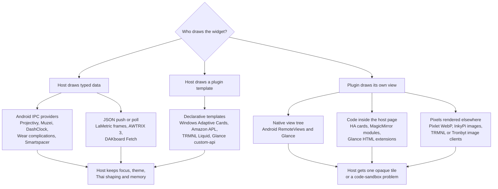
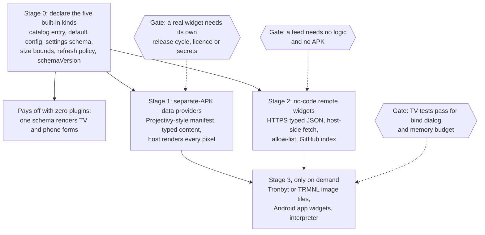
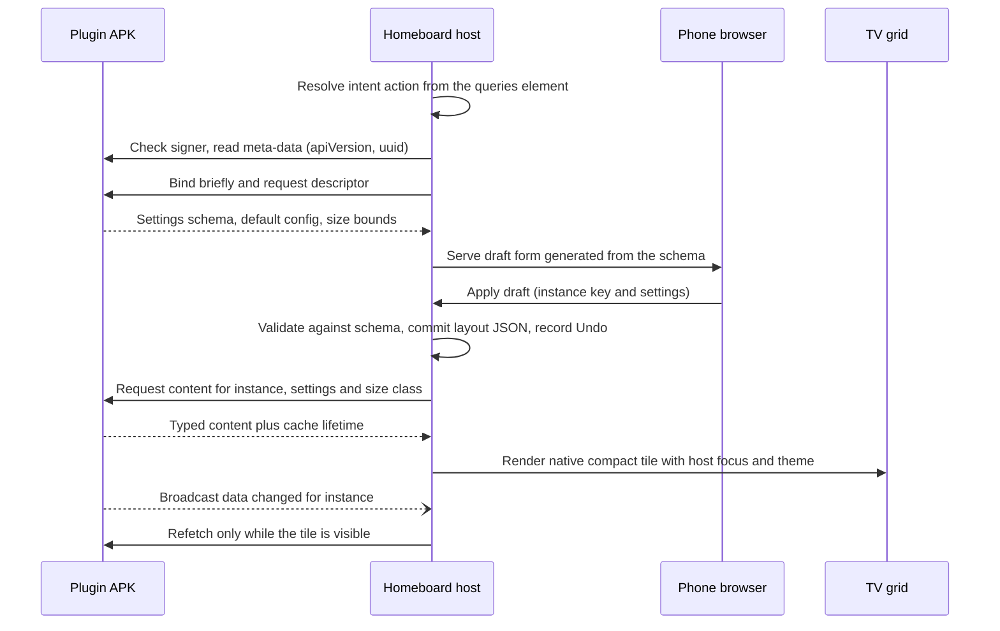

# Prior art solves each piece, never the whole

Yes: every part of Homeboard's design has a mature, documented precedent, but no project combines them, and **nobody ships a third-party widget plugin system for Android TV**. Projectivy's only plugin family is wallpaper, no third-party API was found for Google TV's ambient cards, and ATV Launcher, the one TV launcher that advertises hosting standard Android widgets, is closed source and promises them only "as supported by your device firmware".

The closest analogue for each part is a different project:

- **Paged cell placement:** Android's Launcher3 (Java, Apache‑2.0, with a reorder solver and a grid-migration routine).
- **Keyboard-driven moves and per-resolution layouts:** Homarr.
- **Per-kind metadata, default config, settings schema and size hints:** Home Assistant's card contract.
- **"The screen shows a QR code, the phone edits":** two MagicMirror community modules, MMM‑Config and MMM‑Remote‑Control.
- **Plugins that run as separate APKs and hand the host data to draw:** Projectivy, Muzei and Wear OS complications.

Nothing found matches Homeboard's temporary local server with a draft and transactional Apply/Undo, a D‑pad renderer for any settings schema, or a plugin contract with a separate expanded full-screen payload.

For a 10‑foot D‑pad UI the contract that fits is one where **the host draws** (typed data or a declarative template, never a plugin-drawn view), because only then does Homeboard keep focus, Thai text shaping, theming and memory under its own control. The proposal below is therefore staged: first turn the five compiled-in widget kinds into declared definitions that drive both the TV and phone forms, then open a Projectivy-style "widget data provider" contract for separate APKs, and consider no-code remote widgets or bridges to Tronbyt, TRMNL and Android app widgets only after that. The main risk is not technical: TV plugin ecosystems are tiny (Projectivy's plugin template has 40 stars), and DashClock and Tidbyt show that third-party ecosystems decline when the host stops investing, so each stage has to pay for itself even if no outside author ever arrives.

Researched 2026‑11‑19 as desk research: no code was written and nothing was installed on the TVs. It builds on two earlier investigations, which assessed Home Assistant, MagicMirror², Glance and DAKboard as **dashboards to embed** ([dashboard systems for Homeboard](2026-11-15-dashboard-systems-for-homeboard.md)) and compared launcher foundations ([TV dashboard launcher comparison](2026-11-15-tv-dashboard-launcher-comparison.md)). This report asks a different question: what **design prior art and reusable components** exist for placement, configuration and plugins. The five research notes behind it are linked in each section and listed under [Sources](#sources); they label every claim CONFIRMED (read in source or official docs on 2026‑11‑19) or UNVERIFIED (snippet, forum, press or memory), and this report keeps that label wherever it changes a decision.

## Every Homeboard part has a close cousin, and four have none

The table maps each part of Homeboard to the nearest precedent found, says whether the precedent is code Homeboard could take or only an idea, and names what the precedent lacks. Homeboard's baseline is the paged grid in [HomeLayout.java](../../launcher/app/src/main/java/com/gathin/tvhome/HomeLayout.java), the five kinds in [WidgetKind.java](../../launcher/app/src/main/java/com/gathin/tvhome/WidgetKind.java), the [phone widget editor plan](../plans/2026-11-17-phone-widget-editor.md) and the [Projectivy plugin host plan](../plans/2026-11-16-projectivy-plugin-host.md).

| Homeboard part | Closest analogue | Code or idea | What the analogue lacks |
|---|---|---|---|
| Paged grid with (page, row, column) and span | Launcher3's `favorites` table (screen, cellX, cellY, spanX, spanY) with `ReorderAlgorithm` and `GridSizeMigrationLogic` ([ReorderAlgorithm.java](https://android.googlesource.com/platform/packages/apps/Launcher3/+/refs/heads/main/src/com/android/launcher3/celllayout/ReorderAlgorithm.java)) | Code or port (Apache‑2.0) | Drops items whose minimum span exceeds the new grid; migration is one-way |
| Reflow on density change that never deletes | gridstack.js caches each column count's layout so 12→1→12 restores it ([gridstack-engine.ts](https://raw.githubusercontent.com/gridstack/gridstack.js/HEAD/src/gridstack-engine.ts)); Homarr's "Reset from Base" layouts ([Homarr boards](https://homarr.dev/docs/management/boards/)) | Port the algorithm (MIT, Apache‑2.0) | No paging; web only |
| Hold-OK Move and Resize | Homarr's `placeGridItem`: pin the active item, push collisions, compact the rest ([Homarr layout README](https://github.com/homarr-labs/homarr/blob/HEAD/apps/nextjs/src/components/board/layout/README.md)) | Port (Apache‑2.0) | Implementation not read, only its README description |
| Small, Medium and Large presets | Home Assistant `getGridOptions()`: columns, rows, min and max on a 12‑column grid ([HA custom card](https://contributors.home-assistant.io/frontend/custom-ui/card/)); WidgetKit size families | Idea | — |
| Compact tile plus expanded view | TRMNL's one template per layout size ([TRMNL templates](https://docs.trmnl.com/go/private-plugins/templates)); DashClock's status versus expanded title and body | Idea | No contract defines a separate expanded payload |
| D‑pad nearest-cell focus | Android `FocusFinder` (already in use), Norigin Spatial Navigation core, BBC lrud‑spatial | Port (MIT, Apache‑2.0) | No engine handles a paged grid |
| One JSON document for layout and settings | Grafana's dashboard JSON with an integer `schemaVersion` ([Grafana JSON model](https://grafana.com/docs/grafana/latest/dashboards/build-dashboards/view-dashboard-json-model/)) | Idea | — |
| Per-instance settings | Home Assistant `getConfigForm()` plus `getStubConfig()` ([HA card editor](https://contributors.home-assistant.io/frontend/custom-ui/card-editor/)); TRMNL custom fields; Pixlet `get_schema()` | Idea; renderer code exists (json‑editor, MIT) | No D‑pad renderer for any schema |
| Phone editor reached by QR code | MMM‑Config and MMM‑Remote‑Control ([MMM‑Config](https://github.com/sdetweil/MMM-Config), [MMM‑Remote‑Control](https://github.com/Jopyth/MMM-Remote-Control)) | Code possible (MIT), but JavaScript on Node | No draft, no transactional Apply/Undo, permanent server |
| Undo | Launcher3's solve-on-a-copy then commit, and deferred delete with commit or abort ([ModelWriter.java](https://android.googlesource.com/platform/packages/apps/Launcher3/+/refs/heads/main/src/com/android/launcher3/model/ModelWriter.java)) | Idea | — |
| Separate-APK plugins | Projectivy wallpaper (already hosted), Muzei, Wear OS complications, Smartspacer | Stay compatible; copy the shape | Every Android contract hands settings to a plugin activity or an opaque string |
| Plugin catalogue | HACS default list, Tronbyt apps, TRMNL recipes | Idea | — |

Four things turned up nowhere. **No product pairs a phone to a screen through a QR code that opens a temporary local server with a draft and transactional Apply/Undo**: MMM‑Remote‑Control applies changes live and MMM‑Config keeps one backup file ([web-dashboard notes](2026-11-19-widget-plugin-systems/research-notes/web-dashboard-module-systems.md), [ambient-display notes](2026-11-19-widget-plugin-systems/research-notes/ambient-display-ecosystems.md)). **No surveyed system ships a D‑pad renderer for a settings schema**; AndroidX Preference is the nearest TV-native form, and it renders an XML hierarchy, not a schema ([AndroidX settings](https://developer.android.com/develop/ui/views/components/settings)). **No open-source Android TV launcher hosts Android app widgets**, and no third-party widget API was found for any TV platform: Google TV, Fire TV, Tizen and webOS turned up nothing, and tvOS offers only the Top Shelf content feed ([native-host notes](2026-11-19-widget-plugin-systems/research-notes/native-widget-hosts.md)). **No plugin contract defines a separate full-screen payload**: all treat a click as an intent or deep link. Three whole systems come close to Homeboard's overall shape, and each misses the TV: Home Assistant (cards, a 12‑column sections grid, schema forms and the HACS catalogue, but a web front end bound to a server), MagicMirror² (modules, named regions and the QR editor modules, but a browser plus Node runtime) and TRMNL (plugins, fixed slot sizes, schema forms and 1,282 public recipes, but server-rendered e-ink images from a cloud account).

## Launcher3 and Homarr already solved remote-friendly placement

Grid engines fall into three families ([layout notes](2026-11-19-widget-plugin-systems/research-notes/layout-config-navigation.md)). **Gravity compactors** (react‑grid‑layout, gridstack.js, Grafana) store absolute `{x, y, w, h}` and pull items up to close gaps. **Packers** (Muuri, Packery, CSS Grid `dense`) derive positions from order and size, and CSS warns that dense packing "may cause items to appear out-of-order" ([MDN grid-auto-flow](https://developer.mozilla.org/en-US/docs/Web/CSS/grid-auto-flow)). **Launcher3** stores absolute cells per page, which is Homeboard's model, and it is the only maintained Java implementation: the Android-native grid libraries found (AsymmetricGridView, DynamicGrid, SpannedGridLayoutManager) were last pushed in 2018 and two are archived.

Launcher3's drop solver is the most directly reusable algorithm. `findNearestArea` scans every vacant origin that fits the span, scores by straight-line distance in grid cells, and breaks ties by how well the candidate's direction matches the drag direction. When the target is occupied, `rearrangementExists` tries a push in the drag direction (no displaced item "travels through another item without also displacing that item"), then moving the blockers as a block, then one by one, all on a scratch copy that reverts on failure. If that fails, the solver shrinks the dragged widget "1 in x, then 1 in y" down to its minimum span ([ReorderAlgorithm.java](https://android.googlesource.com/platform/packages/apps/Launcher3/+/refs/heads/main/src/com/android/launcher3/celllayout/ReorderAlgorithm.java)). Its grid migration copies to a temporary table inside one SQLite transaction, places leftovers on new screens, and records the new grid size "so that the migration does not run again"; entries whose minimum span exceeds the new grid are skipped ([GridSizeMigrationLogic.kt](https://android.googlesource.com/platform/packages/apps/Launcher3/+/refs/heads/main/src/com/android/launcher3/model/GridSizeMigrationLogic.kt)). Homeboard's rule that reflow never deletes is already stricter than Launcher3's.

Homarr contributes the piece Launcher3 does not have: a placement rule designed for keys rather than touch. Its README describes `placeGridItem` as "the deterministic keyboard/numeric fallback: the active item is pinned while collisions move out of the way and all other items compact vertically", and the layout core renders children in reading order, which a D‑pad focus order also needs ([Homarr layout README](https://github.com/homarr-labs/homarr/blob/HEAD/apps/nextjs/src/components/board/layout/README.md)). That is exactly what one arrow press during Move should do. Homarr also keeps **several layouts per board**, one per breakpoint: moving an item in one "does not change its coordinates in the others", derived layouts regenerate from Base until edited, and narrowing then re-widening restores the saved arrangement ([Homarr boards](https://homarr.dev/docs/management/boards/)). gridstack.js reaches the same non-destructive return path differently: it caches the layout of each column count before shrinking so that "12 -> 1 -> 12" restores the original, and its `column()` call offers `moveScale`, `list` and `compact` reflow modes ([gridstack API](https://raw.githubusercontent.com/gridstack/gridstack.js/HEAD/doc/API.md)). Homeboard's Auto columns and rows on TVs of different resolutions are the same problem.

Two more ideas transfer cleanly. Home Assistant's sections view is "a grid of 12 columns", rows 56 px high with 8 px gaps, and each card's `getGridOptions()` declares default, minimum and maximum columns and rows; the docs advise multiples of 3 so mixed sizes stay aligned, which maps onto Small, Medium, Large and full width ([HA custom card](https://contributors.home-assistant.io/frontend/custom-ui/card/)). Grafana splits each row or tab into a **Custom** layout (user places panels) or an **Auto grid** (host packs them), and resizing in Auto offers "Switch to custom layout" ([Grafana dynamic dashboards](https://grafana.com/docs/grafana/latest/visualizations/dashboards/build-dashboards/create-dynamic-dashboard/)); that is a legible model for Homeboard's favorites packing around user-placed panels.

| System | What is stored | How size is declared | Rule when the grid or device changes | Pages |
|---|---|---|---|---|
| Homeboard | (page, row, column), span w×h, preset | Small, Medium, Large presets | Reflow, never delete | Yes |
| Launcher3 | screen, cellX, cellY, spanX, spanY; grid size kept separately | minSpanX, minSpanY | One-way migration in a transaction; leftovers to new screens; too-large items skipped | Yes |
| Android app widgets | Host's own choice per widget ID | `targetCellWidth`, `targetCellHeight`, `maxResizeWidth` ([widget layouts](https://developer.android.com/develop/ui/views/appwidgets/layouts)) | Host's problem | Host's choice |
| Home Assistant sections | Card order within sections | `getGridOptions()` columns and rows with min and max, on 12 columns | Optional "dense placement" fills gaps at the cost of order ([HA sections](https://www.home-assistant.io/dashboards/sections/)) | No |
| Grafana | `gridPos {x, y, w, h}`, 24 columns, rows of 30 px, `schemaVersion` | Absolute | Fluid column width only; no density concept | Rows and tabs |
| react‑grid‑layout | One `{i, x, y, w, h}` array per breakpoint | Absolute | Missing breakpoint generated from the nearest larger one ([responsive.ts](https://raw.githubusercontent.com/react-grid-layout/react-grid-layout/HEAD/src/core/responsive.ts)) | No |
| gridstack.js | `{x, y, w, h}` | Absolute | Scale, list or compact, plus a per-column-count cache | No |
| Homarr | `xOffset`, `yOffset`, width, height on 212 × 212 logical tracks | Absolute | Separate layout per breakpoint; Reset from Base | No |
| TRMNL | Slot in a mashup | Full, half vertical, half horizontal, quadrant | Fixed slots; the framework adapts markup per device | Playlist rotation |
| MagicMirror² | Named region such as `top_left` | None; modules stack in config order | Regions resize ([MM module configuration](https://docs.magicmirror.builders/modules/configuration.html)) | No |

None of the web grid libraries ships undo: react‑grid‑layout's contract says "clone before mutating!" and gridstack's `save()` returns plain arrays, which suits snapshot undo but not command undo. Launcher3 gives the two transactional patterns Homeboard's phone editor needs, a scratch solution committed only on drop and deletes that run only after `commitDelete()` ([ModelWriter.java](https://android.googlesource.com/platform/packages/apps/Launcher3/+/refs/heads/main/src/com/android/launcher3/model/ModelWriter.java)), and Grafana keeps **20 saved versions** with diff and restore ([Grafana version history](https://grafana.com/docs/grafana/latest/dashboards/build-dashboards/manage-version-history/)). One gap in Homeboard stands out against all of these: its layout JSON carries no schema version and detects old formats by key presence (for example `has("headerClock")` in [HomeLayout.java](../../launcher/app/src/main/java/com/gathin/tvhome/HomeLayout.java)), which gets fragile once phone drafts, older APKs and third-party settings coexist.

### Focus engines agree on beams but disagree on weights

Every spatial navigation engine surveyed filters candidates to the pressed direction, prefers those overlapping the source on the cross axis (the "beam" or "slice"), and then minimises a weighted distance; they differ in the weights and in whether **containers remember their last-focused child** ([layout notes](2026-11-19-widget-plugin-systems/research-notes/layout-config-navigation.md)). Android's `FocusFinder` uses `13 * major² + minor²`, with the comment "this fudge factor is finely tuned, be sure to run all focus tests if you dare tweak it", and treats horizontal and vertical beams differently by design ([FocusFinder.java](https://android.googlesource.com/platform/frameworks/base/+/refs/heads/main/core/java/android/view/FocusFinder.java)). Amazon's Vega docs say the opposite about weighting, that "distance along the input direction is weighted less heavily" ([Amazon Vega focus management](https://developer.amazon.com/docs/vega/0.24/focus-management.html)), so there is no consensus to copy blindly. On Homeboard's mixed spans, geometry-only scoring means that moving down from a 1×1 tile past a 3×2 widget and back up can land on a different 1×1 than the one you left. The other engines fix this with source memory (`rememberSource`), container memory (`enterTo: last-focused`, `saveLastFocusedChild`) and a minimum overlap before a candidate counts as straight ahead (0.2 in Norigin, 0.5 by default in js‑spatial‑navigation). Because Homeboard's tiles sit on a known cell grid, the same scoring can run in cell space rather than pixels, which makes it deterministic and unit-testable without layout; Spotify built exactly such a "draw a layout, export a JSON navigation tree, test it" tool ([Spotify Engineering](https://engineering.atspotify.com/2023/5/tv-spatial-navigation)). No engine handles focus across pages; all assume scrolling containers.

| Engine | Licence and activity | Candidate scoring | Focus memory and containers | Use for Homeboard |
|---|---|---|---|---|
| Android `FocusFinder` | Apache‑2.0, in the platform | Beam test, then `13 * major² + minor²` | None beyond `nextFocus*` ids and keyboard clusters | Baseline already in use |
| [Norigin Spatial Navigation](https://github.com/NoriginMedia/Norigin-Spatial-Navigation) core | MIT, 498 stars, pushed 2026‑11‑17 | Slice overlap threshold 0.2, slice weight 5, main-axis weight 5; centre, edge or corner distance ([SpatialNavigation.ts](https://raw.githubusercontent.com/NoriginMedia/Norigin-Spatial-Navigation/HEAD/packages/core/src/SpatialNavigation.ts)) | `saveLastFocusedChild`, `preferredChildFocusKey`, focus boundaries | Port the container model |
| [BBC lrud‑spatial](https://github.com/bbc/lrud-spatial) | Apache‑2.0, 68 stars, pushed 2026‑07‑09 | Shortest line from exit edge to entry edge; per-element overlap threshold | Containers with `data-focus` memory | Port the edge-to-edge idea |
| [bbc/lrud](https://github.com/bbc/lrud) | Apache‑2.0, archived 2023 | Tree model with index alignment | Tree nodes | Superseded |
| [js‑spatial‑navigation](https://github.com/luke-chang/js-spatial-navigation) | MPL‑2.0, 432 stars, pushed 2024‑05‑23 | Straight-overlap threshold 0.5 by default | Sections with `enterTo`, `restrict`, `rememberSource` | Idea; copied files would stay MPL |
| [Enact Spotlight](https://github.com/enactjs/enact) (LG webOS) | Apache‑2.0, pushed 2026‑11‑19 | Fork of js‑spatial‑navigation | As above | Idea |
| [WICG spatial navigation](https://github.com/WICG/spatial-navigation) | W3C licence, archived | CSS `--spatial-navigation-*` properties | `--spatial-navigation-contain` | Idea |
| Spotify (write-up) | Not open source | Navigation tree, lowest common ancestor | `NavContainer` with cycle option | JSON test-tree idea |

## One declared schema can drive the TV form and the phone form

The strongest configuration pattern in the web dashboards is **one declarative schema per widget kind that the host renders as a form** ([web-dashboard notes](2026-11-19-widget-plugin-systems/research-notes/web-dashboard-module-systems.md)). Home Assistant splits it into four small pieces that map one-to-one onto Homeboard's add, configure and resize flows: a picker entry (`window.customCards` with name, description and a live-preview flag), a default instance (`getStubConfig()`), a form schema (`getConfigForm()` returning fields with a `selector`, `required`, `default` and conditional visibility) and size hints (`getGridOptions()`). Its `assertConfig` hook throws when the form cannot represent the saved config, which disables the visual editor and falls back to raw YAML until the error clears ([HA card editor](https://contributors.home-assistant.io/frontend/custom-ui/card-editor/)); that is a ready escape hatch for Homeboard's phone editor. Grafana's panel options builder (`addTextInput`, `addBooleanSwitch`, `addRadio` with `showIf`) and Homarr's `optionsBuilder` are code-builder versions of the same idea ([Grafana panel template](https://github.com/grafana/plugin-tools/blob/HEAD/packages/create-plugin/templates/panel/src/module.ts), [Homarr definition.ts](https://github.com/homarr-labs/homarr/blob/HEAD/packages/widgets/src/definition.ts)).

The ambient-display products show how small a TV-sized vocabulary can be ([ambient-display notes](2026-11-19-widget-plugin-systems/research-notes/ambient-display-ecosystems.md)). TRMNL plugin settings are a YAML list where only `keyname`, `name` and `field_type` are required, with about 19 field types chosen "to leverage native browser validations", conditional visibility through `conditional_validation`, and per-locale labels through `description-LOCALE` keys ([TRMNL form builder](https://help.trmnl.com/en/articles/10513740-custom-plugin-form-builder)), which is one ready way to carry Thai and English. Tidbyt's Pixlet stamps `version = "1"` on a schema of 11 field types, including "dynamic fields" whose options come from a handler "called with user inputs"; the Tidbyt phone app renders the form, stores the values in Tidbyt's database and passes them to the app's `config` at every render ([Pixlet schema](https://github.com/tidbyt/pixlet/blob/main/docs/schema/schema.md)). That is precisely the "platform renders a form for code it did not write" loop a plugin system needs.

Every format surveyed is a flat or shallow list of typed fields, so a common denominator exists: `{key, type, label, description, default, required, options, min, max, regex, visibleIf}` ([layout notes](2026-11-19-widget-plugin-systems/research-notes/layout-config-navigation.md)). JSON Schema is the only candidate with maintained validators on both sides: ajv in JavaScript, and on the JVM networknt (Apache‑2.0, Jackson-based), json‑sKema (MIT, draft 2020‑12) or everit (Apache‑2.0, now "in maintenance mode"), though their size and fit on Android were not measured ([networknt](https://raw.githubusercontent.com/networknt/json-schema-validator/HEAD/README.md), [json‑sKema](https://raw.githubusercontent.com/erosb/json-sKema/HEAD/README.md), [everit](https://raw.githubusercontent.com/everit-org/json-schema/HEAD/README.md)). For a phone page served by the TV without a build step, **json‑editor is the only maintained, MIT, dependency-free renderer** found, but it supports only drafts 3 and 4 ([json‑editor](https://raw.githubusercontent.com/json-editor/json-editor/HEAD/README.md)), so conditional fields would need a small custom grammar like Home Assistant's `HaFormFieldCondition` ([ha-form types.ts](https://raw.githubusercontent.com/home-assistant/frontend/dev/src/components/ha-form/types.ts)). For saved settings, Home Assistant's config-entry rule is directly reusable: a minor version only adds keys that older code can ignore, a major version needs a migrate function, and "an entry with a newer major version than your config flow fails to set up" ([HA config entries](https://developers.home-assistant.io/docs/config_entries_index)).

This matters for Homeboard today, before any plugin exists. Each kind has a hand-written Java settings class (`RainSettings`, `CalendarWidgetSettings`, `WorldClockSettings`) in a separate map of the layout JSON, and step 3 of the phone editor plan reads "Build phone forms for every existing widget instance", beside a "typed validator" ([phone widget editor plan](../plans/2026-11-17-phone-widget-editor.md)). A declared schema per kind would generate both the phone form and a D‑pad form on the TV, and make the validator generic. Secrets are the hard case: TRMNL has `password` fields and Pixlet has OAuth2 fields, and Tronbyt lost apps "relying on Tidbyt's cloud services for secrets" when it went local ([tronbyt/server](https://github.com/tronbyt/server)).

| Format | Field vocabulary | Conditions | Validation | Labels in Thai and English | Renderer available | Fit |
|---|---|---|---|---|---|---|
| JSON Schema plus a UI schema | Open-ended types, `enum`, `minimum`, `pattern`; layout in a separate UI schema ([JSON Forms](https://jsonforms.io/docs/uischema/)) | `if`/`then` in later drafts | ajv (JS); networknt, json‑sKema, everit (JVM) | Not built in | json‑editor (MIT, drafts 3 and 4); JSON Forms and rjsf need React | Best data contract; restrict to a subset |
| Home Assistant `ha-form` | About 44 selectors plus primitive types; grid and expandable groups ([HA selectors](https://www.home-assistant.io/docs/blueprint/selectors/)) | And, Or, Not conditions | `assertConfig` | Via HA translations | Lit, Apache‑2.0 | Best design reference |
| Grafana options builder | Text, boolean, radio, select, number, field picker | `showIf` | In code | Not built in | React, Apache‑2.0 tooling | Idea only |
| TRMNL custom fields (YAML) | About 19 types incl. `select`, `xhrSelect`, `time_zone`, `lat_lon`, `password` | `conditional_validation` | HTML5 input validation | `description-LOCALE` | TRMNL's own web UI | Good vocabulary |
| Pixlet `get_schema()` | 11 types incl. Location, Typeahead, OAuth2, Generated | Dynamic handlers | Not documented | Not built in | Tidbyt app, Tronbyt web UI | Good vocabulary; versioned |
| MagicMirror `config.schema.json` | JSON Schema keywords as "editor hints, not full JSON Schema validation" ([MMM‑Remote‑Control](https://github.com/Jopyth/MMM-Remote-Control)) | None | None | No | MMM‑Remote‑Control, MMM‑Config | Shows a lightweight path |
| LaMetric parameters | `data_type` bool, int, string; `format` regex; `required` ([LaMetric device apps](https://lametric-documentation.readthedocs.io/en/latest/reference-docs/device-apps.html)) | None | Regex | No | LaMetric app | Minimal |
| Adaptive Cards inputs | `Input.Text`, `Number`, `Date`, `Time`, `ChoiceSet`, `Toggle` | None | `isRequired`, `min`, `max`, `regex`, `errorMessage` ([input validation](https://learn.microsoft.com/en-us/adaptive-cards/authoring-cards/input-validation)) | Per card | JS; Android renderer under a separate EULA | Idea |
| AndroidX Preference | XML or code hierarchy, saved to SharedPreferences | Dependencies | In code | Android resources | Native; TV fragments in Leanback (status UNVERIFIED) | Nearest TV-native form, not a schema |
| InkyPi `settings.html` | Free HTML; input `name` attributes become keys ([InkyPi plugins](https://github.com/fatihak/InkyPi/blob/main/docs/building_plugins.md)) | Author's own | None | Author's own | Browser only | Cheapest; no TV rendering |

## MagicMirror's QR modules are the phone editor's only close relatives

MagicMirror's community reached Homeboard's idea independently. **MMM‑Remote‑Control** (MIT, 604 stars, pushed 2026‑11‑12) puts a QR code on the mirror "for instant mobile connection", serves a mobile web UI and a REST API with an optional `apiKey`, and reads an optional `config.schema.json` beside each module to render typed controls; the mirror must be opened to the LAN with `address` and `ipWhitelist` ([MMM‑Remote‑Control](https://github.com/Jopyth/MMM-Remote-Control)). **MMM‑Config** (MIT, 57 stars) shows a QR code, serves "a dynamically built form, based on modules installed … and the contents of the config.js" at `/configure`, regenerates the form only when the config or modules change, and on submit writes a new `config.js` "AFTER renaming the current config.js out of the way" ([MMM‑Config](https://github.com/sdetweil/MMM-Config)). The browser editors of Home Assistant, Grafana, Homarr, Dashy and openHAB use network accounts, and none shows a pairing QR code on the display as a core feature (an absence finding, not a confirmed statement).

The ambient devices split into vendor-cloud pairing and always-on local web UIs ([ambient-display notes](2026-11-19-widget-plugin-systems/research-notes/ambient-display-ecosystems.md)). Mango Display on Android TV shows a device code that the user types into a cloud account in any browser ([Mango Display: add a display](https://help.mangodisplay.com/en/articles/6134019-add-a-display-android-tv-android-tv-stick-android-tablet)); Google's Photos Ambient API uses the OAuth device flow for TVs ([Photos Ambient API](https://developers.google.com/photos/ambient/guides/about?hl=en)). Tronbyt serves its web app on port 8000 and lists "the lack of a mobile app" among its drawbacks ([tronbyt/server](https://github.com/tronbyt/server)); InkyPi is configured "from any device on your network" ([InkyPi](https://github.com/fatihak/InkyPi)); AWTRIX NG has "a full web UI on the device" ([awtrix‑ng](https://github.com/Blueforcer/awtrix-ng)). The nearest thing to a draft preview is TRMNL's rendered preview image and Tronbyt's "Save to see the app preview". Homeboard's design is stronger on both axes that matter: the temporary server avoids the permanent LAN exposure that forces MMM‑Remote‑Control's `ipWhitelist`, and the draft with transactional Apply and composite Undo has no counterpart. Chromecast setup, YouTube's "link with TV code" and Fully Kiosk's remote admin were not researched and may be closer analogues.

## Plugin contracts split on who draws the pixels

Across Android, web dashboards and ambient devices, every plugin contract answers one question first: who draws? ([native-host notes](2026-11-19-widget-plugin-systems/research-notes/native-widget-hosts.md), [plugin-runtime notes](2026-11-19-widget-plugin-systems/research-notes/plugin-runtimes-and-policy.md))



**Host draws typed data.** Projectivy, Muzei, DashClock, Wear OS complications and Smartspacer share one Android shape: an exported service or content provider declares a well-known intent action, is protected by a permission, carries its name, protocol version and settings activity in manifest `<meta-data>`, and returns typed data the host renders. Projectivy's AIDL interface is three methods, `getWallpapers(Event)`, `getPreferences()` and `setPreferences(String)`; the manifest declares `apiVersion`, a UUID, `itemsCacheDurationMillis` and an `updateMode` bitmask that includes `CARD_FOCUSED`, the only TV contract found that feeds D‑pad focus to a plugin ([Projectivy plugin README](https://github.com/spocky/projectivy-plugin-wallpaper-provider/blob/main/README.md)). Muzei lets the host own scheduling ("Muzei controls how often the artwork changes") ([MuzeiArtProvider.kt](https://github.com/muzei/muzei/blob/main/muzei-api/src/main/java/com/google/android/apps/muzei/api/provider/MuzeiArtProvider.kt)). Wear OS publishes the only **closed, typed vocabulary** (`SHORT_TEXT`, `LONG_TEXT`, `RANGED_VALUE`, `SMALL_IMAGE` and others) that hosts of many shapes can render, and only the system can bind a provider ([complications](https://developer.android.com/training/wearables/complications/exposing-data)). Smartspacer passes a per-instance `smartspacerId`, which Homeboard needs so one plugin can run twice with different settings, as `widget:rain:1` and `widget:rain:2` do today ([Smartspacer SDK](https://github.com/KieronQuinn/Smartspacer/wiki/3.-SDK:-Creating-a-Target)). Outside Android, LaMetric indicator apps send frames such as `{"frames":[{"icon":3219,"text":"2"}]}` ([LaMetric](https://lametric-documentation.readthedocs.io/en/latest/guides/first-steps/first-lametric-indicator-app.html)) and DAKboard's Fetch block takes JSON with a required `value` and optional `title` and `subtitle` ([DAKboard fetch](https://dakboard.freshdesk.com/support/solutions/articles/35000062047-external-data-fetch-formatting-options)).

**Host draws a plugin template.** Windows widget providers send an Adaptive Card template plus data, declare `small`, `medium` and `large` sizes with `AllowMultiple` in the package manifest, and may return a different template when the size changes ([Windows widget providers](https://learn.microsoft.com/en-us/windows/apps/develop/widgets/widget-providers), [C# provider](https://learn.microsoft.com/en-us/windows/apps/develop/widgets/implement-widget-provider-cs)). TRMNL makes authors write one Liquid template per slot (full, half horizontal, half vertical, quadrant), and public plugins "must provide HTML for all available markup layouts" ([TRMNL docs](https://docs.trmnl.com/go/llms-full.txt)). Glance's extension protocol is today an HTTP response with `Widget-Title` and `Widget-Content-Type` headers whose HTML renders only with `allow-potentially-dangerous-html: true`, but its stated long-term goal is generic JSON content types rendered by Glance's own styles ([Glance extensions](https://github.com/glanceapp/glance/blob/main/docs/extensions.md)), which would move it into the typed-data camp.

**Plugin draws its own view.** Android app widgets ship `RemoteViews` limited to a whitelist of nine layouts and about a dozen widgets, "Descendants of these classes are not supported" ([RemoteViews](https://developer.android.com/reference/android/widget/RemoteViews)), designed for touch with click `PendingIntent`s and no promised focus behaviour. Home Assistant cards are custom elements that receive the `hass` object, whose `callApi` and `fetchWithAuth` run "with the access token of the user" ([hass object](https://developers.home-assistant.io/docs/frontend/data/)). MagicMirror's `node_helper` runs as Node.js with the user's privileges, one instance per module type ([MM node helper](https://docs.magicmirror.builders/module-development/node-helper.html)). Only the first two camps let the host guarantee focus rings, overscan-safe sizing, font scale and Thai shaping on a D‑pad TV; in the third, the realistic option is to treat each plugin view as one focusable tile.

| Contract | Who draws | Payload | Discovery | Per-instance id | Settings | Refresh | Status |
|---|---|---|---|---|---|---|---|
| [Projectivy wallpaper](https://github.com/spocky/projectivy-plugin-wallpaper-provider) | Host | `Wallpaper` parcels | Intent action plus meta-data | No (UUID per plugin) | Plugin activity plus opaque string | Host cache, event mask, broadcast | Active; hosted by Homeboard |
| [Muzei](https://github.com/muzei/muzei) | Host | `Artwork` rows | Content provider plus action | No | Plugin activity | Host-scheduled | Active |
| [DashClock](https://github.com/romannurik/dashclock) | Host | Fixed schema: status 32, title 100, body 1000 characters | Action plus permission | No | Plugin activity | About hourly, screen-on | Dead since 2017 |
| [Wear OS complications](https://developer.android.com/training/wearables/complications/exposing-data) | Host | Typed `ComplicationData` | Action plus system-only bind permission | Yes | Plugin config activity | Period, push, timeline | Active |
| [Smartspacer](https://github.com/KieronQuinn/Smartspacer) | Host | `SmartspaceTarget` | Content provider plus permission | Yes | Plugin config | Plugin-notified | Active |
| LaMetric indicator | Host | JSON frames | Developer portal | Yes ("widgets") | Typed parameters | Local push or poll | Active |
| DAKboard Fetch | Host | JSON `value`, `title`, `subtitle` | URL in a block | Per block | Web options | Schedule tab | Active |
| Windows Widgets | Host | Adaptive Card template plus data | Package extension | Yes | Customization interface | Push | Active |
| Amazon APL widgets | Host (APL runtime) | APL document plus data store | Alexa skill | Yes | Skill | Data Store API | Echo Show only |
| TRMNL plugins | Host server | Liquid template per slot | Account install | Yes | YAML custom fields | Poll, webhook, 15 minutes to daily | Active |
| Apple WidgetKit | System | SwiftUI view per timeline entry | App extension | Yes | App Intents (UNVERIFIED) | Timeline, reload policy, relevance score | Active; not on tvOS |
| Android app widgets | Plugin | `RemoteViews` | `AppWidgetManager` | Yes | Provider configure activity | At most every 30 minutes, or push | Active; TV support optional |
| HA custom cards | Plugin | Custom element | Dashboard resource | Per card | `getConfigForm` schema | Host pushes state | Active |
| MagicMirror modules | Plugin | DOM plus Node helper | Folder in `modules/` | `identifier` | `config.js` | Module's own timers | Active |
| Pixlet / Tronbyt | Plugin (off-device) | WebP image | Community repo | Per installation | `get_schema()` | Server rotation | Active (Tronbyt) |

### Separate APKs are the policy-simplest route on Play

The runtime notes identify six execution models ([plugin-runtime notes](2026-11-19-widget-plugin-systems/research-notes/plugin-runtimes-and-policy.md)). Google Play rules out one of them outright: an app "may not download executable code (such as dex, JAR, .so files) from a source other than Google Play", with an exemption for "code that runs in a virtual machine or an interpreter where either provides indirect access to Android APIs (such as JavaScript in a webview or browser)". The same page makes the host answerable for that code, which "must not allow potential violations of Google Play policies" ([Device and Network Abuse](https://support.google.com/googleplay/android-developer/answer/9888379)). A host that installed plugin APKs itself would need `REQUEST_INSTALL_PACKAGES`, whose permitted uses do not include launchers ([REQUEST_INSTALL_PACKAGES](https://support.google.com/googleplay/android-developer/answer/12085295)). Plugin APKs on Play are separate listings under their own review, which Projectivy already does with its Overflight plugin ([Projectivy on Play](https://play.google.com/store/apps/details?id=com.spocky.projengmenu)). Discovery needs no sensitive permission: the host declares a `<queries>` intent with "exactly one `<action>` element" ([package visibility](https://developer.android.com/training/package-visibility/declaring)), and the plugin sees the host automatically once bound ([automatic visibility](https://developer.android.com/training/package-visibility/automatic)).

Memory is the TV-specific constraint. On 1 GB low-RAM TV devices "the maximum total memory … must not exceed … 280 MB", with 200 MB strongly recommended, and those limits "assume the app has no active bindings" ([TV memory](https://developer.android.com/training/tv/playback/memory)); each bound plugin is a separate process that eats into the device total, so the host should bind briefly and cache, as Projectivy does. WebView adds a renderer process whose memory "is accounted for separately", shared by all of an app's WebViews, and Google's own lab sample saw it jump to about 55 MB on a phone, not a TV ([WebView and memory](https://developer.android.com/topic/performance/memory/guide/webview-memory)). For embedded interpreters, QuickJS is MIT with "367 KiB of x86 code for a simple hello world" ([QuickJS](https://bellard.org/quickjs/)), but Cash App's Zipline, which embeds it, warns that it "does not offer a sandbox or process-isolation and should not be used to execute untrusted code" ([Zipline](https://github.com/cashapp/zipline)). Figma's history is the cautionary tale: its in-engine Realms sandbox was escaped in 2019, it froze plugin updates because "plugin code in Figma is live", moved to QuickJS compiled to WebAssembly in about 11 days, and stated that "we do not rely on human reviews to audit newly-published plugins for security" ([Figma plugin security](https://www.figma.com/blog/an-update-on-plugin-security/)).

| Model | Example | Play status | TV memory cost | D‑pad fit | What a malicious widget could do |
|---|---|---|---|---|---|
| 1. Separate APK over IPC, host renders | Projectivy, Muzei, Wear | Allowed; each plugin reviewed by Play | One process per bound plugin | Host-controlled | Use its own permissions and network; send misleading content; stall IPC |
| 2. Separate APK supplying `RemoteViews` | Android app widgets | Allowed; bind needs user consent | Provider process plus inflated views | Touch-first; one tile at best | Same, plus launch activities on click |
| 3. Embedded interpreter | Tasker JS, Figma (QuickJS) | Allowed with indirect API access; host liable | Engine in host process (unmeasured on TV) | Host-controlled if the host renders | Abuse granted capabilities; loop or exhaust memory; exploit engine bugs |
| 4. WebView HTML and JS | HA Companion, Tasker scenes | Allowed; no JS bridge to untrusted URLs | Shared renderer, about 55 MB on a phone | Focus handoff undocumented | Track the household; abuse any bridge; starve other web widgets |
| 5. Declarative template or JSON | TRMNL, Glance custom-api, LaMetric | Allowed; no code | Minimal | Host-controlled | Track via data URLs; push offensive content |
| 6. Downloaded dex or split APK | — | Forbidden from outside Play | — | — | Anything the host can do |

Hosting ordinary Android app widgets is the riskiest bridge. The CDD makes support conditional ("If device implementations support third-party app widgets, they … MUST declare … `android.software.app_widgets`") ([Android 16 CDD](https://source.android.com/docs/compatibility/16/android-16-cdd)), the TV hardware docs say nothing either way, and the only evidence about the bind dialog on TV is a 2018 Stack Overflow answer saying `ACTION_APPWIDGET_PICK` and `ACTION_APPWIDGET_BIND` "are not available in AndroidTV" (UNVERIFIED, stale) ([SO 50968434](https://stackoverflow.com/questions/50968434)). ATV Launcher's support is known only from press ([Android Authority](https://www.androidauthority.com/atv-launcher-v0-1-41-update-3715420/)), and a provider's configure activity would run as its own UI on the TV, outside Homeboard's phone draft.

### Android TV has no widget ecosystem to join, only neighbours to bridge

Since no TV widget ecosystem exists, "be compatible with" means choosing which neighbouring contracts are cheap to speak. Projectivy wallpaper is done; the rest are optional bridges, each with a blocker.

| Ecosystem | Contract Homeboard would speak | What Homeboard would get | Blocker |
|---|---|---|---|
| Projectivy wallpaper | AIDL v1, already hosted | Wallpaper plugins such as Overflight and a weather-panel wallpaper ([projectivy-weather-wallpaper](https://github.com/shortusername/projectivy-weather-wallpaper)) | None; keep the pinned v1 contract |
| Muzei art providers | Content provider plus intent action | A second, larger wallpaper ecosystem (4,969 stars, active) | Use on Android TV UNVERIFIED |
| Android app widgets | `AppWidgetHost` ([host guide](https://developer.android.com/develop/ui/views/appwidgets/host)) | Any installed app's widget, as one focusable tile | Bind dialog and `app_widgets` feature unverified on Google TV; touch-first layouts |
| Tronbyt and Pixlet | Pull WebP from `/next`, loop for `Tronbyt-Dwell-Secs` ([tronbyt/server](https://github.com/tronbyt/server)) | 1,132 community apps ([tronbyt/apps](https://github.com/tronbyt/apps)) | Needs a LAN Tronbyt server; 64×32 or 128×64 pixel art |
| TRMNL as an image client | BYOS display API, as [trmnl‑android](https://github.com/usetrmnl/trmnl-android) does | 1,282 public recipes ([recipes.json](https://trmnl.com/recipes.json?sort-by=install)) | TRMNL account or self-hosted server; 800×480 1- or 2‑bit e-ink design |
| TRMNL recipes rendered locally | Liquid plus the MIT TRMNL framework CSS | Per-slot templates that map onto tile sizes | Markup needs an authenticated API; recipe licences unstated; Java Liquid engine not checked |
| Home Assistant cards | WebView over an HA frontend | 1,182 HACS dashboard plugins | Covered in the [earlier report](2026-11-15-dashboard-systems-for-homeboard.md); needs an HA server; cards run with the user's full token |
| MagicMirror, AWTRIX, InkyPi | — | — | Browser plus Node runtime; non-commercial or GPL‑3.0 licences |

Distribution prior art converges on one shape for small projects: a GitHub index that authors join by pull request, with automated checks. HACS admits only the owner or a major contributor, requires a full GitHub release and an "OSI-approved licence GitHub can identify", rejects archived repos, and warns that "new additions still take months to be reviewed"; it now holds 1,182 dashboard plugins and ships inside Home Assistant 2026.11 as the Marketplace ([HACS include](https://hacs.xyz/docs/publish/include/), [HACS Marketplace](https://hacs.xyz/docs/marketplace/)). TRMNL separates **install** ("Installed recipes receive automatic updates") from **fork** ("do not receive any updates from the original creator"), and its review agent renders every layout, orientation and option before a human approves ([TRMNL plugin recipes](https://help.trmnl.com/en/articles/10122094-plugin-recipes)). MagicMirror's catalogue of 1,527 modules shows the long-tail cost: about 46% have no commit since 2023 ([modules.json](https://modules.magicmirror.builders/data/modules.json)). Tidbyt shows the steward risk: after it joined Modal, merging community PRs slowed sharply (one merged on 2026‑06‑20, 62 open on 2026‑11‑19), and the Tronbyt hard fork now holds 1,132 apps against the original's 888 ([tidbyt/community commits](https://github.com/tidbyt/community/commits/main), [tronbyt/apps](https://github.com/tronbyt/apps)).

## Licences decide what is code and what is only an idea

Homeboard is MIT. Apache‑2.0 code can ship inside it if Homeboard includes the licence, marks modified files, keeps the notices and carries any NOTICE file forward; those files stay Apache‑2.0 ([Apache License 2.0](https://www.apache.org/licenses/LICENSE-2.0.txt)). MPL‑2.0 is "file-level" copyleft that still lets others "combine your code with code under other licenses" ([MPL 2.0 FAQ](https://www.mozilla.org/en-US/MPL/2.0/FAQ/)). GPL‑3.0 and AGPL‑3.0 code would pull the combined app under those licences, non-commercial licences are incompatible outright, and a repo with no licence is all rights reserved. This is general licence reasoning, not legal advice. Star counts and push dates come from the GitHub API on 2026‑11‑19, as recorded in the notes.

| Project | Licence | Stars | Last push | Treatment |
|---|---|---|---|---|
| [Launcher3 (AOSP)](https://android.googlesource.com/platform/packages/apps/Launcher3/) | Apache‑2.0 (file headers) | n/a | `main` | Reuse code or port: reorder, migration, deferred delete |
| [spocky/projectivy‑plugin‑wallpaper‑provider](https://github.com/spocky/projectivy-plugin-wallpaper-provider) | Apache‑2.0 | 40 | 2026‑04‑28 | Reuse; already a dependency |
| [muzei/muzei](https://github.com/muzei/muzei) | Apache‑2.0 | 4,969 | 2026‑11‑13 | Reuse API module; copy contract shape |
| [KieronQuinn/Smartspacer](https://github.com/KieronQuinn/Smartspacer) | GPL‑3.0 app, Apache‑2.0 SDK | 3,603 | 2026‑11‑06 | SDK only; app is ideas only |
| [farmerbb/Taskbar](https://github.com/farmerbb/Taskbar) | Apache‑2.0 | 1,303 | 2024‑11‑21 | Reuse `AppWidgetHost` wrapper if ever needed |
| [romannurik/dashclock](https://github.com/romannurik/dashclock) | Apache‑2.0 | 484 | 2017‑05‑22 | Idea; deprecated |
| [react‑grid‑layout](https://github.com/react-grid-layout/react-grid-layout) | MIT | 22,496 | 2026‑11‑19 | Reuse `core` in the phone preview |
| [gridstack.js](https://github.com/gridstack/gridstack.js) | MIT | 9,258 | 2026‑11‑17 | Reuse on phone; port the column cache |
| [homarr‑labs/homarr](https://github.com/homarr-labs/homarr) | Apache‑2.0 | 5,404 | 2026‑11‑19 | Port `placeGridItem` with attribution |
| [home‑assistant/frontend](https://github.com/home-assistant/frontend) | Apache‑2.0 | 5,811 | 2026‑11‑19 | Idea (Lit and TypeScript); code allowed with notice |
| [MagicMirrorOrg/MagicMirror](https://github.com/MagicMirrorOrg/MagicMirror) | MIT | 24,230 | 2026‑11‑18 | Idea |
| [Jopyth/MMM‑Remote‑Control](https://github.com/Jopyth/MMM-Remote-Control) | MIT | 604 | 2026‑11‑12 | Idea; code allowed |
| [sdetweil/MMM‑Config](https://github.com/sdetweil/MMM-Config) | MIT | 57 | 2026‑09‑25 | Idea; code allowed |
| [NoriginMedia/Norigin‑Spatial‑Navigation](https://github.com/NoriginMedia/Norigin-Spatial-Navigation) | MIT | 498 | 2026‑11‑17 | Port the core |
| [bbc/lrud‑spatial](https://github.com/bbc/lrud-spatial) | Apache‑2.0 | 68 | 2026‑07‑09 | Port |
| [luke‑chang/js‑spatial‑navigation](https://github.com/luke-chang/js-spatial-navigation) | MPL‑2.0 | 432 | 2024‑05‑23 | Idea; copied files stay MPL |
| [json‑editor/json‑editor](https://github.com/json-editor/json-editor) | MIT | 4,904 | 2026‑10‑30 | Reuse on the phone page |
| [networknt/json‑schema‑validator](https://github.com/networknt/json-schema-validator) | Apache‑2.0 | 1,089 | 2026‑11‑09 | Candidate TV validator (Android fit unverified) |
| [erosb/json‑sKema](https://github.com/erosb/json-sKema) | MIT | 84 | 2026‑11‑13 | Candidate TV validator (Android fit unverified) |
| [tidbyt/pixlet](https://github.com/tidbyt/pixlet) | Apache‑2.0 | 848 | 2026‑11‑18 | Idea (schema); Go, not embeddable |
| [tronbyt/server](https://github.com/tronbyt/server) | Apache‑2.0 | 230 | 2026‑11‑16 | Speak its client contract |
| [usetrmnl/trmnl‑android](https://github.com/usetrmnl/trmnl-android) | MIT | 91 | 2026‑11‑05 | Reuse if an image-client bridge is built |
| [usetrmnl/larapaper](https://github.com/usetrmnl/larapaper) | MIT | 459 | 2026‑11‑19 | Idea (recipe hosting) |
| [microsoft/AdaptiveCards](https://github.com/microsoft/AdaptiveCards) | MIT repo; Android renderer under a separate EULA | 1,975 | 2026‑11‑18 | Idea; read the EULA before bundling |
| [quickjs‑ng/quickjs](https://github.com/quickjs-ng/quickjs) | MIT | 4,183 | 2026‑11‑19 | Only if an interpreter stage happens |
| [cashapp/zipline](https://github.com/cashapp/zipline) | Apache‑2.0 | 2,320 | 2026‑11‑18 | Idea: signed manifests; no sandbox |
| [grafana/grafana](https://github.com/grafana/grafana) | AGPL‑3.0 | 77,988 | 2026‑11‑19 | Concepts only (`gridPos`, `schemaVersion`) |
| [glanceapp/glance](https://github.com/glanceapp/glance) | AGPL‑3.0 | 38,306 | 2026‑11‑07 | Concepts only |
| [gethomepage/homepage](https://github.com/gethomepage/homepage) | GPL‑3.0 | 33,734 | 2026‑11‑19 | Concepts only |
| [MM2‑0/Kvaesitso](https://github.com/MM2-0/Kvaesitso) | GPL‑3.0 | 5,402 | 2026‑11‑13 | Concepts only |
| [FossifyOrg/Launcher](https://github.com/FossifyOrg/Launcher) | GPL‑3.0 | 739 | 2026‑11‑18 | Concepts only |
| [leanbitlab‑org/LtvLauncher](https://github.com/leanbitlab-org/LtvLauncher) | GPL‑3.0 | 481 | 2026‑11‑19 | Concepts only |
| [fatihak/InkyPi](https://github.com/fatihak/InkyPi) | GPL‑3.0 | 4,285 | 2026‑11‑04 | Concepts only |
| [openhab/openhab‑webui](https://github.com/openhab/openhab-webui) | EPL‑2.0 | 258 | 2026‑11‑18 | Concepts only |
| [Blueforcer/awtrix3](https://github.com/Blueforcer/awtrix3) | CC BY‑NC‑SA 4.0 | 2,344 | 2026‑09‑20 | API shape only; discontinued |
| [Klevico/Monet‑Launcher](https://github.com/Klevico/Monet-Launcher) | None | 334 | 2026‑11‑13 | Nothing reusable |
| [tsynik/LeanbackLauncher](https://github.com/tsynik/LeanbackLauncher) | None detected | 690 | 2026‑02‑07 | Nothing reusable |

## Recommendation: a staged plugin contract where the host draws

This is a proposal for discussion, not a decision. Under the house workflow, any stage that is approved needs its own plan with mockups and diagrams before implementation. The direction is to copy the **typed-data, host-renders** shape that Projectivy, Muzei and Wear OS already prove on Android, add the **declared settings schema** that only the web and ambient systems have, and treat every plugin-drawn route as an optional bridge. Each stage has to pay off on its own.



**Stage 0: declare the built-in kinds.** Turn each `WidgetKind` into a definition record modelled on Home Assistant's four pieces plus Homarr's runtime fields: a catalog entry (English and Thai name, description, preview), a default instance, a settings schema, size bounds (default, minimum and maximum span, with Small, Medium and Large as named points inside them, as `getGridOptions()` does), and a refresh policy (cache lifetime, pause when off-page, as Homarr's `deferUntilVisible` and MagicMirror's `suspend()` do, and a shared provider keyed by inputs, so two rain tiles for the same place fetch once). Store per-instance settings in one generic map validated against the schema, and add an integer `schemaVersion` with Home Assistant's major/minor rule. The phone editor renders forms from the schema, through json‑editor or a small custom renderer; the TV renders the same schema with D‑pad controls (toggle, list picker, stepper, and "edit on phone" for free text). In the same stage, re-implement Launcher3's `findNearestArea` and Homarr's pin-push-compact rule for Move, cache the authored layout per grid size for a lossless return path (gridstack's idea), and score focus in cell space with per-region memory. This stage benefits Homeboard even if no plugin ever ships, because it replaces two hand-built forms per kind with one declaration.

**Stage 1: separate-APK widget data providers.** Open a Homeboard-namespaced intent action (name to be decided) whose manifest copies Projectivy's metadata (`apiVersion`, UUID, name, cache duration) and update broadcast, Muzei's host-owned scheduling, Smartspacer's per-instance id and Wear's closed vocabulary. The plugin supplies the Stage 0 descriptor, so its settings render in Homeboard's phone draft rather than in a plugin activity; a plugin activity stays available only as an escape hatch, for example for an OAuth login. A starting vocabulary could be `metric` (value, unit, status colour, trend), `series` (sparkline or forecast), `list` (events or items), `text` (title and body, like DashClock), `image` (with Projectivy-style display modes) and `ranged` (progress, like `RANGED_VALUE`). Air quality maps onto `metric` plus `series`, rain onto `series` and the Thai calendar onto `list`, while favorites and world clocks stay host-native. Content can vary by size class, including an `expanded` class for the full-screen view, the gap no existing contract fills. Security follows the platform: one action in `<queries>` and no `QUERY_ALL_PACKAGES`, a signer allow-list (`knownSigner` from API 31, which Cast1's Android 14 has, per the [TV cleanup record](../testing/2026-11-18-tv-cleanup.md); a runtime signature check on older TVs) ([custom permissions](https://developer.android.com/guide/topics/permissions/defining)), brief binds with the bind and request deadlines and quarantine rule from the Projectivy host plan, and each plugin receiving only its own instance's settings. Distribution is Play listings or sideloading, never an in-app installer.

An illustrative descriptor for a hypothetical plugin shows the shape; it is not a specification:

```json
{
  "apiVersion": 1,
  "uuid": "3f0c2b9e-7d41-4a8e-9c55-1b2a6e0f9d10",
  "name": {"en": "Canal water level", "th": "ระดับน้ำในคลอง"},
  "sizes": {"default": [4, 2], "min": [2, 1], "max": [8, 4], "expanded": true},
  "content": ["metric", "series"],
  "cacheSeconds": 900,
  "settings": [
    {"key": "station", "type": "select", "required": true,
     "label": {"en": "Station", "th": "สถานี"}, "optionsFrom": "plugin"},
    {"key": "unit", "type": "select", "default": "cm", "options": ["cm", "m"]}
  ]
}
```

**Stage 2: no-code remote widgets.** Let a widget be an HTTPS endpoint that returns the same typed JSON, which is Glance's stated goal, DAKboard's Fetch block and LaMetric's poll model. Homeboard fetches on the widget's behalf against a per-widget host allow-list, so it sees every request (the privacy property Model 1 lacks), and per-size templates in a restricted, escape-by-default template language can follow TRMNL if typed content proves too narrow. Publish a GitHub `index.json` that authors join by pull request, checked by a GitHub Action for a release, an OSI licence and a non-archived repo (HACS), with TRMNL's install-versus-fork split and Homepage's demand gate for anything promoted into the compiled-in set ([Homepage widget authoring](https://gethomepage.dev/widgets/authoring/getting-started/)).

**Stage 3: bridges, only on demand.** A Tronbyt client tile has the simplest contract found but needs a LAN server; a TRMNL image tile needs an account or a BYOS server; Android app widgets need the TV tests below to pass and would appear as one focusable tile each. An embedded interpreter (QuickJS through an Apache‑2.0 binding such as [quickjs‑kt](https://github.com/dokar3/quickjs-kt)) or WebView widgets come last, only for a concrete widget whose logic typed data cannot express, and only behind a single audited capability layer, Figma's "membrane", with a remote kill-switch.

**What to stay compatible with.** Keep the pinned Projectivy wallpaper v1 contract exactly as hosted today, and shape the widget-provider contract after it so one plugin author's tooling covers both. Follow Android's package-visibility rules (one action per `<queries>` intent) so the host never needs `QUERY_ALL_PACKAGES`. Make the settings schema a strict subset of JSON Schema, so the phone page and the TV validate the same document with off-the-shelf validators, and reuse TRMNL and Pixlet field-type names where they overlap, so authors can port forms. Leave the Tronbyt `/next` contract and TRMNL's BYOS display API as documented Stage 3 options rather than commitments.

The lifecycle a Stage 1 plugin would follow, from discovery to a rendered tile:



| Component | Treatment | Source |
|---|---|---|
| Projectivy API module and host code | Keep; reuse its discovery, bind, deadline and quarantine code for widget providers | Apache‑2.0, already in use |
| Launcher3 reorder and migration | Re-implement from the description, or copy files with Apache headers | Apache‑2.0 |
| Homarr `placeGridItem` | Read the source, then port with attribution | Apache‑2.0 |
| gridstack column cache | Re-implement the idea in Java | MIT |
| Cell-space focus scoring and container memory | Re-implement from `FocusFinder`, Norigin and js‑spatial‑navigation | Apache‑2.0, MIT, MPL‑2.0 (idea only) |
| Settings schema | A JSON Schema subset with TRMNL and Pixlet field names where they overlap | Open formats |
| Phone form renderer | json‑editor (MIT), or a small custom renderer if drafts 3 and 4 are too limiting | MIT |
| TV validator | networknt, json‑sKema or a hand validator over the subset; measure APK cost first | Apache‑2.0, MIT |
| Layout versioning | `schemaVersion` plus Home Assistant's major/minor rule | Idea |
| Catalogue | HACS-style GitHub index; TRMNL install versus fork | Idea |

| Risk | Evidence | Mitigation in this proposal |
|---|---|---|
| Nobody writes plugins | Projectivy's template has 40 stars and only one plugin family; no Android TV plugin author community was found; DashClock was deprecated | Stage 0 pays off alone; Stage 1 waits for a concrete widget that needs it |
| Typed content is too narrow | TRMNL lets authors add CSS and JS after Liquid; Glance caps power on purpose | Per-size templates in Stage 2; interpreter last |
| Memory on low-RAM TVs | 280 MB budget assumes no active bindings; WebView renderer counted separately | Brief binds and host caching; no WebView by default; measure on Cast1 and Cast2 |
| Hung or hostile plugins | Binder calls run on a thread pool and throw `DeadObjectException` ([AIDL](https://developer.android.com/develop/background-work/services/aidl)); a Java timeout does not cancel a Binder call | Reuse the Projectivy host's deadlines and quarantine; off-main-thread calls |
| Play policy | Host answers for interpreted code; no in-app installs for launchers | APK plugins reviewed by Play; no installer; interpreter only behind a capability layer |
| Contract churn | Glance's API "may change"; Figma called its sandbox switch "disruptive to our developers" | `apiVersion` plus major/minor; publish a sample plugin and validator before anyone depends on it |
| Steward risk | Tidbyt merging slowed after the Modal deal; HACS reviews take months | Forkable index under an open licence; documented signing-key rotation |
| Privacy | A plugin APK's own network use is invisible to the host | Require network disclosure in the index, as Obsidian does ([Obsidian developer policies](https://github.com/obsidianmd/obsidian-developer-docs/blob/main/en/Community%20directory/Developer%20policies.md)); Stage 2 routes every fetch through the host |

## Open questions and what to test on the TVs

These are the facts the notes could not settle, ordered by how much they change the plan.

| Question | How to settle it | What it decides |
|---|---|---|
| Do Cast1 and Cast2 support app widgets and the bind dialog? | `adb shell pm list features` for `android.software.app_widgets`; resolve `android.appwidget.action.APPWIDGET_BIND` with `adb shell cmd package query-activities`; try `bindAppWidgetIdIfAllowed()` in a debug build | Whether Stage 3 app widgets exist at all |
| Is each TV a low-RAM device, and how much headroom does Homeboard have? | `adb shell getprop ro.config.low_ram`; `adb shell dumpsys meminfo` for Homeboard at idle and on a busy page | The real budget for plugin processes |
| What do bound plugin processes cost? | Bind two or three sample providers at once and sum their PSS with Homeboard's | Whether Stage 1 can hold bindings or must fetch and release |
| What does the WebView renderer cost on these TVs? | One WebView tile; measure the `sandboxed_process0` renderer against the phone's 55 MB | Whether any WebView route is affordable |
| What does QuickJS cost on ARM? | Add an Apache‑2.0 QuickJS binding to a debug build; measure APK growth and per-context RAM | Whether an interpreter stage is affordable |
| How does D‑pad focus cross between native tiles and WebView content? | No official guidance found; prototype one embedded page | WebView widget usability |
| Can json‑editor, react‑grid‑layout's `core` and Norigin's core load on the TV-served page without a bundler? | Load each from the APK's assets on the phone page | Phone editor dependencies |
| Do the JVM JSON Schema validators run on Android at an acceptable size? | Build networknt and json‑sKema into a test APK; check desugaring and size | Validator choice on the TV |
| How does Homarr's `placeGridItem` really behave? | Read the implementation, not only the README | Whether to port it or write Homeboard's own |
| Where do plugin secrets live, and are they excluded from export and phone drafts? | Design question for the Stage 0 plan | Whether keyed APIs can be plugins at all |
| Would Projectivy's author want a shared widget-provider contract? | Not asked; any outreach needs Will's approval | Namespace and long-term compatibility |
| Do TRMNL's terms allow a third-party client to render recipe markup, and is there an MIT or Apache Java Liquid engine? | Read the terms; check the licence and activity of a Java Liquid engine such as liqp | The TRMNL local-render bridge |
| Are Chromecast setup, YouTube's "link with TV code" or Fully Kiosk's remote admin closer to the phone editor? | Not researched in this pass | Whether the phone editor has closer prior art |
| What do Thai PDPA rules require for plugin data flows? | Not researched; out of scope here | Disclosure wording in the index |

## Conclusion

The research reframes the question. Homeboard does not lack a plugin API so much as a **declaration**: the moment each built-in kind declares its settings, sizes and refresh policy as data, the phone editor, the TV settings screen, a future APK plugin and a no-code remote widget all become consumers of the same record, and the plugin system becomes an extension of the architecture rather than a second one. The precedents also show where Homeboard is already ahead. Its non-destructive reflow is stricter than Launcher3's, and its temporary server with a transactional draft has no counterpart in MagicMirror, Tronbyt or the commercial frames. Those are the parts worth protecting while borrowing everything else.

The second takeaway is about which ecosystem to bet on. On a D‑pad TV the safe contracts are the ones where the host draws, and Android already has a working example in the Projectivy contract Homeboard hosts. Every larger catalogue (Home Assistant cards, MagicMirror modules, TRMNL recipes, Tidbyt apps) was built for a different screen or input model, so compatibility with them is a bridge to build when a household asks for one, not a foundation. The history of DashClock and Tidbyt says plugin ecosystems last only as long as their host's investment, which argues for a contract small enough that Homeboard benefits from it alone.

## Sources

The research notes behind this report, each with CONFIRMED and UNVERIFIED labels, access dates and GitHub statistics:

- [Native widget and plugin host systems](2026-11-19-widget-plugin-systems/research-notes/native-widget-hosts.md): Android app widget hosting, Projectivy, Muzei, DashClock, Wear OS, Smartspacer, WidgetKit, Windows Widgets, open-source launchers.
- [Web dashboard module systems](2026-11-19-widget-plugin-systems/research-notes/web-dashboard-module-systems.md): MagicMirror², Home Assistant and HACS, Homarr, Homepage, Dashy, Glance, Grafana, openHAB, Node-RED, Smashing, TRMNL, the MagicMirror QR modules.
- [Layout engines, settings schemas and D‑pad navigation](2026-11-19-widget-plugin-systems/research-notes/layout-config-navigation.md): react‑grid‑layout, gridstack.js, Launcher3, schema formats and validators, spatial navigation engines, undo patterns.
- [Plugin runtimes, sandboxing, distribution and Play policy](2026-11-19-widget-plugin-systems/research-notes/plugin-runtimes-and-policy.md): six execution models, interpreters, WebView memory, Play policy, capability models, catalogues.
- [Ambient and household display ecosystems](2026-11-19-widget-plugin-systems/research-notes/ambient-display-ecosystems.md): TRMNL, Tidbyt and Tronbyt, LaMetric, AWTRIX, InkyPi, Inkycal, DAKboard, Mango Display, Echo Show.

Earlier investigations this report builds on: [Dashboard systems to integrate into Homeboard TV](2026-11-15-dashboard-systems-for-homeboard.md) and [Google TV dashboard launcher foundation comparison](2026-11-15-tv-dashboard-launcher-comparison.md). Homeboard files compared against: [HomeLayout.java](../../launcher/app/src/main/java/com/gathin/tvhome/HomeLayout.java), [WidgetKind.java](../../launcher/app/src/main/java/com/gathin/tvhome/WidgetKind.java), the [phone widget editor plan](../plans/2026-11-17-phone-widget-editor.md) and the [Projectivy plugin host plan](../plans/2026-11-16-projectivy-plugin-host.md).
