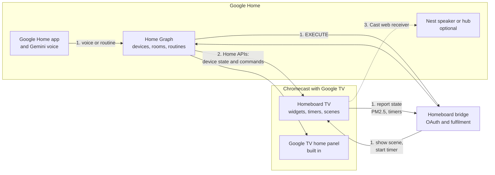
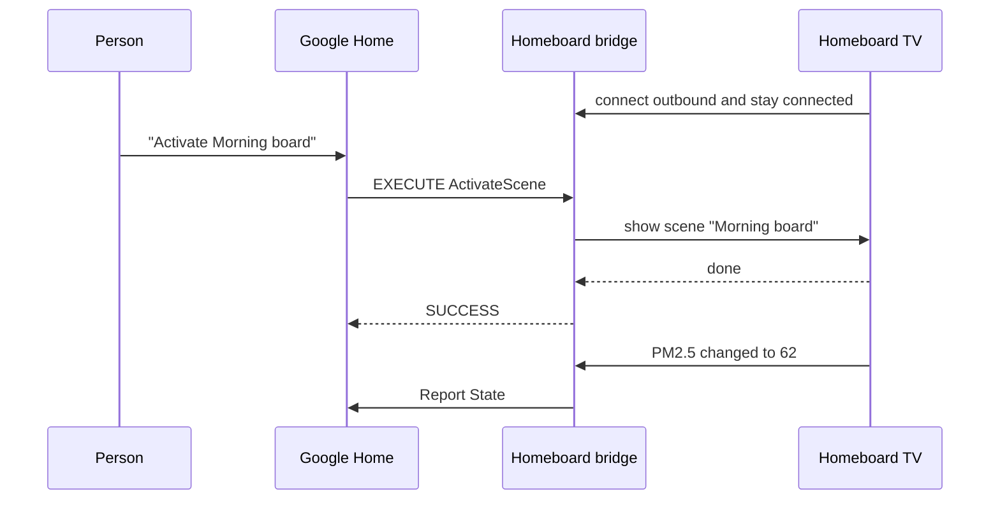
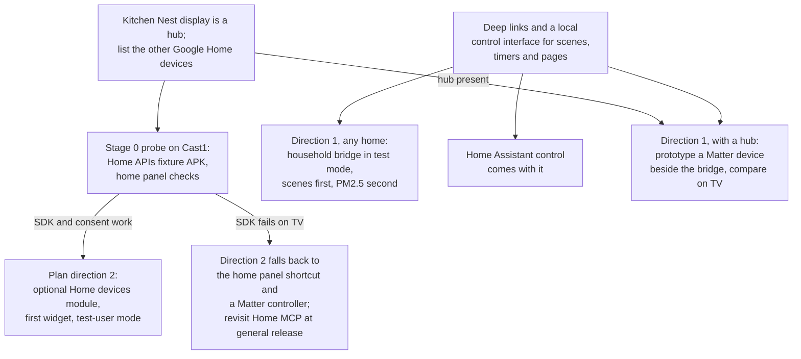

# Integrating Homeboard TV with Google Home: the options

**Purpose:** Lay out every route by which Homeboard TV and Google Home can work together, what each one costs, and which to try first.

Will asked on 20 November 2026: "what are our options for integrating homeboard-tv into google home?" This is desk research against Google's developer documentation as it stands today. **Nothing here has been tested on Cast1 or Cast2.** Where a claim rests on a page I read, the page is linked; where it rests on memory or inference, it says so.

## Summary

"Integration" covers three different things, and they need different machinery:

| Direction | What the household gets | Best route | Needs a server? |
|---|---|---|---|
| **1. Homeboard appears in Google Home** | "Hey Google, activate Morning board"; Google Home routines that switch the TV's dashboard; Homeboard's PM2.5 reading usable as a routine trigger | Cloud-to-cloud integration in test mode, or a Matter device if the home has a Google hub | Cloud-to-cloud: a small bridge. Matter: none |
| **2. Google Home appears on Homeboard** | Widgets for lights, sensors, thermostats, doorbell and cameras that are already in the Google Home app | Home APIs for Android inside the TV app | No, if it runs on a TV at all |
| **3. Homeboard appears on other Google screens** | The dashboard on a Nest Hub | Cast web receiver | A hosted web page |

**Recommendation:**

1. **Probe direction 2 first.** A throwaway fixture APK that calls the Home APIs on Cast1 answers, in about a day, the one question the documentation does not: whether the SDK and its consent screen work on a Google TV device. If it passes, direction 2 needs no server, no account system and no monthly cost, which matches how Homeboard is built today.
2. **For direction 1, stay at household scale and prototype both routes.** A cloud-to-cloud integration in test mode works for the accounts on our own developer project with no certification, but it creates a server. A Matter device inside Homeboard needs no server at all, but it needs a Google hub on the network. The household has one, the kitchen Nest display, so build both prototypes and compare them on the TV. Do not offer either publicly yet: a public cloud-to-cloud launch means Homeboard accounts, a hosted service and Google certification, and public Matter means industry certification.
3. **Before either, add deep links and a local control interface to Homeboard.** Every route in direction 1 ends by telling the TV "show this scene" or "start this timer". Defining that once serves Google Home, Home Assistant and anything else.
4. **Park** the Cast receiver, Nest Device Access and Home MCP. Reasons are in each section.

**What the household has** (Will, 20 November 2026: the chromecast-coordinator "already knows there is" a hub). The coordinator's [Nest display notes](../../../chromecast-coordinator/docs/nest-displays.md) record a kitchen Nest Hub or Nest Hub Max, exact model not yet verified. That is a Google hub, so Matter, local fulfilment and hub-run automations are all open. Still unknown: which other devices are in the Google Home app. Direction 2 is only worth building if there are devices there worth showing.

## How costs are weighed

Will, 20 November 2026: "engineering is practically free these days". Writing the code is not the scarce resource, so this report does not rank options by how much there is to build. It ranks them by what stays expensive after the code exists:

- **Standing obligations:** a service that must stay up, the secrets it holds, accounts to look after.
- **Gates only Google controls:** certification, registration, brand verification, a subscription requirement.
- **Gates only Will can pass:** console sign-ups, and device sessions on Cast1 and Cast2 through the coordinator.
- **What the household must own or pay for:** a Google hub, a subscription.
- **Permanent weight in the launcher:** APK size, a Play services dependency, new permissions.

One consequence: where two routes differ mainly in effort, the answer is to prototype both and compare them on the device, not to argue it out on paper.

## The three directions

Direction 1 and direction 2 are independent. Neither needs the other, and they can ship in either order.

## What exists today

| Fact today | Evidence | Why it matters |
|---|---|---|
| Homeboard is a Java launcher with no Google Play services dependency, `minSdk` 26 and `targetSdk` 34. | `launcher/app/build.gradle` | The Home APIs need Play services, Kotlin and Android 10 or later, so they belong in an optional module, not the core launcher. |
| Homeboard has no cloud service and no accounts. | [Bridge boundary](../../bridge/README.md), [product direction](../product-direction.md) | Any cloud-to-cloud route creates the first server, the first account and the first secret. |
| The phone controller's HTTP listener (NanoHTTPD) runs only during an approved Configure-from-phone session. | `PhoneEditorServer.java`, [phone shortcuts how-to](../how-to/phone-tv-shortcuts.md) | There is no always-on local interface that Google, Home Assistant or a bridge could call. One has to be designed. |
| Homeboard already holds things Google Home has traits for: timers and alarms, an air-quality reading, and (planned) scheduled scenes. | [README](../../README.md), [product direction](../product-direction.md) | These are the candidates to expose in direction 1. |
| The household has a kitchen Nest display: a Nest Hub or Nest Hub Max, exact model not yet verified and not yet enrolled in the coordinator. | [Coordinator Nest display notes](../../../chromecast-coordinator/docs/nest-displays.md) | Every Nest Hub model is on Google's Matter hub list and its Home APIs hub list. It can commission a Matter device, run local fulfilment and show a Cast receiver. |
| The two test TVs run Android 14 and Android 12; Cast2 is the Android 12 one. | [Coordinator device inventory](../../../chromecast-coordinator/docs/device-types-capabilities-and-controls.md), coordinator `docs/operations.md` | Both meet the Home APIs' Android 10 minimum. |
| The coordinator already has a Cast backend that can run a registered custom Cast Web Receiver on a Nest display and send it messages. It is implemented in source; live acceptance on the kitchen display is outstanding. | [Coordinator Nest display notes](../../../chromecast-coordinator/docs/nest-displays.md) | Option 3A has a sender and a test path already, as a development tool. |
| Both test TVs are already devices in Google Home, as Cast devices. | Standard Chromecast behaviour; not re-verified in this pass | Exposing Homeboard as a second "TV" would duplicate what Google already controls: power, volume and app launch. |
| Google TV ships its own home panel for favourited smart-home devices, opened from the quick settings dashboard or by long-pressing Home. | [Google TV Help](https://support.google.com/googletv/answer/15158065?hl=en) | A basic version of direction 2 may already be one button away. Whether it survives Homeboard being the Home app is untested. |

## Direction 1: Homeboard appears in Google Home

### 1A. Cloud-to-cloud integration

This is Google's standard route for a third party to put devices into the Google Home app. Homeboard would declare virtual devices, and Google would send voice and routine commands to a web service we run.

What has to exist:

- **An OAuth 2.0 server** for account linking. Google links a Google account to "a Homeboard account", so Homeboard needs some notion of one, even if it is a single pairing code per TV.
- **A fulfilment webhook** answering `SYNC`, `QUERY`, `EXECUTE` and `DISCONNECT`.
- **Report State** calls to the Home Graph API with a service account, so that Google knows the current state without asking ([Report State](https://developers.home.google.com/cloud-to-cloud/integration/report-state?hl=en)).
- **A channel from the bridge to the TV.** The TV sits behind home NAT, so it must hold an outbound connection to the bridge.

What Homeboard could honestly expose:

| Homeboard thing | Google type and trait | What it enables | Confidence |
|---|---|---|---|
| A saved scene or layout | `SCENE` with `Scene` ([guide](https://developers.home.google.com/cloud-to-cloud/guides/scene?hl=en)) | Voice activation; `ActivateScene` as a routine action, for example "when the doorbell rings, show the Front door page" | High. This is what the type is for. |
| Air quality | `SENSOR` with `SensorState`, which supports `AirQuality` and numeric `PM2.5` in µg/m³ ([trait](https://developers.home.google.com/cloud-to-cloud/traits/sensorstate?hl=en)) | "What's the air quality?"; `SensorState` is listed among routine starters ([starters and actions](https://developers.home.google.com/automations/starters-conditions-and-actions?hl=en)), so "PM2.5 above 50, turn on the purifier" | Medium. The trait fits. Presenting a public data feed as a sensor is a stretch of "accurate device type" for certification, though harmless in test mode. |
| Timers | `Timer` trait ([trait](https://developers.home.google.com/cloud-to-cloud/traits/timer?hl=en)) | "Set the Homeboard timer for 10 minutes" | Low. Google recommends this trait for cooking appliances, and Google's own speakers answer plain timer requests themselves. Whether the voice grammar routes to a display-type device is untested. |
| The screensaver | `Modes`: a "screensaver" mode whose settings are Clock, Home background and each installed provider ([trait](https://developers.home.google.com/cloud-to-cloud/traits/modes?hl=en)). `Toggles`: "screensaver" on shows it now, off dismisses it ([trait](https://developers.home.google.com/cloud-to-cloud/traits/toggles?hl=en)) | "Set the screensaver on Homeboard to Clock"; "turn on the screensaver on Homeboard" | Medium. This is what these traits are for; see below. Voice is documented. How the Google Home app draws them is not. |
| Settings | `Toggles` for two-state settings; `Modes` for a choice among several, such as the background, the dashboard page or which widget is full screen | Voice control of the settings a person would actually say aloud | Medium, same caveat. |
| The TV's stock controls | `TV` with `AppSelector`, `InputSelector`, `MediaState`, `OnOff`, `TransportControl`, `Volume` ([guide](https://developers.home.google.com/cloud-to-cloud/guides/tv?hl=en)) | Nothing new | Skip these traits. The Chromecast is already in Google Home with them. A "Homeboard" device per TV should carry only our own modes and toggles. |

**Our own controls, but not our own interface** (Will, 20 November 2026: "what about exposing screensaver and settings in google home with our own set of widgets?"). The two halves of that have different answers:

- **Our own set of controls: yes.** `Modes` exists for devices whose "modes and settings for each mode are arbitrary and unique to each device", and `Toggles` for any setting with two states. We choose the names, the options and their spoken synonyms. Each needs synonyms per language, with English required; I did not check whether Thai is supported.
- **Our own interface inside the Google Home app: no.** I found no mechanism for a third party to supply its own screens or widgets there. Google draws whatever it draws for each trait. I could not confirm from the documentation that the app shows any control at all for `Modes` and `Toggles`; that has to be seen on a phone. Our own interface for these settings stays where it is, in Homeboard and the phone controller.
- **Routines are narrower than voice.** The list of routine starters, conditions and actions I read includes `ActivateScene`, `SensorState` and the timer commands, but not `Modes` or `Toggles` ([starters and actions](https://developers.home.google.com/automations/starters-conditions-and-actions?hl=en)). Anything a routine should trigger, such as "show the screensaver at 22:00", is safer as a scene.
- **The list changes.** Installing or removing a screensaver provider changes the mode's options, so the bridge has to ask Google to sync again when that happens.

Two ways to run it:

- **Test mode, our household only.** An integration that has not been certified appears as "[test] *name*" to accounts with access to the developer project. This is the same arrangement Home Assistant documents for its manual Google setup ([Home Assistant](https://www.home-assistant.io/integrations/google_assistant/)). No certification, no company profile. I did not find a stated expiry for test integrations, and did not confirm there is none.
- **Public launch.** Requires Test Suite results, a company profile, a policy review and certification ([certification steps](https://developers.home.google.com/cloud-to-cloud/certification/submit?hl=en)). Google's policy says device types must be "accurate and specific based on the identity of the device itself" ([policies](https://developers.home.google.com/policies?hl=en)), which a dashboard app declaring sensors and scenes may not satisfy. It also means running an account service for strangers.

One current change to be aware of: Google moved third-party account linking fully into the Google Home app, with partner updates due by 30 October 2026 ([migration guide](https://developers.home.google.com/cloud-to-cloud/account-linking-migration?hl=en)). A new project simply follows the current instructions.

**Cost:** Google charges nothing for the developer project. The bridge is a small always-on service; a Cloudflare Worker with a persistent connection per TV plausibly fits a free or lowest paid tier, but I have not priced it. The lasting cost is not the code (OAuth server, webhook, TV-side client, settings screen, revocation path) but the obligation it creates: a service that holds the tokens linking the household's Google account, and has to stay up and stay secure for as long as anyone uses it.

**Verdict:** The route for direction 1 that works in any home, at household scale only. This home has a Google hub, so compare it with 1B before committing.

### 1B. Homeboard as a Matter device

Matter is local. A Google hub on the same network commissions the device and then controls it without any cloud of ours, so this route needs **no OAuth server and no bridge**. Google Home supports the relevant Matter types, including Air Quality Sensor with PM2.5 measurement, On/Off Plug-in Unit and bridges ([supported devices](https://developers.home.google.com/matter/supported-devices?hl=en)). The usual pattern for virtual actions is a bridge exposing one on/off switch per scene.

Will, 20 November 2026: "this is a GREAT idea!!! if it works, that is". So it leads direction 1, and the first job is to find out whether it works.

What says it can work:

- The Matter project ships an Android app that acts as a device, not a controller: its [Android Virtual Device App](https://github.com/project-chip/connectedhomeip/tree/master/examples/virtual-device-app/android) is "a commissionee device on Android" that displays its own Matter QR code. That is the starting point for a probe.
- A TV is a good place to show a pairing QR code: the Google Home app on a phone scans it from the screen. Commissioning over the home network needs no Bluetooth.
- The hub is already in the kitchen.

**The probe that settles it:** a fixture APK built from that example, declaring one on/off device under a test vendor ID, installed on Cast1 and commissioned through the Google Home app. It works if "Hey Google, turn on Homeboard test" changes the state on the TV, and if it still answers after another app has been in the foreground for an hour. It needs nothing else in this report built first.

What gates it:

- The Matter stack is a large native library, built per CPU architecture. Building it into a Java launcher is work, which is cheap; the added APK size is permanent. I did not measure it.
- Homeboard must be running to answer. Whether its process stays alive while another app is in the foreground is untested.
- Named settings may not carry over. On a brief check I found no Mode Select support in [Google's Matter cluster list](https://developers.home.google.com/matter/clusters?hl=en), so the screensaver choice would become one on/off switch per option. Cloud-to-cloud expresses it properly.
- An uncertified device can only use a test vendor ID (`0xFFF1` to `0xFFF4`), which Google Home accepts when the account has a matching Matter integration in the Developer Console ([create a Matter integration](https://developers.home.google.com/matter/integration/create?hl=en)). That works for us and for nobody else.
- Shipping to the public needs Connectivity Standards Alliance membership and certification. I did not check the fees.
- The home must have a Matter hub. Google lists Nest speakers and displays, Nest Wifi Pro and the Google TV Streamer (4K) ([same page](https://developers.home.google.com/matter/supported-devices?hl=en)). The Chromecast with Google TV is not in that list. The household's kitchen Nest display is: Nest Hub, Nest Hub (2nd gen) and Nest Hub Max all appear on it.

**Verdict:** The lead route for direction 1 at household scale, pending the probe. Its limit there, our own accounts only, is the same as 1A's test mode, and it avoids the server, the secrets and the internet dependency altogether. It depends on the home having a Google hub, and this one does. Prototype it beside 1A and compare on the TV. Public release stays blocked by certification.

### 1C. Through Home Assistant

If a household runs Home Assistant, it already has a Google connection, either through Home Assistant Cloud (paid) or its manual cloud-to-cloud setup. Homeboard then only needs to be controllable by Home Assistant, and Home Assistant scripts or scenes become the things Google sees. Homeboard builds no cloud at all.

What Homeboard needs for this is the same thing 1A needs on the TV side: deep links or a local control interface. Home Assistant's Android TV integrations can start an activity on the TV; I did not re-check their current deep-link support in this pass.

**Verdict:** Free for households that have Home Assistant, irrelevant for those that do not. It is a reason to design the control interface generically, not a Google-specific plan.

### 1D. Local Home SDK

This is an add-on to 1A, not an alternative. A small JavaScript app, hosted by Google and run on the household's Nest speaker or display, discovers the device over mDNS, UDP or UPnP and sends commands over HTTP, TCP or UDP on the LAN, with cloud fulfilment as the fallback ([local fulfilment](https://developers.home.google.com/local-home/overview?hl=en)). It is still documented and I found no retirement notice.

It would let `EXECUTE` reach the TV directly, but `SYNC` still needs the cloud, Report State is not supported locally, and it needs a Google speaker or display in the home, which the kitchen Nest display satisfies.

**Verdict:** Only after 1A exists, and only if latency is a problem.

### 1E. The TV's own voice assistant

I found no supported way for a TV app to register custom voice commands with the assistant on the remote. Google's App Actions documentation names phones, cars and wearables, not TVs ([Assistant for Android](https://developer.android.com/develop/devices/assistant/overview?hl=en)), and Google began replacing Assistant with Gemini on phones on 4 September 2026 ([9to5Google](https://9to5google.com/2026/08/04/google-assistant-september-2026-shutdown/)), so the developer surface is in flux. "Open Homeboard" by app name is the most that can be assumed.

**Verdict:** Not an option today.

## Direction 2: Google Home appears on Homeboard

### 2A. Home APIs for Android, inside the TV app

The Home APIs let any Android app, with the user's consent, read and control the devices, rooms and automations in that user's Google Home ([overview](https://developers.home.google.com/apis/android/overview?hl=en)). They are the only general-purpose route: 101 device types, from lights, plugs, thermostats and temperature, humidity, air-quality, contact and occupancy sensors to Nest cameras and doorbells ([supported types](https://developers.home.google.com/apis/android/supported-device-types?hl=en)). State arrives as live streams, so a widget stays current without polling. There is no server of ours in the path.

What Google's pages say:

| Requirement | Detail | Source |
|---|---|---|
| Platform | "An Android device running Android 10 or later set up with a Google Account", with Google Play services | [SDK setup](https://developers.home.google.com/apis/android/sdk?hl=en) |
| Language | Kotlin. From release 1.11 the SDK requires Kotlin 2.4.0 | [release notes](https://developers.home.google.com/apis/release-notes?hl=en) |
| Identity | A Google Cloud project with an Android OAuth client tied to the package name and the signing certificate's SHA‑1 | [OAuth setup](https://developers.home.google.com/apis/android/oauth?hl=en) |
| Before registration | The app is "unverified": only OAuth test users can grant access, up to 100 of them, and it sees every supported device type | [permissions](https://developers.home.google.com/apis/android/permissions?hl=en) |
| To publish | Developer Console registration, approval per device type and OAuth brand verification | [permissions](https://developers.home.google.com/apis/android/permissions?hl=en) |
| Sideloaded builds | The policy applies "whether integrating via Google Play, third party app store, or other means", so sideloading is contemplated | [policies §4](https://developers.home.google.com/policies?hl=en) |
| Data rules | Retain data for at most 10 days; no selling it, no advertising use, no AI training on it; security assessments as Google specifies | [policies §4](https://developers.home.google.com/policies?hl=en) |
| Sensitive devices | Locks, cameras and doorbells need consent device by device | [permissions](https://developers.home.google.com/apis/android/permissions?hl=en) |
| Activity | The SDK is actively developed; the latest release note is dated 19 November 2026 | [release notes](https://developers.home.google.com/apis/release-notes?hl=en) |

**The unanswered question is the TV.** Google's Home API pages describe phones and never mention Android TV as a place the SDK runs. A search result quoting Google's Play services setup guide lists the older `play-services-home` artifact as supported on phone and tablet only; I did not open that page myself. Google TV appears in the Home APIs only as a device type to be controlled and, for the Google TV Streamer, as a hub. Both test TVs clear the Android 10 minimum (Android 14 and Android 12). Three things could still fail on Cast1: the Play services module may be missing or too old, the consent screen may not be usable with a remote, or sign-in may be refused on this form factor.

Consequences for Homeboard if it does work:

- It goes in a separate Gradle module and probably a separate build edition, because it brings Kotlin, Play services and a Google Cloud identity into a launcher that has none of them.
- It is off on TVs below Android 10, which Homeboard otherwise supports from Android 8.
- Until Homeboard is registered and verified, only the 100 listed test users can use it. That is fine for our household and for early testers, not for a public release.
- The 10‑day retention limit rules out a long history chart from Google Home data unless the user's own device is not counted as "you" retaining it. That needs reading the policy text closely before designing any trend view.

**Cost:** nothing recurring.

**Verdict:** The best fit for Homeboard if it runs on a TV. Probe it before designing anything.

### 2B. Home MCP

On 16 September 2026 Google opened early access to Home MCP, a Google-hosted server (HTTPS endpoint `home.googleapis.com/mcp`) through which an AI agent can list homes and devices, read state and history, run device actions and list or save automations ([user guide](https://developers.home.google.com/mcp/home?hl=en), [TechCrunch](https://techcrunch.com/2026/09/16/your-ai-agents-can-now-control-your-google-home-devices/)). It uses ordinary OAuth with the scope `home.platform.v2` over streamable HTTP.

It matters here because it is the first way to read Google Home state over plain HTTPS, with no Play services. A bridge, or in principle the TV itself, could call `list_home_states` and feed a widget.

The limits:

- It requires an active **Google Home Premium Advanced** subscription, US$20 a month at US prices ([9to5Google](https://9to5google.com/2025/10/01/google-home-premium/)). I could not confirm the plan is sold in Thailand.
- It is early access, built and described for AI agents. I have not read whether its terms allow a non-agent client such as a dashboard. Rate limits are enforced but not published on the page I read.
- It blocks sensitive actions such as unlocking doors.
- It needs a web OAuth client with a redirect URL, so the TV cannot complete sign-in alone. A phone page or a hosted callback is required.

**Verdict:** Park, and watch. If it leaves early access without the subscription requirement it becomes the simplest route for direction 2. Worth a short experiment only if the household already pays for Premium Advanced.

### 2C. Nest Device Access

A REST interface for Nest thermostats, cameras, doorbells and the Nest Hub Max, with a one-time US$5 registration fee ([Device Access](https://developers.google.com/nest/device-access)). No Play services. Events need a Pub/Sub topic in our own Google Cloud project, because Google stops publishing to its hosted topics after 30 November 2026 ([release notes](https://developers.google.com/nest/device-access/release-notes)).

**Verdict:** Only relevant if the household owns Nest-branded devices, and then only for those. It does not see anything else in Google Home.

### 2D. Home Assistant

Homeboard's product direction already lists "Home Assistant sensors when available". Home Assistant reaches devices through their own vendors, and Nest devices through the same Device Access interface as 2C ([Nest integration](https://www.home-assistant.io/integrations/nest/)). It does not read the Google Home device list.

**Verdict:** A separate integration with its own plan. It overlaps direction 2 only for households that have both.

### 2E. Homeboard as a second Matter controller

Matter devices can be shared from Google Home to another controller on the same network. Homeboard could then read them locally with no Google account. It needs the same large native Matter stack as 1B, a commissioning flow on a TV, and covers Matter devices only.

**Verdict:** The fallback for direction 2 if the Home APIs do not run on a TV. It shares its native stack with 1B, so the two cost less together than apart.

### 2F. The built-in Google TV home panel

Google TV already shows favourited Google Home devices, including cameras, in a home panel reached from the quick settings dashboard or by long-pressing the Home button ([Google TV Help](https://support.google.com/googletv/answer/15158065?hl=en)). It needs standard mode, an opt-in and at least one other smart-home device in the home.

Two cheap checks on Cast1 would settle its value: whether long-press Home still opens the dashboard when Homeboard is the Home app, and whether the panel has a launchable activity that a Homeboard tile could open. Neither is documented.

**Verdict:** Check it during the 2A probe. If it works, Homeboard gets basic device control for the cost of one shortcut tile.

## Direction 3: Homeboard on other Google screens

### 3A. Cast web receiver

A custom Cast receiver is a web page that Google's devices load, registered in the Cast Developer Console for a US$5 one-time fee; unpublished receivers run only on devices registered by serial number ([registration](https://developers.google.com/cast/docs/registration?hl=en)). Something must start the cast: a phone browser, a server, or the TV app through the Cast SDK, which needs Play services.

Homeboard's widgets are native Android views, so a Nest Hub dashboard would be a second, web implementation of each one. Community reports say idle custom receivers are closed after about ten minutes on Nest displays; I did not verify that.

The household has a Nest display in the kitchen, and the chromecast-coordinator already has a Cast backend that can launch a registered custom receiver there and send it messages. That backend is a development tool and has not yet been accepted on the real display, but it gives a prototype a sender and a test path without new work.

**Verdict:** No longer parked: a prototype is worth making once the coordinator's kitchen display is enrolled. Writing the second implementation is cheap; the hosted page, the US$5 registration and keeping two renderings of every widget in step are the lasting costs. A shipped version still needs its own way to start the cast.

### 3B. Cast Connect

The reverse arrangement: Homeboard as a Cast receiver that phones cast into ([Android TV receiver](https://developers.google.com/cast/docs/android_tv_receiver)). It is designed for media playback, and Google notes that assistant functionality is not fully supported for it.

**Verdict:** No clear use for a dashboard.

### 3C. The Google shopping list and Homeboard Groceries

"Add milk to my shopping list" on a Google speaker writes to Google Keep ([Google's examples](https://blog.google/products-and-platforms/devices/google-nest/gemini-for-home-things-to-try/)). None of the smart-home routes above carries list contents, and to my knowledge Keep has no API for consumer accounts; I did not re-verify that.

**Verdict:** No supported path found. Noted because it is the first thing a household would ask for.

## Comparison

Effort is left out on purpose; see [How costs are weighed](#how-costs-are-weighed).

| Option | Direction | Our server | Play services | Works for the public without Google review | Recurring cost | What gates it | Verdict |
|---|---|---|---|---|---|---|---|
| 1A Cloud-to-cloud, test mode | 1 | Yes | No | No: our accounts only | Hosting, small | A standing service holding tokens; console setup | **Build at household scale** |
| 1A Cloud-to-cloud, public | 1 | Yes | No | No: certification | Hosting plus support | Certification; accounts for strangers | Not now |
| 1B Matter device | 1 | No | No | No: test vendor ID only | None | A Google hub in the home (present); APK size | **Prototype beside 1A** |
| 1C Via Home Assistant | 1 | Theirs | No | Yes | Theirs | The household running Home Assistant | By-product of a control interface |
| 1D Local Home SDK | 1 | Yes (1A) | No | As 1A | As 1A | Needs 1A and a Google speaker or display | Later, if latency matters |
| 2A Home APIs on the TV | 2 | No | Yes | 100 test users until registered | None | Whether it runs on a TV; registration to go public | **Probe first** |
| 2B Home MCP | 2 | Small | No | Unknown | US$20 a month to the user | Early access; subscription; terms | Watch |
| 2C Nest Device Access | 2 | Small | No | US$5 per developer | Small | Owning Nest devices | Only with Nest devices |
| 2E Matter controller | 2 | No | No | Yes, for Matter devices | None | APK size; Matter devices only | Fallback if 2A fails |
| 2F Built-in home panel | 2 | No | n/a | Yes | None | Whether it survives a third-party launcher | Check during the probe |
| 3A Cast receiver | 3 | Web page | For TV-started casts | Yes, once published | Hosting | A Nest display (present); two renderings to keep in step; a way to start the cast | Prototype after the display is enrolled |

## Recommended sequence

1. **Finish the inventory.** The hub question is answered: there is a kitchen Nest display. Confirm its exact model when the coordinator enrols it, and list which other devices are in the household's Google Home.
2. **Stage 0 probe, on Cast1.** A fixture APK in the pattern of `launcher/widget-fixture` that initialises the Home APIs, runs the permission flow, lists devices and subscribes to one state stream. Record the Play services version, whether each screen can be driven with the remote, and what fails. In the same session, check the two home panel questions from 2F. This is a foreground device job, so it goes through the coordinator.
3. **Stage 0 Matter probe, on Cast1.** The on/off fixture described under 1B. It is independent of the Home APIs probe and of the control interface, so it can run in the same device session as step 2.
4. **Design the control interface.** Decide between intent deep links, an always-on authenticated local listener, or both, and what they can address: a scene, a page, a timer. This is useful with or without Google.
5. **Then plan whichever direction the probe and the inventory favour.** Each is a design-and-implementation job with visible surfaces, so each needs its own plan with mockups and diagrams. Where two routes survive, such as the bridge and the Matter device, build both prototypes and let the device decide.

These are tracked in [`TODO.md`](../../TODO.md) as three items: the Stage 0 probe, the control interface, and the paired Matter device and bridge prototypes.

## Not verified

- Whether the Home APIs run on Cast1 or Cast2 at all: Play services module, consent screen with a remote, sign-in. This is the largest unknown in the report.
- Which Play services version the two test TVs have.
- The kitchen Nest display's exact model, and which other devices are in the household's Google Home.
- Whether long-press Home still opens Google's dashboard with Homeboard as the Home app, and whether the home panel can be launched by intent.
- Whether a test-mode cloud-to-cloud integration expires or needs periodic renewal.
- What the Google Home app shows for `Modes` and `Toggles`, whether a routine can set them, whether Thai synonyms are supported, and whether Google accepts a `TV` device that declares only those traits.
- Whether Google Home supports the Matter Mode Select cluster; my check of its cluster list was brief.
- Whether Google's voice grammar sends timer requests to a non-cooking device with the `Timer` trait.
- Whether Home MCP's terms allow a non-agent client, its rate limits, and whether Premium Advanced is sold in Thailand.
- Connectivity Standards Alliance membership and certification fees.
- How much the Matter native stack adds to the APK, and whether Homeboard's process stays alive to answer Matter commands while another app is in the foreground.
- The Play services "phone and tablet only" table for `play-services-home`, which I saw quoted in a search result, not on the page.
- Idle timeouts for custom Cast receivers on Nest displays.
- That Google Keep has no consumer API.
- Hosting cost for the bridge.

## Sources

All accessed 20 November 2026.

- [Home APIs for Android overview](https://developers.home.google.com/apis/android/overview?hl=en) · [SDK setup and supported hubs](https://developers.home.google.com/apis/android/sdk?hl=en) · [Permissions API](https://developers.home.google.com/apis/android/permissions?hl=en) · [OAuth setup](https://developers.home.google.com/apis/android/oauth?hl=en) · [Supported device types](https://developers.home.google.com/apis/android/supported-device-types?hl=en) · [Connectivity](https://developers.home.google.com/apis/android/connectivity?hl=en) · [Release notes](https://developers.home.google.com/apis/release-notes?hl=en)
- [Google Home MCP server user guide](https://developers.home.google.com/mcp/home?hl=en) · [TechCrunch, 16 September 2026](https://techcrunch.com/2026/09/16/your-ai-agents-can-now-control-your-google-home-devices/)
- [Google Home developer policies](https://developers.home.google.com/policies?hl=en)
- [Cloud-to-cloud device types](https://developers.home.google.com/cloud-to-cloud/guides?hl=en) · [TV guide](https://developers.home.google.com/cloud-to-cloud/guides/tv?hl=en) · [Scene guide](https://developers.home.google.com/cloud-to-cloud/guides/scene?hl=en) · [Sensor guide](https://developers.home.google.com/cloud-to-cloud/guides/sensor?hl=en) · [SensorState trait](https://developers.home.google.com/cloud-to-cloud/traits/sensorstate?hl=en) · [Timer trait](https://developers.home.google.com/cloud-to-cloud/traits/timer?hl=en) · [Report State](https://developers.home.google.com/cloud-to-cloud/integration/report-state?hl=en) · [Certification](https://developers.home.google.com/cloud-to-cloud/certification/submit?hl=en) · [Account linking migration](https://developers.home.google.com/cloud-to-cloud/account-linking-migration?hl=en)
- [Modes trait](https://developers.home.google.com/cloud-to-cloud/traits/modes?hl=en) · [Toggles trait](https://developers.home.google.com/cloud-to-cloud/traits/toggles?hl=en) · [Matter clusters supported by Google Home](https://developers.home.google.com/matter/clusters?hl=en)
- [Automation starters, conditions and actions](https://developers.home.google.com/automations/starters-conditions-and-actions?hl=en)
- [Local fulfilment](https://developers.home.google.com/local-home/overview?hl=en)
- [Matter supported devices and hubs](https://developers.home.google.com/matter/supported-devices?hl=en) · [Create a Matter integration](https://developers.home.google.com/matter/integration/create?hl=en)
- [Nest Device Access](https://developers.google.com/nest/device-access) · [Device Access release notes](https://developers.google.com/nest/device-access/release-notes)
- [Control smart home devices on your Google TV](https://support.google.com/googletv/answer/15158065?hl=en)
- [Cast registration](https://developers.google.com/cast/docs/registration?hl=en) · [Android TV receiver overview](https://developers.google.com/cast/docs/android_tv_receiver)
- [Google Assistant for Android](https://developer.android.com/develop/devices/assistant/overview?hl=en) · [9to5Google on the Assistant shutdown](https://9to5google.com/2026/08/04/google-assistant-september-2026-shutdown/)
- [Home Assistant: Google Assistant](https://www.home-assistant.io/integrations/google_assistant/) · [Home Assistant: Google Nest](https://www.home-assistant.io/integrations/nest/)
- [9to5Google on Google Home Premium pricing](https://9to5google.com/2025/10/01/google-home-premium/) · [Google's Gemini for Home examples](https://blog.google/products-and-platforms/devices/google-nest/gemini-for-home-things-to-try/)
- [Google Home Developer newsletter, May 2026](https://developers.home.google.com/newsletters/2026/05) · [February 2026](https://developers.home.google.com/cloud-to-cloud/newsletters/2026/02)
