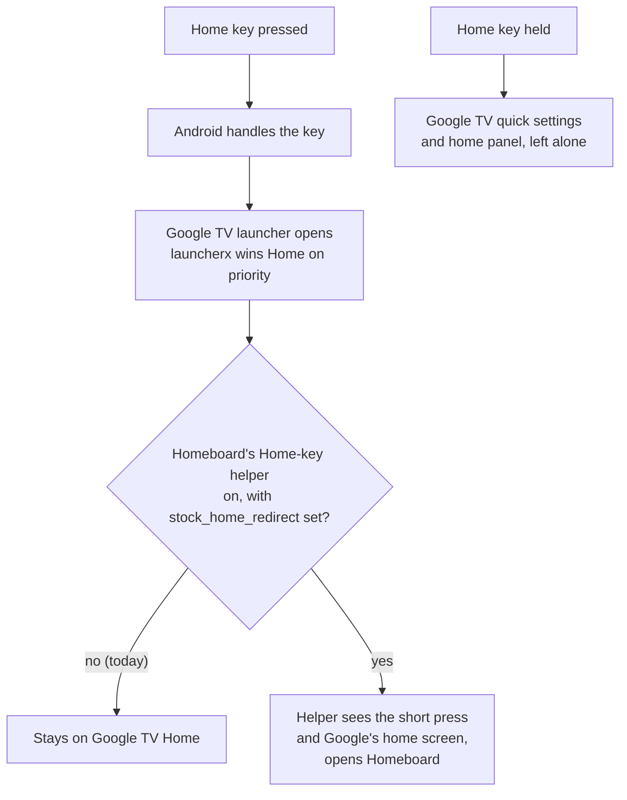

# The Home key on Google TV: what can and cannot be changed

**Purpose:** Settle whether Homeboard can become what the remote's Home button opens on a Chromecast with Google TV, and by which route.

Will, 20 November 2026, on the Home key opening Google TV during the control interface's Stage 0 check: "that's a real bummer. it seems as though we can't change it on google tv (research more?) but i'm hoping/expecting to be able to override the home key on the tv."

This is desk research plus a read of code and notes already in this repository. Nothing here was tested on Cast1 or Cast2 beyond the Stage 0 observation.

## Summary

- **Choosing a different Home app does not work on Google TV.** Android records the choice and the Home key still opens Google TV's launcher. That is confirmed by upstream's field notes and matches what Stage 0 saw on both test TVs.
- **Overriding the Home key does work, and Homeboard already carries the code.** The launcher inherited from CleanYourTV includes an accessibility helper, `HomeKeyService`, with a setting named `stock_home_redirect`. It is off in Homeboard today because the setting is empty.
- **Disabling Google's launcher also works, and should be avoided here.** It breaks the Google Home panel and Ambient mode's album picker, and getting back needs ADB.
- **So the expectation is right:** the override is the route, it keeps Google's launcher installed, and what remains is a probe on Cast1.

## What happens today

## Three routes

| Route | Result | Cost |
|---|---|---|
| **Choose Homeboard as the Home app** (the role, or `set-home-activity`) | Does nothing for the key. The role is recorded on the new launcher and Home still opens Google's, because `com.google.android.apps.tv.launcherx` outranks it while enabled. | None, and no benefit. |
| **Disable Google's launcher** (`pm disable-user` over ADB) | Home goes to Homeboard. | The Google Home panel opens and closes at once, Ambient mode cannot pick albums, and once Google's launcher is enabled again the TV's Settings offer no Disable, so handing Home back needs ADB. A firmware update can turn it back on. |
| **Override the key with the accessibility helper** (`stock_home_redirect`) | Google's launcher stays enabled. A short press of Home opens Homeboard, and Google's home screen is sent back to Homeboard whenever it appears. A held press is left alone, so Google's quick settings and home panel still open. | An accessibility service has to be on. Google's home screen may show for a moment first. Firmware updates have disturbed this approach before. |

Sources for the first two rows are upstream's own troubleshooting notes, vendored here at `vendor/cleanyourtv-cleanup/docs/TROUBLESHOOTING.md`: role and `set-home-activity` changing nothing was seen on a TCL set with Android 14; the broken panel on a TCL set with Google TV 11, where upstream's advice is "if the household uses Google Home lights, keep launcherx enabled and hand Home to the new launcher with `stock_home_redirect`". Neither was observed on a Chromecast.

The third row is how other launchers do it. Projectivy's "Override current launcher" uses the accessibility permission to take Home presses while Google TV stays installed underneath ([Gadget Hacks](https://android.gadgethacks.com/how-to/best-google-tv-launcher-replacement-projectivy-setup-guide/), [FlatpanelsHD](https://www.flatpanelshd.com/guide.php?subaction=showfull&id=1754640308)).

## What Homeboard already has

| Piece | Where | State |
|---|---|---|
| The helper | `HomeKeyService.java`, declared in `AndroidManifest.xml` | Present. Upstream treats it as opt-in at build time (`HOME_KEY_SERVICE=1`). |
| The setting | `stock_home_redirect` in `res/values/config.xml`, also readable from a theme's `config.json` | Empty, so the redirect is off. It takes the stock launcher's package name. |
| Short press against a held press | `redirectHomeKey` in `HomeKeyService.java` | A short press opens Homeboard 250&nbsp;ms after the system has handled the key; a held press is passed through for Google's quick settings. |
| Keeping Google's launcher as the Home process | `stockHomeStays` in `HomeKeyService.java` | When Google's launcher is still Android's Home, Homeboard is started like an app, not as Home, so the remote's YouTube and Netflix buttons keep working (upstream issue 1274). |
| The Home role request | Homeboard settings → Default Home app | Present, and documented in the [quick start](../how-to/quick-start.md) as possibly not honoured for the key. This research says it will not be on Google TV. |

## What this means elsewhere

- **Google Home panel.** The override keeps Google's launcher enabled, and the panel depends on it, so this route is the one compatible with the [Google Home work](2026-11-20-google-home-integration.md). By design a held Home press still opens Google's dashboard.
- **Control interface.** With the override, Homeboard is not Android's Home process. Whether it can still bring itself to the front from behind another app (Decision 1 and run C in the [control interface plan](../plans/2026-11-20-control-interface.md)) is therefore still open, and worth testing with the helper on.
- **Play edition.** An app that uses the accessibility interface without being an accessibility tool needs a declaration in the Play Console and a prominent disclosure ([Play policy](https://support.google.com/googleplay/android-developer/answer/10964491?hl=en)). A fixed "this key opens this app" rule looks permitted, but I found no explicit ruling on remapping.
- **Turning the helper on.** From Android 13, a sideloaded app can be blocked from accessibility until the person allows restricted settings for it ([Esper](https://esper.io/blog/android-13-sideloading-restriction-harder-malware-abuse-accessibility-apis)). I found nothing on whether Google TV applies this. Upstream turns the helper on over ADB, which sidesteps it.

## The probe

1. Build Homeboard with `stock_home_redirect` set to `com.google.android.apps.tv.launcherx`.
2. Turn the helper on, on Cast1, through the coordinator. Whether its settings workflow can write the accessibility setting and restore it is not checked.
3. Press Home from Homeboard, from another app and from Google TV's home screen. Record what opens, and whether Google's home screen is visible first.
4. Hold Home. Confirm Google's quick settings and the home panel still open.
5. Press the remote's YouTube and Netflix buttons. Confirm they still open their apps.
6. Restart the TV and repeat step 3.
7. Restore the accessibility setting to its starting value.

## Not verified

- Any of this on Cast1 or Cast2, apart from the Home key opening Google TV during Stage 0.
- Which app formally holds the Home role on either TV.
- Whether a Chromecast on Android 14 behaves like the TCL sets in upstream's notes.
- Whether Google TV blocks turning on an accessibility service for a sideloaded app.
- Whether the coordinator can write and restore the accessibility setting.
- A March 2026 Google TV update that reportedly disturbed launcher overrides; I saw it in one secondary source ([simturax](https://simturax.com/replace-stock-launcher-google-tv/)) and did not confirm it.
- Whether Play accepts a Home-key override under its accessibility policy.

## Sources

All accessed 20 November 2026.

- `vendor/cleanyourtv-cleanup/docs/TROUBLESHOOTING.md` in this repository, and the upstream issue it cites, [CleanYourTV issue 1653](https://github.com/Gathin23/cleanyourtv/issues/1653)
- `launcher/app/src/main/java/com/gathin/tvhome/HomeKeyService.java` and `launcher/app/src/main/res/values/config.xml` in this repository
- [Gadget Hacks: Projectivy setup guide](https://android.gadgethacks.com/how-to/best-google-tv-launcher-replacement-projectivy-setup-guide/) · [FlatpanelsHD: replacing the Google TV interface](https://www.flatpanelshd.com/guide.php?subaction=showfull&id=1754640308) · [PLUI: the Home button on Android TV and Google TV](https://pluitv.com/us/home-button/) · [mustafa.net: replacing the Google TV launcher without root](https://mustafa.net/2026/11/01/replace-google-tv-launcher-without-root/)
- [Google Play: use of the AccessibilityService API](https://support.google.com/googleplay/android-developer/answer/10964491?hl=en) · [Esper: Android 13 restricted settings](https://esper.io/blog/android-13-sideloading-restriction-harder-malware-abuse-accessibility-apis)
