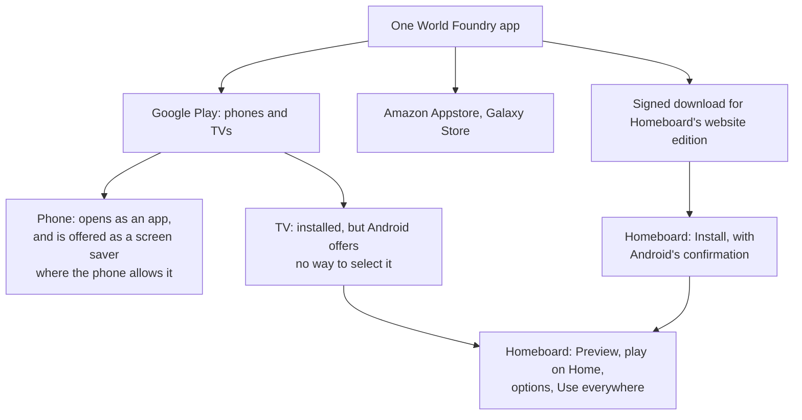
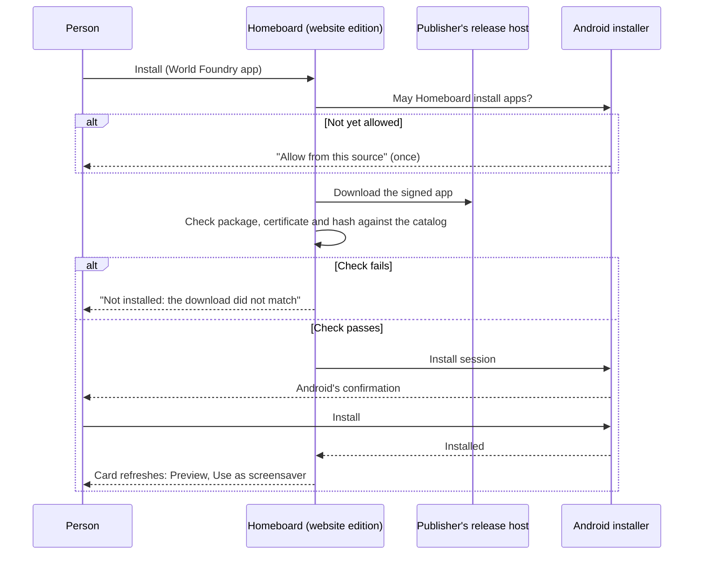
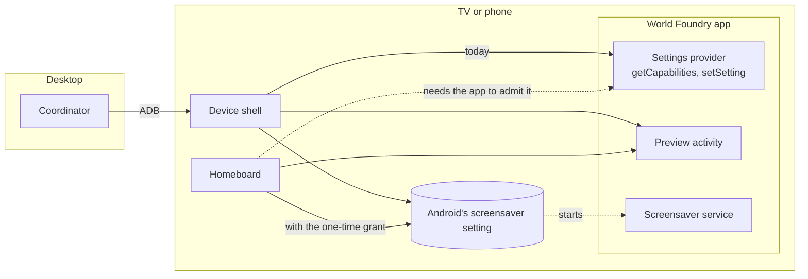

# Distributing the World Foundry screensavers: stores, Homeboard and one app

**Research, 2026‑11‑20.** Nothing here is implemented. It answers three things Will asked
on 2026‑11‑20 and feeds the [screensaver plan](../plans/2026-11-20-screensavers.md):

- "i have a developer account and do want to make them generally available on platform
  stores", with stores mattering most for phones, "w/o sideloading cuz for normals".
- "i'm also interested in supporting installation from homeboard-tv", because screensaver
  tools on Google TV are "extremely limited".
- "can we provide one apk that is both the app and a screensaver interface? if so, that
  would be ideal".

Will also noted that `../chromecast-coordinator/` "already [has] a lot of this", without
knowing whether its interface is at the right level for Homeboard.

**How this was checked.** Four research agents read live primary pages on 2026‑11‑20 and
reported findings with sources. I re‑fetched four of the most consequential statements
myself and they matched: Play's repetitive‑content rule, the install‑permission rule, the
target‑API levels, and the statement that direct sideloads are not yet covered by
developer verification. Everything else is as the agents reported it. Local facts come
from the World Foundry and coordinator checkouts. What could not be confirmed is listed
under [Not verified](#not-verified).

## Recommendation

1. **Ship one World Foundry app, not three.** One package that is the playable app, the
   Android screensaver and the interface Homeboard uses. That is what Will called ideal,
   and Play's policies point the same way: a set of near‑identical apps is a listed
   rejection reason, and so is an app that is only one wallpaper.
2. **Publish it on Google Play for phones and TVs** as one package with a TV track, then
   on the Amazon Appstore and Samsung Galaxy Store, which are free.
3. **Let Homeboard do what Google TV will not.** Homeboard plays the tanks through the
   app's own preview activity and, after the one‑time setup, makes it the TV's
   screensaver. On TVs the obstacle is selecting a screensaver, not installing one.
4. **Install from Homeboard through two back ends.** The website edition of Homeboard
   installs its own publisher's apps through Android's installer, with the person's
   confirmation. The Google Play edition, which Will confirmed there will be, must hand
   off to Play, because Play policy forbids the first route there.
5. **Reuse the coordinator's settings contract, one level up.** The contract is the right
   shape. Today it is reachable only from the device shell, so the World Foundry app must
   admit Homeboard as a caller.

## What exists today

Measured in `~/WorldFoundry-wbniv/android` on 2026‑11‑20.

| App | Package | Module | Release APK | What it is |
|---|---|---|---|---|
| Aquarium screensaver | `org.worldfoundry.screensaver` | `screensaver` | 9.3 MB | Screensaver, a TV launcher entry that plays the chosen tank, a preview activity, a settings provider |
| Seahorse Grid | `org.worldfoundry.seahorsegrid` | `screensaver` | 4.5 MB | The same, one scene |
| Planted Tank | `org.worldfoundry.plantedtank` | `screensaver` | 4.6 MB | The same, one scene |
| WF Aquarium | `org.worldfoundry.wf_game.aquarium` | `app` | 10.7 MB | The playable app: eight tanks behind a selector, phone as a gamepad |

Gaps between these and a store release:

| Fact today | Evidence | Why it matters |
|---|---|---|
| Release builds are signed with the debug keystore | `screensaver/build.gradle.kts` | Not publishable; installed copies cannot be updated by a properly signed one |
| The TV feature is declared as required | `screensaver/src/main/AndroidManifest.xml:3` | A store hides the app from every phone |
| Only a TV launcher entry | the three flavor manifests | No icon on a phone |
| `targetSdk` 34 | `build.gradle.kts` | Enough for a TV‑only Play app; a phone app needs 36 |
| Native libraries are 16 KB aligned | `readelf` shows `LOAD` alignment `0x4000` on both ABIs | Already meets Play's page‑size rule |
| 64‑bit and 32‑bit libraries | APK contents | Meets Play's rule; 32‑bit stays allowed and our TVs need it |
| No permissions requested | manifests | A simple Data safety form |
| Settings provider accepts only the device shell | `TankSettingsProvider.java:27` | Homeboard cannot read or change tank settings |
| Licence described as GPL v2; Will owns the copyright | `docs/LICENSE`; Will, 2026‑11‑20 | Will can license the engine as he chooses. Third‑party libraries and any art from outside sources still need a notices list before a store listing. |

## One APK that is the app and the screensaver

**Yes.** Android lets one package declare all of these together, and the screensaver
module already declares four of them:

| Part of the one app | Who uses it | Exists today? |
|---|---|---|
| Launcher activity, for phones and TVs | The person, as an app | TV entry only; the playable version is in the other module |
| Screensaver service, in its own process | Android, on phones and on TVs where it can be selected | Yes |
| Preview activity, exported | Homeboard, for Preview and Home idle; the coordinator, for "show" | Yes |
| Settings provider | Homeboard's Options screen; the coordinator | Yes, but shell‑only |

What it takes:

- **Merge the three scenes and the playable app into one package.** Seahorse Grid and
  Planted Tank become tanks inside it. This is also what Play's policies favour (below).
- **Open it to phones.** Stop requiring the TV feature, add a phone launcher entry, keep
  the TV entry and banner.
- **Choose the package name once.** It cannot change after publishing. Two candidates
  exist already; the existing installs are debug‑signed and need reinstalling either way.
- **Build both native targets into it**, or fold them into one library. The size is not
  measured: the playable app is 10.7 MB and the Aquarium screensaver 9.3 MB, and how much
  level data they share decides where between about 11 MB and 20 MB the result lands.
- **Raise `targetSdk` to 36**, because a package that also ships to phones follows the
  phone rule.

## Google Play

| Requirement | Finding | Source |
|---|---|---|
| Target API | Phone apps must target API 36; TV apps API 34. A phone‑and‑TV package needs 36. | [Target API requirements](https://developer.android.com/google/play/requirements/target-sdk), updated 2026‑10‑28 |
| 16 KB pages | Applies to apps targeting API 35 or higher with native code; updates that do not comply are blocked from 2027‑02‑01. Ours are aligned. | [Page sizes](https://developer.android.com/guide/practices/page-sizes), updated 2026‑11‑04 |
| Format and signing | New apps are uploaded as app bundles with Play App Signing; TV updates as APKs ended in 2023. | [TV distribution](https://developer.android.com/training/tv/publishing/distribute), updated 2026‑05‑08 |
| 64‑bit | Required for every 32‑bit library shipped; shipping both is allowed, on TV too. | [64‑bit requirement](https://developer.android.com/google/play/requirements/64-bit), updated 2026‑10‑28 |
| TV form factor | Opt in from the Play Console; needs a TV screenshot, a 320×180 banner containing the app's name, D‑pad operation, a TV launcher entry, landscape. Reviewed against the TV quality list. | [TV app quality](https://developer.android.com/docs/quality-guidelines/tv-app-quality) |
| One package for phone and TV | Supported and recommended, with a dedicated TV track. | TV distribution, as above |
| Privacy | A privacy policy and the Data safety form are required even when nothing is collected. | [Data safety](https://support.google.com/googleplay/android-developer/answer/10787469) |
| Testing rule | At least **12 testers opted in continuously for 14 days**, per app, for personal developer accounts created after 2023‑11‑13. **It applies to Will's account**, so to the World Foundry app and to Homeboard. | [Testing requirement](https://support.google.com/googleplay/android-developer/answer/14151465) |
| Developer fee and verification | US$25 once for the publishing developer account, already paid on Will's existing account. Existing developer accounts have an identity‑verification deadline of their own. **Testers do not pay this registration fee or complete developer identity verification.** | [Registration](https://support.google.com/googleplay/android-developer/answer/6112435) |
| Tester accounts | Testers need a regular Google or Google Workspace account and must join the test using that account; they do not need a Play Console developer account. | [Test prerequisites](https://support.google.com/googleplay/android-developer/answer/9845334) |

**Three policies shape the product, not only the paperwork:**

- **Repetitive content.** Publishing several apps with highly similar function and
  experience is a named violation, and the guidance is to combine them into one app.
  [Policy](https://support.google.com/googleplay/android-developer/answer/9899034).
- **Minimum functionality.** An app that is a single wallpaper is a named example of too
  little. A one‑scene screensaver is close to it; an app with several playable tanks is
  not. [Policy](https://support.google.com/googleplay/android-developer/answer/9898783).
- **Accurate listing.** The description must match what the app does. No policy mentions
  screensavers, but a TV listing that promises a screensaver most Google TV devices cannot
  select is a risk. The listing should lead with the app, and say that on many TVs making
  it the screensaver needs Homeboard or a developer command.
  [Policy](https://support.google.com/googleplay/android-developer/answer/9888077).

## Where a store-installed screensaver actually works

| Device | Can an ordinary person select a third‑party screensaver? |
|---|---|
| Pixel phones | There is a Screen saver setting (Display & touch), shown while charging or while upright and charging. Google's help page lists only built‑in ones; whether Play screensavers appear in the chooser is **not confirmed**. Our own record says the World Foundry screensavers ran on the Pixel 8 Pro, but not how they were selected. |
| Samsung phones | A Screensaver setting exists with built‑in choices; third‑party choice is not confirmed. |
| Google TV | No. Google's Ambient mode offers only its own sources. The only route is a developer command, with a minimum idle time of 6 min. Sony says its Google TV models cannot even change the start time. |
| Older Android TV | Has a Screen saver setting; reports say third‑party ones can be chosen. |
| Fire TV | Developer command only on Fire OS 7 and 8.0; Fire OS 8.1 and later ignore the setting. Vega OS devices run no Android apps at all. |

Sources: [Pixel screen saver](https://support.google.com/nexus/answer/2818748),
[Samsung](https://www.samsung.com/ae/support/mobile-devices/how-to-enable-screensaver-on-my-samsung-phone/),
[Google TV Ambient mode](https://support.google.com/googletv/answer/10070821),
[Aerial Views instructions](https://github.com/theothernt/AerialViews#how-to-set-aerial-views-as-the-default-screensaver).

Two consequences:

- **On TVs, Will's reading is right.** A store gets the app onto the TV and then stops.
  Homeboard is what makes it a screensaver there.
- **On phones, the app has to earn its place as an app.** The screensaver role is a bonus
  where the phone offers it, and that needs a check on a real phone (see Not verified).

## Other stores

| Store | Cost | Worth it? | Notes |
|---|---|---|---|
| Amazon Appstore | Free | Yes, for Fire tablets and for presence on Fire TV | Fire OS 14 needs `targetSdk` 34 and 64‑bit; Fire OS 16 needs 36 and 16 KB pages. As a screensaver it is blocked on Fire OS 8.1 and later, so it is an app there. |
| Samsung Galaxy Store | Free | Yes, low effort | A free app needs only a non‑commercial seller account. |
| F‑Droid | Free | Later | Fits a GPL app with no trackers; needs a fully free build and licensed assets; inclusion can take a month or more; poor on TVs. |
| Xiaomi GetApps, Huawei AppGallery | No fee found | Low priority | Identity checks; reach is mostly outside our markets. |
| Aptoide | Unclear | No | Review may need a subscription; TV support not stated. |

Outside Android, briefly: Apple's Mac App Store does not accept screensavers (direct,
signed distribution only); nothing was found that lets a third party ship one on Apple TV
or iPhone; Steam is an established home for screensaver‑like apps at US$100 per product;
the Microsoft Store's rules do not mention screensavers.
Sources: [Amazon device filtering](https://developer.amazon.com/docs/app-submission/device-filtering-and-compatibility.html),
[Galaxy Store FAQ](https://developer.samsung.com/galaxy-store/faq.html),
[F‑Droid inclusion policy](https://f-droid.org/en/docs/Inclusion_Policy/),
[Apple forum answer](https://developer.apple.com/forums/thread/805361),
[Steam Direct](https://partner.steamgames.com/steamdirect).

## Installing from Homeboard

| Route | Who can use it | What the person sees | Limits |
|---|---|---|---|
| **Android's installer** | Homeboard's website edition | Android's own confirmation, plus a one‑time "allow Homeboard to install apps" | Forbidden in a Play edition of Homeboard: Play allows that permission only when installing packages is the app's core purpose, and lists no companion‑app case. |
| **Play listing** | Any edition | The Play Store opens on the listing | Documented for phones; on the TV it is what the provider directory already does. |
| **Play's inline install sheet** | A Play edition only | Play's half sheet over Homeboard | Homeboard must be on Play, meet Play's eligibility rules and accept its terms. TV support is not stated. |
| **Play on the phone, sent to the TV** | The person | Chooses the TV in Play | Outside Homeboard's control. |

Sources: [Install permission policy](https://support.google.com/googleplay/android-developer/answer/12085295),
[Inline installs](https://developer.android.com/distribute/marketing-tools/inline-installs),
[Linking to Google Play](https://developer.android.com/distribute/marketing-tools/linking-to-google-play),
[Android 14 installer changes](https://developer.android.com/about/versions/14/features).

**Recommended design.** One Install action with two back ends chosen when Homeboard is
built, the same way the Rewards plan already separates a `nocommerce` build:

- **Website edition** (today's Homeboard, from [biohack.net/homeboard](https://biohack.net/homeboard/)):
  direct install, for Homeboard's own publisher only. The catalog names each app's
  package, its signing certificate and the file's hash. Homeboard downloads over HTTPS,
  checks all three, then hands the file to Android, which asks the person.
- **Play edition**, if there is one: Install opens Play's sheet or listing.
- **Every other publisher's app** stays a link, as the provider plan decided.

**Developer verification does not block this today.** Android's new verification rule
went live on 2026‑09‑30 in Thailand and three other countries, but only for installs from
seven named stores. Direct sideloads are not covered yet, enforcement outside Play is
limited to phones and tablets, and ADB is unchanged; the wider rollout is planned for
2027. Registering the packages and signing keys now, in the Play Console, costs nothing
extra and removes the risk.
Sources: [Developer verification guide](https://developer.android.com/developer-verification/guides),
[its FAQ](https://developer.android.com/developer-verification/guides/faq).

**One thing to get right before publishing: the signing key.** A copy installed from
Homeboard and a copy installed from Play can update each other only if they carry the
same signature. That means choosing how the Play signing key and the direct‑download key
relate before the first upload. It was not researched here.

## The coordinator's interface

The coordinator already has list, select, configure, show and trigger for screensavers,
and APK and store installs. Every one of them runs through the device shell over ADB,
which an operator's desktop has and an app on the TV does not.

| Coordinator does | Through | Can Homeboard, as an ordinary app? |
|---|---|---|
| List screensavers | `cmd package query-services` | Yes, through the package manager |
| Select one | `settings put secure` | Only with the one‑time grant in the screensaver plan |
| Read and change a tank's settings | `content call` on the app's provider | **Not today.** The provider refuses every caller except the shell. |
| Show now | `am start` of the preview activity | Yes; the activity is exported |
| See what is running | `dumpsys dreams` | No |
| Install an APK | `pm install` | Only through Android's installer, as above |
| Know which app is a screensaver with settings | A registration table in the coordinator | No table; it must come from the app |

**The contract is the right shape; the gate and the registry are at the wrong level.**
[`settings-provider-contract.md`](../../../chromecast-coordinator/docs/settings-provider-contract.md)
has the app publish a versioned document of its settings, from which the coordinator
builds its form without knowing any field by name. Homeboard's Options screen can be built
from the same document. Three changes make it work for an app:

1. **Admit Homeboard.** The provider accepts the shell, itself, and callers signed with an
   allow‑listed certificate (Homeboard's release key).
2. **Declare instead of register.** The app already names its settings authority in the
   screensaver service's metadata. It should name its preview activity and launch extras
   the same way, so Homeboard and the coordinator both discover them from the app.
3. **Give the contract a neutral home.** It has three implementers now: the World Foundry
   app, the coordinator and Homeboard.

## The bundled default

Will expects to bundle "an even better screensaver by default", perhaps a World Foundry
3D clock. Two ways to make it the default:

| | Compiled into Homeboard | In the World Foundry app, installed at first run |
|---|---|---|
| First experience | There at once | One Install step, then the default |
| Licence | Will owns the World Foundry copyright, so he can license the engine to Homeboard on terms that fit its MIT licence. Without that grant the combined APK would fall under the GPL. | Stays separate |
| Size | Homeboard grows from 5.4 MB by the engine (about 3.5 MB compressed) and the scene | Homeboard unchanged |
| Build | Homeboard's container needs the NDK and the engine, or a pinned prebuilt library | Unchanged |
| Safety | The engine must run in its own process so a crash cannot take down the Home app | Already its own process |
| Updates | Every scene fix needs a Homeboard release | Independent |

**Recommended, revised after Will's answer:** compiling the 3D clock in is now a
reasonable choice, because the licence obstacle is his to remove. It costs about 3.5 MB,
a pinned prebuilt engine library in Homeboard's build, and a separate process. It gives
a default that is there at once, in both editions, with no install step, which matters
more now that the Play edition cannot install anything itself. Keep today's Clock as the
fallback on a device whose processor the engine does not support. The grant should be
written down in both repositories when it is made.

## Not verified

- Whether Play screensavers appear in the Pixel and Samsung screen‑saver choosers. A
  check on the Pixel 8 Pro settles it.
- Whether a Play listing link opens on our Chromecasts' Play Store, and whether Play's
  inline sheet works on TVs.
- Where "Install unknown apps" is on Google TV and what Play Protect shows there.
- Any Google statement on GPL v2 apps on Play. None was found either way.
- How the Play signing key and a direct‑download key should relate so both copies update.
- The statement that off‑Play verification covers only phones and tablets: reported from
  the FAQ by a research agent; my own re‑fetch confirmed the sideload exemption but did
  not find that sentence.
- How long a TV quality review takes, and the next target‑API deadline.
- The third‑party libraries inside the World Foundry engine and any tank art that came
  from outside sources. Will owns the copyright in his own work; those parts keep their
  own terms and need a notices list.
- The merged app's size.

## Will's answers

Asked and answered on 2026‑11‑20.

1. **The Play account is personal and was not created before 2023‑11‑13.** So every new
   app needs a closed test with at least 12 testers opted in continuously for 14 days
   before it can go to production.
   That applies once to the World Foundry app and once to Homeboard, and is one more
   reason to publish one World Foundry app, not three. The two tests can run at the same
   time with the same testers. Testers use ordinary Google or Google Workspace
   accounts; they do not pay the developer registration fee or undergo developer
   identity verification (clarified 2026‑11‑21; see the Google Play table above).
2. **The one app's name and package name: still open.** It cannot change after
   publishing.
3. **Homeboard will go on Google Play.** ("yes!") So there are two editions. The Play
   edition does not carry the install permission and hands installs to Play; the website
   edition keeps direct install. Homeboard needs its own Play preparation: it targets API
   34 today, which is enough only while it is a TV‑only listing, and its accessibility
   helpers, location use and alarm permission each have a Play declaration to complete.
   Those requirements were not researched here and need their own plan.
4. **Will owns the World Foundry copyright.** That removes the licence obstacle to
   compiling World Foundry code into Homeboard, and it settles who may list the app.

## What this changes in the screensaver plan

- The Install section gains an Install action for Homeboard's own publisher's apps; the
  mockup shows it.
- Stage 0 gains questions about the phone chooser, the TV Play Store and the TV
  installer.
- A new stage covers the companion contract: discovery from metadata, Options built from
  the app's settings document, and Preview through the app's activity.
- The World Foundry work itself (one app, signing, store listings, admitting Homeboard)
  belongs in the World Foundry repository and needs its own plan there.
