# 3D timepieces: 50 ideas for a clock worth watching

**Brainstorm, 2026‑11‑21.** Nothing here is built or prototyped. Will asked for "50 ideas
for 3d timepieces (sure, some watches/clock mechanisms, but can use other things like
water, pendulums, dominoes (lol) )", then "is 50 too many? how about 30?" and "include
diagram/visalization for each idea". The first version was 30 ideas with sketches and a
one‑line bench of 20 more. Will then said "go ahead and add mockups for the extra 20",
so this is now all 50, each with a sketch: the 30 I picked first, written up by group,
and then [the other 20](#the-other-20).

I have read these as candidates for 3D screensaver scenes beside the Clock scene in the
[screensaver plan](../plans/2026-11-20-screensavers.md). That is my assumption, and
nothing below depends on it.

**About the sketches.** They are schematics, not renders: one small isometric drawing
kit in [`build.py`](2026-11-21-3d-timepieces/build.py) draws all 50, so they can be
regenerated or extended with `python3 build.py`. Each one shows 10:08:22 unless its
caption says otherwise, so the readings can be compared.

## What makes one of these work on a TV

1. **The scene must be a function of the clock.** A screensaver starts at an arbitrary
   moment, so every pose has to be computable from the current time alone. A domino's
   angle depends only on how long ago its second passed; a bucket is full if its bit is
   set. All 50 are meant as choreography that looks like physics, not as a simulation
   that would have to be replayed from midnight.
2. **It has to say how it is read.** Some of these read at a glance from the sofa, some
   are counted and some are decoded. The table below says which. A decoded one probably
   wants the plan's small "Show clock" overlay switched on.
3. **Nothing bright should sit still.** A dial in a fixed place is a burn‑in risk. A
   slow camera orbit fixes that for nearly all of these, and it is also what makes them
   3D rather than a flat picture.
4. **One small event a minute, one big event an hour.** The ones that hold attention
   have a reason to look up at :00.

## At a glance

"Reads" is my judgement from the idea alone; none of it has been tested on a screen.

| # | Idea | Driven by | Reads | Moves |
|---|---|---|---|---|
| 1 | [Exploded skeleton movement](#1-exploded-skeleton-movement) | Gear train | At a glance | Continuously |
| 2 | [Triple-axis tourbillon](#2-triple-axis-tourbillon) | Escapement in cages | At a glance (sub-dial) | Continuously |
| 3 | [Planetary ring-gear clock](#3-planetary-ring-gear-clock) | Epicyclic gears | With practice | Continuously |
| 4 | [Verge and foliot tower clock](#4-verge-and-foliot-tower-clock) | Falling weight | Hour only | Each tick |
| 5 | [Pendulum wave](#5-pendulum-wave) | 12 pendulums | Count | Continuously |
| 6 | [Foucault pendulum and pegs](#6-foucault-pendulum-and-pegs) | One long pendulum | Count | Each minute |
| 7 | [Conical pendulum](#7-conical-pendulum) | Circling ball | At a glance | Continuously |
| 8 | [Float clepsydra](#8-float-clepsydra) | Dripping water | At a glance | Slowly |
| 9 | [Siphon time-flow clock](#9-siphon-time-flow-clock) | Water and siphons | Count | Each swing |
| 10 | [Tipping-bucket binary cascade](#10-tipping-bucket-binary-cascade) | Water | Decode | Each minute |
| 11 | [Hourglass carousel](#11-hourglass-carousel) | Sand | Count | Continuously |
| 12 | [Sand table that writes the time](#12-sand-table-that-writes-the-time) | Ball and magnet | At a glance | Each minute |
| 13 | [Water-curtain digits](#13-water-curtain-digits) | Falling drops | At a glance, briefly | Continuously |
| 14 | [Congreve rolling-ball clock](#14-congreve-rolling-ball-clock) | Rolling ball | At a glance | Continuously |
| 15 | [Rolling-ball rail clock](#15-rolling-ball-rail-clock) | Balls on rails | Count | Each minute |
| 16 | [Domino ring](#16-domino-ring) | Dominoes | At a glance | Each second |
| 17 | [Sixty-second chain reaction](#17-sixty-second-chain-reaction) | Chain reaction | At a glance | Continuously |
| 18 | [Marble pixel board](#18-marble-pixel-board) | Marbles | At a glance | Each minute |
| 19 | [Sundial under a real sun](#19-sundial-under-a-real-sun) | Sunlight | With practice | Slowly |
| 20 | [Shadow-digit sculpture](#20-shadow-digit-sculpture) | A lamp | At a glance | Each minute |
| 21 | [Anamorphic shards](#21-anamorphic-shards) | The camera | Only at alignment | Continuously |
| 22 | [Candle clock with dropping balls](#22-candle-clock-with-dropping-balls) | Flame | Count | Slowly |
| 23 | [Orrery geared to the clock](#23-orrery-geared-to-the-clock) | Orbits | At a glance | Continuously |
| 24 | [Globe in a 24-hour sun ring](#24-globe-in-a-24-hour-sun-ring) | Earth's rotation | With practice | Slowly |
| 25 | [Star dome with the Plough as hand](#25-star-dome-with-the-plough-as-hand) | The night sky | With practice | Slowly |
| 26 | [Split-flap wall](#26-split-flap-wall) | Flaps on drums | At a glance | Each minute |
| 27 | [Pin-field relief](#27-pin-field-relief) | Rising pins | At a glance | Each minute |
| 28 | [Construction crew](#28-construction-crew) | Tiny workers | At a glance | Continuously |
| 29 | [Train loops](#29-train-loops) | Model trains | At a glance | Continuously |
| 30 | [Hour tree](#30-hour-tree) | Growth | Count | Slowly |
| 31 | [Newton's cradle](#31-newtons-cradle) | Colliding balls | Seconds only; drums for the rest | Each second |
| 32 | [Metronome forest](#32-metronome-forest) | 60 metronomes | Count | Continuously |
| 33 | [Galton board](#33-galton-board) | Falling balls | Seconds only; wheels for the rest | Each second |
| 34 | [Marble spiral towers](#34-marble-spiral-towers) | Rolling marbles | With practice | Continuously |
| 35 | [Incense seal clock](#35-incense-seal-clock) | Smouldering incense | Roughly | Slowly |
| 36 | [Melting ice block](#36-melting-ice-block) | Melting ice | Count | Slowly |
| 37 | [Lava-lamp digits](#37-lava-lamp-digits) | Heat and wax | At a glance, mostly | Continuously |
| 38 | [Ferrofluid digits](#38-ferrofluid-digits) | Electromagnets | At a glance | Each minute |
| 39 | [Bamboo tipper and pond](#39-bamboo-tipper-and-pond) | Water | At a glance | Each minute |
| 40 | [Tide harbour](#40-tide-harbour) | The tide | Tower dial only | Slowly |
| 41 | [Armillary sphere](#41-armillary-sphere) | The sun's path | With practice | Slowly |
| 42 | [Moon lantern](#42-moon-lantern) | Lamps and shadows | At a glance | Slowly |
| 43 | [Lighthouse](#43-lighthouse) | A sweeping beam | At a glance | Continuously |
| 44 | [Mirror and haze](#44-mirror-and-haze) | Light beams | At a glance | Continuously |
| 45 | [Flip-dot wall](#45-flip-dot-wall) | Flipping discs | At a glance | Each minute |
| 46 | [Twist tower](#46-twist-tower) | Rotating drums | At a glance | Each minute |
| 47 | [Abacus](#47-abacus) | Sliding beads | Decode | Each second |
| 48 | [Cuckoo village](#48-cuckoo-village) | Clockwork figures | Tower dial only | Each quarter |
| 49 | [Knitting clock](#49-knitting-clock) | A knitting machine | Count | Continuously |
| 50 | [Window city](#50-window-city) | Lit windows | At a glance | Each minute |

## Where I would start

These are opinions, not findings.

- **Domino ring (16).** It reads like a dial, something happens every second, and each
  domino's pose is a one‑line function of the time. It is also the one you laughed at.
- **Rolling-ball rail clock (15).** The best hourly event of the first 30: at 12:59 every rail
  dumps at once.
- **Anamorphic shards (21).** The only idea here that cannot exist as a flat clock, so
  it earns the 3D most.
- **Pendulum wave (5).** The most beautiful continuous motion, and the maths is exact.
- **Split-flap wall (26).** The safe one: legible from anywhere, cheap to build, and a
  good first scene for testing the plumbing.

None of the other 20 displaces these for me. The Lighthouse (43) and the Twist tower
(46) come closest: both read from across a room and both have a good event on the hour.

## Gears and escapements

### 1. Exploded skeleton movement

A real going train, modelled tooth for tooth, with its layers pulled apart along the
centre arbor: barrel at the bottom, then the train, the balance and the dial. The camera
orbits, and the layers drift apart and close up again on the hour.

**Reads:** an ordinary dial on top. **Look for:** the balance flicking back and forth
while the barrel below it barely creeps.

### 2. Triple-axis tourbillon

The escapement sits inside three nested cages, each turning on a different axis at its
own rate. Watchmakers build these to average out gravity's pull on the balance. A
simulation has no gravity to average, which is the joke, but the motion is hypnotic.

**Reads:** a small sub‑dial for hours and minutes; the bead on the outer cage laps once
a minute. **Look for:** the three cages coming back into line.

### 3. Planetary ring-gear clock

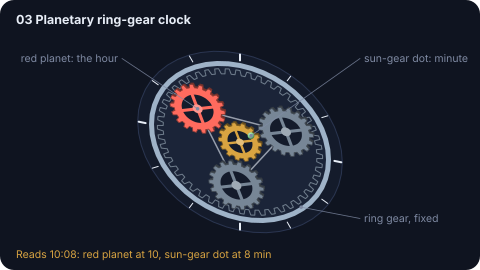

No hands. A sun gear turns once an hour and its dot is the minute hand. Three planets
roll around inside a fixed ring gear, carried round once in 12 h, and the red one is
the hour hand. A single stage needs a ring with 11 times the sun's teeth to give 12:1,
so a real build would use a compound stage; the sketch is not to ratio.

**Reads:** like a dial once you know which planet is red. **Look for:** the planets
spinning backwards as they walk forwards.

### 4. Verge and foliot tower clock

The oldest mechanical escapement. A falling weight turns a crown wheel; two pallets on a
vertical rod catch it one tooth at a time and fling a weighted bar, the foliot, back and
forth. It has one hand because the real thing drifted by many minutes a day.

**Reads:** the hour only, which is honest about what such a clock knew. **Look for:**
the lurching tick, and the weight being wound back up at midnight.

## Pendulums

### 5. Pendulum wave

Twelve pendulums of graded length, tuned so each makes one more swing a minute than its
neighbour. They start in a line, smear into a travelling wave, split into interleaved
groups and snap back into line exactly every 60 s.

**Reads:** the shape is the seconds (in line at :00, two alternating groups at :30), lit
bobs count the hour, and beads on the beam count the minutes. **Look for:** the snap
back into line.

### 6. Foucault pendulum and pegs

The museum set piece: a long pendulum whose swing plane slowly turns, toppling a ring of
pegs. A real one turns with the Earth, once in 24 h divided by the sine of the latitude,
which is about 101 h in Bangkok and 37 h at 40° N. This one is geared to half a turn an
hour, so each end of the swing topples 30 pegs.

**Reads:** pegs down are the minutes, lamps around the edge are the hour. **Look for:**
all 60 pegs standing back up on the hour.

### 7. Conical pendulum

A ball on a wire that circles instead of swinging, one lap a minute, with no tick at
all. French makers sold clocks like this in the 19th century. Its shadow on the dial
below is the seconds hand, and two beads on rings carry the minutes and hours.

**Reads:** like a dial. **Look for:** nothing in particular; this is the calmest of the
first 30 and suits a room where people are talking.

## Water and sand

### 8. Float clepsydra

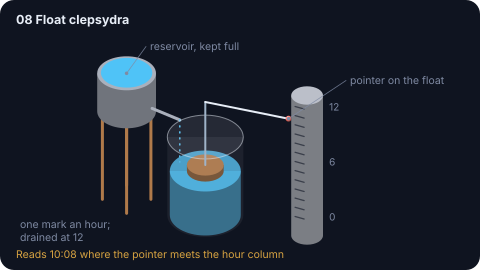

The ancient Greek design credited to Ctesibius. A reservoir kept brim‑full drips at a
constant rate into a cylinder; a float rises with the water and carries a pointer up an
hour column.

**Reads:** the pointer's height. **Look for:** 12 o'clock, when the cylinder siphons
empty in one gulp and the pointer drops back to the bottom.

### 9. Siphon time-flow clock

Loosely after Bernard Gitton's glass water clocks. A pendulum meters coloured water into
glass vessels: 12 hour bulbs, five ten‑minute vessels and a tube for single minutes.
Each one fills, and a siphon empties it the moment it is full.

**Reads:** count the full vessels (the sketch shows 10:38). **Look for:** the hour,
when the minute vessels all drain into one hour bulb.

### 10. Tipping-bucket binary cascade

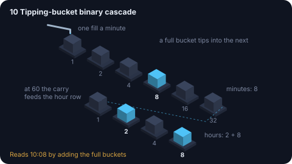

Each bucket tips on its second fill and pours into the next one down, so a staircase of
them is a binary counter made of water. A full bucket is a 1. Six buckets count the
minutes and pass a fill to a row of four for the hours.

**Reads:** add up the full buckets, so this is one to decode. **Look for:** minute 31
to 32, when five buckets tip in a row.

### 11. Hourglass carousel

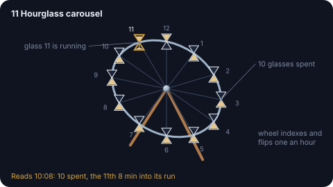

Twelve one‑hour glasses on a wheel. On the hour the wheel steps round and the next glass
turns over.

**Reads:** spent glasses are the hour, and the sand level in the running glass is the
minutes. **Look for:** noon and midnight, when the whole wheel inverts and all twelve
start again.

### 12. Sand table that writes the time

A steel ball, dragged by a magnet under the table, ploughs the digits into fine sand,
in the manner of kinetic sand tables. A wiper bar levels a digit before it is rewritten.
Low raking light does the rest.

**Reads:** the digits, directly. **Look for:** the ball taking most of the minute to
write the minute.

### 13. Water-curtain digits

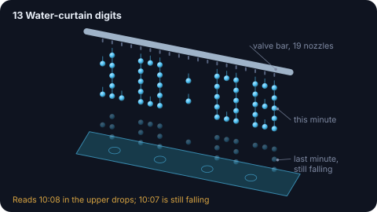

A bar of 19 valves releases drops row by row, so the digits form in mid‑air and fall as
a sheet, like the graphic waterfalls built in some stations and malls. Real drops fall
1.4 m in about half a second, so the scene would slow gravity to let each image hang.

**Reads:** directly, but only while the image is falling. **Look for:** two minutes on
screen at once, the old one hitting the pool as the new one forms.

## Balls and chain reactions

### 14. Congreve rolling-ball clock

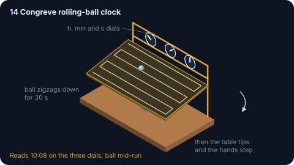

William Congreve's 1808 design. A ball takes 30 s to zigzag down a tilted brass table.
At the end it trips a latch, the table tilts the other way and the hands step. The real
ones keep poor time because dust slows the ball; a simulated one has no dust.

**Reads:** three small dials. **Look for:** the tip at each half minute.

### 15. Rolling-ball rail clock

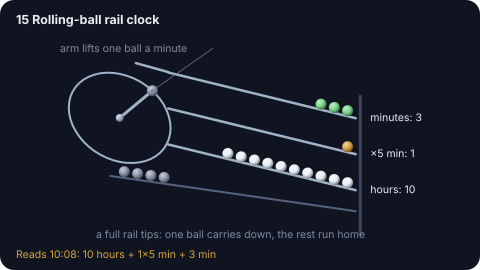

The 1970s desk toy. An arm lifts one ball a minute onto the top rail. When a rail is
full it tips: one ball drops to the rail below and the rest run home.

**Reads:** add the rails, hours plus five‑minute balls plus single minutes. **Look
for:** 12:59 to 1:00, when every rail dumps at once.

### 16. Domino ring

Sixty dominoes in a ring fall one a second. A reset arm follows half a lap behind and
stands them back up, so the wave never stops. Inside are a ring of 60 minute tiles and
12 hour blocks, one of each raised.

**Reads:** like a dial: the falling front is the seconds hand. **Look for:** the hour,
when the inner rings could topple too.

### 17. Sixty-second chain reaction

A Rube Goldberg machine timed to take exactly one minute: ramp, dominoes, seesaw, bucket
and string. Its last act is to drop the minute flap, and then every piece re‑arms.
Several machines could take turns, so no two minutes look alike.

**Reads:** the flap display, and how far along the chain the action is. **Look for:**
the last five seconds.

### 18. Marble pixel board

Marbles drop from a hopper through gates into a grid of 19 by 5 pockets and spell the
time. On the minute, trapdoors release only the digits that changed and a screw lift
carries the marbles back up.

**Reads:** the digits, directly. **Look for:** the hour, when all four digits empty and
refill.

## Light, shadow and fire

### 19. Sundial under a real sun

An ordinary horizontal sundial, lit by a sun placed where it really is for the date, the
time and the home's latitude. Day length and the seasons come for free. At night the
moon casts a fainter shadow, or the numerals glow.

**Reads:** the shadow on the hour lines. A true sundial differs from clock time by up to
about 16 min over the year, so the scene either shows that honestly or nudges its sun.
**Look for:** sunrise and sunset.

### 20. Shadow-digit sculpture

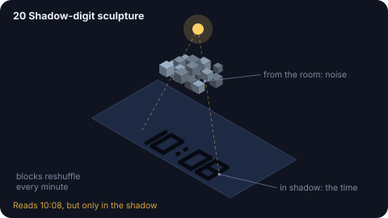

A cloud of blocks that looks like noise from the room, but whose shadow under one lamp
reads the time. Digital sundials use the same trick. Each minute the blocks reshuffle
into a different cloud with the next shadow.

**Reads:** only in the shadow, never in the object. **Look for:** the reshuffle, when
the shadow dissolves and reforms.

### 21. Anamorphic shards

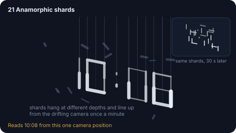

Fragments hang at different depths like a mobile. From one viewpoint they line up into
the digits; from anywhere else they are debris. The camera drifts on a loop that reaches
the sweet spot once a minute and holds it for a few seconds.

**Reads:** only at alignment, so it wants the overlay clock. **Look for:** the moment
it resolves. This idea cannot exist as a flat clock.

### 22. Candle clock with dropping balls

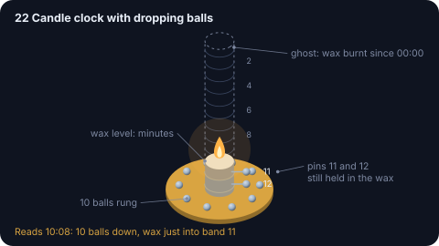

A marked candle burns one band an hour. A pin at each mark holds a metal ball; when the
wax melts past the pin, the ball drops into a brass dish. A new candle is lit at 00:00
and at 12:00.

**Reads:** balls in the dish are the hour, and the wax level within its band is the
minutes. **Look for:** a ball dropping on the hour, and the room dimming as the candle
shortens.

## Sky

### 23. Orrery geared to the clock

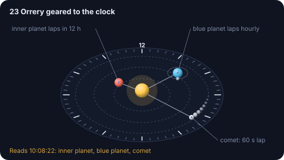

A brass orrery whose three bodies lap in 12 h, 1 h and 60 s instead of years. A second
mode could put the real planets where they are tonight and show the time on the Earth's
own rotation.

**Reads:** like a dial with planets for hands. **Look for:** the comet's lap each
minute, and the three lining up at 12:00.

### 24. Globe in a 24-hour sun ring

The Earth turning once a day inside a fixed ring marked 0 to 24, with 12 always facing
the sun. Home's meridian meets the ring at the local time, and the day and night line
shows who else is awake.

**Reads:** follow the home pin to the ring; every other city reads the same way. **Look
for:** city lights coming on as places cross into night.

### 25. Star dome with the Plough as hand

The night sky over the house. The line from Merak through Dubhe to Polaris sweeps
anticlockwise once per sidereal day, which is how a 16th‑century nocturnal told the
time. The stars gain about 4 min a day on the clock, so the ring is turned for the date.

**Reads:** the pointer on a 24 h ring (the sketch shows 22:08). It works only at night,
so it pairs with the sundial for the day. **Look for:** satellites and the moon.

## Digit machines

### 26. Split-flap wall

A station departure board, modelled with every flap on its drum and the camera close
enough to see the flaps blur. The clatter is half the charm, and the plan keeps
screensaver sound off, so this is the silent version.

**Reads:** directly, from anywhere in the room. **Look for:** the hour, when all four
drums spin.

### 27. Pin-field relief

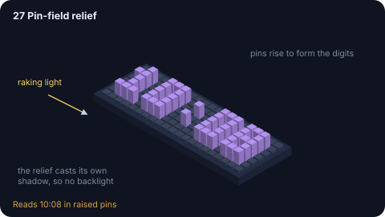

A bed of square pins that rise to form the digits in relief, like a pin‑art toy or MIT's
inFORM table. A low raking light gives all the contrast, so nothing on screen is bright.
Changes sweep across the bed as a wave.

**Reads:** directly. **Look for:** the wave. This is the kindest of the first 30 to an OLED
panel.

### 28. Construction crew

After Maarten Baas's Real Time films. A tiny crew with a crane takes down and rebuilds
the digits out of planks, and each minute takes the whole minute to build.

**Reads:** directly, though the last digit is always in progress. **Look for:** the
hour, when all four digits come down and the crew has to hurry.

## Living things and toys

### 29. Train loops

Three concentric model railway loops with a station at each of the 12 positions. A short
hour train runs the inner loop, a longer minute train the middle, and a single express
car laps the outer loop once a minute.

**Reads:** like a dial with trains for hands. **Look for:** the trains passing each
other at 12:00.

### 30. Hour tree

A tree that grows a branch every hour. The newest branch grows a leaf every five minutes
and a bud for each minute between. At 00:00 and 12:00 the leaves fall and it starts
again. The season could follow the date.

**Reads:** count branches, then leaves and buds, so it is slow to read. **Look for:**
the leaf fall. This is the most ambient of the first 30.

## The other 20

These complete the original 50. They began as a one-line bench under the first 30, and
were sketched after Will said "go ahead and add mockups for the extra 20" (2026‑11‑21).
They are in no particular order, and several of them carry only part of the time
themselves; where that is so, the entry says what carries the rest. The attributions
(the incense seal clocks, Ferrolic, the 365 Knitting Clock) are from memory and I have
not looked them up.

### 31. Newton's cradle

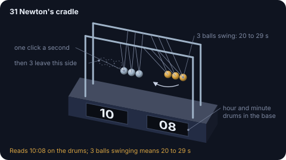

A six-ball cradle that clicks once a second. One ball swings for the first ten seconds
of the minute, two for the next ten, and so on, so the size of the swinging group
counts the tens of seconds. The hour and minute sit on numeral drums in the plinth.

**Reads:** hour and minute directly from the drums; the cradle itself carries only the
seconds. **Look for:** :50, when all six swing together and the clicking stops until
the minute.

### 32. Metronome forest

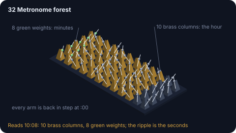

Sixty metronomes in 12 columns of five, each set a shade faster than the last, so they
drift apart and all come back into step on the minute. The brass columns count the
hour and the green weights count the minutes. It is the pendulum wave (5) again,
denser and with more to count.

**Reads:** count the brass columns, then the green weights. **Look for:** the last few
seconds of each minute, when the ripple closes up into one beat. A real one is mostly
about the sound, and the plan keeps sound off.

### 33. Galton board

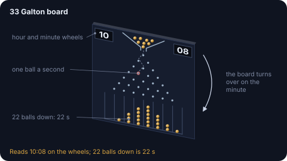

One ball a second drops through a triangle of pegs into a row of bins, so a bell curve
builds over the minute. On the minute the board turns over and the balls run back to
the hopper. The hour and minute are on two numeral wheels in the top corners. Each
ball's path would be picked from a hash of the time, which keeps the scene a function
of the clock.

**Reads:** seconds from how full the bins are; hour and minute from the wheels.
**Look for:** the board turning over, and the curve coming out the same shape by a
different route every minute.

### 34. Marble spiral towers

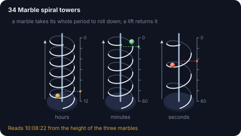

Three spiral ramps, for hours, minutes and seconds. A marble takes its whole period
to roll from top to bottom (12 h, 60 min, 60 s) and a lift returns it, so each marble's
height against the scale beside it is a hand.

**Reads:** three heights against three scales, so slower than a dial. **Look for:**
the seconds marble riding the lift once a minute, and all three at the top at 12:00.

### 35. Incense seal clock

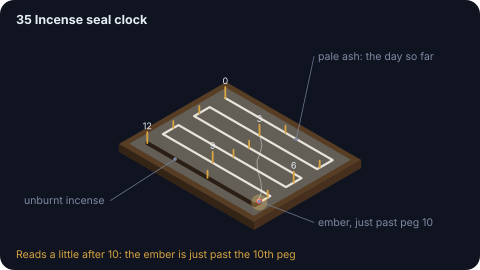

After the Chinese incense seal clocks: a line of incense powder laid in a maze on a
bed of ash, burning from one end for 12 h, with a peg at every hour. The pale burnt
trail is the day so far.

**Reads:** the hour from the nearest peg and the minutes by how far the ember is past
it, so to within about ten minutes. **Look for:** the glow and the smoke, and the seal
being relaid at 00:00 and 12:00.

### 36. Melting ice block

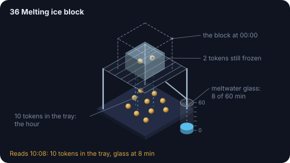

A block of ice on a grille with 12 tokens frozen into it at different depths. It melts
over 12 h and drops a token into the tray each hour. The meltwater runs to a glass that
fills over the hour and is emptied when the token drops.

**Reads:** count the tokens in the tray, then read the glass for the minutes.
**Look for:** the token dropping on the hour, and a fresh block at 00:00 and 12:00.

### 37. Lava-lamp digits

A wide lava-lamp tank. Wax blobs rise from the heated base and merge into the four
digits near the top. Just before the minute they sag and sink apart, and the next
minute's digits form out of the next rise.

**Reads:** directly while the digits hold, and not at all during the change.
**Look for:** the digits melting.

### 38. Ferrofluid digits

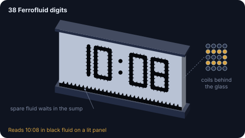

A thin glass tank of black ferrofluid in front of a lit panel, with a grid of
electromagnets behind. The magnets that are switched on pull fluid up out of the sump
into spiky numerals. Zelf Koelman's Ferrolic display did this for real.

**Reads:** directly. **Look for:** the fluid dropping back and climbing again at each
change. The lit panel is the largest bright area in any of the 50, so it would need to
be dim or kept moving.

### 39. Bamboo tipper and pond

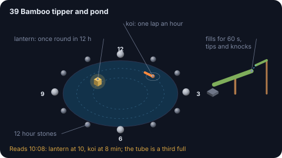

A shishi-odoshi: a bamboo tube fills from a spout for a minute, tips, empties and
knocks back on a stone. It stands by a pond ringed with 12 stones. A floating lantern
drifts once round the pond in 12 h and a koi laps it once an hour.

**Reads:** like a dial, with the lantern as the hour hand, the koi as the minute hand
and the tube's fill as the seconds. **Look for:** the tip on the minute. The knock is
the point of a real one, and the plan keeps sound off.

### 40. Tide harbour

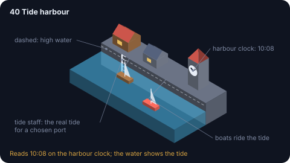

A model harbour whose water level follows the real tide for a chosen port. Boats rise
and fall on their moorings and a tide staff on the quay shows the level. The time
itself is only on the harbour clock.

**Reads:** from the tower dial, which is small in the scene; the tide is a second,
slower thing to read. **Look for:** boats settling on the mud at low water. It needs
tide predictions for the port, and I have not looked for a source.

### 41. Armillary sphere

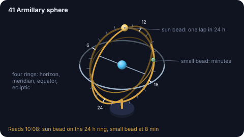

Brass rings for the horizon, meridian, equator and ecliptic around a small Earth. A
sun bead travels the equator ring once in 24 h against hour marks, and a smaller bead
laps the ecliptic ring once an hour for the minutes. It is close kin to the globe (24).

**Reads:** with practice, since the hour ring is a 24 h dial seen at an angle.
**Look for:** the sun bead crossing the meridian ring at 12:00.

### 42. Moon lantern

A moondial. A lit model moon, showing the true phase for the date, circles overhead
once in 12 h, and the shadow it throws from the central post is the hour hand. A small
lantern on a lower, wider circle laps once an hour and throws the longer minute shadow.

**Reads:** like a dial with shadows for hands, both pointing away from their lamps.
**Look for:** the phase changing through the month, and the two shadows crossing.

### 43. Lighthouse

A lighthouse on a rock inside a ring of 12 rocks. The beam sweeps the ring once a
minute, a boat circles once an hour, and the lit windows up the tower count the hour.

**Reads:** the beam and the boat like hands; the windows are counted.
**Look for:** the beam passing over the boat, and all the windows going dark at 12:00.

### 44. Mirror and haze

Three mirrors turn on a central column and throw three beams through haze onto a drum
of gauze. A beam cannot stop halfway, so the hands are all the same length and are
told apart by colour, width and height: wide amber for the hour, green for the minute,
thin red for the second.

**Reads:** like a dial once the colours are learned. **Look for:** the beams crossing
in the haze. The scene is mostly dark, which is kind to an OLED panel.

### 45. Flip-dot wall

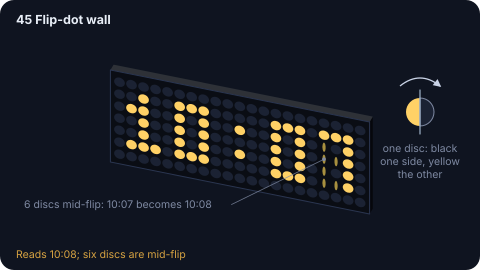

A wall of discs, black on one side and yellow on the other, each flipped by a coil,
as on old bus and station signs. The digits are redrawn every minute, and in 3D the
discs can be seen turning edge-on as they go.

**Reads:** directly. **Look for:** the hour, when most of the wall flips at once.

### 46. Twist tower

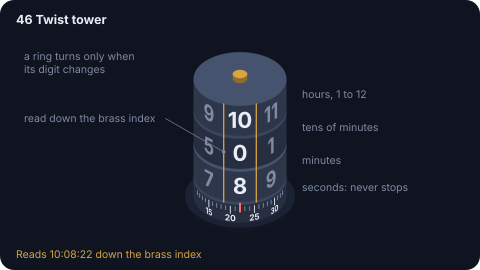

Stacked drums with numerals round their sides: hours, tens of minutes and minutes,
over a seconds ring that never stops. Each drum turns only when its digit changes, and
the time is read down a brass index on the front.

**Reads:** directly, but top to bottom rather than left to right. **Look for:** the
hour, when three drums turn together.

### 47. Abacus

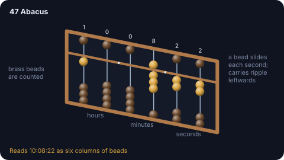

A soroban with six rods, two each for hours, minutes and seconds. The bead above the
beam counts five and the four below count one each. The beads slide by themselves
every second and carry to the left.

**Reads:** decoded, unless you already read an abacus. **Look for:** the carries at
:59, which ripple across several rods.

### 48. Cuckoo village

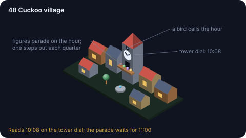

A glockenspiel town: houses round a clock tower. A figure steps onto the balcony at
each quarter, they all parade on the hour, and a bird calls the count.

**Reads:** from the tower dial, which is small in the scene. **Look for:** the parade
on the hour, and the windows lighting at dusk.

### 49. Knitting clock

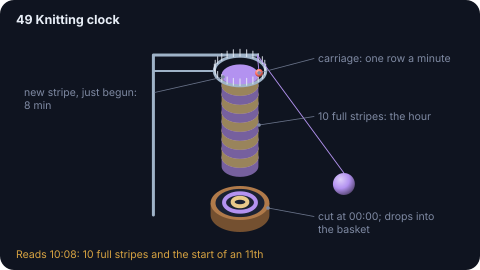

After Siren Elise Wilhelmsen's 365 Knitting Clock, speeded up. A circular knitting
machine knits one row a minute and changes yarn on the hour, so the hanging tube gains
a stripe an hour. The carriage laps the needles once a minute. At 00:00 the day's
knitting is cut and drops into the basket.

**Reads:** count the stripes for the hour; the depth of the newest stripe gives the
minutes only roughly. **Look for:** the colour change on the hour and the cut at 00:00.

### 50. Window city

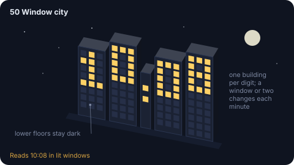

A city block at night with one building for each digit. The lit windows on the top
five floors form the digit, and a narrow tower between the pairs has two lit windows
for the colon.

**Reads:** directly. **Look for:** a window or two changing on the minute. The sky
could follow the real time of day.
