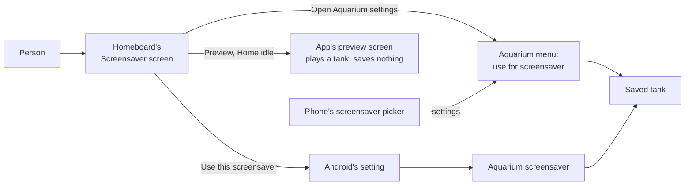

# Screensavers across Homeboard, the World Foundry apps and Android

**Status (2026‑11‑26):** investigation for Will, with three decisions open (below). Nothing
here is built. It reframes Stage 5 of the [screensaver plan](../plans/2026-11-20-screensavers.md),
which is on hold.

## Three questions, three owners

Every screensaver answers three questions. Today each has a different owner, and one has none.

| Question | Who answers it today | Evidence |
|---|---|---|
| **When** does it start? | Android's idle time, in every app. Homeboard can add its own timer, on Home only. | [how‑to](../how-to/screensaver.md); [Stage 0](../testing/2026-11-20-screensavers-stage0.md) Q1 |
| **Which** screensaver runs? | Android's setting. On Google TV no screen lets a person change it; Homeboard can, after a one‑time `adb` command ("Use everywhere"). Phones and tablets have their own picker. | Stage 0 Q2, Q5, Q9 |
| **What** does it show: which tank, which clock? | **Nobody a person can reach.** Aquarium and Clocks each keep a saved choice that only `adb` can change. Neither app's menu sets it, and neither declares Android's settings link. | WorldFoundry [`android/screensaver/README.md`](../../../WorldFoundry-wbniv/android/screensaver/README.md); its `res/xml/dream.xml` is empty |

How it fits together today:

## What this shows

1. **Google TV is the hard case.** Someone without `adb` can install Aquarium there and never
   see its screensaver, except through Homeboard, whose Use everywhere itself needs one `adb`
   command per TV.
2. **Android cannot preview another app's screensaver.** Homeboard can only play one by
   starting that app's own preview screen, which both World Foundry apps already export.
3. **Homeboard's screensaver on Home does not keep the screen on** (no `KEEP_SCREEN_ON` or wake
   lock in its code), so Android's own screensaver probably starts over it when Android's
   time runs out: 10 min on Cast1. Not yet seen on a device (Stage 0 Q7).
4. **Homeboard already has Open ‹app› settings** for any screensaver that declares Android's
   settings link (`settingsActivity`). The World Foundry apps declare none.

## Proposed: one owner per question

| Question | Owner | Change needed |
|---|---|---|
| When | Android's idle time. Settled on 2026‑11‑20 ("change everywhere is the desire"); Homeboard's own timer stays for a TV it does not manage. | None |
| Which | Android's setting; on Google TV, Homeboard is the picker (Use everywhere). | None |
| What | **Each app, in its own menu**, reached through Android's standard settings link. Homeboard's Open ‹app› settings and a phone's screensaver picker then open it with no new Homeboard code. | WorldFoundry: a "use for screensaver" choice and the link |
| Play on Home and Preview, no `adb` | Homeboard starts the app's own preview screen for one run. | WorldFoundry: declare the preview screen's names (no access rights). Homeboard: Stage 5 without the tank choice |

## Decisions for Will

1. **Who chooses the tank or clock?**
    - **The app (recommended).** Works on every device, with or without Homeboard. No app has
      to trust another, and Homeboard needs no new code. You lose picking a tank from
      Homeboard's own list or its phone controller: they open the app's menu instead.
    - **Homeboard.** Needs the trust list in the
      [companion contract](../plans/2026-11-26-screensaver-companion-contract.md), kept current
      for every Homeboard signing key, including a test key to remove before publishing.
    - **The app now, Homeboard later** if the phone controller turns out to need it.
2. **Should Homeboard play installed World Foundry screensavers on Home and in Preview?**
    - **Yes (recommended).** It is the only way someone without `adb` sees them on Google TV,
      and it gives Preview. The apps only declare names; nothing gains access to anything.
      Still to check: a ringing timer must bring Homeboard back while the app's screen is in front.
    - **No.** World Foundry screensavers run only through Use everywhere.
3. **The default screensaver.** Homeboard's Clock today. Will, 2026‑11‑20: "perhaps some sort
   of world foundry 3d clock? i'll provide that later". The Clocks app now exists.
    - **Keep Clock and offer the Clocks app (recommended until Homeboard is published).** No
      new obligations.
    - **Compile a World Foundry clock into Homeboard.** It is there at once, but Homeboard grows
      by about 3.5 MB, its build needs the engine, the licence grant must be written down, and
      every scene fix needs a Homeboard release
      ([distribution research](2026-11-20-screensaver-distribution.md#the-bundled-default)).

## Not decided here

- Stage 0 Q7, Android's screensaver over Homeboard's: needs a device run.
- Installing apps from Homeboard (the rest of Stage 5): unchanged, waits on publishing.
- Seahorse Grid stays its own app (WorldFoundry decision D7); Planted Tank is being retired.
