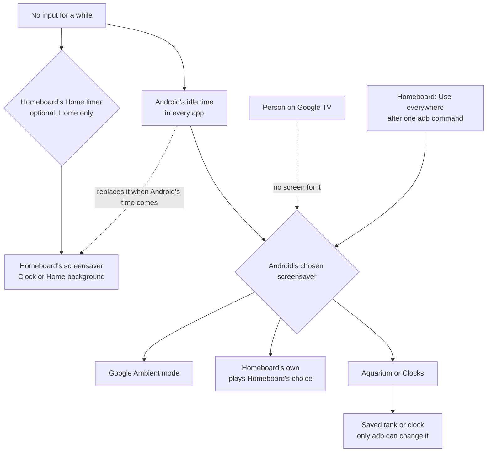
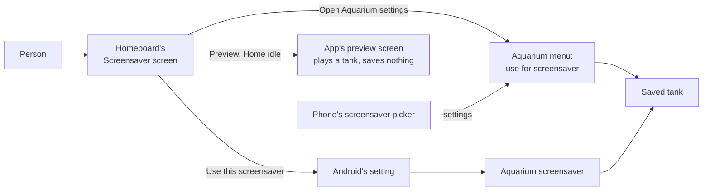

# Screensavers across Homeboard, the World Foundry apps and Android

**Status (2026‑11‑26):** four decisions made by Will (below). Nothing here is built. It
reframes Stage 5 of the [screensaver plan](../plans/2026-11-20-screensavers.md).

## Three questions, three owners

Every screensaver answers three questions. Today each has a different owner, and one has none.

| Question | Who answers it today | Evidence |
|---|---|---|
| **When** does it start? | Android's idle time, in every app. Homeboard can add its own timer, on Home only. | [how‑to](../how-to/screensaver.md); [Stage 0](../testing/2026-11-20-screensavers-stage0.md) Q1 |
| **Which** screensaver runs? | Android's setting. On Google TV no screen lets a person change it; Homeboard can, after a one‑time `adb` command ("Use everywhere"). Phones and tablets have their own picker. | Stage 0 Q2, Q5, Q9 |
| **What** does it show: which tank, which clock? | **Nobody a person can reach.** Aquarium and Clocks each keep a saved choice that only `adb` can change. Neither app's menu sets it, and neither declares Android's settings link. | WorldFoundry [`android/screensaver/README.md`](../../../WorldFoundry-wbniv/android/screensaver/README.md); its `res/xml/dream.xml` is empty |

How it fits together today:

## What this shows

1. **Google TV is the hard case.** Someone without `adb` can install Aquarium there and never
   see its screensaver, except through Homeboard, whose Use everywhere itself needs one `adb`
   command per TV.
2. **Android cannot preview another app's screensaver.** Homeboard can only play one by
   starting that app's own preview screen, which both World Foundry apps already export.
3. **Android's own screensaver replaces Homeboard's when Android's time comes.** Seen on Cast1
   on 2026‑11‑26: Homeboard's Clock played from 1 min, and Android's selected screensaver took
   over at Android's idle time, leaving Homeboard's paused underneath
   ([Q7 record](../testing/2026-11-26-screensaver-q7.md)). Homeboard holds no wake lock and does
   not keep the screen on. So on a TV Homeboard does not manage, its screensaver is only a
   lead‑in to Android's, which on Google TV is Ambient mode unless someone changed it with `adb`.
4. **Homeboard already has Open ‹app› settings** for any screensaver that declares Android's
   settings link (`settingsActivity`). The World Foundry apps declare none.

## Proposed: one owner per question

| Question | Owner | Change needed |
|---|---|---|
| When | Android's idle time. Settled on 2026‑11‑20 ("change everywhere is the desire"); Homeboard's own timer stays for a TV it does not manage. | None |
| Which | Android's setting; on Google TV, Homeboard is the picker (Use everywhere). | None |
| What | **Each app, in its own menu**, reached through Android's standard settings link. Homeboard's Open ‹app› settings and a phone's screensaver picker then open it with no new Homeboard code. | WorldFoundry: a "use for screensaver" choice and the link |
| Play on Home and Preview, no `adb` | Homeboard starts the app's own preview screen for one run. | WorldFoundry: declare the preview screen's names (no access rights). Homeboard: Stage 5 without the tank choice |

## Decisions

**Decided by Will on 2026‑11‑26:** "go with your recommendations on all four". Decision 4 had
no recommendation when he answered; the one given in the same reply is recorded below, and he
can still reverse it.

1. **Who chooses the tank or clock? The app.** Each app gets its own "use for screensaver"
   choice, reached through Android's standard settings link. That works on every device, with or
   without Homeboard; no app trusts another, and Homeboard needs no new code. Given up: picking a
   tank from Homeboard's own list or its phone controller, which open the app's menu instead.
   Rejected: Homeboard choosing, which needed the trust list in the
   [companion contract](../plans/2026-11-26-screensaver-companion-contract.md). It can be
   revisited if the phone controller needs it.
2. **Homeboard plays installed World Foundry screensavers on Home and in Preview: yes**, through
   each app's own preview screen, with names the apps declare and no access rights. It lasts only
   until Android's idle time on a TV Homeboard does not manage (point 3). Still to check: a ringing
   timer must bring Homeboard back while the app's screen is in front.
3. **The default screensaver: keep Homeboard's Clock and offer the Clocks app** until Homeboard is
   published. Will, 2026‑11‑20: "perhaps some sort of world foundry 3d clock? i'll provide that
   later". Rejected for now: compiling a World Foundry clock into Homeboard, which would add about
   3.5 MB, the engine in Homeboard's build, a written licence grant, and a Homeboard release for
   every scene fix ([distribution research](2026-11-20-screensaver-distribution.md#the-bundled-default)).
4. **Homeboard does not keep the screen on while its own screensaver plays.** Doing so would
   override the TV's own power settings, including turning the TV off, and need a shutdown limit
   of Homeboard's own. On a TV Homeboard manages, Android plays Homeboard's choice for the whole
   idle time anyway. Homeboard's screen should say that Android's screensaver follows its own
   (see the [user guide](../how-to/screensaver.md#when-it-starts)).

## Without debugging switched on

Will asked (2026‑11‑26) what still works once USB and wireless debugging are switched off
after the one‑time `adb` command. Expected, from Android's design and other apps' setup
guides, but not tried on our devices, which the coordinator reaches through debugging:

| | After debugging is switched off |
|---|---|
| Homeboard's own screensaver, its options and Home timer | Works; never needed `adb` |
| The screensaver Android already uses | Keeps running; Android stores the choice itself |
| Use this screensaver, Undo and Restore everywhere | Should work: the permission stays with the installed Homeboard, which checks it on every change. Lost on uninstall or reset; then the setup screen returns |
| Which tank or clock a World Foundry app shows | Cannot be changed; today only `adb` changes it (decision 1) |

## Not decided here

- Debugging switched off: a device check needs a person to switch it off, change the
  screensaver in Homeboard and switch it back on for a coordinator read.
- Stage 0 Q7's wake half: where the TV returns after Android's screensaver, and what Homeboard
  does then. The coordinator's `check` stops watching once another app is in front.
- Installing apps from Homeboard (the rest of Stage 5): unchanged, waits on publishing.
- Seahorse Grid stays its own app (WorldFoundry decision D7); Planted Tank is being retired.
