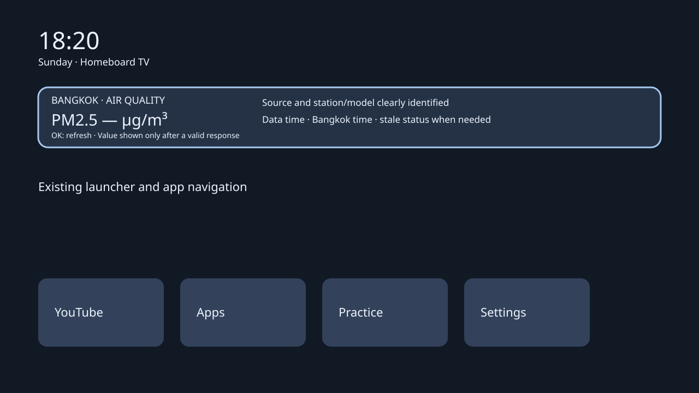
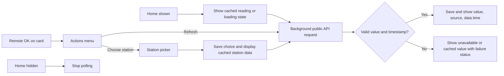
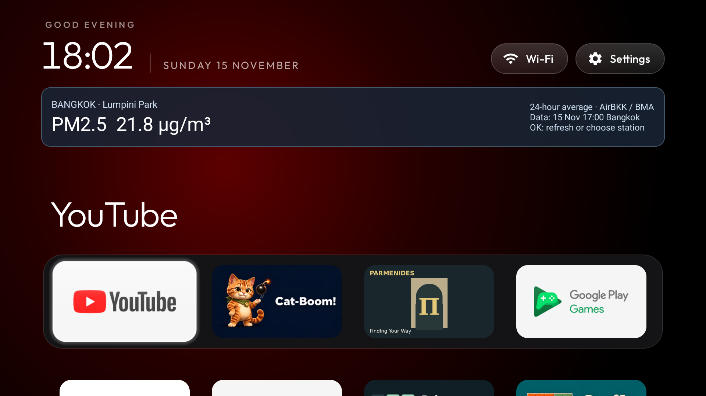
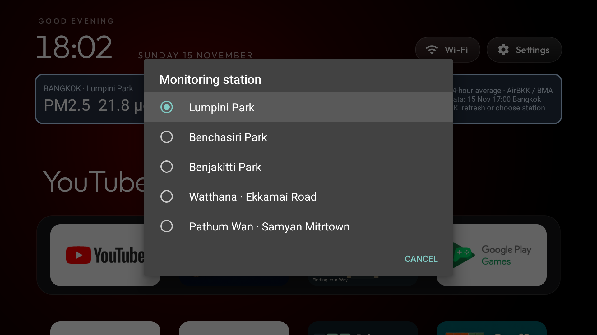
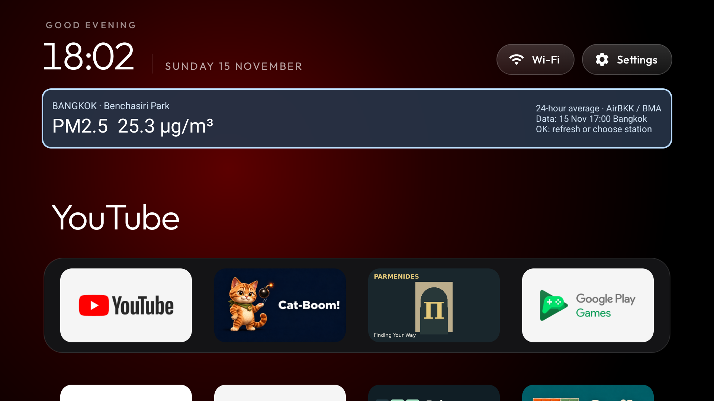

# First integration: Bangkok air quality

Will wants one useful native card in the CleanYourTV-derived launcher, with minimal
setup. No Home Assistant, MagicMirror server or integration bridge is required.
The TV fetches a public feed directly. AirBKK provides measured station data over HTTPS without an account or API key.
No model estimate is substituted for a station measurement.

The card is above the app grid so it reserves its own space. Up/Down move between
native controls. OK opens a small menu with Refresh reading and Choose monitoring station.
The picker offers Lumpini Park (default), Benchasiri Park, Benjakitti Park,
Watthana/Ekkamai Road and Pathum Wan/Samyan Mitrtown. Selecting a station saves
the choice and displays its cached reading while refreshing. Requests have a
30-second manual cooldown. Poll only while Home
is visible; bound request duration and response size. Preserve the last successful
reading during outages, label stale data and never substitute zero for missing data.
The widget backfills up to 720 distinct hourly points from the official AirBKK
report's 24-hour moving-average series into a circular buffer, then extends the
history with new station updates. Its separate 24H and 30D sparklines are labeled
by their time windows, not as instantaneous readings. Thai PCD condition bands use
blue/green/yellow/orange/red across the value, trends and full tile background. A
text label and orange/red triangle with a plain-language outdoor activity cue
supplement the color. The numeric
24-hour threshold ranges and their official source are documented in the
[flexible grid plan](2026-11-15-flexible-home-grid.md#pm25-tile).

- [x] Define the native card and direct-fetch architecture.
- [x] Select and document the public source.
- [x] Implement parsing, refresh, cache and lifecycle.
- [x] Run 320 tests, lint and packaging in the build container.
- [x] Validate live data, layout, station selection and dock focus through the shared coordinator.

## Source and behavior

The [official AirBKK dashboard](https://official.airbkk.com/airbkk/th) uses an empty
POST to `https://official.airbkk.com/airbkk/Api` to read public station data.
Its table labels PM2.5 as µg/m³, average 24 hours. The integration reads `MeasIndex`,
`PM2.5` and `DateTime` from its `message` array; station time is interpreted in
Asia/Bangkok. Station 114 is Lumpini Park. This is one named station, not an
average across Bangkok or a reading at Will's home.

Refresh every 15 minutes while Home is visible. Mark data older than three hours
STALE. Keep valid cached data on request failure, with a refresh-failed label.
Reject missing/negative/non-finite values, invalid dates, timestamps more than ten
minutes ahead of the device clock and a response older than the saved reading.
The feed currently needs no credentials. It is the site's public endpoint, not a
versioned API contract; availability/schema and redistribution terms need review
before a public Play release. Attribution appears on the card.

Air4Thai was evaluated but its HTTPS endpoint failed certificate validation;
HTTP redirected to the same endpoint. No TLS verification bypass is implemented.
Open-Meteo was reachable but supplies modeled estimates, so it was not selected.

This first version uses English UI and a fixed shortlist of stations. Other launcher
themes, race panels and accessibility settings need separate layout validation.

## Device evidence

Coordinator job `J‑4680558986b5` completed on the shared Chromecast after automatic
recovery/retry of an installation timeout (`J‑caa873a66983`). Screenshots confirm
live data, card focus, the actions menu, the station picker, switching from Lumpini
to Benchasiri, and return to dock focus. The default launcher was not changed.
Full local evidence is in `evidence/air-quality-first/` (ignored by Git).

The values in these screenshots are historical test readings, not current advice.
The device pass preceded extracting the same card into a shared layout for Hebrew
and default resources; final packaging checks cover that correction. No full-device
offline simulation, extended soak test or alternate-language device test is claimed.

Final container recheck passed all 320 tests, debug lint (zero errors, 98 inherited
warnings and 96 informational findings), debug APK and unsigned release bundle.
The shared-layout correction adds no lint warnings.

## Contribution decision and next checks

The shared Hebrew/default card layout corrects an omission introduced by our new
feature. It was not an upstream CleanYourTV defect, so no upstream patch is planned.
Keep the air-quality feature here; isolate genuine upstream launcher bugs if found.
Prepare a showcase entry after a public usable release, with separate authorization
to publish. See [the contribution strategy](../upstream/README.md).

- [x] Verify the final shared-layout APK and saved station after relaunch.
- [x] Exercise the Refresh menu action and return to the top controls on the TV.
- [ ] Verify a manual request after its cooldown separately from UI invocation.
- [x] Recheck raw screenshots: header text is present; the earlier disappearance report was an image-preview artifact.
- [ ] Test outage/recovery and lifecycle behavior with controlled data or app-local
  fault injection; do not disrupt the shared device's network.
- [ ] Test alternate themes, RTL presentation and enlarged text.

The coordinator recipe now captures the saved station on startup, invokes Refresh,
changes station, returns to the dock and navigates back to the top controls.

## Final APK follow-up and corrected screenshot interpretation

Coordinator job `J‑a51c59e42d15` completed with APK SHA-256
`7a4e23fca428c61e5cd22d11ce2d972ac4316d576343560ba57117a5b91d26e8`.
It retained Benchasiri across the APK update/relaunch, loaded the newer 18:00 data,
switched to Benjakitti, and returned focus to the app dock and Wi-Fi control.
Evidence is in `evidence/air-quality-final/`. The early Refresh action occurred
inside the 30-second cooldown, so screenshots prove menu behavior, not a distinct
manual network request.

**Correction:** reinspection of `evidence/air-quality-final/input-frame-004.png`
as a fresh resized image shows the clock, date and controls intact. The earlier
report of disappearing header text was an image-preview artifact, not an observed
app defect. There is no upstream rendering fix justified by that evidence.

The [widgets-first interaction plan](2026-11-15-widget-home.md) now supersedes this
prototype's always-visible dock. The air-quality card is now an optional widget.

## Widget Home supersedes the original dock prototype

The [widget Home implementation](2026-11-15-widget-home.md) now hosts the card.
Station and settings menus are native overlays inside the activity window.
This is the chosen interaction structure, not a fix for a proven upstream rendering
defect. Current container validation passes 327 tests; screenshots are in the
[quick start](../how-to/quick-start.md).
