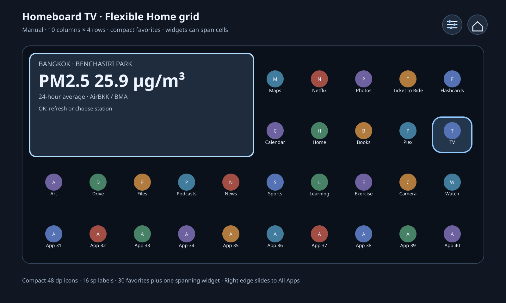
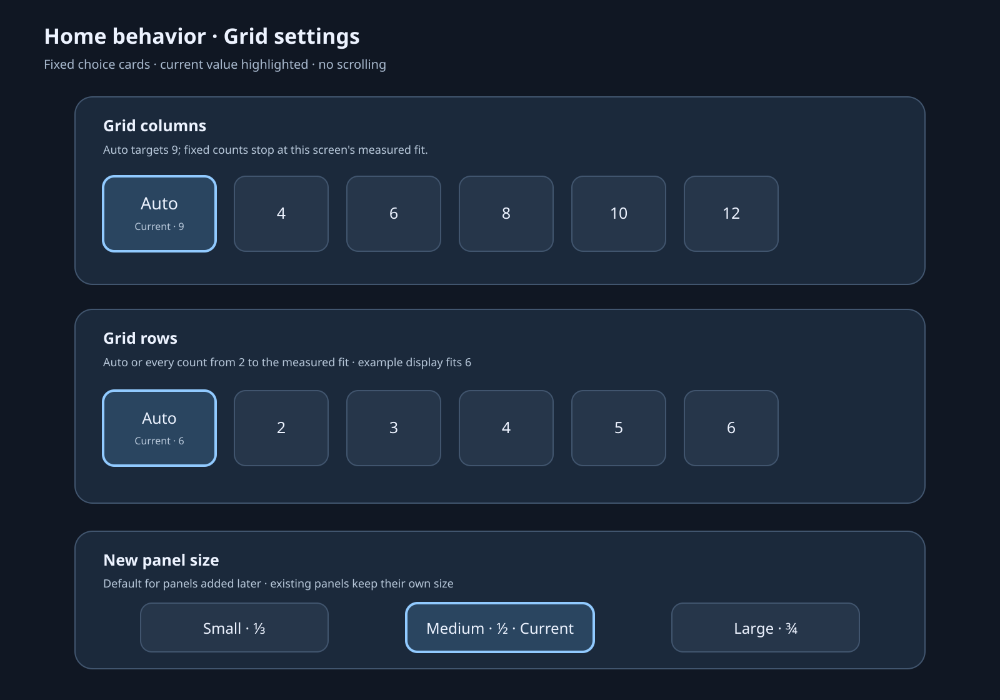
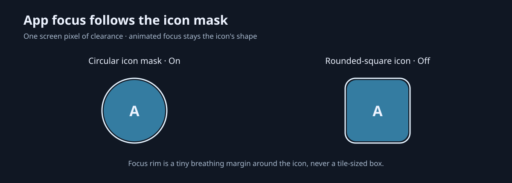
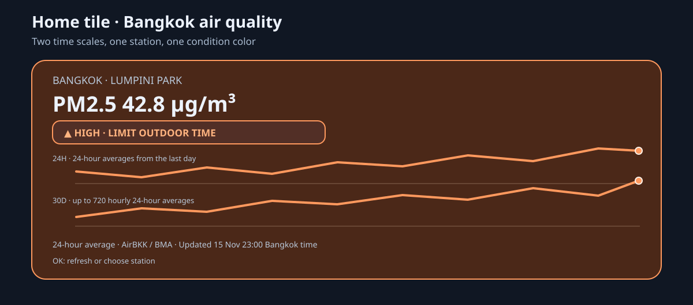
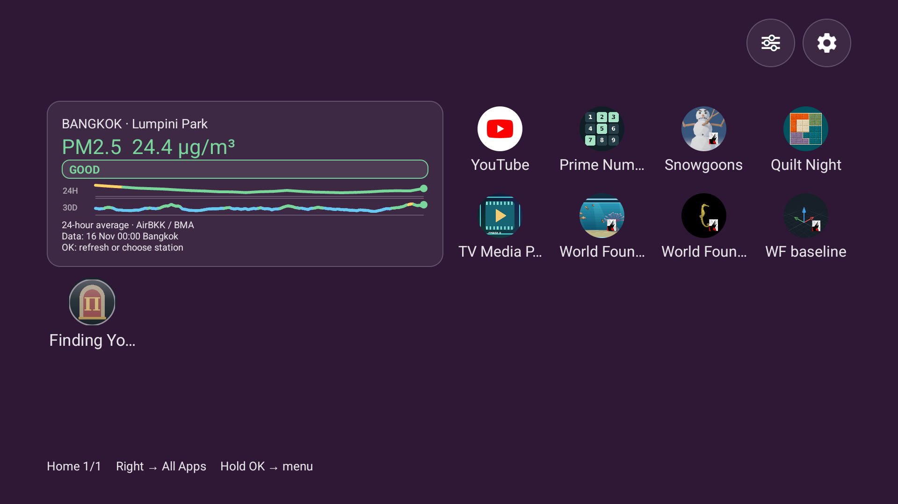
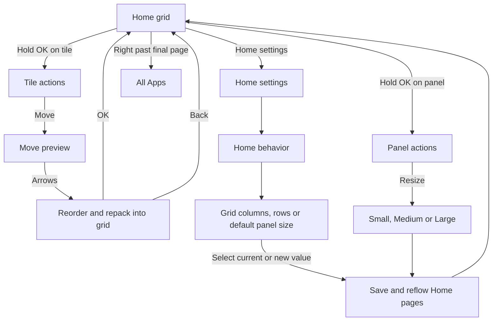

# Flexible Home grid

**Status: PM2.5 30D capture reviewed on Cast1; iterative testing remains on Cast1 until Will says Homeboard is usable, then moves to Cast2 · 16 November 2026**

Keep iterative installs on Cast1 while Will is still testing Homeboard. Move to
Cast2 after Will says the app is usable. Cast2 is currently reserved for personal
use; its earlier status does not change the active Cast1 test target.

Replace the fixed 2 × 2 dashboard placement with a responsive, configurable grid.
Home favorites use one cell for Small icons or two columns for Banners, selected
independently of All Apps in Appearance → Icons. See the
[Home favorite sizes plan](2026-11-16-home-favorite-app-sizes.md) and its mockups
for reflow and Undo. Widgets can span multiple cells and rows so they remain useful.

## Design decisions

- The Home grid uses a selectable column count: **Auto**, 4, 6, 8, 10 or 12. Auto
  chooses up to 9 columns according to the TV's usable width; fixed choices are
  capped at the device's measured fit.
- Rows offer **Auto** or any count from 2 through the number that fits on the TV.
  A page contains one configured grid; usable height and legibility determine the
  maximum instead of a short, arbitrary preset list.
- Small app favorites occupy 1 × 1 cells with circular or original launcher icons.
  Banners occupy 2 × 1 cells with 16:9 artwork, an icon fallback and rectangular
  focus. Both reserve label and focus clearance inside the measured cell.
- The air-quality widget spans two rows by default. Small, Medium and Large adjust
  widget spans relative to the selected grid; the placement algorithm packs
  favorites around each panel.
- Panels have three configurable sizes. Home behavior sets the default for newly
  added panels; existing panels keep their own size and expose a Resize action.
  Small, Medium and Large use roughly one third, one half and three quarters of
  the grid width; Large also uses a third row when available. App favorites use their selected span.
- Hold OK → Move changes ordering; tiles reflow into the configured grid. Arrows
  follow the nearest cell in the requested direction. Right/left page transitions
  remain animated; the last Home page still opens All Apps.
- Home settings → Home behavior owns Grid columns, Grid rows and New panel size. The
  choices show current state and use fixed pages/grids, with no scrolling.
- Store grid choices with the existing Home layout. Changing density reflows items
  without deleting, hiding or uninstalling anything.

The responsive placement and grid selectors are implemented. Auto defaults to nine
columns to leave some breathing room; selectable fixed choices are 4, 6, 8, 10 and
12. Rows default to Auto, with manual values from two through the measured display
fit. This iteration adds per-panel size and defaults, a condition-tinted PM2.5
surface, historical trend backfill and an icon-shaped focus highlight. Container
build and Cast1 verification for this iteration are pending.

## Screen mockup

The Home behavior screen also selects the default size for future widget panels.
Each existing panel has a Resize action, so changing the default will not change
panels already on Home.

This example shows a manual 10-column layout and four rows. Auto defaults to 9 for
a little more breathing room; 10 and 12 remain available to compare on the TV. A
smaller screen caps the selected count at the measured fit.

### PM2.5 tile

The tile shows the measured **24-hour average** and keeps that averaging period
visible. Separate 24H and 30D sparklines show AirBKK's hourly
24-hour moving-average values; a 720-slot circular buffer stores the newest 30 days
per station. The number, both trends and whole tile background use Thailand's PCD
color bands, with a text label and triangle alert so color is never the only signal. Above 37.5 µg/m³,
show “HIGH · limit outdoor time”; above 75.0, show “VERY HIGH · avoid outdoor
activity.” A distinct focus outline keeps the selected tile obvious. The source,
station and Bangkok timestamp stay visible, including stale and refresh-failure
status. See the [30-day sparkline implementation plan](2026-11-16-pm25-30-day-sparkline.md)
for the buffer and backfill details.

The bands follow the PCD's Thailand AQI thresholds for a 24-hour PM2.5 average:

| Color | 24-hour concentration | Tile label |
|---|---:|---|
| Blue | 0–15.0 µg/m³ | Very good |
| Green | 15.1–25.0 µg/m³ | Good |
| Yellow | 25.1–37.5 µg/m³ | Moderate |
| Orange | 37.6–75.0 µg/m³ | High · limit outdoor time |
| Red | 75.1 µg/m³ and above | Very high · avoid outdoor activity |

Threshold source: [Thailand Pollution Control Department, 2025 national dust
management plan, Appendix B](https://www.pcd.go.th/wp-content/uploads/2025/08/pcdnew-2025-08-01_07-12-19_226372.pdf),
which identifies the bands as the 2023 Thailand AQI criteria. The government
announcement says the revised AQI took effect 1 June 2023 and lowered the red
band to 75.1 µg/m³ ([Thailand.go.th](https://www.thailand.go.th/public/useful-information-detail/001_04_073)).

### Alan Cooper design review

- The tile answers the user's immediate question first: what is the reading and
  does it need attention?
- The measured value, status word, triangle, source and timestamp make system state
  visible without opening the widget. The trend adds context, not another control.
- High and very high states use both color and plain-language action cues. The
  colored, outlined badge remains recognizable from across the room.
- Remote users can select the tile and press OK for refresh or station choice; the
  passive card does not require precision pointing or a multi-step setup.
- Labels distinguish the 24-hour average from hourly or instantaneous data, and
  stale/error state remains explicit rather than looking like a live value.

## Remote flow

## Acceptance

- [x] Home grid shows 1 × 1 favorite icons at compact launcher size, with no
      full-cell app background.
- [x] Auto and fixed column settings fit the display; row and column choices
      survive app relaunch. Rows provide Auto and every count from 2 to the
      display's measured fit.
- [x] Air widget spans its configured width and two rows; favorites pack into the
      remaining cells without overlap.
- [x] D-pad movement selects the nearest tile in that direction, including around
      the spanning widget; moving a tile reorders and repacks it.
- [x] Changing density preserves ordering and repacks the same tiles into pages.
- [ ] Set a default size for panels added later and resize existing panels
      independently; verify sizes and placement persist after relaunch.
- [ ] Cast1 review confirms page slides, focus restoration, Move/Back, and the All
      Apps boundary at the selected density.
- [x] Container unit tests, lint and APK build pass.
- [x] Cast1 screenshot shows the installed APK, compact favorites and readable
      station, value, badge, trend area, source and timestamp. Offline OCR found
      PM2.5, Bangkok and AirBKK.
- [x] Unit coverage checks all five Thai PCD concentration bands and saved trend history.
- [ ] Observe a naturally orange/red reading on Cast1 to verify the alert in a live condition.
- [x] Backfill 30 days of hourly 24-hour-average data; display both 24H and 30D
      sparklines from the 720-sample circular buffer.

## Verification record

- Container: `task check && task build` passed (unit tests, lint, debug APK).
- APK SHA-256: `9323196b45869d0fe896133b4858c63e03bc5cb38bf543ec64fb007a38a619d5`.
- Cast1 coordinator check: `J‑6cfd42b6d77a` completed with the registered APK
  installed and Homeboard foregrounded; screenshot and logs are in
  `evidence/cast1-flexible-grid-air-trend-2026-11-15/` (git-ignored).
- The capture shows five 48 dp app icons alongside the wide air widget on the
  configured 10-column page. It has one distinct station update so far; the
  sparkline will fill as later AirBKK timestamps arrive.
- Offline screenshot OCR passed for PM2.5, Bangkok and AirBKK.
- Latest 30-day build SHA-256:
  `915acb04082c4367688ab6c10a619c106edc3d3c5bd203fcb340095d1babc360`.
  Install was verified by coordinator job `J‑404d82ded33d`; the scripted capture
  step hit a plugin error and automatic recovery completed. Standalone coordinator
  capture `J‑fe9ebca377eb` succeeded and OCR passed. The screenshot now shows both
  sparklines and is embedded above. Large-panel clipping and manual resize-setting
  review are still open.
