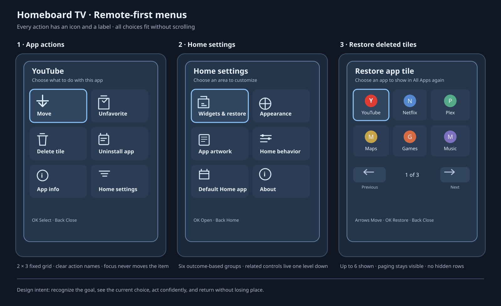
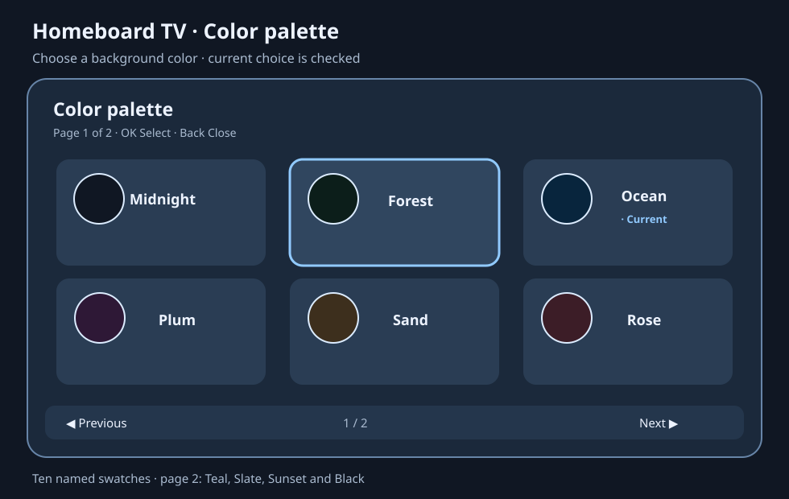
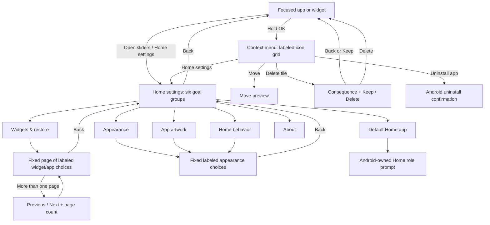

# Homeboard TV menus: icons, no scrolling, goal directed

**Status: implemented; final Cast1 visual verification pending · 15 November 2026**

Redesign every menu Homeboard draws so Will can act from the sofa with the remote
without scrolling, decoding icon-only controls, or remembering hidden choices.
Every selectable action gets a recognizable icon **and** a visible label. Each menu
fits its available screen area; longer collections use understandable groups or
fixed pages, never a scrolling viewport.

This applies to Homeboard's widget, app, settings, appearance, restore, and
confirmation menus. It does not restyle Android's own system screens, photo picker,
uninstall confirmation, or Home-role prompt; Homeboard hands those tasks to Android.

The Appearance proposal in this dated plan was superseded on 16 November. The
current Background and wallpaper dialog has one color-palette action with the
selected color shown as a swatch; the selector has twenty choices in five rows.
Photo selection and theme-wallpaper actions are not currently offered. See the
[current palette plan](2026-11-16-palette-trend-resize.md).

## Goal-directed design filter

Use one primary interaction persona: **Will, relaxing in front of the TV with a
remote**, wants to make one clear change quickly, understand its effect, and get
back to the dashboard. This is a working persona based on the observed product use,
not a claim about all future users. Revisit it with other users before a public
release.

The filter follows Cooper's Goal-Directed Design: design around a person's goals
and mental model, not a catalogue of implementation features. See [Wiley's *About
Face* overview](https://www.wiley.com/en-gb/about-face-the-essentials-of-interaction-design-4th-edition-p-9781118766583)
and [Center Centre's explanation of Goal-Directed Design](https://articles.centercentre.com/goal_directed_design/).

| Cooper-inspired question | Menu decision |
|---|---|
| What is the person trying to accomplish? | Name groups by outcome: **Add or restore**, **Appearance**, **App artwork**, **Home behavior**, **About**. Keep implementation terms out of titles. |
| Does the interface match the person's mental model? | Keep app actions with the app; widget actions with the widget; global choices in Home settings. Explain the consequence beside destructive choices. |
| Does the product make the next action obvious? | Pair each icon with a persistent text label. Use familiar metaphors only; never make the icon the only clue. |
| Does the interface remember state and reduce repeated work? | Show current choices in the menu (checkmark/status text) and apply simple preference changes immediately where safe. |
| Can the person recover and stay in control? | Keep Back as a reliable escape; confirmations name what changes; cancellation leaves state untouched; return focus to the invoking tile/control. |
| Is the product demanding attention it does not need? | Keep menus compact, legible at TV distance, and use a small number of choices per screen. Group related choices rather than shrinking text or adding a scroll bar. |

This is a design filter, not a demand to decorate every row. Icons earn their space
when they speed recognition. Labels, focus, current state, and consequences carry
the meaning.

## Shared interaction contract

- Every Homeboard-authored selectable control has a semantic icon and a readable
  label. Never show icon-only menu actions. Decorative headings and explanatory
  text do not need icons.
- Use one shared menu renderer and icon vocabulary. The same action uses the same
  icon in tile menus, settings and confirmations. Use existing vector resources
  where their meaning fits; add purpose-drawn vector icons for missing concepts.
- Keep the focused item unmistakable with the existing animated glass highlight;
  retain a visible focus treatment under reduced motion. Focus movement must not
  change a setting by itself.
- Build a fixed grid/list of rows sized for 10-foot reading and D-pad selection.
  Measure against the usable display bounds and system insets. No Homeboard menu
  may contain a `ScrollView`, nested scroll container, or clipped off-screen action.
- Choose the menu structure before reducing type size. Split choices into concise,
  goal-based submenus; for genuinely long collections, use fixed pages with a
  visible page count, persistent Previous/Next controls and preserved selection.
- All visible choices on a screen fit at once. No hidden actions below the fold.
  When an item is unavailable, show why and make the available next step explicit.
- Back closes the current layer without committing a preview. Confirmations use
  plain-language consequences; the safe action is focused initially.
- Keep a predictable title, optional one-line explanation, content area, and
  footer hint (for example, `OK Select · Back Close`). Show toggled/current state
  in words or a checkmark plus words; color is never the only signal.
- All Apps tiles, app-grid pagination and dashboard pages are not menus and retain
  their existing navigation model. Android-owned screens are outside the renderer
  contract.
- On returning from a launched app or Android-owned screen, restore the previous
  app/widget and page before accepting the next joystick or D-pad input. Do not
  rebuild an unchanged launcher surface just because it resumed.
- In compact All Apps, snap the glass highlight to the saved tile after resume and
  window-focus regain, even if Android did not dispatch a new tile focus change;
  resume the spring animation on the next remote navigation.

## Proposed menu map

| Current menu / collection | Proposed structure |
|---|---|
| App hold menu | Fixed 2 × 3 action grid: Move, Favorite/Unfavorite, Delete tile, Uninstall app, App info, Home settings. Confirmation before Delete remains a separate two-action screen. |
| Air-quality widget hold menu | Fixed 2 × 3 grid: Configure station, Move, Resize, Delete widget, Home settings. No unused sixth slot needs to be filled. |
| Home settings (currently eight flat rows) | Six goal groups in a 2 × 3 grid: Widgets & restore, Appearance, App artwork, Home behavior, Default Home app, About. A group opens its own compact screen; current status is shown beside relevant groups. |
| Appearance (superseded; see current palette plan) | Earlier proposal for wallpaper source, ten named colors, circular icon mask and reduced motion. The current flow uses a single-color button with a swatch and a five-row palette screen; wallpaper actions are hidden. |
| App artwork | Two large labeled choices for All Apps: Launcher icons and TV banners; mark the current one. Home favorites remain compact 48 dp launcher icons with 16 sp labels and the same circular mask/focus treatment, regardless of this setting. |
| Home favorite app tile | Use the compact launcher-icon presentation: 48 dp icon, 16 sp single-line label, optional circular crop, no full-cell card background, and a small animated glass highlight around the icon. A favorite must not turn into a banner-sized widget. |
| Delete / uninstall unavailable confirmation | A clear consequence summary plus two labeled icon actions: Keep/Cancel and Delete tile/Open app info. Safe action gets initial focus. The Android uninstall confirmation remains system-owned. |
| Add widget | Fixed set of available widget cards/actions, each with its icon and short label. Show an explicit empty state when no more can be added. |
| Manage deleted app tiles / Restore app tile | Fixed pages of up to 6 app choices with app icon and label. Show `Page n of m`; Previous and Next are always visible and disabled clearly at bounds. Restore the chosen app immediately and return focus to its restored tile. |
| Resize, circular mask, reduced motion, Home role, About | Small fixed-choice screens or direct reversible toggles with a clear selected state; no scrolling. System handoffs remain labeled as such. |

The shared renderer is implemented and reviewed on Cast1. Continue to use device
captures to verify labels, focus, current-state markers and page transitions as the
menu system evolves. Do not turn Homeboard settings into a long flat panel; grouping
should reduce the choices a person must scan at once.

## Mockups

The appearance flow also has a dedicated, paged color palette. Each choice pairs
its name with a matching color swatch; the active choice is labeled **Current**.

The diagram is a layout mockup rather than final art. The existing theme colors,
font, rounded geometry and animated focus remain the visual foundation. Each button
shows both an icon and a label; paging controls live in the fixed footer and never
scroll away.

## Navigation and review flow

## Delivery sequence

- [x] Inventory every Homeboard-authored menu and confirm the Android-owned handoff
      boundaries above.
- [x] Add the missing semantic vector icons and map each menu action to the shared
      icon vocabulary; keep icons paired with text labels.
- [x] Replace the generic scrolling menu builder with a shared bounded renderer
      supporting a small fixed choice grid, grouped submenus, and explicit pages.
- [x] Reorganize Home settings into six goal groups; update tile/widget menus,
      confirmations, appearance and app artwork screens.
- [x] Implement paged restore/deleted-app choices, including empty and one-page
      states, focus retention, and Previous/Next bounds.
- [x] Preserve and restore the current app/widget focus and page across app returns,
      Android handoffs, and activity recreation; prevent first-frame focus jumps.
- [x] Ensure each menu fits the smallest supported TV layout, has readable labels,
      an unmistakable focus state, and an always-available Back path.
- [x] Update the quick start and replace its All Apps screenshot with the current
      Cast1 capture; add a palette selector mockup for the menu not reached by automation.
- [x] Build and run project checks in the container, then install on Cast1 through
      the shared Chromecast coordinator and verify a successful launch.
- [ ] Record any labels/icons that Will cannot identify immediately and revise the
      hierarchy before considering the menu system complete.

## Acceptance

- [x] No Homeboard-authored menu scrolls or hides an action off-screen.
- [x] Every selectable action has a semantic icon and persistent text label.
- [x] Related choices are grouped under outcome-based labels; the root settings
      screen presents no more than six primary groups.
- [x] Long restore lists use fixed pages with visible count and clear D-pad controls.
- [x] Current settings are visible; safe cancel/back behavior is consistent.
- [x] Home favorites keep 48 dp icons, 16 sp labels and icon-centered focus treatment
      instead of filling the dashboard cell with a banner card.
- [x] Delete, uninstall, app info and system handoffs are visually and verbally
      distinct.
- [x] TV-distance screenshots show labels and focus clearly at normal viewing size.
- [ ] Manual Cast1 review confirms each menu can be traversed without scrolling and
      the desired action is recognizable without relying on color alone.

The palette selector and resume-highlight snap are implemented. Final container
`task check` and `task build` passed. Coordinator job `J‑72a2cfeba591` installed
APK SHA-256 `7e33dbf3ee5bd08150150d5c3a245eff596ba37b724c85f22e3b77cd3e9cf80f`
and completed its launch check on Cast1. Its All Apps screenshot is in the
[quick start](../how-to/quick-start/all-apps.png). The earlier scripted-menu job
`J‑5d5bf193f038` stopped before its first input with a coordinator plugin error;
automatic recovery returned Cast1 to ready. The final simple check succeeded, but
did not traverse the palette menu or verify the resume highlight after launching
another app. Those two interactions still need Will's hands-on review.

The follow-up Home-favorite build was installed and captured by coordinator job
`J‑720f2cddffb0` (APK SHA-256
`20cf4078d80eae625ec8905cbf5fa7f36cd5878adde1f905a7ab5aa4eeebeeda`). The
[quick-start favorite screenshot](../how-to/quick-start/favorite-home.png) confirms
small app icons, labels and a highlight centered on the selected icon. Scripted
cross-app return verification is unavailable under the coordinator's foreground
guard; Will can confirm that interaction manually on Cast1.
