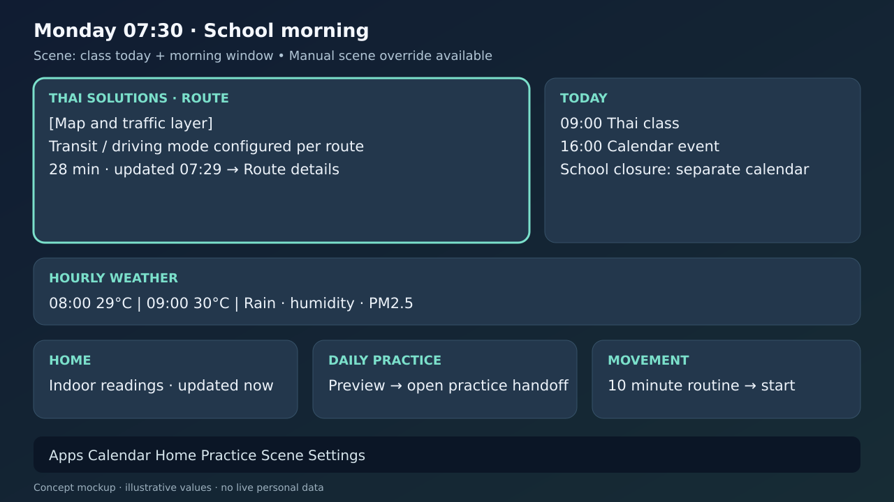
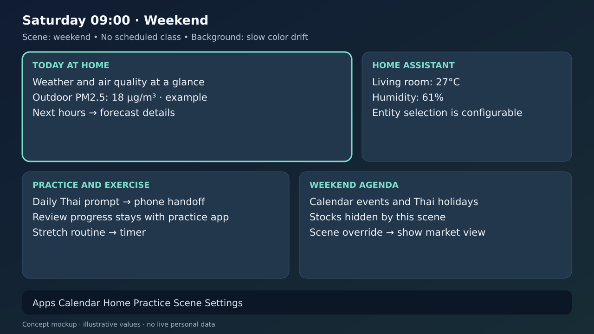
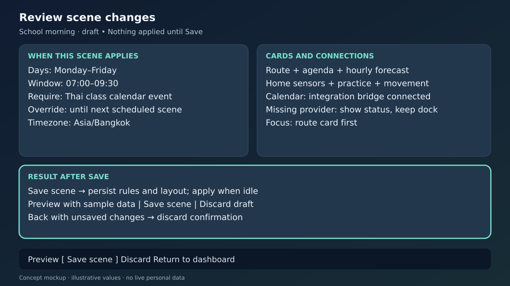
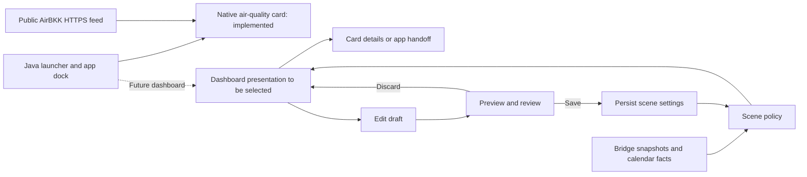

# Homeboard TV project foundation

## Direction

**Current interaction plan:** [Widgets first, All Apps to the right](2026-11-15-widget-home.md).
Custom widgets and app favorites fill Home, or Home can be empty. Scroll right past
the widgets to reveal All Apps. Hold OK exposes app actions including separate
Delete tile and Uninstall app choices. This supersedes the always-visible dock in
the earlier mockups below; those remain longer-term content examples.

**Current first step:** [Bangkok air-quality card](2026-11-15-air-quality.md),
implemented natively with a direct public feed and no dashboard server. The broader
reuse investigation below remains an option for later features, not a prerequisite.

Keep CleanYourTV's Java launcher and add small, useful native integrations. The
first card reads public Bangkok air-quality data directly. Home Assistant is not
currently installed. No dashboard server or custom bridge is a prerequisite.

The [dashboard comparison](../investigations/2026-11-15-dashboard-systems-for-homeboard.md)
remains research for later needs. MagicMirror², Home Assistant, WebView and Kotlin
are not selected dashboard technologies. The later
[wallpaper-provider host](2026-11-16-projectivy-plugin-host.md) retains Kotlin only
for the public API parcel classes. Revisit them only when the next feature benefits
from them. Scheduled scenes and the broader mockups below remain future work.

## Upstream contribution decision

Keep the air-quality feature and its shared-layout correction in Homeboard. The
omission in the Hebrew variant was introduced by our card addition; it was not a
CleanYourTV bug and does not warrant an upstream patch.

When integration reveals an independently reproducible CleanYourTV bug, isolate a
small fix, reproduce it against upstream, and check the contribution requirements.
The first planned community interaction is a showcase entry once Homeboard has a
public, usable release and documentation. No issue, PR, showcase submission or
publication is authorized by this plan alone. See [upstream strategy](../upstream/README.md).

## Screen mockups

## Workflow and implementation boundary

The proposed policy selects an unexpired manual override, then an actual class within the
morning window, then weekend or weekday. It uses an explicit time zone and does not infer class
cancellation from a public holiday. This policy is not implemented.

## Status and next work

- [x] Import pinned launcher source with provenance and licenses.
- [x] Give Homeboard a distinct app identity and local Git repository.
- [x] Use one container build image for local tests, lint and packaging, and CI configuration.
- [x] Implement live Bangkok PM2.5, station selection, cached data and native remote navigation.
- [x] Pass 327 unit tests, lint and APK/bundle packaging in containers.
- [x] Validate live data and station switching on Chromecast through the coordinator.
- [x] Record that the Hebrew-layout correction belongs only in Homeboard.
- [x] Verify the final shared-layout APK, saved station across relaunch and remote access to Refresh/top controls.
- [x] Replace separate dialogs with same-window menus.
- [x] Recheck screenshots independently: reported disappearing content was a preview artifact.
- [x] Implement the widgets-first navigation plan and its empty-dashboard state.
- [ ] Validate outages/recovery and background/foreground transitions without changing shared-device network settings.
- [ ] Check alternate themes, accessibility text sizing and RTL layout on-device.
- [ ] Choose the next small integration after the air-quality baseline is reliable.
- [ ] Revisit scheduled scenes, Calendar authorization and a bridge only when needed.
- [ ] Audit permissions, provider terms and release signing before Google Play distribution.
- [ ] Prepare a public repository/release and showcase proposal when authorized.

The air-quality card is working. The complete school/weekend dashboard is not yet
implemented. Avoid adding a framework or server simply to anticipate later cards.
