# Homeboard TV: widgets first, All Apps to the right

**15 November 2026 · Will's current product direction · installed for Cast1 review**

Home is a customizable widget surface. Favorited apps are widgets alongside air
quality and other information. The surface may also contain **nothing**: no required
clock, card or permanent app dock. Moving right beyond the widgets slides open the
full app launcher. Both Delete and Uninstall appear as distinct app-menu options.

The implementation replaces the earlier permanent dock with a native widget Home
and a separate All Apps surface in the same activity. AirBKK remains a direct public
integration. There is no hosted release yet. The illustrations below are design mockups;
the [quick start](../how-to/quick-start.md) includes actual TV screenshots.

## Home with widgets

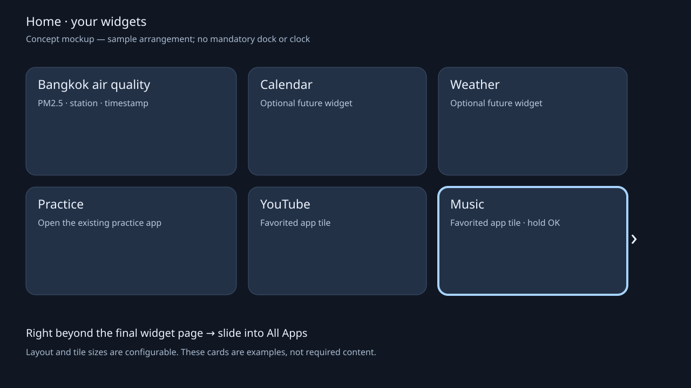

Will chooses which widgets appear, their positions and sizes. Information widgets
and favorited app tiles share the dashboard. No default app favorites are inserted
merely because an app is installed. Air quality can be removed like any other widget.
Calendar, weather and practice in the mockup illustrate future possibilities.

**Implemented navigation:** dashboard widgets occupy one or more horizontal
pages. Within a page, arrows move focus spatially. Right at a page's outer edge moves
to the next page; Right beyond the final dashboard page reveals All Apps. This lets
multi-row layouts work without requiring a single long row of widgets. Home uses two columns and two rows per page. Air quality occupies one or two columns;
app favorites occupy one cell. All Apps uses four columns and two rows.

## Slide into All Apps

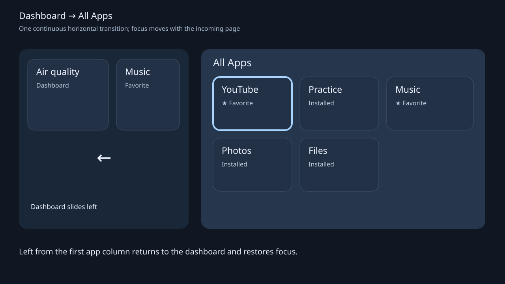

The dashboard slides left as All Apps enters from the right over 420 ms; returning
slides Home in from the left. All Apps is part of
the same Home activity, not a second application. Left at the first app column
returns to the last dashboard page and restores its previous focus. Back from All
Apps also returns to the dashboard. Repeated Home returns to the dashboard rather
than opening All Apps automatically. Reduced-motion mode uses an immediate switch.

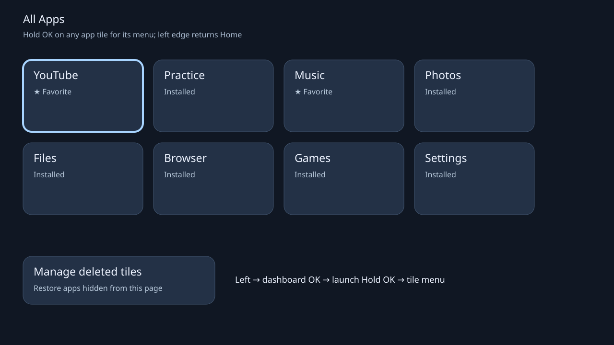

All Apps initially lists launchable installed apps. Its ordering is separate from
dashboard placement. Favoriting adds an app tile to the dashboard; unfavoriting
removes that dashboard tile while keeping the app available in All Apps. Favoriting
an already-favorited app does not create duplicates.

## An intentionally empty dashboard

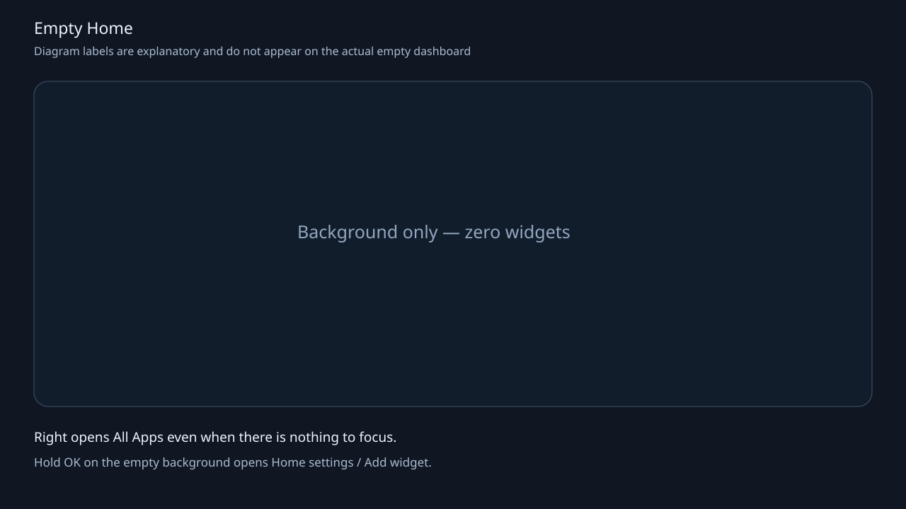

Zero widgets is a supported saved state. Show only the chosen background, including
a plain background if preferred. Do not repopulate it on reboot, app installation or
an empty-layout check. Right must still reveal All Apps without a focused widget.
Hold OK on empty background opens Home settings with Add widget and customization.
Home settings remains available from app/widget hold-OK menus; the persistent gear is
reserved for Android device Settings.

## Hold-OK menus

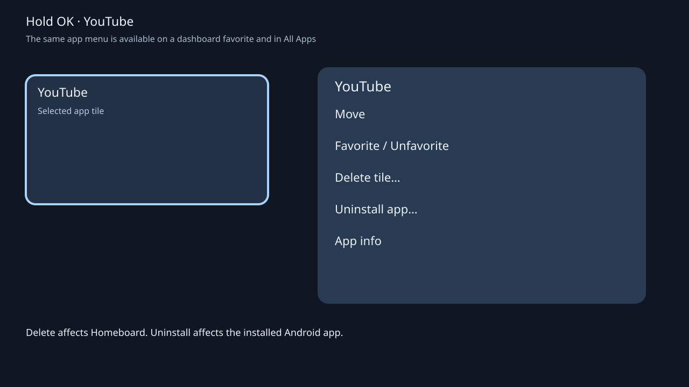

A short OK launches the app or activates a widget. Holding OK opens the appropriate
menu and must not also trigger the short-click action when the key is released.
The app menu works for both dashboard favorites and All Apps tiles.

| Action | Dashboard app tile | All Apps tile |
|---|---|---|
| Move | Reposition within the dashboard | Reorder within All Apps |
| Favorite / Unfavorite | Reflect and change favorite state | Add/remove the app's dashboard tile |
| Delete tile | Remove this dashboard tile; app stays in All Apps | Hide this tile from All Apps; app stays installed |
| Uninstall app | Open Android's uninstall confirmation | Same Android uninstall flow |
| App info | Open Android app settings | Same Android app settings |

For an information widget, the menu offers Configure, Move, Resize where supported,
and Delete widget. Favorite and Uninstall do not apply to a data widget.

**Implemented Delete semantics:** deletion affects the surface on which it is invoked.
Deleting an All Apps tile does not silently delete an existing dashboard favorite.
A Manage deleted tiles entry restores hidden launcher tiles; Add widget restores
removed information widgets. Use the words “Delete tile” and “Uninstall app” in the
UI so their different effects are explicit. Will requested both actions; the implementation uses these
surface-specific semantics.

## Review, move and resulting actions

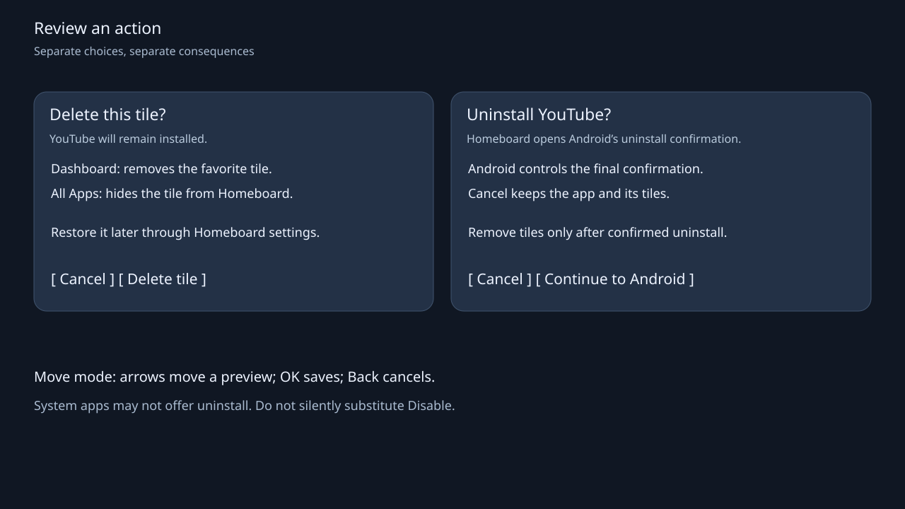

Move mode shows a preview. Arrows change position; OK commits the new layout; Back
cancels and restores the original position. Normal page switching is suspended while
moving, and the preview follows the tile across pages. Focus remains
on the moved tile after saving.

Delete asks for confirmation describing what will disappear and where it can be
restored. Uninstall delegates the final decision to Android. A canceled or failed
uninstall leaves app tiles intact; confirmed package removal reconciles all surfaces.
System apps may not support uninstall; show that state explicitly. Do not substitute
Disable or execute a shell package-removal command.

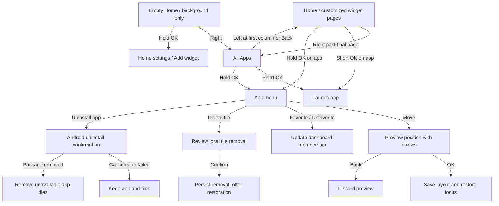

## Architecture for the first implementation

Keep the Java launcher and native views. Add a dashboard layout model that can
persist an empty list, widget instances and app favorites. Maintain a separate All
Apps order and hidden-tile list. Use stable app/component identifiers, not positions
in the installed-app enumeration. Keep page selection, focus restoration and move
preview state separate from persisted layout.

The existing air-quality card becomes one configurable widget instance. It continues
to fetch AirBKK directly; no Home Assistant, MagicMirror, WebView or server is needed.
Later cards can introduce their own provider requirements without forcing this first
navigation implementation to adopt a dashboard framework.

Do not change the device's default Home app as part of a smoke test. Build/test in
containers and use complete coordinator-owned jobs for device validation.

## Implementation sequence and acceptance checks

- [x] Record widgets-first Home, right-side All Apps and the valid empty state.
- [x] Show populated, transition, launcher, empty, menu and confirmation mockups.
- [x] Separate Delete tile from Uninstall app.
- [x] Implement same-window menus and verify station selection. Reinspection confirms earlier disappearing-text reports were preview artifacts, not app defects.
- [x] Introduce dashboard persistence, including an explicitly empty layout.
- [x] Move the current air-quality card into the dashboard and put the app grid on its own right-hand page.
- [x] Implement deterministic focus, page transitions, Home/Back and reduced motion.
- [x] Implement Favorite/Unfavorite and independent ordering of the two surfaces.
- [x] Implement hold-OK menus, cancellable move preview, local deletion and restoration.
- [x] Delegate uninstall confirmation to Android and handle cancellation/package removal.
- [ ] Test empty Home across relaunch, newly installed apps, deleted/favorited combinations, last-item deletion and unavailable apps.
- [x] Test navigation, short/held OK separation and canceled Home moves through the shared coordinator.
- [ ] Test uninstall cancellation/removal through a coordinator workflow that supports Android confirmation.

## Upstream boundary

This Homeboard-specific interaction model and the air-quality feature remain here.
The earlier Hebrew-layout correction fixed our own omission and needs no upstream
patch. Reproduce general launcher defects independently before preparing upstream
fixes. A showcase entry follows a public usable release, subject to authorization;
no outreach or publication is part of this plan update.

## Verification and current limits

Container validation passed 327 tests, debug lint (zero errors, 179 warnings and
96 informational findings), APK assembly and unsigned release bundle packaging.
Unused inherited resources contribute to lint warnings after replacing the dock.

Coordinator job `J‑305df3cd6bcd` verified station menus, Home/All Apps navigation,
last-widget deletion and empty Home. Home move/cancel/save, deletion and restoration passed functional checks.
Reinspection of raw captures confirms that earlier reports of missing text were
image-preview artifacts. See the [validation record](../testing/2026-11-15-widget-home.md).

The activity keeps Java/native views, inherited app metadata and wallpaper support,
but replaces the dock-specific UI and lifecycle. Old optional dock layouts are no
longer active. This milestone does not establish parity with every upstream option.
Scheduled layouts, other data widgets, extensive RTL/accessibility/theme validation
and production signing remain future work. Shared-device tests do not change the
default Home app. The Homeboard setting requests Android's Home role, but Google TV
may route the physical remote Home key directly to Google TV Home; this still needs
manual Cast1 verification.

## App artwork setting

Use **Home settings → App artwork** to choose each installed app's standard launcher
icon or its TV banner. This controls both All Apps and Home favorites. TV banners
are the default; missing banners fall back to the app icon. Tile sizes, labels,
favorites and ordering are preserved. Choosing an option applies and saves it;
Back leaves the current setting unchanged.

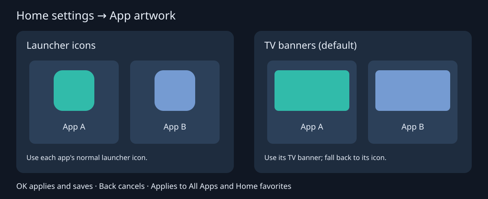

## Dense app grid, icon mask and persistent device settings

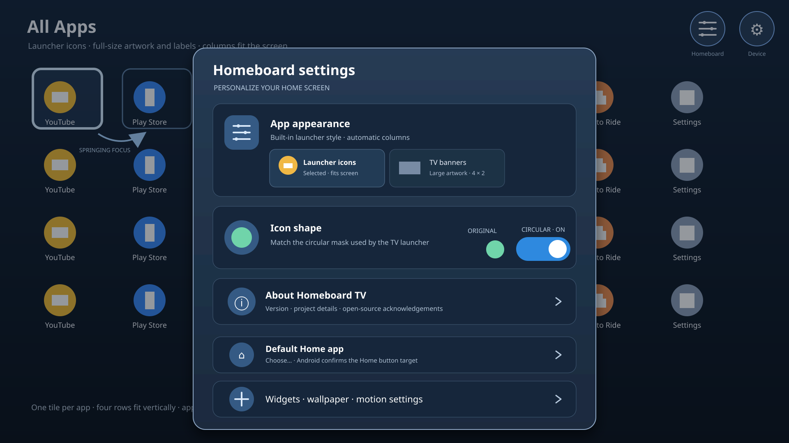

**Launcher icons** uses the installed app's normal icon and label treatment, with
the same 48 dp icon, 16 sp one-line label and optional circular clipping on every
page. The number of columns is calculated from screen width so each app keeps a
usable cell; on a typical TV it should fit more than six columns. Four rows remain
visible, giving around 32 apps per page on common TV resolutions. **TV banners** keeps its larger 4 × 2 layout. Page size and page-up/down
navigation follow the calculated column count. The circular mask remains a setting
and does not change icon size.

Compact All Apps uses the launcher’s glass focus highlight as a moving overlay. It
springs between app positions while the selected icon and label grow slightly; reduced-motion
mode places the highlight directly. At rest, icons and labels sit directly on the
wallpaper with no blue tile cards. Labels stay visible and uncluttered, with no
favorite marker added to their text.

The app catalog shows one tile per package. When an app exposes multiple launcher
activities, keep the user's existing activity choice if possible, otherwise prefer
the Leanback launcher entry. Migrate duplicate saved activity keys for that package
to the chosen tile so favorites, order and hidden state remain coherent. Filter log
and log-file utility activities by their visible label or component/package name.

Keep both settings destinations visible at the top right of Home and All Apps:
**Homeboard settings** (sliders icon) opens dashboard choices, while **Device
Settings** (gear) opens Android settings. They are separate, focusable controls;
neither is an app-grid tile. Do not include the system Settings app in the grid.

Homeboard settings shows the current default Home app and a **Choose default Home
app** action. On Android 10+, it requests the system Home role; older TV builds use
Android's Home settings screen. Will selects Homeboard TV there. Android owns that
selection, and the app reports the result. Once selected, standard Android Home
intents should launch Homeboard through its existing `MAIN` + `HOME` intent filter.
Some TV remotes or firmware may route the physical Home key directly to Google TV
regardless of the selected role; that behavior must be checked on-device and is not
guaranteed by the Home activity declaration alone.

All Apps uses vertical pages in either artwork mode. Down from its bottom row goes
to the next page at the corresponding column; Up from the top row returns to the
previous page at that column. On the first All Apps page, Up opens Homeboard settings.
This avoids trapping the user on later pages or sending Up to Settings.

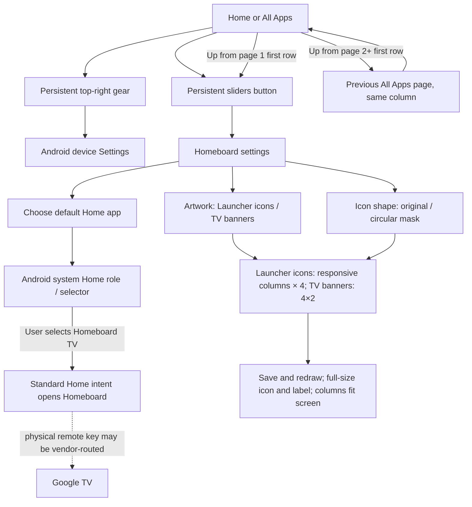

Will's earlier theme-only wallpaper choice did not visibly change the screen. The
previous iteration added a photo picker, app-private copy and saved wallpaper
selection; visible rendering and persistence still need interactive acceptance on
Cast1. Do not mark wallpaper complete from a settings label or picker toast alone.

### Active iteration acceptance

- [x] Implement a persistent device Settings gear on Home and All Apps; remove the system Settings tile.
- [x] Add a separate persistent Homeboard settings button beside the device gear.
- [x] Make Up from an All Apps page's first row return to the previous page; on page 1, focus Homeboard settings.
- [x] Make Launcher icons use a responsive full-size icon grid and TV banners use 4 × 2.
- [x] Add an original/circular launcher-icon mask setting with the same icon size.
- [x] Keep developer log viewer apps hidden; the multi-log collector/viewer idea remains parked.
- [x] Photo selection and wallpaper controls were previously implemented; their
      menu actions were removed on 16 November pending a useful wallpaper flow.
- [x] Build and install the iteration on cast1 through the coordinator; installed hash is recorded in the test log.
- [ ] Verify 32 app slots fit at 1080p and the gear, mask, filtering and wallpaper behavior on the TV.
- [x] Capture actual Cast1 Home screenshot with persistent gear.
- [ ] Verify both top-right settings buttons and Up navigation from All Apps page 4 on Cast1.
- [ ] Capture All Apps density and circular-mask choices on Cast2.
- [ ] Verify one Ticket to Ride tile, log utilities hidden, and responsive full-size icon grid on Cast1.
- [ ] Record and review a short Cast1 video of focus moving across compact All Apps; a still image cannot confirm the animation.
- [x] Add an About entry in Homeboard settings.
- [x] Show the default Home app and request Android's Home role from Homeboard settings; report the result on return.
- [ ] On Cast1, select Homeboard in Android's prompt and test the physical Home key. Android TV documentation says Home returns to Google TV Home, so role selection may not override remote firmware routing; any interception method needs separate review.

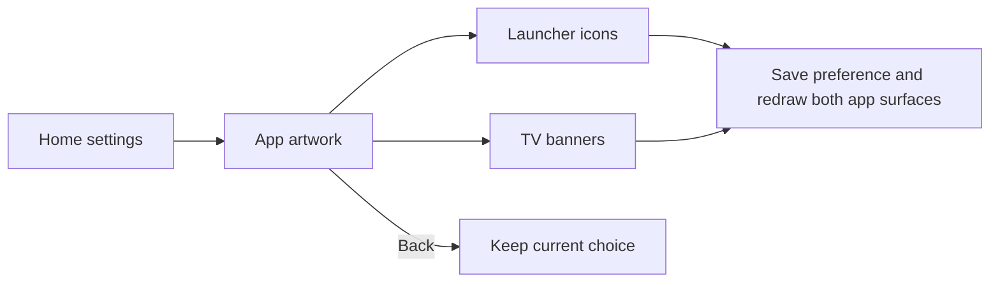

Current iteration adds persisted **App artwork: Launcher icons / TV banners** for
both app surfaces. On 16 November Will moved iterative testing from Cast1 to
Cast2. The coordinator currently reports Cast2 paused for another owner's
personal use; wait for availability before installing. Automated remote-input
sequences are paused while Will tests.
