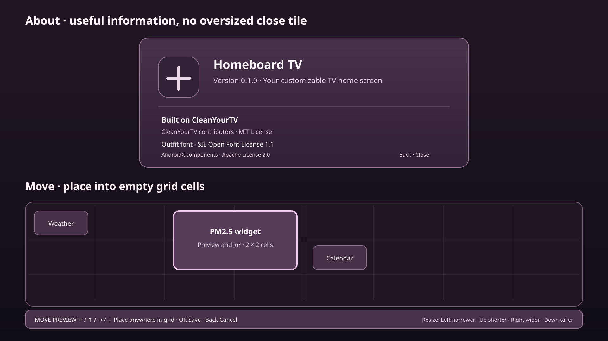
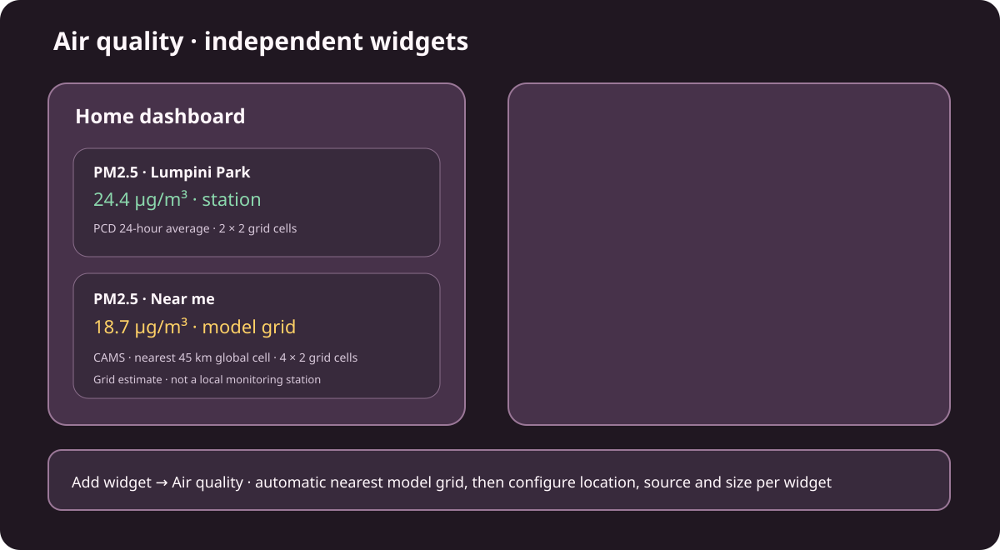
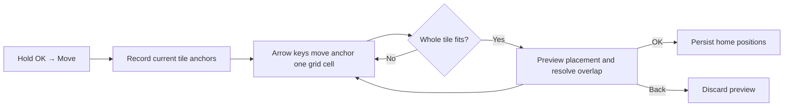

# About dialog, free grid placement and per-widget air quality

**Status: design updated · implementation in progress · 16 November 2026**

## Scope

Fix three usability gaps surfaced on Cast1:

1. Replace the one-option About menu with a branded information dialog.
2. Let a Home tile move to any valid grid position, including empty cells.
3. Let multiple PM2.5 widgets keep separate locations, sizes, and settings; choose
   a nearest-location default rather than assuming Bangkok.

The resize interaction is also updated: its help replaces the normal Home footer
with one full-width, one-line strip aligned to the grid and styled like a dialog.

## Mockup

The Background and wallpaper dialog contains only the palette action, with a swatch
for the selected color. The palette selector has twenty choices in five compact
rows; see the [menu mockup](2026-11-16-palette-trend-resize/background.svg) and
[palette mockup](2026-11-16-palette-trend-resize/palette.svg).

## About dialog

- Show the Homeboard icon, product name, installed version and concise purpose.
- Identify CleanYourTV and its contributors, and list bundled license
  acknowledgements accurately.
- Use one readable information panel with a small Back/Close hint. Do not create
  a full-size menu card for a single Close action.

## Home placement

- Begin with the current tile coordinates across the dashboard pages.
- Move by grid coordinates, not list index. Every valid top-left grid cell where
  the full tile span fits is a destination, including currently empty cells.
- If a destination overlaps another tile, move the overlapped tile to the
  nearest available grid position while preserving its span.
- Preview positions without changing persisted layout; OK commits, Back cancels.
- Circular app icons now follow the measured gap, ring and halo in the
  [Google TV app focus plan](2026-11-16-google-tv-app-focus.md), superseding the
  earlier one-pixel clearance proposal. Unmasked icons retain their existing rim.

## Resize help

- Keep the dashboard and selected panel visible during resize.
- Replace the Home footer with a single line at the bottom, spanning the same
  width as the grid.
- Use the same palette-derived fill and border as the dialog panel.
- Explain: Left narrower, Up shorter, Right wider, Down taller, OK saves, Back
  cancels. Keep the current one-cell-per-key behavior.

## Multiple, location-aware air widgets

- Give every air widget a stable unique key and independent persisted
  configuration, size, source, location and bounded history.
- Keep existing Bangkok station choices available as explicit station choices.
- Ask for foreground approximate location when needed; allow a manually selected
  location when the TV cannot provide it.
- For an automatic nearest default, show which source and geographic location
  the reading represents. The candidate no-key global source is Open-Meteo's
  CAMS air-quality model; it provides model-grid forecasts, not station readings.
- Preserve clear differences between model estimates and monitor measurements,
  including the relevant averaging period and source attribution.

Will selected the nearest model grid as the default when no nearby physical
monitor is available. Open-Meteo describes 11 km European and 45 km global model
coverage; its [official API documentation](https://open-meteo.com/en/docs/air-quality-api)
requires clear attribution. Label these as model estimates, with timestamps,
provider and grid location, and preserve AirBKK readings as station measurements.

## Acceptance

- [ ] About shows useful information and credits in a compact readable dialog;
      Back closes it without a giant Close card.
- [ ] Home move preview reaches any valid empty or occupied grid anchor for the
      selected tile span; collisions resolve without overlap.
- [ ] Move OK persists positions; Back restores all original positions.
- [ ] Resize guidance is a one-line, dialog-styled strip spanning the grid.
- [x] The palette selector shows twenty choices in five rows on one screen.
- [ ] Put Icons under Appearance, with All Apps artwork choices in the Icons submenu.
- [ ] Multiple air widgets have separate location, size, source and settings.
- [ ] Auto location does not claim a model grid is a local monitor reading.
- [x] Circular app focus uses the reference gap and halo; captured on Cast1.
- [x] Container tests and lint pass for the 20-choice palette and background
      menu update.
- [x] Install and capture the circular app focus revision on Cast1; Cast2 remains
      held for personal use.
- [ ] Cast1 remains recovery-required after `target-left-foreground` and
      unverified cleanup; see `evidence/cast1-palette-12-2026-11-16/` and
      `evidence/cast1-recovery-2026-11-16/`.
