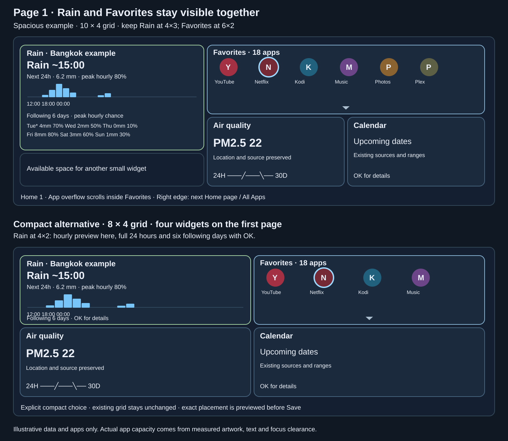
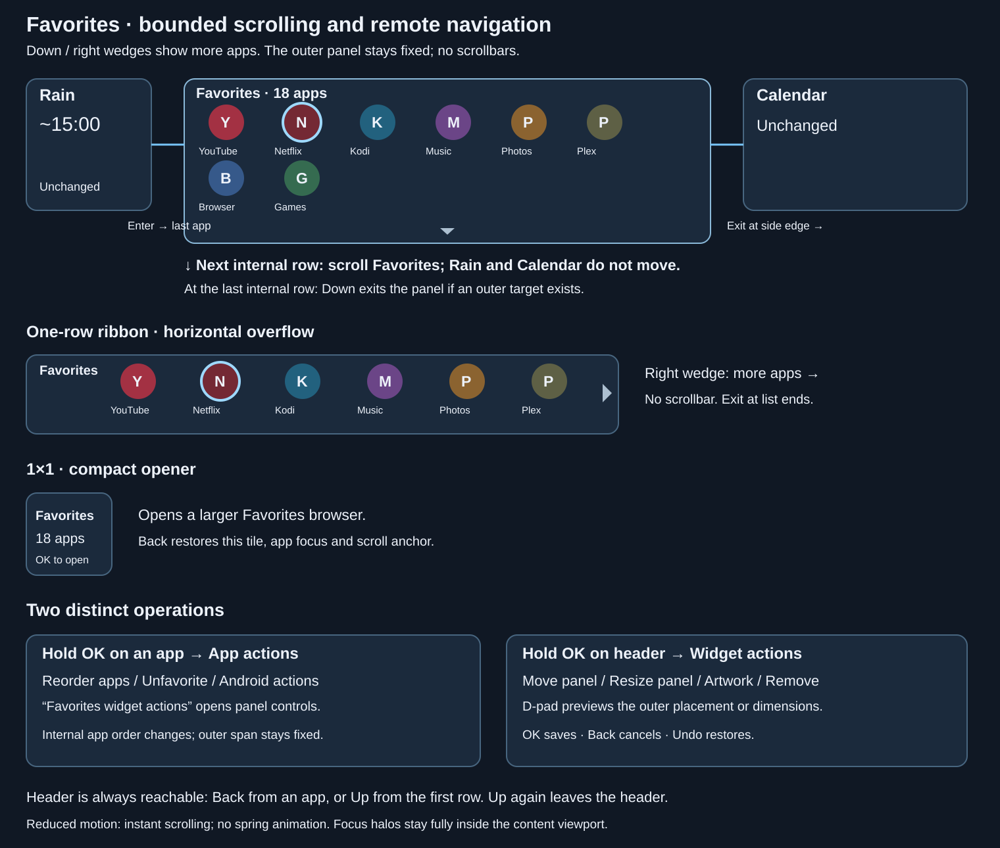
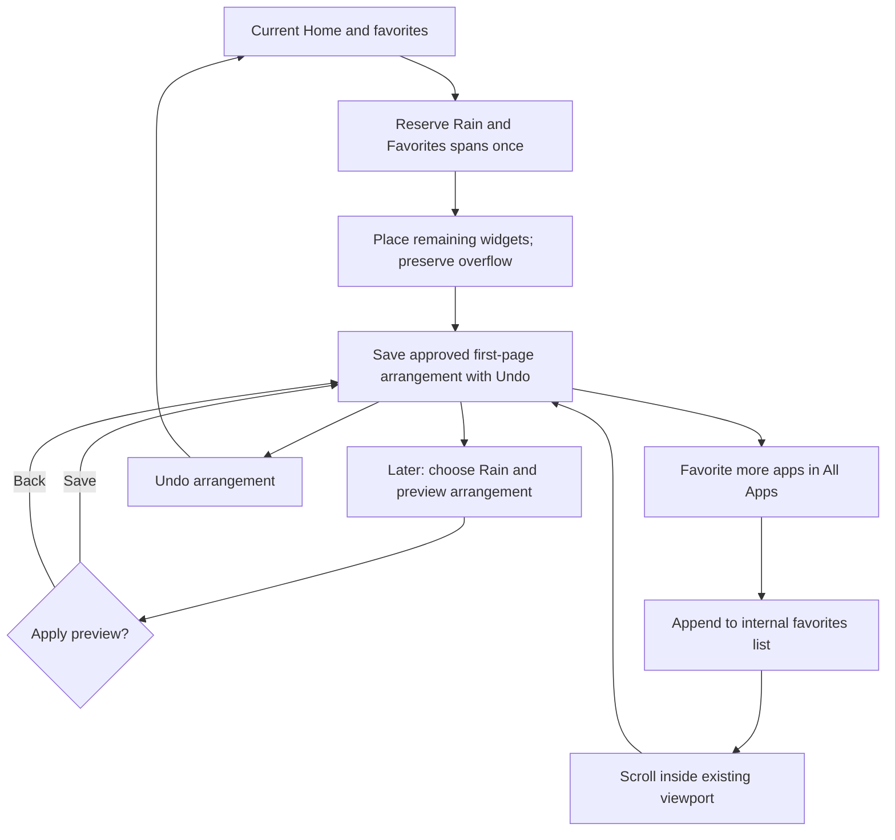
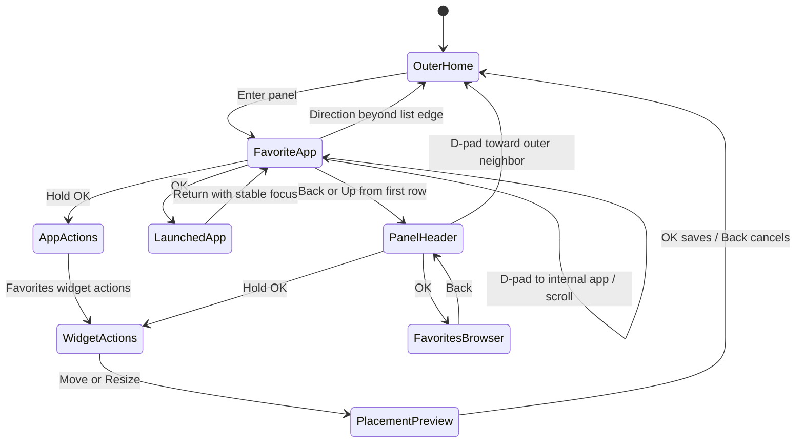

# First-page rain and a bounded Favorites widget

**Status: implemented · 0.1.23 installed and launched on Cast1; page-1 screenshot checked · Cast2 queued · 17 November 2026.**

Put the rain widget on **Home page 1**. Replace the individual favorite-app tiles
with **one movable, resizable Favorites container** on that same page. Extra apps
scroll inside that container, so favoriting an app cannot push rain or other
widgets onto another Home page. Will approved implementation and deployment on
17 November 2026. See the implementation record below for delivered behavior and
validation limits.

## Proposed first page



The drawings use example apps and invented weather. Grid dimensions are examples,
not a request to change Will's current grid. Respect the actual fitted Home grid,
text scaling, screen margins and independent widget settings.

**Recommendation:** keep rain at **4×3** when it fits, as in the rain plan. Start
Favorites at **4×2**; on a wider page, **6×2** is a useful choice that reveals more
apps while keeping the panel shallow. Both are normal exact cell spans, with the
same Move, Resize, opacity and Undo conventions as other widgets.

| Layout | Rain | Favorites | Other widgets |
|---|---|---|---|
| Spacious example, 10 columns × 4 rows | 4×3 at upper left | 6×2 at upper right | Air and Calendar occupy the lower right, 3×2 each; their details adapt to that space. The remaining lower-left strip stays available. |
| Compact example, 8 columns × 4 rows | 4×2 at upper left | 4×2 at upper right | Air and Calendar each use 4×2 below. Rain's six daily values are available with OK. |
| Keep rain's recommended detail on an 8-column page | 4×3 at upper left | 4×2 at upper right | Keep any other widget that fits; overflow widgets move to later Home pages. Preview those moves before applying. |

The spacious example is recommended **when that grid already fits**. On a smaller
page prefer the 4×3 rain layout with overflow elsewhere; offer the compact example
as an explicit choice if keeping all four widgets visible matters more. Do not
silently reduce rain to 4×2 or reduce font size just to reproduce a drawing.

## First-page placement and existing settings

- Select the existing rain widget and existing favorites. Preserve the rain
  location, forecast windows, units, label and animation preference. If several
  rain widgets exist, choose which one belongs on page 1; do not merge their data.
- If rain has not been added, add one unconfigured rain widget on page 1 with
  **Set location**. Do not guess coordinates or duplicate a configured widget.
- Reserve page-1 space for Rain and Favorites together before placing the remaining
  widgets. Other widgets keep their requested positions whenever they fit;
  resolve overlaps deterministically and move overflow to later Home pages.
- The approved deployment applies the initial page-1 arrangement once, with
  Undo restoring the previous layout, favorites order and placements. It does not
  wait for another approval screen after this implementation request.
- For later changes, **Favorites widget actions → More → Arrange Rain and Favorites
  on page 1** selects a rain instance and shows the arrangement preview. OK saves;
  Back cancels. Overflow widgets remain on later Home pages.
- This is a **one-time arrangement**, not permanent pinning. Later user Move/Resize
  actions are respected. Adding more favorites changes the internal list only;
  it never enlarges the container or changes the outer page count.
- Do not reset wallpaper, opacity, language, air settings, calendar settings,
  hidden apps, All Apps order or installed app data.

## Favorites becomes a real container

There is one Favorites widget backed by a single ordered favorites list. App
shortcuts inside it no longer consume individual cells in the outer Home grid.
The existing **Home favorites → Small icons / Banners** setting remains the
artwork choice for the container, independent of All Apps.

Use a native `RecyclerView` with `GridLayoutManager` inside the fixed panel. The
pinned launcher reference already uses that combination for a scrolling app grid,
including keeping focused artwork visible. Reuse the relevant scrolling/focus
principles and existing app artwork views; keep the new container independent of
the original full-screen dock geometry.



### Sizing and overflow

| Panel size / shape | Composition | Overflow behavior |
|---|---|---|
| 1×1 | Favorites icon and count, with a clear OK affordance | OK opens a larger Favorites browser. An app icon is not squeezed into an unreadable focus target. |
| 2×1 or a wider one-row ribbon | One app row; compact header/count if it fits | Horizontal scrolling within the row. |
| 1×2 or another narrow, tall panel | One column of apps, or a compact opener if artwork and labels do not fit | Vertical scrolling when viable; otherwise OK opens the larger browser. |
| 2×2 | Small app grid, usually one or two columns depending on artwork | Vertical scrolling; banners may use one column. |
| **4×2 · recommended default** | Readable app grid with title/count and a reserved down-wedge cue | Vertical scrolling through additional rows. |
| **6×2 · recommended wide option** | More columns, preserving the same icon sizes and readable labels | Vertical scrolling; more favorites are visible before scrolling. |
| 4×3 / taller | More visible rows, using the same app sizing rules | Vertical scrolling; the outer panel stays the same size. |
| Fill Home | Full available Home area with the same ordered favorites | Scroll inside the panel; Back and edge navigation still offer an exit. |

These are content rules, not fixed app-capacity promises. Derive the number of
columns and visible rows from the panel's **inner** width/height, artwork mode,
font scale and focus clearance. A panel cell is not the same as an app cell.

- Scroll only along **one axis** per layout. A one-row ribbon scrolls horizontally;
  a taller grid scrolls vertically. A resize can change the axis while preserving
  the same focused app and bringing it into view.
- **Use directional wedges, never scrollbars.** A small **down wedge** centered
  at the bottom means more app rows below. A **right wedge** at the right edge
  means more apps ahead in a horizontal ribbon. Show the matching up/left wedge
  only when there is content to return to in that direction. At the start show
  only down/right; in the middle show both directions; at the end show only
  up/left. With no overflow show no wedges.
- Wedges indicate available D-pad movement; they are passive, not extra focus
  targets or buttons. Keep them within reserved panel padding, clear of labels
  and the focus halo. Use the palette's readable foreground color, with no track,
  thumb, bouncing animation or pointer/drag affordance. Keep app positions stable
  when a wedge appears or disappears.
- Disable native horizontal/vertical scrollbars and overscroll glow in both the
  Home container and its larger Favorites browser. The header may retain the
  total app count, but omit desktop-style visible-range counters such as
  “1–6 of 18”. Announce position and more-content directions through accessibility
  text instead. Reduced motion does not remove these static navigation cues.
- Keep app labels readable. Clip artwork, glow and scrolling content within the
  panel's content viewport; reserve sufficient inset for the full focus halo.
  Do not let an off-screen app paint over Rain or another widget.
- A large app count never changes the container's saved outer span. Use recycling
  so a long list does not create every app view at once.
- Empty favorites shows **No favorites yet · Add apps**. OK opens All Apps with
  the existing favorite action available. Favoriting the first app creates the
  container if needed; deleting the container and Undo are described below.

## Remote interaction: launch, scroll and leave

The Home grid navigates between widgets; inside Favorites it navigates between
apps. Focus transfer must work without trapping the remote or requiring an extra
OK before every app launch.

| Input / event | Result |
|---|---|
| Enter Favorites from a neighboring widget | For the compact opener, focus the opener. Otherwise focus the last focused favorite if it remains available; otherwise the nearest visible app at the entry edge. Scroll only enough to reveal the whole focus halo. |
| D-pad toward an existing internal neighbor | Move to that app. If it is outside the viewport, scroll the panel to reveal it. Do not turn the outer Home page. |
| D-pad beyond the final internal neighbor in that direction | Exit to the nearest outer widget in that direction. At a Home page boundary use existing page / All Apps navigation. |
| Up from the first row | Focus the panel header; Up again exits toward a widget or top settings control. |
| Down from the final row | Exit downward if a target exists; otherwise stay at the boundary without wrapping. |
| Left / right at the side of a vertical grid | Exit to an outer neighbor; do not wrap into a different internal row. Right-edge exit can reveal All Apps when the outer Home boundary is reached. |
| Left / right at the end of a horizontal ribbon | Exit only after the first / last favorite has been reached. Apps beyond the viewport take precedence over an outer page change. |
| OK on an app | Launch it immediately. Returning restores that app and the internal scroll anchor. |
| Hold OK on an app | App actions: reorder within Favorites, unfavorite, and existing Android app actions. Include **Favorites widget actions** as an explicit route to moving/resizing the panel. |
| Hold OK on the panel header or compact opener | Widget actions: Move, Resize, artwork, Manage favorites, Remove widget. |
| Back while browsing Favorites on Home | Move focus out to the panel header; leave the outer page unchanged. A subsequent normal navigation can leave the panel. Never unfavorite or delete anything. |
| OK on a compact opener / header | Open the larger Favorites browser, with the same list and app actions. Back restores Home size, scroll anchor and focus. |

Keep the header reachable from the first app row (Up) and through Back. Once it is
focused, D-pad moves between outer widgets. This makes Fill Home escapable even
when it has no neighboring widget. A screen-reader description announces the
container title, app count, app label and available actions.

Disable smooth scrolling and spring/glow motion under Reduced motion. Normal mode
may use a short scroll animation, but repeated held-key input must remain bounded
and responsive. Restore focus by stable app key rather than adapter position.

## Managing favorites and the widget

- **Favorite / Unfavorite:** update the dedicated ordered list. Newly favorited
  apps append; existing order stays stable. Unfavorite removes only that shortcut.
- **Reorder apps:** an internal Move preview reorders the list and scrolls at the
  viewport boundary. OK saves; Back cancels. This action does not move the panel.
- **Move widget / Resize widget:** operate on the outer Home grid and existing
  preview/Undo flow. Temporarily freeze internal navigation and scrolling so the
  same D-pad cannot resize the panel and navigate apps simultaneously.
- **Remove widget:** remove the container from Home while retaining its favorites
  list for re-adding. Re-add restores the list; Undo restores the prior panel and
  placement. The action subtitle must explain this behavior.
- **Last app unfavorited:** leave the empty container in place. Do not create layout
  churn by deleting the widget automatically.
- **App uninstalled / unavailable:** remove a confirmed uninstalled package from
  favorites; preserve a temporarily unavailable app as a disabled tile with an
  explanatory action. Match the launcher's current package-removal rules.
- All Apps remains a separate surface with its own artwork, ordering and hidden
  list. Favoriting an app there targets this container, not an outer Home cell.

## Workflows





## State and implementation boundary

Proposed model:

```text
HomeLayout
  widgets: [rain key, favorites widget key, air key, calendar key, ...]
  panelSpans / homePositions: normal per-widget size and placement
  favorites: ordered unique app keys
  homeAppSize: existing Small icons / Banners preference

Transient UI state
  focused favorite key + visible scroll anchor / offset
  outer widget focus + Home page
  internal reorder preview OR outer Move/Resize preview
```

The current implementation stores individual favorite app keys in `widgets`.
Convert that **existing saved user state once** into the ordered favorites list,
replace those outer shortcuts with one Favorites key, and preserve their relative
order. This is a concrete need to retain the user's current choices, not a parallel
legacy UI or compatibility layer. New writes use the clean container model only.
The old per-app outer coordinates are retained only in the Undo snapshot of that
change. The new arrangement places the selected Rain and Favorites on page 1.

Keep one favorites collection and one Home container in this version. Preserve
stable launcher activity identities and package deduplication. Outer page packing
sees one bounded Favorites widget regardless of how many apps it contains.

Implementation should isolate a `FavoritesWidgetView`/controller and internal
adapter, with a clear focus handoff to `MainActivity`. Reuse existing artwork,
package watching, context actions and Undo rather than adding a dashboard engine.
Review the outer `dispatchKeyEvent` routing: it currently consumes Home D-pad
navigation, so child scrolling cannot work reliably through an embedded view alone.

## Acceptance and rollout after approval

1. Add model tests for retaining current favorites order, uniqueness, empty lists,
   re-add/removal, package removal, layout serialization and Undo. Verify that adding
   100 favorites leaves the outer spans, Rain's page and Home page count unchanged.
2. Test first-page placement for fitting and crowded layouts, several Rain widgets,
   missing Rain, an empty Home, grid/text-size changes and cancel/Undo. Never erase
   an independent rain location or silently drop another widget.
3. Check compact opener, ribbon, narrow/tall, 2×2, 4×2, 6×2, 4×3 and Fill Home in
   icon/banner modes with English/Thai and enlarged text. Include 0, 1, exactly
   fitting, one-overflow-row and many favorites. Inspect focus halos at every edge.
   Verify down/right wedges at the start, both direction wedges in the middle,
   up/left at the end, and none when everything fits. Neither the Home panel nor
   the larger Favorites browser may show a scrollbar or overscroll glow.
4. Through the shared coordinator on Cast1, verify app launch/return, internal
   scrolling, side exits, outer page/All Apps navigation, header/Back, menu actions,
   internal reorder versus outer Move/Resize, persistence and Reduced motion.
   Use supported cross-app workflows; a foreground-guard failure is not proof of
   a launch bug. Preserve user data and the default Home choice.
5. Run `task check`, `task build` and `task bundle` in containers. Coordinate one
   deployment owner, compare all attempted version codes, and use `task deploy`
   for a newly numbered frozen APK. Install and capture a real page-1 arrangement
   showing Rain and Favorites together once Cast1's coordinator connection works.
6. Update the rain, Home favorites, quick-start and validation records to describe
   the final container behavior and actual screenshot evidence.

This proposal supersedes the separate outer favorite tiles in the earlier
[Home favorite sizing plan](2026-11-16-home-favorite-app-sizes.md). It extends the
[rain plan](2026-11-16-rain-widget.md) with page-1 placement while preserving rain's
forecast configuration and adaptive content rules.

**Approved scope:** rain on page 1, one resizable Favorites container on page 1,
4×2 Favorites by default (6×2 on a wide layout), internal scrolling with directional
wedges instead of scrollbars, and the remote focus/management behavior shown here.


## Implementation record · 17 November 2026

`HomeLayout` now stores one ordered `favorites` list and one `widget:favorites`
outer panel. Startup converts existing app shortcuts once and places the first
existing Rain instance with Favorites on page 1; no Rain settings are replaced.
The deployment request authorizes this initial saved arrangement. Undo retains
the exact previous state; startup does not repeat it after Undo or later moves.
The settings action can subsequently select a different Rain instance and preview
another arrangement.

The selected Rain uses 4×3 where possible. Favorites uses up to six remaining
columns × two rows. With fewer than eight columns, both panels narrow to share
page 1; height clamps to the fitted grid. Other widgets keep their requested
positions when possible and overflow to subsequent pages without deletion.

`FavoritesWidgetView` uses a RecyclerView/GridLayoutManager, recycled native app
artwork, a reachable header and passive directional wedges. Short one-row panels
use horizontal scrolling; their header appears through Back/Up so it does not take
artwork space. A compact opener handles rectangles too small for readable apps.
Full-size browser and Home panel both disable native scrollbars and overscroll.
App reordering has a separate preview from outer panel Move/Resize. Removing the
widget retains the ordered list. Switching icons/banners reflows the internal
list without changing outer grid geometry or the panel span.

Container tests cover saved-state conversion, uniqueness, package/activity
updates, remove/re-add, Undo snapshots, first-page layout across grid sizes,
nonoverlap, 100-app overflow invariance, artwork isolation and navigation edges.
The final candidate passed 411 JVM tests, six calendar pipeline tests, parity for
455 bilingual resources, lint, debug APK assembly and release bundle packaging.
Device results remain pending while Cast1 is unreachable;
see the [validation record](../testing/2026-11-17-favorites-container.md).
