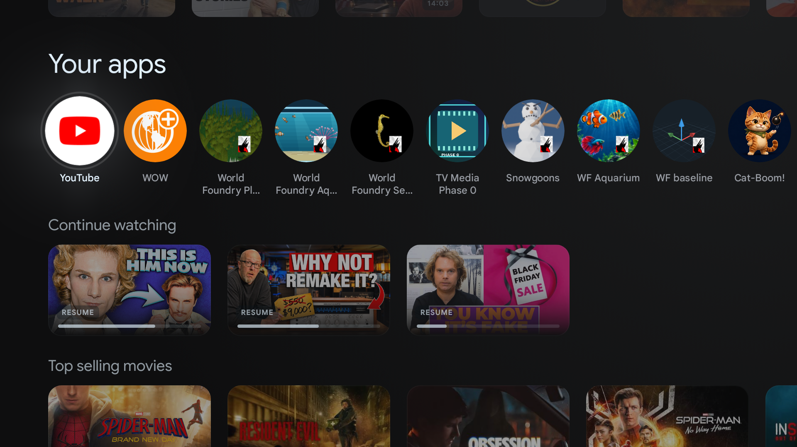
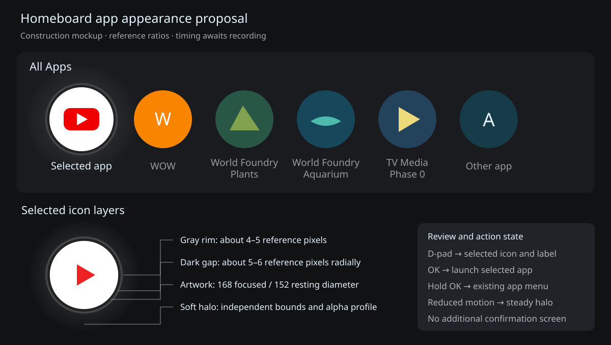
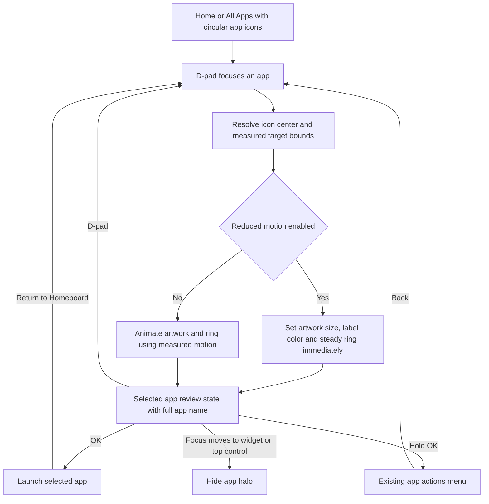
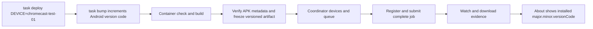
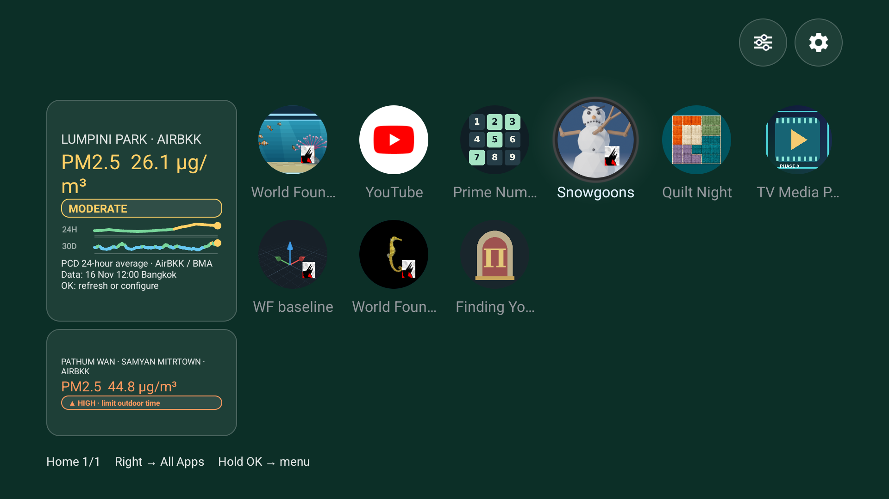
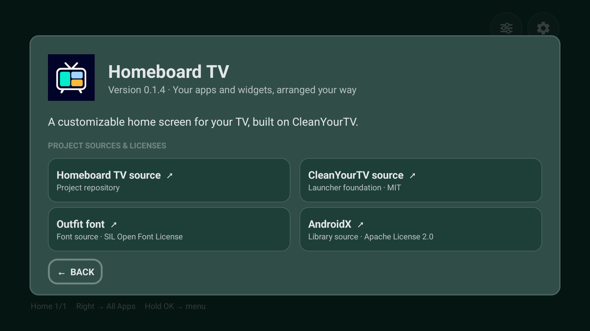
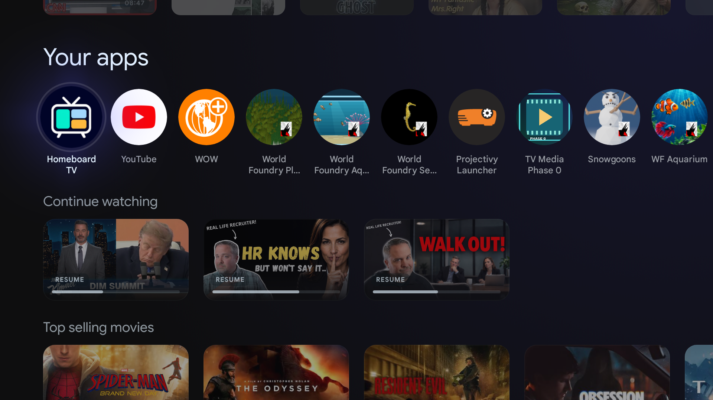
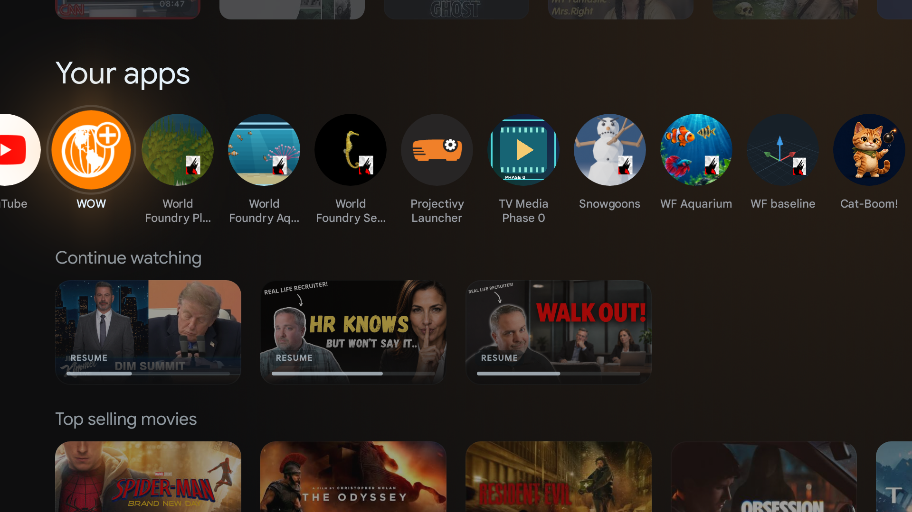
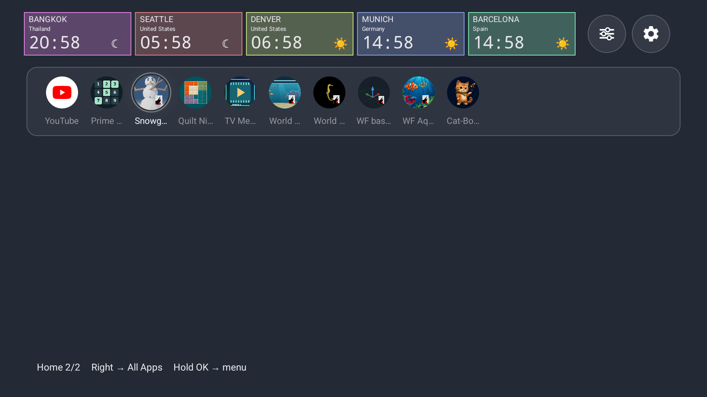

# Google TV app icons and glowing focus

Home now also supports [Banners for favorites](2026-11-16-home-favorite-app-sizes.md),
independent of All Apps artwork. The circular geometry below applies to Small icons.
Banners use aspect-preserving 16:9 plates and their own rectangular rim and halo;
changing size rebuilds focus and Undo restores the prior layout and Home navigation.

**Status: deployed on Cast1 as 0.1.4; Cast2 coordinator install preflight failed · 16 November 2026**

Match the app artwork, circular mask, focused enlargement, gray focus ring,
soft halo and label treatment in Cast2's Google TV launcher as closely as the
device evidence allows. Apply the treatment to Homeboard's circular app icons
on Home and All Apps. Keep Homeboard's widget layout, app ordering and remote
actions. The reference's recommendation rows are outside this change.

## Reference and screen mockups

[Full resolution reference PNG](2026-11-16-google-tv-app-focus/reference.png)
captures the 1920 × 1080 display with YouTube selected. The coordinator capture
completed successfully and exported verified evidence. Preserve this PNG as the
visual baseline; use its pixels rather than a compressed chat preview.




The mockups below show the proposed Homeboard treatment and its layers. They
are construction drawings, not evidence of an implemented match. App symbols
are placeholders; production artwork comes from installed packages.



| Property | Approximate reference pixels | Implementation target |
|---|---|---|
| Unfocused icon diameter | 152 | Normalize dimensions relative to this diameter |
| Focused artwork diameter | 168 | About 1.105 × resting artwork size |
| Selected icon center | (192, 316) | Keep the artwork center fixed during enlargement |
| Next icon center | (374, 316) | Reference center pitch about 182; do not stretch Homeboard widgets to copy the entire page |
| Focus ring outer diameter | 190 | Outer radius about 95, including the visible rim |
| Dark gap outside selected artwork | About 5–6 radially | Keep artwork, gap and ring independently adjustable |
| Gray ring thickness | About 4–5 | Sample edge cross sections before fixing the final value |
| Outer halo | Broad, low contrast | Measure against the local background; avoid a hard outer boundary |
| App labels | About 24 high; one or two lines | Bright selected label, muted resting label, centered below artwork |

These are initial screenshot measurements, not Android dp values. The selected
label has interior pixels near `#e4f3ff`; the rim near the top has pixels around
`#434546`. Antialiasing and the background affect edge values. Infer color and
opacity together from several scan lines instead of treating sampled composites
as universal paint colors. Measure icon-only regions so the large white YouTube
disc does not distort halo brightness measurements.

## Motion reference

The successful PNG used the coordinator's supported personal capture. No
reference movie has been captured yet. Pulse period, pulse amplitude, focus
travel and easing remain unmeasured. A screenshot establishes a visible halo,
not its animation. Submit requested jobs and let the coordinator own admission;
a personal-use marker is not an agent-side install gate.

Capture ten seconds of the
unchanged launcher, then a separate focus transition if needed. Use one bounded
coordinator job per complete session, with no installation or app launch for the
reference recording:

```sh
task chromecast:devices
task chromecast:queue
task chromecast:submit DEVICE=chromecast-test-02 WORKFLOW=record-live DURATION=10
task chromecast:watch JOB=<returned-job>
task chromecast:evidence JOB=<returned-job> OUT=<absolute-reference-directory>
```

For a transition recording, let Will move between adjacent icons during the
bounded recording, or use an explicitly supported complete input-and-recording
workflow. Keep installation and default-Home selection out of the reference job.

Extract successive frames around the selected icon, measure ring intensity and
radial halo falloff after subtracting the local background, and plot them over
time. Check whether brightness varies globally, travels around the ring, or
stays steady. Record focus acquisition duration, outgoing fade, artwork scale
and any overshoot. Use the observed behavior: add a repeating pulse only if the
recording shows one. Freeze the measured constants and timestamped example
frames alongside this plan before claiming motion fidelity. Static implementation can proceed now; keep a
steady halo and provisional 180 ms acquisition with critically damped travel.
These timings are implementation choices, not reference measurements.

## Source review and revised implementation scope

The latest source already preserves focus on resume and implements the new pie
menus, undo and flexible Home grid. Preserve those behaviors and the uncommitted
`GlassView` stroke-width constant. Current repository instructions select Cast1
for iterative installs until Will says the app is usable; Cast2 remains the
reference device. Personal-use admission belongs to the coordinator, which
supports background installs during that state.

The earlier one-physical-pixel gap request in the move/widgets plan is superseded
for circular app icons by this measured reference gap and ring. Noncircular
artwork retains its existing focus path. Do not change saved Home positions or
row counts to enlarge icons: fit artwork and a stable label slot to each measured
cell, up to a preferred 76 dp diameter, and use reference ratios at that size.
All Apps circular-icon mode uses approximately 96 dp column pitch and 128 dp row
pitch to accommodate reference-size artwork and two-line labels; banner and
unmasked modes retain their previous density. Home positions and row counts
remain unchanged. Two-line labels fit only where the
cell has room; dense cells keep a single-line ellipsis and full accessible name.

Resolve adaptive icon foreground/background layers using Android's documented
extra inset and render them through a circular mask. Keep legacy activity icons
from the existing package resolver. Exact round-resource choice for individual
packages remains a device comparison task, rather than guessing resource names.
See [Android adaptive icon drawable documentation](https://developer.android.com/reference/android/graphics/drawable/AdaptiveIconDrawable).

## Rendering changes

The current app path in `MainActivity.java` uses 48 dp compact icons, `FIT_CENTER`,
a circular outline and `APP_FOCUS_SCALE = 1.08f` before this change. It scaled the entire tile,
including the label, and moves one `GlassView` with underdamped springs. The
highlight receives `setInset(0)`, while `GlassView.onDraw()` only draws its outer
glow when the inset is positive. It also adds a translucent fill and top sheen.
Those behaviors explain why the present treatment differs from the reference.

1. **Resolve artwork before drawing focus.** Compare the same installed packages
   on both launchers, including YouTube, WOW and World Foundry icons. Inspect the
   launcher activity's icon and round-icon/adaptive-icon resources to determine
   which source reproduces each reference. Keep adaptive foreground/background
   layers intact. Match the artwork's internal scale and crop; a circular clip
   around a letterboxed square is insufficient. Use the installed package's own
   resources rather than baking reference screenshots or logos into Homeboard.

2. **Separate artwork, label and focus geometry.** Give each app tile a stable
   artwork center and label slot. Enlarge the artwork only; animate label color
   separately. Reserve enough label height for two lines and an ellipsis, while
   preserving the full accessibility name. Preserve tile hit targets and logical
   focus bounds. Express the reference ratios through one app-appearance metrics
   object so density conversion happens once, without multiplying raw screenshot
   pixels into Android dp. Account for Homeboard's grid spacing and text scaling.

3. **Draw a dedicated app ring and halo.** Add a small native Java
   `AppFocusView` rather than changing shared menu glass behavior. Draw the halo
   behind the artwork, the dark separation and gray rim around it, and no sheen
   across its face. Allocate outer bounds large enough for the entire halo plus
   antialiasing. Ring bounds and halo bounds must be separate; a zero-inset stroke
   cannot provide a visible outer glow. Disable clipping at the necessary parent
   boundaries and check screen edges and adjoining rows. Keep widgets, menus,
   noncircular artwork and banners on their existing rendering paths.

4. **Use cached drawing resources.** Start with a smooth radial alpha gradient
   in a reusable texture or shader, calibrated to the reference profile. Avoid
   allocating bitmaps, paints or paths during animation and avoid a software blur
   every frame. Retain a hardware-composited layer for translation/alpha where
   appropriate. If the movie shows a changing glow, animate its intensity or
   measured spatial effect independently of the sharp ring and artwork.

5. **Replace guessed motion with observed motion.** Tune acquisition and travel
   after recording. The existing spring stiffness 260 and damping ratio 0.58 are
   current behavior, not reference measurements. Do not preserve bounce unless
   it appears in the launcher recording. On rapid repeated D-pad input, retarget
   from the current rendered position and scale without jumping through stale
   intermediate destinations. Ensure focus leaving an app hides its halo.

6. **Respect lifecycle and reduced motion.** Show only the current app's focus;
   suspend it while menus or other controls own focus. Restore it once after
   returning from an app or rebuilding the surface. Cancel motion and repeating
   callbacks when detached or backgrounded. Reduced motion retains the selected
   ring and steady halo with immediate position/size updates and no pulse.

## Focus and action flow



This is a visual treatment, so it adds no confirmation screen or setting menu.
The focused app and its label are the review state before OK launches the app.
Keep the existing circular-mask choice; selecting circular icons should use the
matched treatment without requiring Will to configure glow parameters.

## Dated agenda

### 16 November 2026

- [x] Capture and inspect Cast2's full-resolution launcher reference.
- [x] Compare the current app rendering code with the reference geometry.
- [x] Prepare the screen mockup, focus flow and implementation plan.

### When Cast2 is available for a reference recording

- [ ] Record ten seconds of idle focus and a bounded adjacent-icon transition.
- [ ] Measure the halo profile, timing, scale and artwork source for matching apps.
- [ ] Replace approximate values with measured constants and retain example frames.

### Implementation from the static reference

- [x] Introduce the shared appearance metrics and dedicated app focus renderer.
- [x] Implement adaptive artwork normalization, icon enlargement and independent label treatment.
- [ ] Confirm per-package artwork choices against Google TV on the device.
- [x] Integrate focus movement, lifecycle handling and reduced motion.
- [x] Run `task check` and `task build` in the established container environment.
- [x] Freeze/register the built APK, then install on available Cast1 through one
  complete coordinator-owned job, preserving app data and settings.
- [x] Export Homeboard focus, top-control, menu and installed-version captures.
- [ ] Complete same-package reference matching and reference-motion calibration.

## Acceptance and comparison

Compare matched crops at the same output resolution and icon diameter. Align on
the artwork center rather than the whole Homeboard page. Overlay reference and
candidate edges, inspect horizontal/vertical intensity profiles and compare label
baselines. Use identical packages and avoid fitting artwork differences by
distorting the focus ring. Check a bright disc, dark disc, adaptive icon and
transparent artwork. Raw whole-screen difference scores are unsuitable because
Homeboard's content and layout intentionally differ.

Initial acceptance thresholds are artwork diameter within 2 reference pixels,
ring outer radius within 2 pixels and label baseline within 3 pixels after
normalization. Tune halo falloff against several reference cross sections and
have Will compare on the TV. After motion calibration, match observed transition
duration within one captured frame and repeat period within 5 percent if a pulse
exists. These are targets, not completed validation results.

Exercise Home favorites, All Apps, top controls, menus, page changes, rapid
D-pad movement, app return, a screen-edge icon, two-line labels, alternate
backgrounds and reduced motion. Verify there is one focus indicator, no clipped
halo, no glow left on a formerly selected app and no change to saved ordering.
Profile a bounded on-device transition if visible stutter appears; cached drawing
alone does not prove smooth frame delivery. Add meaningful tests for lifecycle
or focus-state regressions uncovered by the change; visual fidelity is established
by exported device evidence and Will's review.

The source review found unrelated UI edits in the current working tree. Implement against the
current source carefully, preserve those edits and keep shared `GlassView` menu
behavior intact. This plan authorizes no upstream contribution or publication;
retain existing licenses and package-resource provenance.

## Implementation and build evidence

`AppAppearance` holds reference geometry and cell-fitting rules. `AppFocusView`
draws the cached radial halo, dark gap and rim behind the icon grid.
`CircularAppTile` handles adaptive artwork, a stable label slot, artwork-only
scale and independent label color. `MainActivity` selects this renderer only
for circular app icons, retains the unmasked/banner paths and cancels or hides
focus when another control, menu or background activity takes over. No idle
pulse is invented.

The container run passed all 346 unit tests, including three new geometry and
cell-fit regressions, and Android lint with zero errors, 195 warnings and 96
informational findings. Debug APK assembly passed. Lint also required a named
`Typeface.NORMAL` constant in the existing pie menu and explicit braces around
short conditional statements; those changes preserve behavior.

The frozen APK and source hashes are recorded in
[`build.json`](../../artifacts/validation/google-tv-focus/build.json), with APK
SHA-256 `d9b094f175a49092ac665fd542183520b395c25a55b28997372d770658022f40`.
These private build artifacts are local evidence and are excluded from Git.

## Deployment version numbering

Will requires a distinct version for every deployment. Store major, minor and
the integer Android version code in `version.properties`. Generate APK
`versionName` as `major.minor.version_code`; the existing About dialog reads
that installed APK metadata. The About dialog uses the APK `versionName` directly, with no separate display
counter. Version `0.1.2` was confirmed in the dialog; the final combined revision
was deployed as `0.1.4` with version code 4. Version 3 was consumed by a
failed deployment-wrapper check before any device job was submitted.

The About screen keeps its existing layout and shows:

| About dialog element | Next deployment content |
|---|---|
| Heading | Homeboard TV |
| Version under heading | Version 0.1.4, read from the installed APK |
| Purpose and attribution | Existing text |
| Bottom action | Back to Home settings |



`task bump` runs the version mutation through Gradle in the build container.
`task deploy` always bumps before building, so a failed attempt may consume a
number; numbers are never rolled back or reused for a new deployment. The
deployment helper refuses stale APK metadata and an existing versioned artifact
directory. Keep the low-level coordinator tasks for evidence, reference capture
and job control; use `task deploy` for each new Homeboard deployment.

The first focus recording completed, but Will was viewing About during its
scripted icon checks. Those frames establish the dialog and larger resting
artwork, not the intended focused-icon transitions. The next bounded job must
close existing menus before navigating and capture both focus and the new
installed version.

The complete deployment wrapper was checked from `task deploy`, including nested
Task calls. Its first integration attempt exposed inherited empty `WF_CC_*`
parameters overriding child arguments. The helper now clears only the adapter's
request parameters before each child Task and preserves coordinator identity and
connection environment. That failure occurred before registration/submission;
version 3 remains consumed. Reusing an existing artifact number is also verified
to fail before contacting a device.

## Final Cast1 deployment and additional Cast2 install

`task deploy` completed end to end for version **0.1.4**, Android version code 4,
with app data preserved. All **348 tests** passed; lint reported **zero errors**,
193 warnings and 96 informational findings. The coordinator completed with
health ready and exported the recording and captures. The installed About
dialog visibly reads **Version 0.1.4**, directly from APK metadata.





The focused capture shows Snowgoons, despite its scripted label saying
`youtube-focused`; evaluate the actual screen, not that label. The following
top-control capture and the About capture show no lingering app halo. The
returned-Home frame matches the top-control state. The visible ring, artwork
enlargement and independent selected label are verified; exact animation
fidelity and per-package Google TV artwork comparisons remain open.

[Machine-readable validation summary](2026-11-16-google-tv-app-focus/validation.json).
Private APK, receipt and movie: `artifacts/deployments/0.1.4/`.

Will also requested installation on Cast2. Submit installs to the coordinator;
do not add an agent-side personal-use gate or request that Will release the
hold. Background installation and foreground verification are separate stages
owned by the coordinator.

The same frozen 0.1.4 APK was registered and submitted as an install job for
Cast2. The coordinator granted the job during personal use, then failed its
background preflight with `personal-install-unverified`. Exported command
evidence reaches the active-process query before stopping, and there is no
completed installation entry. Cast2 remains healthy. The requested Cast2 install
is therefore **not complete**. Private failure evidence is under
`artifacts/deployments/0.1.4/cast2-evidence/`. No direct-device fallback or
coordinator guard bypass was used. Additional devices in one deployment receive
the identical frozen APK/version; a new source revision requires a new number.


## Favorites ribbon measured against Google TV · 20 November 2026

Measured from Cast2's own Google TV home through a coordinator-owned Remote
session, 1080p frames: [first app focused](2026-11-16-google-tv-app-focus/cast2-gtv-focus-first-app.png)
and [after three Right presses](2026-11-16-google-tv-app-focus/cast2-gtv-focus-after-scroll.png).
The coordinator cannot video-record the stock launcher (`record` needs a registered
app, `record-live` takes no input), so **transition timing is still unmeasured**.




| Property | Google TV | Homeboard Favorites 0.1.107 |
|---|---|---|
| Icon diameter | 152 px | about 87 px (a one-row ribbon is about 88 dp tall) |
| Centre pitch | 182 px (1.2 × icon) | 121 px |
| Gap | 30 px | about 34 px |
| Focused icon | 168 px, centre fixed | same ratio, centre fixed |
| Rim | gap to about r = 91, gray rim to r = 95 | same geometry; lighter on the panel (3:1) |
| Halo | tinted with the focused icon's colour, about 8 % falling to 4 % | tinted the same way |
| Scrolling | focus stays at x = 192; the row scrolls under it and slices the left icon | whole cells only |

Google TV's label is about 24 px high on a 152 px icon. The app's 16 sp label is
twice that relative to the icon and forced a 176 px pitch, so Favorites uses a 12 sp
label and a 56 dp preferred icon. The pitch follows the icon as drawn
(`AppAppearance.favoritePitchDp`). Result:
[Cast1, 0.1.107](2026-11-16-google-tv-app-focus/cast1-favorites-0.1.107.png). Will accepted it.
Only round icons in the Favorites ribbon changed; All Apps, Home and banners did not.


