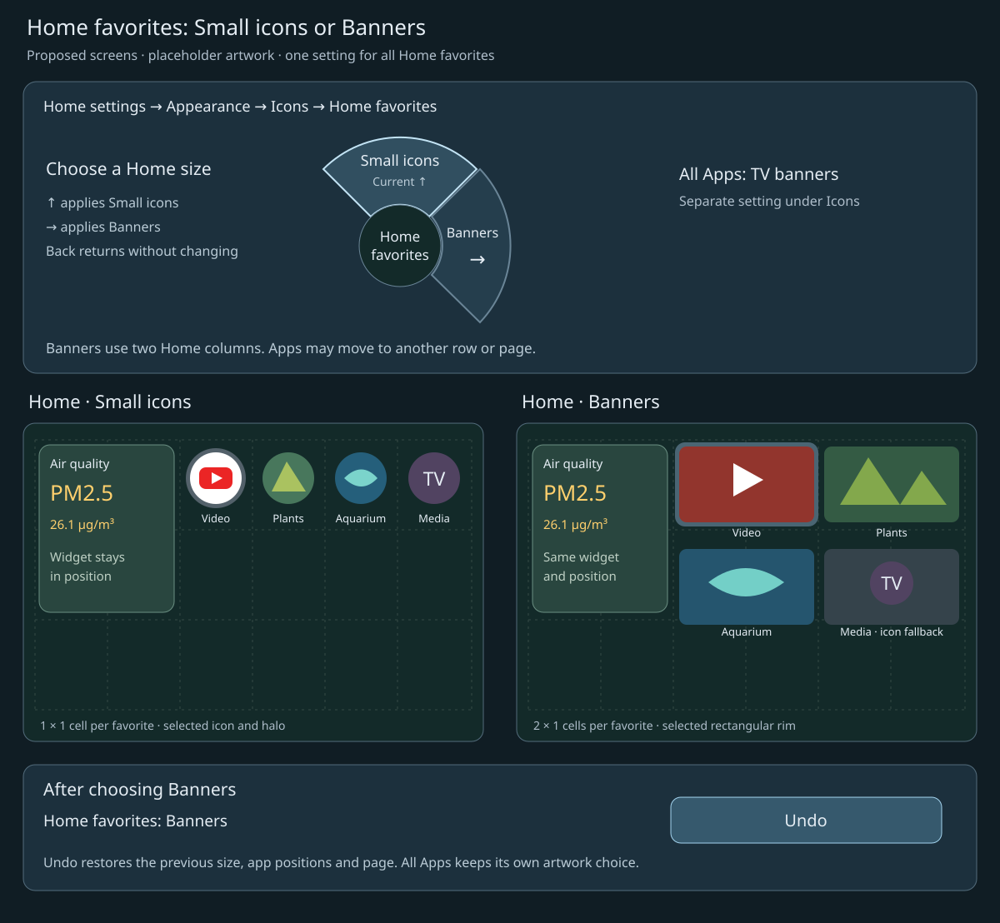
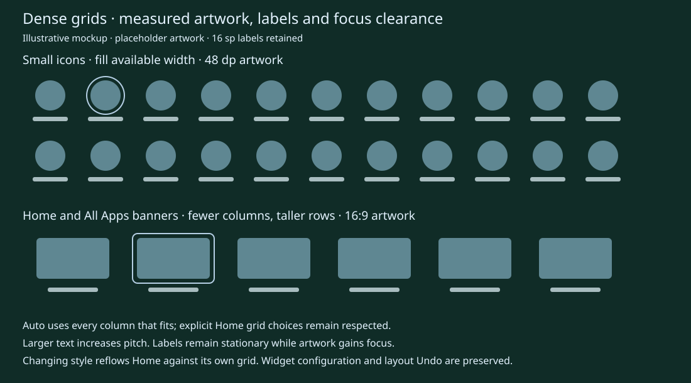
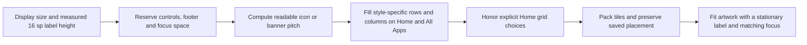
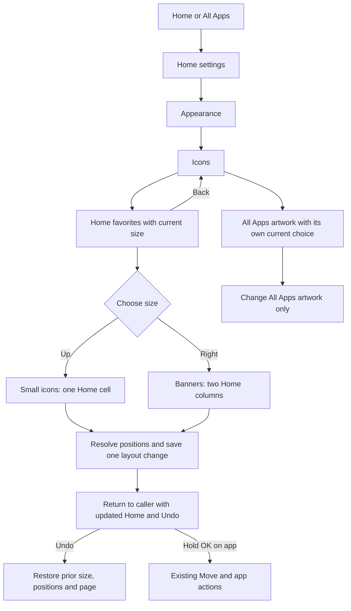
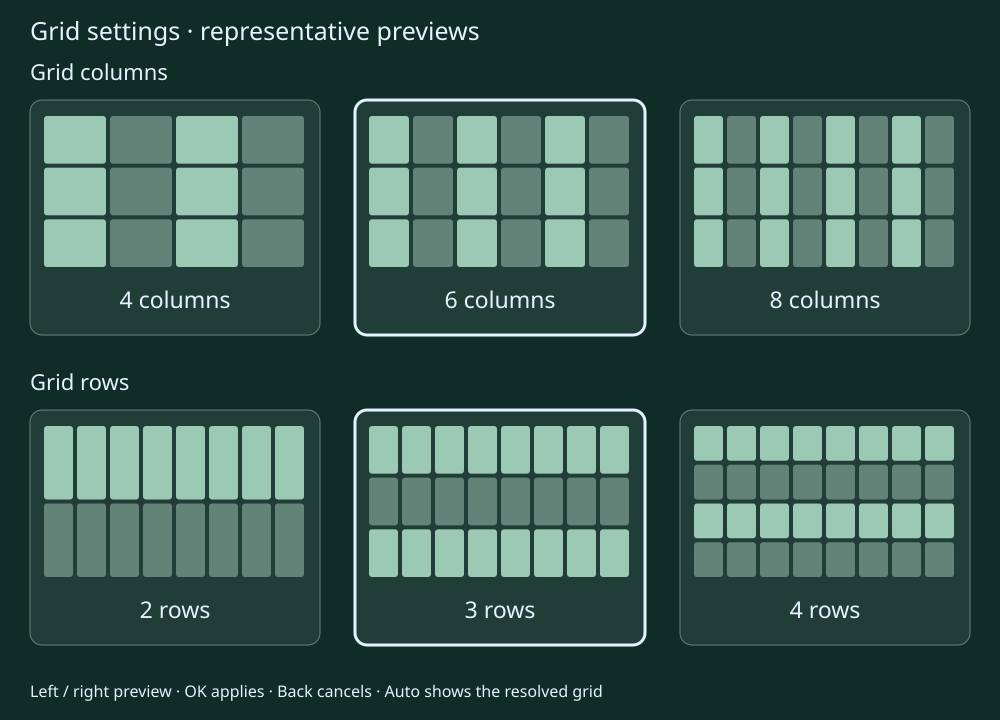
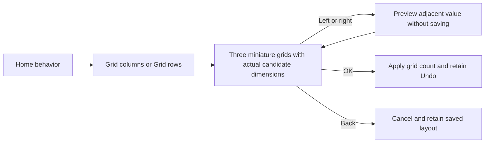

# Home favorite app sizes

**Container follow-up:** the [first-page Rain and Favorites implementation](2026-11-16-first-page-rain-and-favorites-container.md)
retains the independent Small icons / Banners choice inside a bounded scrolling
Favorites panel. The separate outer app placement described below is historical.

**Status: dense style-specific layouts implemented and container-checked; 0.1.8 deployed, then replaced by the separate Projectivy 0.1.9 build; combined integration pending · 16 November 2026**

[Deployment and validation record](../testing/2026-11-16-home-favorite-app-sizes.md)
records the exact 0.1.7 APK, successful Cast1 launch, scripted-input failure and
the earlier coordinator-owned Cast2 job deferred during personal use. That queued
0.1.7 job was cancelled when the density revision superseded it.
The density implementation is committed on `main` as `6a0366b`, after the Home
favorites implementation `be49bd7`. Will assigned the other agent to merge its
Projectivy work into `main` before the next combined deployment. Do not reinstall
0.1.8 over 0.1.9; the next deployment needs a version code greater than 9.

Let Will display favorited apps on Home as **Small icons** or **Banners**.
This is one setting for all Home app favorites, independent of the existing
All Apps artwork choice. Default to Small icons so existing Home layouts retain
their current presentation until Will changes it.

## Screen mockups

The mockup uses placeholder app artwork. Actual icons and banners come from
installed apps. It shows a six-column Home grid to make the span change clear;
the implementation must also fit the configured Auto and fixed grids.

## Settings and remote interaction

Use **Home settings → Appearance → Icons**. Turn the existing Icons leaf into
two branches, each showing its current value:

| Icons branch | Choices | Applies to |
|---|---|---|
| Home favorites · Small icons | Small icons / Banners | All favorited apps on Home |
| All Apps · TV banners | Launcher icons / TV banners | The existing All Apps view |

The Home favorites submenu shows **Small icons · Current** and **Banners**,
or the reverse current marker. Its subtitle explains that banners use wider
cells and taller rows, and tiles may move to another row or page. Use the existing compass menu:
Up chooses Small icons, Right chooses Banners, OK performs the displayed center
action, and Back returns without selecting a new value. Merely opening the
submenu changes nothing.

Choosing a size applies it immediately and returns to the invoking surface,
using the existing terminal-action behavior. Show **Home favorites: Banners**
or **Home favorites: Small icons**, with the existing **Undo** action. There is
no separate confirmation step. Re-selecting the current choice does not create
an Undo entry or reflow the layout. Opening this setting from All Apps must keep
the All Apps artwork selection and return location intact.

This first version is a global Home setting. It does not introduce per-app size
overrides, arbitrary app resizing, or another grid-density control.

## Tile appearance and layout

### Dense layout revision

Will requested the densest reasonable layout after 0.1.7. Use 48 dp small icons,
16 sp labels and measured text height. Reduce side margins to 32 dp, Home's top
margin to 88 dp and bottom margin to 52 dp; use 8 dp horizontal and 6 dp vertical
cell gaps. Auto Home fills all columns that fit, up to the existing limit of 12,
instead of stopping at nine. Explicit row/column choices remain respected.

All Apps uses the same measured small-icon pitch. Banners also use a responsive
grid, with a minimum 144 dp column pitch and room for a 96 × 54 dp image, focus
clearance and a label. Larger text increases the minimum pitch automatically.
At a representative 960 × 540 dp TV size this gives 11 × 4 small icons and
6 × 3 All Apps banners, compared with 8 × 4 Home icons, 9 × 3 All Apps icons
and 4 × 2 All Apps banners previously. Counts vary with display and font metrics.
Home uses the selected style too: icons use a compact 11 × 4 grid in that
example; banners use six wider cards across three taller rows. Internally, a
Home banner still spans two placement columns, so its Auto grid has 12 placement
columns and three rows. Explicit grid choices are capped at the readable fit
for the selected style. Switching style resolves positions against the new grid;
widgets keep their origins where they fit, and otherwise move without losing
their configuration. Undo restores the previous style, grid fit and positions.

Verify that another row or column would violate the minimum pitch, that larger
text reduces density when needed, and that 720p/1080p/4K displays use their dp
dimensions consistently. This revision changes spacing and automatic grid fit;
the Home size and artwork selection workflow stays the same. The former shared
Home grid between icon and banner styles is superseded by this revision.

| Property | Small icons | Banners |
|---|---|---|
| Home grid span | 1 column × 1 row | 2 columns × 1 row |
| Artwork | Launcher icon | App-provided TV banner |
| Aspect and mask | Existing icon shape or circular-mask choice | 16:9 image with rounded corners |
| Focus | Existing icon focus, including circular ring and halo | Rounded rectangular outline and soft halo around the image |
| Label | Existing fitted label slot | Centered below the image, ellipsized as needed |
| Missing banner | Not applicable | Center the launcher icon on a neutral 16:9 plate, with the app label below |

Fit a banner's 16:9 image inside the space left after reserving its label and
focus clearance. Never stretch an icon into banner proportions or crop a banner
merely to fill a dense cell. Circular masking applies to small icons only.
Keep focus enlargement inside the available image area and leave the label
stationary. Preserve the full app name in the tile's accessibility description.

Changing size must preserve favorites membership, logical ordering, widget
configuration. The dense layout revision computes a separate grid fit for each
style. Resolve tiles against the selected style's grid before rendering:

1. Capture the current resolved positions and full layout snapshot for Undo.
2. Keep widgets at their resolved positions and spans where they fit the new
   grid; resolve positions outside the new bounds without changing configuration.
3. Place favorites in their existing logical order. Keep each app's prior origin
   if the new span fits without overlap; otherwise use the existing deterministic
   placement search for the next available position, including another page.
4. Persist the new size and resolved positions together as one undoable change.
5. Restore focus to the initiating app when it is still present, following it
   to its resolved page. For settings opened from a top control, retain that
   control's focus and clamp the Home page to the new page count.

Shrinking banners to small icons keeps their current origins; it does not silently
repack every gap. Undo restores the entire preceding layout, including exact
positions, page, style-dependent grid fit and size. Changing the setting to Small icons later is a new
layout change, rather than a hidden restoration of an earlier arrangement.
An empty Home stays empty. Newly favorited apps use the current Home size.

Move mode must use the selected app span for occupancy, collision resolution and
directional navigation. Removing and restoring a favorite keeps the global size
choice. Deleting or uninstalling an app continues to use the existing actions.

## Choice and action flow

## Implementation changes

`appArtworkSettings()` now branches into Home favorites and All Apps. Presentation
is selected through `HomeLayout.appUsesBanner()`, and both packing paths share
the same span calculation. `BannerAppTile` reserves a stationary label and focus
clearance before fitting 16:9 artwork. `BannerFocusView` supplies rectangular
focus without a circular mask or glass overlay.

- Add a persisted `homeAppSize` value with exactly `small` and `banner`. An absent
  field uses `small`, preserving current saved layouts. Validate unsupported
  values at the normal layout parsing boundary; do not introduce aliases or
  a separate compatibility layer.
- Share the app-span calculation between automatic packing and explicit-position
  packing. Keep widget span calculation unchanged. Use the same result in move
  previews and nearest-neighbor navigation.
- Centralize the app presentation decision by surface and size. Home uses
  `homeAppSize`; All Apps keeps `appBanners`. Use this decision consistently in
  artwork resolution, tile construction, focus classification and focus restore.
- Reuse installed activity banner lookup and icon fallback. Keep `CircularAppTile`
  for small circular icons. Give banner images their own aspect-preserving layout
  and rectangular focus path; do not alter menu glass or round banner artwork.
- Update `configureTile()`, `createAppFocusHighlight()`, the global focus listener
  and `snapDenseAppHighlight()`: their current Home-is-compact assumptions must
  not leave a circular halo on a banner or retain a halo after changing size.
- Apply the size and resolved positions through the existing layout save/Undo
  mechanism as one transaction. Capture the prior Home page and focus alongside
  the layout for this action: the generic layout snapshot alone does not contain
  navigation state. Undo from All Apps restores that underlying Home state
  without forcing a surface switch. Cancel stale focus animation before rebuilding
  the surface and honor reduced motion during the change and subsequent moves.
- Replace the “Home favorites stay compact” copy and update the quick start and
  related grid/focus plans to describe both supported Home presentations.

## Dated agenda

### 16 November 2026

- [x] Review current artwork settings, Home rendering and placement code.
- [x] Specify the independent Home size setting, mockups and action flow.
- [x] Implement persistence, shared span resolution and size-change Undo.
- [x] Implement the menu branches, banner layout and focus integration.
- [x] Add regression tests and run `task check` and `task build` in containers (357 tests, zero failures; lint has zero errors).
- [x] Implement separate dense Home and All Apps grids for icons and banners,
  including style-dependent Home reflow and Undo; 362 tests and container lint pass.

### Device acceptance after implementation

- [x] Deploy a newly numbered APK through the coordinator, preserving app data
  (0.1.7 installed and launch-verified on Cast1; identical APK queued for Cast2).
- [ ] Capture Small icons, Banners, fallback artwork, focus movement and Undo.
- [ ] Verify favorite ordering, widget positions, collisions, page overflow,
  moving a wide tile and returning from an app.
- [ ] Verify both Home sizes with both All Apps artwork settings; each choice
  must remain independent across relaunch and configuration changes.
- [ ] Check an empty Home, one favorite, many favorites, long app names,
  dense grids, RTL, larger text and reduced motion.

Use devices/queue for status and submit complete coordinator-owned jobs; let the
coordinator schedule them. Do not add a personal-use gate. Record actual install,
launch and visual acceptance outcomes separately.

## Acceptance tests

Unit tests should cover saved-size round trips and the default for an absent
field; 1 × 1 and 2 × 1 spans in both placement paths; keeping widgets fixed;
nonoverlapping placement at the right edge and across page boundaries; and Undo
restoring exact prior positions and size. Include a crowded-grid case where
changing to Banners creates an extra Home page, then Undo removes that page.

Device evidence must show usable 16:9 artwork, a readable label, the correct
focus shape and no leftover circular halo on banners. Exercise focus leaving
for top controls and menus, rapid app-to-app navigation, saved focus on resume,
and returning from a launched app. A completed coordinator job establishes job
execution; inspect its captures before marking visual acceptance complete.

## Visual grid-setting previews · 16 November 2026

Grid columns and Grid rows selectors show three miniature dashboard grids for
the previous, selected and next value. Each preview uses the candidate count on
the axis being edited and the current effective count on the other axis. The
selected value is framed; Auto previews the TV-fitted count and states the
resolved dimensions. Column previews emphasize vertical groups, while row
previews emphasize horizontal groups. Numbers remain visible and spoken so
color is not the only cue.

This changes the selector presentation and keeps the existing supported values,
TV fit bounds, remote navigation and Apply/Cancel behavior.

The visual selectors were implemented and inspected on Cast1 in **0.1.21**.
The column preview changed from Auto 12×3 to four columns; the row selector
showed three rows and the adjacent two-row schematic. Back preserved the saved
values. See the [combined validation record](../testing/2026-11-16-calendar-and-grid.md).
