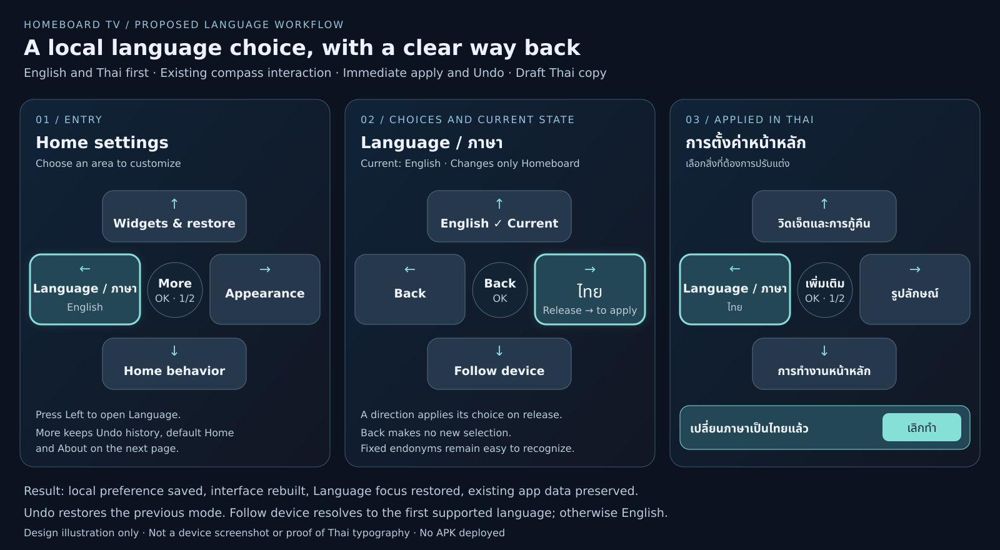
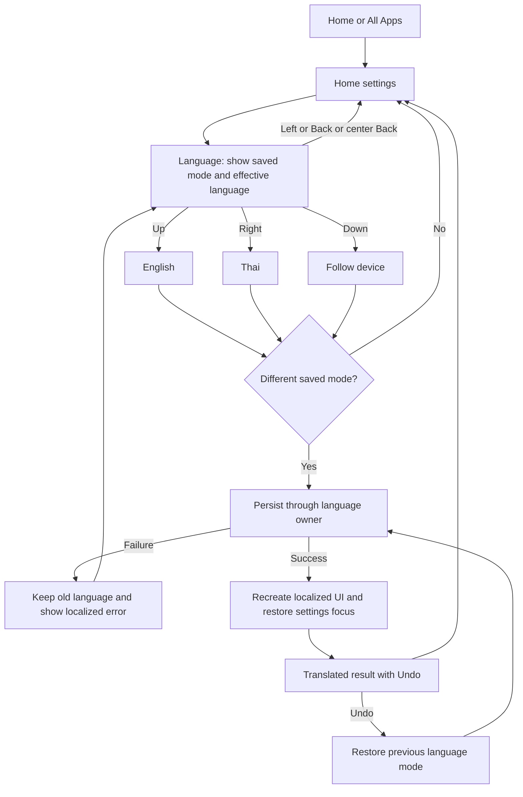

# Language setting and repeatable English/Thai translation

**Status: core implementation in isolated worktree; copy/device acceptance pending · 16 November 2026.**

Add **Home settings → Language** with English and Thai, plus a Follow device
choice. Translate the complete reachable Homeboard interface and establish one
repeatable procedure that prevents incomplete translations at commit, CI and
deployment boundaries. Keep the Java launcher and native Android resources.

The implementation addendum records the working language setting and structural
resource gate. The broader review/commit/acceptance workflow below remains the
design target; unimplemented checks are explicitly marked. No device deployment
or linguistic acceptance is claimed.

## Review basis and decisions

Reviewed Homeboard at base commit `aa1009572e9b6603b490279c989dc1afea6472f1`
with unrelated calendar work in progress. See the
[Parking Space critique](/home/will/parking-space/docs/investigations/2026-11-16-english-thai-translation-workflow-critique.md)
for evidence: its 188 English/Thai catalog keys match, but hardcoded UI, raw errors,
split locale ownership and missing dedicated gates remain. Reuse the process
lessons and typed messages; keep Flutter-specific machinery in Parking Space.

Homeboard already has default English and inherited `values-th/strings.xml`
resources, a manual `locales_config.xml`, and `android:localeConfig` in the
manifest. The current files contain 150 default resource entries and 68 Thai
entries; this is not a reachable-UI coverage measurement. The locale list
advertises many inherited languages that do not cover the new product UI.
`MainActivity` extends framework `Activity`, minSdk is 26 and compile/target SDK
is 34. New menu titles, actions, Undo feedback, About and air-quality text are
largely Java literals. A picker alone would produce a mixed-language launcher.

Use Android XML strings, plurals and arrays with generated `R` identifiers.
Do not add JSON translation lookup, Flutter, a dashboard framework, an online
translation dependency or account synchronization. Use one language policy
throughout the app. Retain imported translation files, licenses and provenance;
advertise and package only the initial English/Thai language configurations so
an unsupported device language cannot select fragments of another translation.
Check the merged release resources, including library resources, before claiming
this filtering is effective. Keep non-language resource variants intact.

## Screen mockups and remote behavior

The Thai wording in these design mockups is draft copy for linguistic review.
Language endonyms remain **English** and **ไทย** in either interface. Use a globe
icon and a bilingual **Language / ภาษา** recovery label. Put Thai on its own line
where the pair will not fit. Do not use flags.

1. Add a first-page Language branch to the existing Home settings compass,
   retaining the other destinations through its existing More pagination. It
   shows the saved mode and effective language; update the settings overview
   mockup/workflow and device recipes for the new order.
2. The Language compass offers **Up: English**, **Right: ไทย**,
   **Down: Follow device**, **Left: Back**. Its center describes the current
   choice; OK performs the existing center Back action. Mark the saved choice
   with a check and text, distinct from transient key-press focus.
3. Preserve the established directional contract: a directional key release
   activates its arm. Opening the screen changes nothing; Back/Left returns
   without a new selection. Do not introduce a radio-dialog Save step or require
   OK after a terminal arm.
4. A choice persists locally, applies immediately, and returns to Home settings
   with Language focused, in the chosen language. Show localized feedback and
   Undo. Choosing the already saved mode is a no-op. Changing Follow device to
   English is a real change even if both currently display English.
5. Restore focus, invoking Home/All Apps surface and page across recreation.
   Retain the settings breadcrumb as resource/action IDs, not cached translated
   labels. Back later returns to the original surface. The bilingual recovery
   entry and fixed endonyms let Will recover from an accidental selection.

## Language policy and Android integration

| Situation | Required behavior |
|---|---|
| First run / Follow device | First supported language in the device preference list; English if none match |
| Explicit English / Thai | Remains selected through relaunch, process death and APK updates; independent of device language |
| Regional tags | `en-*` resolves to English; `th-*` resolves to Thai; no guessed geolocation |
| Device configuration changes | Follow device re-resolves; an explicit choice remains explicit |
| Android app-language settings, API 33+ | Same state as the in-app picker; empty app locale list means Follow device |
| Unsupported/corrupt stored value | Safe Follow device behavior; record diagnostics, never crash or advertise another supported language |
| Undo | Restore previous mode, not just its previously resolved language; ordinary layout Undo must not reset language |

Introduce a small `AppLanguage` owner for modes, resolution, persistence and
localized contexts. **API 33+ uses `LocaleManager.get/setApplicationLocales` as
the authority**, with an empty list for Follow device. Read platform state on
resume rather than overwriting an external selection with a stale preference.

**API 26–32 has a concrete support requirement: it is in the current minSdk
range.** Use a single private preference and a narrowly scoped configuration
context before view inflation (`attachBaseContext`); recreate the affected UI
after a successful change. This is current platform coverage, not a legacy
preference migration. Use a copied `Configuration` and `createConfigurationContext`;
do not mutate global resources or the device locale. Audit every reachable
activity and app-owned clock/dream/service resource consumer. Clear/rebuild
formatters, menus and cached app-owned labels when the language changes.

Before the main UI refactor, prove this small framework-Activity adapter in a
containerized emulator/fixture on API 26/32 and 33/34. Check configuration updates,
context leakage and process restoration. Android's documented AndroidX option
requires AppCompatActivity contexts on API 32 and below; simply adding
`AppCompatDelegate.setApplicationLocales` to this framework Activity is insufficient.
If the small adapter fails these checks, revise this plan explicitly around the
supported AndroidX path before adopting it; do not ship two competing locale owners.
Handle a future OS upgrade from the pre-33 storage once if that upgrade path is
supported; ensure it never overrides a subsequent platform selection. There are
no earlier Homeboard language preference formats to migrate.

Persist language outside `HomeLayout` snapshots so unrelated layout Undo cannot
revert it. Extend Undo entries with a typed language-change action; render history
descriptions from resource IDs and arguments in the current locale. Preserve all
favorites, empty Home, widget configuration, wallpaper/opacity, density and caches.
If local persistence fails, keep the old setting/UI and offer localized feedback;
never report a successful change before the owner accepts it.

References: Android's [per-app language guidance](https://developer.android.com/guide/topics/resources/app-languages)
documents platform synchronization and the AppCompat context restriction;
[localization guidance](https://developer.android.com/guide/topics/resources/localization)
and [string resources](https://developer.android.com/guide/topics/resources/string-resource)
cover complete defaults and resource messages. The framework adapter above is a
project design choice requiring validation, not Android's recommended AndroidX recipe.

## Translation scope and formatting

Inventory every **reachable app-owned surface**, including Home, empty Home,
All Apps, top controls, compass menus/pagination, appearance, move/resize hints,
restore/delete/favorite, Undo/history, About, air-source/location forms, permission
rationales, loading/empty/stale/offline/error states, wallpaper attribution and
accessibility descriptions. Include secondary activities and the clock/dream if
reachable. Review inherited wording for product identity; do not translate
obsolete CleanYourTV instructions into newly exposed Homeboard behavior.

Move complete sentences to stable semantic resource keys. Use indexed typed
placeholders such as `%1$s`/`%2$d`, escaped literal percent signs, Android plurals
for quantities, and per-locale arrays with stable order where needed. Keep action,
station, palette, widget and provider IDs language-neutral. Never branch on a
translated label: current code such as the comparison with `"UI opacity"` in
`MainActivity` must become an action/setting ID before its label is translated.

Store underlying values, timestamps and cached facts independently of presentation.
Re-render built-in location labels such as Near me and model/station status from
IDs and facts; do not persist an English sentence as the location identity.
Preserve user-entered names. Use reviewed bilingual names for the five built-in
Bangkok stations; treat unknown provider names as attributed external content.
Map known app/network failures to resource messages with a generic localized
fallback, keeping raw exception text in diagnostics.

Use the **effective app locale**, not a process-global default, for display
formatters. Use 24-hour time in both languages and Latin digits for measurements,
coordinates and version numbers in v1. Display localized day/month names and an
explicit Gregorian year in general Homeboard timestamps; a Buddhist-year calendar
presentation must label its era and remain a separate domain decision. Display
and input formatters must agree for coordinate entry. Protocol URLs, JSON/cache
keys, parsers and numeric wire values remain locale-invariant. Test English/Thai
formatting against fixed timestamps and coordinates.

Thai shaping, stacked vowel/tone marks, line breaking and focus-card height must
be inspected with the actual font stack. Prefer system Thai fallback if it passes;
add a bundled font only for a demonstrated rendering problem, with its license.
Do not shrink text to conceal clipping. Recompute fit for dense grids and long
menu labels. Verify accessibility labels and meaningful focus at larger text sizes.

Coordinate with the in-progress
[Thai calendar plan](2026-11-16-thai-calendar-widgets.md): if its widgets join the
same deployment, translate their reachable UI and review calendar/era semantics.
This language plan does not authorize, complete or block on implementing those
widgets separately. The release inventory must reflect the actual combined tree.

## Reusable procedure and enforcement

Adopt [the translation how-to](../how-to/translations.md) as the contributor
procedure. It separates source/copy, linguistic, render and artifact evidence;
the same stages apply to ARB in Parking Space and XML here.

Proposed implementation artifacts:

| File or area | Planned work |
|---|---|
| `AppLanguage.java`, locale-aware entry points | One language owner, API adapters and restoration |
| `MainActivity.java`, `AirQualityCard.java`, reachable UI classes | Resource extraction, picker, localized feedback, stable IDs and Undo |
| `res/values/`, `res/values-th/` | Complete English/Thai messages, plural/array coverage and context comments |
| `res/xml/locales_config.xml`, app Gradle configuration | Advertise/package English and Thai; preserve inherited source files |
| `docs/translations/` | Supported locales, reachable-surface inventory, glossary, explicit exemptions and source/translation review fingerprints |
| `dev/check-translations.py` and container tooling | Deterministic read-only catalog/review checks and structured report |
| Android lint configuration/custom detector | New hardcoded app-owned Java/XML UI text, formatting and resource issues |
| `Taskfile.yml`, Gradle checks, `.github/workflows/check.yml` | One checker exercised locally, in commit checks, CI and deployments |
| Repository hook adapter | Validate staged snapshot without replacing the shared global hooks |
| `dev/deploy.py`, deployment manifest, device recipes | Freeze check/review/source hashes and verify bilingual candidate evidence |
| `docs/testing/` | English/Thai rendering, persistence, accessibility and acceptance record |

The checker must handle XML duplicates, empty strings, missing/default-only keys,
bad aliases, arrays, plural categories appropriate to each language, typed/indexed
format arguments, nontranslatable exceptions and stale review fingerprints.
Catalog equality alone is insufficient. Validate English/Thai coverage for all
shipped reachable strings; inherited unreachable resources get explicit scoped
exceptions, not a growing generic lint baseline. Any newly reachable resource
loses that exception. A changed English value, placeholder contract, context or
Thai value invalidates the corresponding linguistic review until reviewed again.

| Gate | Blocks on | Runs where / evidence |
|---|---|---|
| Commit, relevant changes | Invalid/incomplete catalogs, new hardcoded app-owned UI, stale copy review, missing surface coverage | Proposed `task i18n:check` in a container on the staged snapshot; unstaged fixes cannot make staged code pass |
| Required CI, every candidate | Same checks plus unit/lifecycle tests and deterministic packaged resource validation | Existing container workflow updated explicitly; direct Gradle CI entry point must not skip the checker |
| Before candidate install | Failed automated/copy checks, mismatched source/artifact/check report | `task deploy` runs preflight before bump and reruns required checks with the new version, then freezes exact APK and reports |
| Device acceptance | Missing/failed bilingual render, focus, persistence or recovery evidence | Complete coordinator-owned job(s), watch, evidence and documented visual assertions for the frozen APK |
| Promotion / broader rollout | Failed or deferred required device acceptance | Candidate hash, version, job evidence and reviewer result must match; another source build needs a fresh deployment number |

Commit checks are fast and scoped to translation-affecting changes, including UI
consumers, manifest/locale policy and checker configuration. Docs-only commits
need document checks. CI and deployment validate the whole candidate; no bypass
based solely on changed-file detection. Do not require a new human translation
review when message/context fingerprints are unchanged. A copy review identifies
reviewer and date; machine-assisted drafts remain visibly unreviewed. Linguistic
review cannot be substituted with catalog parity or a build result.

The existing global `core.hooksPath` points outside this repository. Add a
repository-owned check through its supported dispatcher, if one exists. Otherwise
provide an explicit staged-check/commit task and rely on required CI until a
shared dispatcher change is separately authorized. Do not replace global hooks
or claim automatic pre-commit enforcement before it is wired and demonstrated.

## Implementation sequence and acceptance

- [x] Review Parking Space's code, catalogs, tests and enforcement entry points.
- [x] Write the critique, reusable procedure, mockups and workflow proposal.
- [ ] Inventory reachable Homeboard text and record approved exemptions/glossary.
- [ ] Implement checker/report and negative fixtures; wire local/CI gates.
- [ ] Prove the language owner and API adapters before broad UI edits.
- [ ] Extract complete messages, remove label-based logic and review English/Thai.
- [ ] Implement Language compass, persistent state, current markers and typed Undo.
- [ ] Add lifecycle/format/resource tests and run `task check`, `task build`,
  `task bundle` inside the container. Build the shared image when tooling changes.
- [ ] Update quick start, menu overview and affected coordinator recipes.
- [ ] Deploy a newly numbered candidate to Cast1 and inspect bilingual evidence.
- [ ] Record acceptance; leave failed/deferred checks open and fix forward.

Required automated cases include first supported locale selection (`fr,th`),
unsupported fallback, regional tags, explicit override, Follow device, invalid
storage, same-mode no-op, failed persistence, restart/process death, system
app-language changes on API 33+, typed Undo and unchanged product settings.
Resource/format tests cover representative strings, plurals, reordered/typed
arguments, escaped percent, Unicode, dates and locale-invariant protocol values.
Checker negative fixtures must fail on missing Thai, duplicate names, mismatched
arguments, a changed English meaning with stale Thai review, and newly reachable
untranslated UI. Confirm each enforcement entry point propagates failure.

On Cast1 verify English → Thai → relaunch → English, Follow device and Back/Undo
recovery; include Home/All Apps, complete menus, About/version, air-quality
normal/stale/error states and wallpaper settings. Check large text, dense labels,
Thai marks, focus and clipping. Do not alter shared device system language merely
to test: use approved coordinator profiles or a containerized emulator for OS
locale cases. Define locale-aware assertions; the current OCR smoke oracle
normalizes to ASCII and requires English `Bangkok`, so it cannot establish Thai
acceptance. Use supported Thai OCR/UI assertions plus human visual review; do not
weaken the existing oracle to accept any screenshot.

Use [the Chromecast workflow](../how-to/chromecast.md): merge intended features,
compare attempted version codes across worktrees, assign one deployment owner,
then `task deploy DEVICE=chromecast-test-01 RECIPE=<reviewed-language-recipe>`.
Each new build consumes a new code; About stays `major.minor.version_code`.
Devices/queue precede submission; the coordinator owns admission, install,
foreground verification, watch and evidence. Preserve app data/settings and the
default Home app. Personal use may defer foreground work; report installation
and visual acceptance separately. Stop device work on service downtime.

Freeze base revision **and working-tree patch/content digest**, version, APK
SHA-256, catalog/context/review fingerprints, check results, device profile,
coordinator jobs and screenshots together. Current `dev/deploy.py` records a base
commit but not the full dirty source; extend it so evidence cannot be mistaken
for a different combined build. A completed job or higher About number alone is
insufficient. Accept the feature only when all required English/Thai outcomes are
recorded against that exact artifact.

## Implementation addendum — 16 November 2026

Implementation is isolated in `.worktrees/thai-language`, branch
`feature/thai-language`, based on `e288f89`. The main checkout's concurrent
calendar work is deliberately excluded.

- [x] Add English/Thai/Follow device compass and selected-mode marker.
- [x] Apply one native locale owner to the launcher and secondary activities/dream.
- [x] Persist independently of layout, support language Undo and return to settings
  after activity recreation.
- [x] Extract core launcher/menu/air-quality copy into paired Android resources;
  translate station names and measured/model condition descriptions separately.
- [x] Retain protocol headers and parsing formats independently of UI language.
- [x] Restrict advertised/packaged languages to English and Thai.
- [x] Add `task i18n:check` and require resource parity/argument/array checks from
  unit tests, lint, APK and bundle tasks, including the existing CI Gradle path.
- [ ] Complete the wider planned staged-index, source-aware lint, review-fingerprint
  and artifact-acceptance automation. The structural resource gate does not prove
  complete reachable-surface coverage or linguistic approval.
- [ ] Competent Thai copy review and on-device focus/shaping/persistence validation.
- [ ] Validate pre-33 lifecycle and future OS-upgrade migration in an emulator.
- [ ] Convert remaining inherited/persisted feedback and dynamic fragments to
  whole typed messages; finish the secondary/provider-status surface inventory.

The initial Thai copy is an implementation draft, not a linguistic signoff. This
worktree has not been merged or installed over the combined testing APK. Preserve
one deployment owner and merge intended features before a combined deployment.
