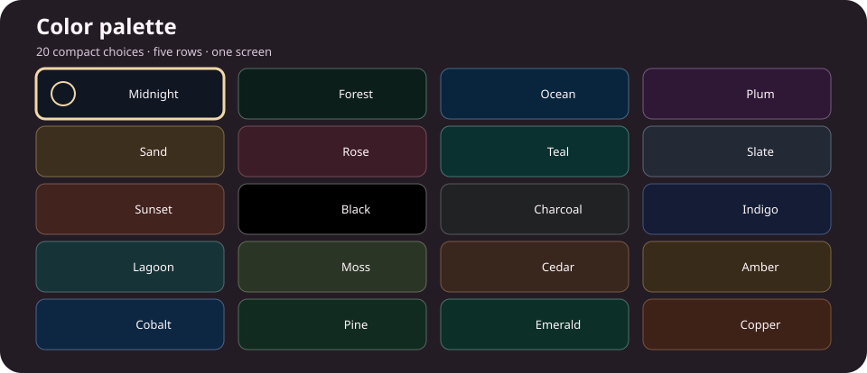
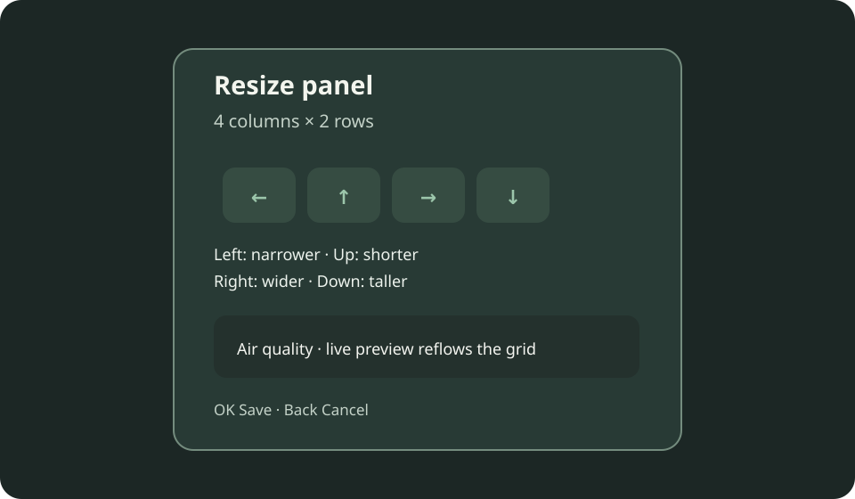
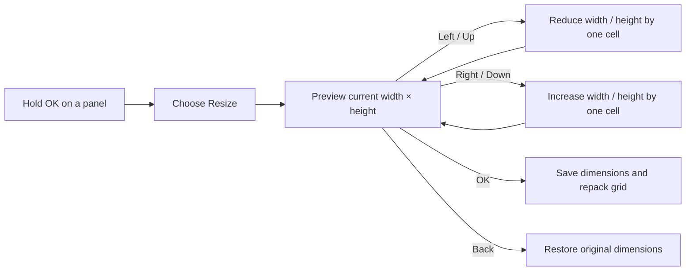

# Palette-driven surfaces, condition trends and directional panel resizing

**Status: 20-choice compact selector and background-menu update in progress · 16 November 2026**

## Goal

Make the selected palette control the launcher’s visual surfaces, show PM2.5
condition changes directly in both sparklines, simplify the palette choices, and
let Will resize any dashboard panel one grid cell at a time with the remote.

## Screens

### Palette selector

Show twenty compact palette swatches in five rows on one screen, without a pager.
The Background and wallpaper dialog first shows only a Choose color palette
action, with a swatch that reflects the selected color. The palette-grid swatch
is marked Current. Palette choice defines the
background, recessed and raised surfaces, focus border, and muted interface text.

### PM2.5 trend

Each segment uses the PCD condition of its endpoint sample: blue for very good,
green for good, yellow for moderate, orange for high, and red for very high.
The card surface follows the selected palette; condition colors remain reserved
for readings and the chart.

### Directional resize

The remote changes one axis at a time. Each arrow updates a live grid preview;
OK commits the preview and Back restores the original panel size.

## Design decisions

- Keep familiar condition colors as data encoding for each PM2.5 segment and
  the current reading; derive interface backgrounds and focus styling from the
  selected palette.
- Derive the glass sheen, focus rim, scrim, menu icons and air-quality panel
  surface from the same palette color.
- Offer twenty distinct palettes on one compact 4 × 5 screen, with smaller
  cards so every choice remains visible together.
- Keep the Background and wallpaper dialog, but show only the palette action and
  its current-color swatch. Hide photo and theme wallpaper actions until wallpaper
  customization has a useful, working user experience.
- Persist exact panel width and height in grid cells. The existing “New panel
  size” presets continue to set the starting size of panels added later.
- Preview reflow without persisting. Commit only on OK; Back discards it.
- Keep controls visible, readable, and usable without scrolling.
- Mark the selected swatch visually and avoid a pager or extra text in the label.

## Acceptance

- [x] Both sparkline traces color every segment by that sample’s condition.
- [x] Launcher and PM2.5 interface surfaces, borders and highlight derive from
  the selected palette; no fixed blue UI fills remain.
- [x] Palette selector shows twenty choices in five rows on one compact screen.
- [x] Background and wallpaper shows the selected color on its palette button.
- [x] Photo and theme wallpaper actions are removed from the menu.
- [x] Up/Left shrink the matching axis; Down/Right grow it by one cell.
- [x] OK persists exact dimensions; Back restores the previous layout.
- [x] Container tests, lint and APK build pass.
- [ ] Submit an independent Cast2 install-only job, including during personal use;
  record installed-hash proof separately from capture acceptance.
- [ ] Coordinator launch/capture on Cast2 after its personal-use pause clears.

## Verification record

The previous 12-choice build passed `task check && task build`; its APK SHA-256 is
`3a1c749a11ebf39adfeeb633f1ed3b3f51416a13d5c39371bab568b6b4f43754`.
Coordinator job `J‑dd4e3f10934f` on `chromecast-test-01` verified that hash after
installation. The launch check then reported `target-left-foreground`;
the coordinator's automatic readd job `J‑1f4ea2610527` also stopped at
`cleanup-unverified` and required supervision. No screenshot was produced for
this iteration. Evidence is preserved at
`evidence/cast1-palette-12-2026-11-16/`. The 20-choice change passed
`task check && task build`. Its APK is
`artifacts/validation/homeboard-tv-cast1-palette-20-background-menu-2026-11-16.apk`
with SHA-256
`8d9ebac7e0cd01c7035563ce4a3fd24c09b36a20ed9423b1e8ff377943062263`.
Cast2 is paused for another owner's personal use, so its support report marks
install/check unavailable. Cast1 remains `recovery-required` from the earlier
run; its support report also marks install/check unavailable. Evidence for the automatic recovery job is at
`evidence/cast1-recovery-2026-11-16/`. It shows Android's location permission
dialog took foreground, preventing restoration. The new APK has not been
installed or captured on either device. The previous successful screenshot remains
useful for the PM2.5 display, but predates the compact palette screen.
