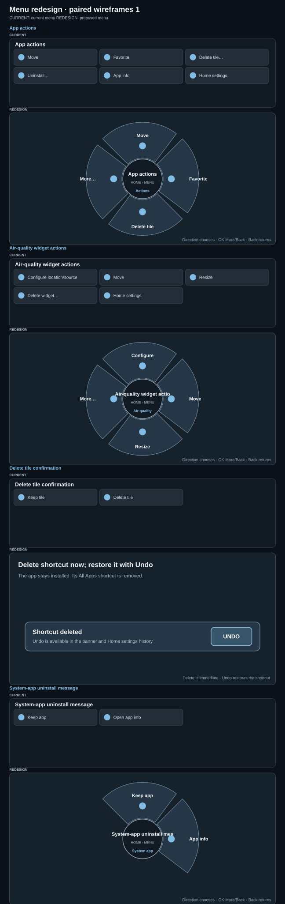
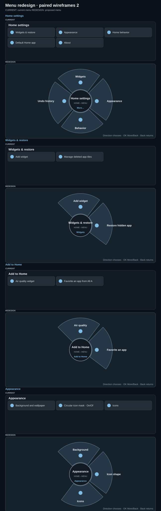
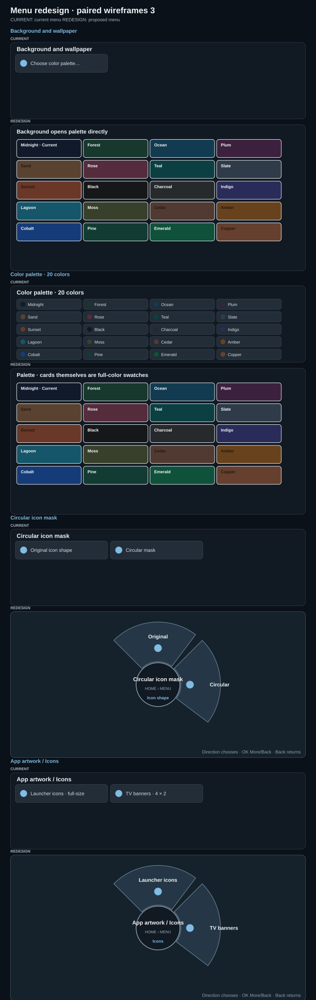
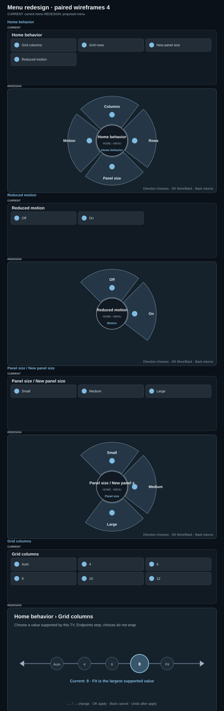
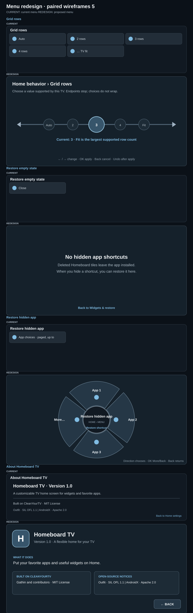
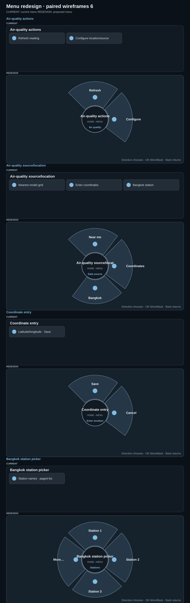
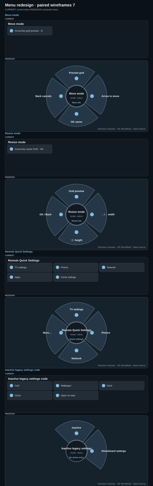
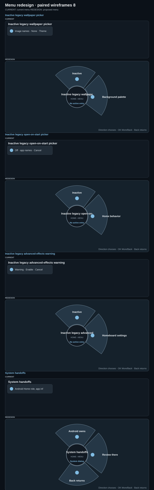
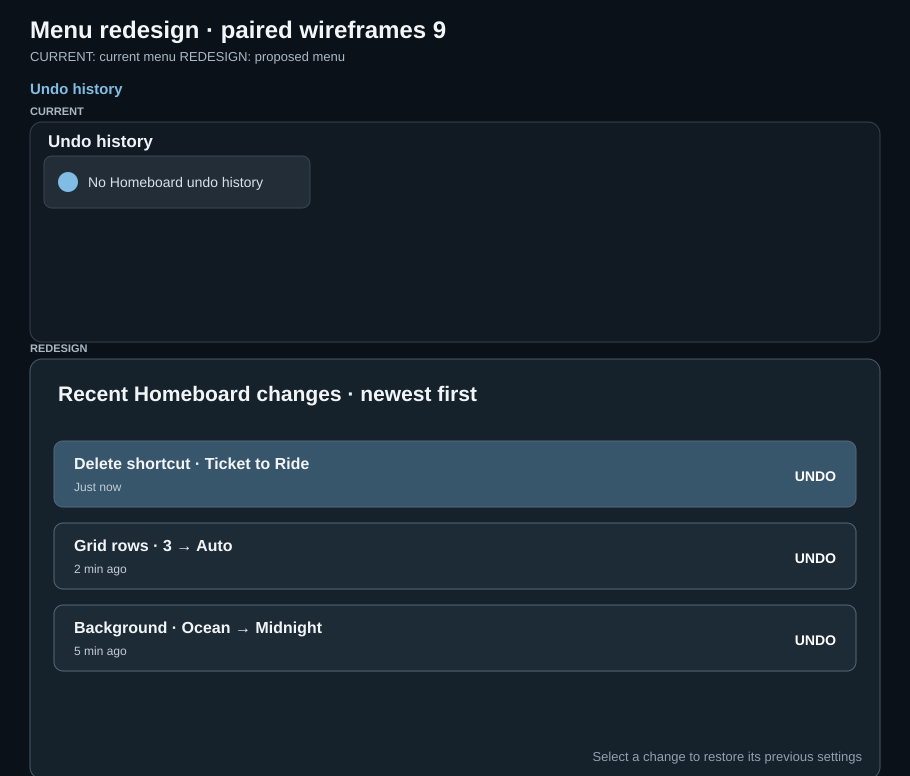
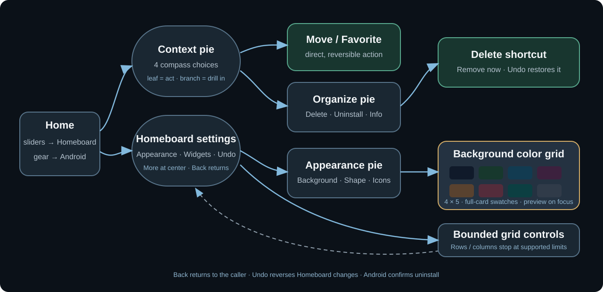

# Homeboard TV menu redesign: compass pies and color cards

**Status: implementation complete and exercised on Cast1; Will's full remote review remains open · 16 November 2026**

Redesign Homeboard's complete remote-operated menu experience: its entry points,
hierarchy, interaction, layout, typography, color, icons, focus feedback and exit
behavior. A TV remote should feel like a short conversation with the interface:
Will opens a menu, points in the direction of the outcome he wants, and the menu
either completes that action or opens the next relevant choice.

The current dialog named **Background and wallpaper** only offers background
color. Rename it **Background** and take Will straight to the palette. Keep the
20-choice palette as a large grid. Fill each palette card with its own color so
the swatch is the whole card, not a tiny icon.

## Goal-directed design filter

Primary persona: **Will on the sofa with a TV remote**, making a quick change and
returning to Home. Use Alan Cooper's Goal-Directed Design filter throughout:

| Design question | Decision |
|---|---|
| What outcome is Will trying to reach? | Use plain outcome names such as Appearance, Move, Restore, and Delete tile. Avoid implementation labels and stale labels such as Background and wallpaper. |
| What does he need to know before acting? | Put the action and its consequence in the same place. Show the current setting and keep the selected direction unmistakable. |
| Can he act with the remote he has? | Map Up, Right, Down, and Left to four visible compass choices. A directional press selects a terminal action; a branch opens the next pie. OK/Enter is reserved for the center action, such as More or a second page. Back returns one level. |
| Does he stay in control? | Prefer immediate, reversible Homeboard changes with Undo. Confirm only changes the app cannot reliably reverse. Move and resize remain previews until OK saves; Back cancels. System-owned prompts remain visibly identified as Android screens. |
| Is the interface asking for unnecessary work? | Use four choices per pie and page overflow through More. Avoid scrolling menus; use a bounded scroller only for finite grid row/column values. The palette remains a grid. |
| Can he recover easily? | Back returns to the parent pie and restores the initiating tile's focus. A bounded Undo history reverses recent Homeboard changes. Every layer shows a breadcrumb and current state. |

This is the interaction model implemented for the Cast1 review. Directional selection is
deliberately direct: pressing a direction activates that visible arm on key-up.
Actions that open another menu naturally drill down; terminal actions apply
immediately. The user should not need an additional OK press to confirm a normal
setting. Deleting or restoring a Homeboard shortcut applies immediately and can
be undone. Android keeps control of uninstall, app information and Home-role
prompts; its uninstall confirmation remains because Homeboard cannot reverse it.

## Interaction and visual system

- **Compass pie:** four large, labeled choices at North, East, South and West
  around a calm center hub. Each arm has a recognizable icon, action label and
  clear selected state. A directional key invokes its matching arm on release.
- **Center action:** the center shows the page or breadcrumb and, when needed,
  `More`, `Previous`, `Next`, or `Back`. OK/Enter invokes this center action. It
  never becomes a hidden requirement for a terminal compass choice.
- **Back:** always returns to the parent pie, or closes the root pie. It does not
  undo an already applied ordinary setting. Preview flows such as move and
  resize keep their existing save/cancel contract, then add the committed change
  to Undo history.
- **Undo:** after a Homeboard change, show a bottom banner with the action name
  and an Undo button. Keep a bounded history in Home settings so Will can undo
  more than one recent action and recover after the banner expires or the app
  restarts. Group palette focus previews into one history item. Store settings
  only, not PM2.5 samples or caches.
- **Undo boundary:** favorite, unfavorite, add/restore/delete shortcut, add or
  remove a panel, move, resize, grid density, appearance and widget source or
  location are reversible and belong in Homeboard Undo. App uninstall, Android
  settings, app info and Home-role changes are owned by Android; Homeboard cannot
  promise to reverse them, so Android's confirmation and handoff remain.
- **Overflow:** menus with more than four options expose four at a time and a
  center paging action with a visible `Page n of m` count. Collections such as
  restore and air-monitor locations remain labeled and paged, with no scroll view.
  The only scrollers are the bounded row/column value selectors.
- **Palette grid:** preserve four columns by five rows. Make each whole card the
  swatch color, keep its name readable with contrast-aware text, and show the
  current color with both a clear outline and a `Current` marker. Moving focus
  previews and applies a color; Back returns to Appearance.
- **Background path:** Home settings → Appearance → Background → palette grid.
  Do not show wallpaper/photo or theme-wallpaper choices when no such behavior
  exists.
- **Settings shortcuts:** the sliders icon at top right opens Homeboard settings;
  the adjacent gear opens Android device settings. Keep both visible and label
  them separately.
- **Dialogs and editing:** coordinate entry is a palette-matched form with labeled
  latitude/longitude fields and Save/Cancel; invalid values stay in the form.
  Redesign About as a content-first information page: product name and version,
  purpose, CleanYourTV attribution, license details and a clear Back action.
  Move/resize remain direct grid-edit modes with the existing bottom help strip
  and OK/Back behavior.
- **Grid controls:** Home behavior opens bounded selectors for columns and rows.
  Show the current value and only the finite values supported by this TV. The
  column selector offers `Auto`, 4, 6, 8, 10 and 12 columns, filtered by the
  TV's measured fit. Rows offer `Auto` and supported row counts up to the same
  fit. Left and Right step without wrapping; endpoints stop.
  This is a bounded value control, not a scrollable menu.
- **Restore wording:** call the destination **Restore hidden app** and explain
  that it returns the app's shortcut to All Apps; it does not reinstall the app.
  When no shortcuts are hidden, explain that state and offer Back. Restoring a
  shortcut applies immediately and can be undone.
- **Alan Cooper filter:** remove duplicate destinations, explain consequences
  before destructive actions, show state in text and icon, focus the likely next
  action, and avoid decorative choices that do not help Will reach a goal.
- **System-owned interfaces:** Android Settings, Home-role choice, app info,
  uninstall confirmation and the text keyboard are handoffs. Keep Homeboard's
  labels and return focus clear; do not imitate or intercept Android's prompt.

## Current menu inventory and paired mockups

The left side in each image is a structural wireframe of the current code: a
centered rectangular card with a title and selectable rows/cards. It is not a
device screenshot. The right side shows the next proposal. Each current menu
type in `MainActivity`, `AirQualityCard` and `QuickSettingsActivity` is listed
below; the shared template is shown separately so the pending changes can be
reviewed before implementation.

### Home and contextual menus

| Current menu | Proposed behavior |
|---|---|
| App actions | Move, Favorite and Delete tile are direct arms; More contains Uninstall, App info and Homeboard settings. Delete shows Undo. |
| Air-quality widget actions | Configure, Move and Resize are direct; More contains Refresh, Delete and Home settings. |
| Delete Home/All Apps tile | Delete immediately and show Undo; remove the separate confirmation pie. |
| System-app uninstall notice | Keep app or open Android app info; never imply Homeboard can uninstall a protected system app. |
| Homeboard settings (sliders icon) | Widgets, Appearance, Home behavior and Undo history; More contains Default Home and About. The separate gear opens Android device settings. |
| Widgets & restore | Add or Restore hidden app. |
| Add to Home | Add air quality or go to All Apps to favorite an app. |
| Restore hidden app | Return a deleted shortcut to All Apps; show a clear empty state when none are hidden. |

### Appearance and presentation menus

| Current menu | Proposed behavior |
|---|---|
| Appearance | Background, Icon shape and Icons. |
| Background and wallpaper | Remove this misleading one-choice menu; rename it Background and open the palette directly. |
| Color palette | Keep the 4 × 5 grid, with the entire card filled by the color, legible name, current marker and immediate preview. |
| Circular icon mask | Original shape or Circular mask; show which is current. |
| App artwork | Move inside Appearance and rename Icons; preserve launcher icons and TV banners as the choices. |

### Behavior and data-choice menus

| Current menu | Proposed behavior |
|---|---|
| Home behavior | Columns, Rows, Panel size and Motion. |
| Reduced motion | Off/On direct choice with current state. |
| New/existing panel size | Small, Medium, Large direct choices; preserve the distinct explanation for existing versus future panels. |
| Grid columns and rows | Bounded selectors show current and supported values; left/right steps without wrapping. |
| Empty restore state | “No hidden app shortcuts” with a short explanation; Back closes. |
| Restore hidden app | Four hidden shortcuts at a time; restoring returns the shortcut to All Apps and shows Undo. |
| About Homeboard TV | Use a content-first page with product/version, purpose, attribution and licenses; Back is clear and unobtrusive. |
| Air-quality actions | Refresh or Configure. |
| Air-quality source/location | Nearest model grid, manual coordinates, or Bangkok station. |
| Coordinate entry | Branded field form; directional Save/Cancel action, with the Android keyboard when text entry is active. |
| Bangkok station picker | Four named stations at a time and a center paging action. |

### Transient, quick and system-owned screens

| Current screen | Proposed behavior |
|---|---|
| Move preview | Keep the grid preview; make the target, occupied cells and saved/cancelled state explicit. Arrow keys move; OK saves; Back cancels. |
| Resize preview | Keep the grid preview and one-line footer; preserve the axis instructions and OK/Back contract. |
| Remote Quick Settings | Replace the separate rectangular row panel with the same four-arm compass style; More contains Homeboard settings. |
| Android Settings, app info, uninstall and Home-role prompts | Keep Android's UI. Identify the handoff before opening and restore the prior Homeboard focus on return. |
| Inactive legacy settings code | Old CleanYourTV LauncherSettingsActivity and its wallpaper, Open on start and advanced-effects screens have no active entry point. They are not menus a user can currently open. Keep active settings in Homeboard settings. |

Paired-08 marks Android system handoffs and inactive legacy code as boundaries.
The inactive `LauncherSettingsActivity` wallpaper and Open on start
pickers are not reached by Homeboard's active `ACTION_LAUNCHER_SETTINGS` route;
they should remain outside the menu tree.

## Menu flow

## Delivery sequence

- [x] Inventory active Homeboard menus and create paired current/proposed
      structural mockups for every menu type.
- [x] Define the compass, bounded selectors, Undo history, and Android-owned
      confirmation boundaries before implementing the next menu iteration.
- [x] Add a repository `task md` render check that stops if a Mermaid diagram
      falls back to raw text, then opens the reviewed HTML in the browser.
- [x] Open this plan in the browser for review.
- [x] Replace the generic card-grid menu renderer with a four-arm compass pie;
      map D-pad directions to immediate leaf selection or submenu entry.
- [x] Group actions into four-choice pies and add center paging for long menus.
- [x] Rename Background and wallpaper to Background and remove the extra
      one-choice step before the palette.
- [x] Fill each palette card with its own color, increase the swatch to the full
      card, add readable contrast/current state, and apply on focus.
- [x] Restyle the Quick Settings panel to the shared compass language.
- [x] Redesign coordinate entry, About, and transient move/resize help to fit
      the same visual system while preserving their required controls.
- [x] Review with the Alan Cooper filter and ensure every option is actionable,
      every reversible action has Undo, irreversible actions are confirmed, and every menu has a clear
      Back path.
- [x] Build in the container, install on Cast1 through the coordinator, and
      inspect Cast1 screenshots for the selector/Undo round-trip, About and
      Restore empty state; see
      [the Cast1 run record](../testing/2026-11-16-pie-menu-redesign.md).
- [x] Exercise the Mermaid fallback guard on each `task md` render: its detector
      first proves it catches raw `flowchart` and `pie` code blocks, then rejects rendered
      HTML containing that fallback.
- [x] Review revised mockups for Undo banner/history, bounded grid selectors,
      Restore hidden app and About before implementation.
- [x] Add persistent, bounded Undo for Homeboard-owned layout and widget settings;
      retain Android confirmation for uninstall and other system-owned actions.
      Store up to 20 recent changes, including widget configuration but excluding
      sensor history and cache data.
- [x] Replace grid row/column option menus with bounded, non-wrapping selectors
      that show only values supported by the device; columns are Auto, 4, 6, 8,
      10 or 12, filtered by measured fit.
- [x] Redesign Restore hidden app and About from the paired mockups.
- [ ] Will's Cast1 remote review confirms directional activation, center paging,
      submenu Back behavior and palette focus preview.

## Acceptance

- [x] Every active Homeboard menu has a paired current and proposed mockup and
      appears in the inventory above.
- [x] Four directions are sufficient to select any visible terminal action or
      enter its submenu; ordinary leaf choices do not require OK/Enter.
- [x] OK/Enter has a visible center action for paging or entering More; Back
      returns to the parent menu and restores its caller focus.
- [x] No menu scrolls or clips actions; long choice lists page visibly.
- [x] Background is not mislabeled as wallpaper, and it opens the palette
      directly.
- [x] Palette remains a single-screen 4 × 5 grid; each card is itself a large
      color swatch with legible name and visible current state.
- [x] Homeboard-owned changes can be undone; Android-owned destructive actions
      retain Android's confirmation flow;
      move/resize retain preview, save and cancel behavior.
- [x] Grid row and column controls show finite, TV-supported values and stop at
      both ends without wrapping.
- [x] Restore hidden app clearly restores only the shortcut to All Apps and has
      a helpful empty state.
- [x] About shows product/version, purpose, upstream attribution and licenses in
      a content-first layout with an easy Back action.
- [x] Homeboard settings are identified by the sliders icon; the gear remains
      Android device settings.
- [ ] The shared visual system works from a TV remote at 10-foot viewing
      distance, including text contrast and focused-state distinction.
- [x] Android-owned screens remain Android-owned, and returning from them
      restores the correct Homeboard page and focused item.
