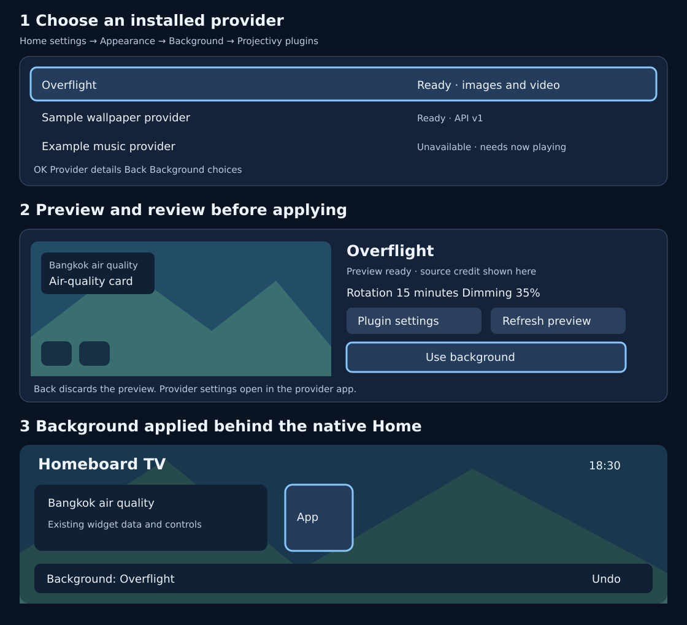
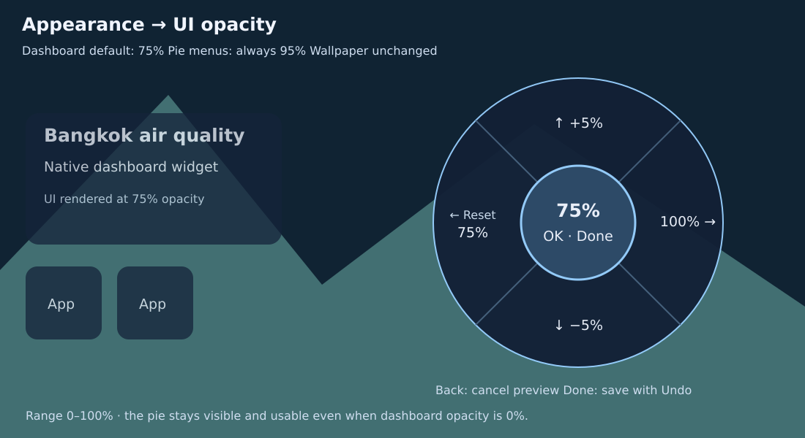
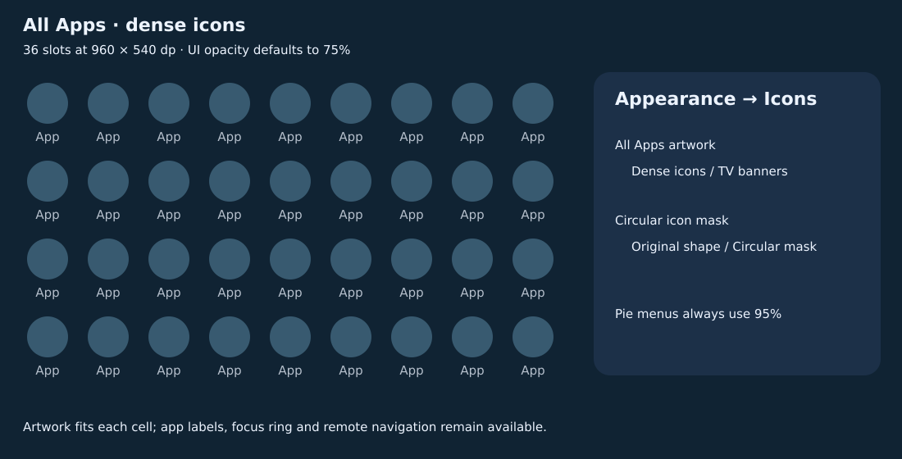
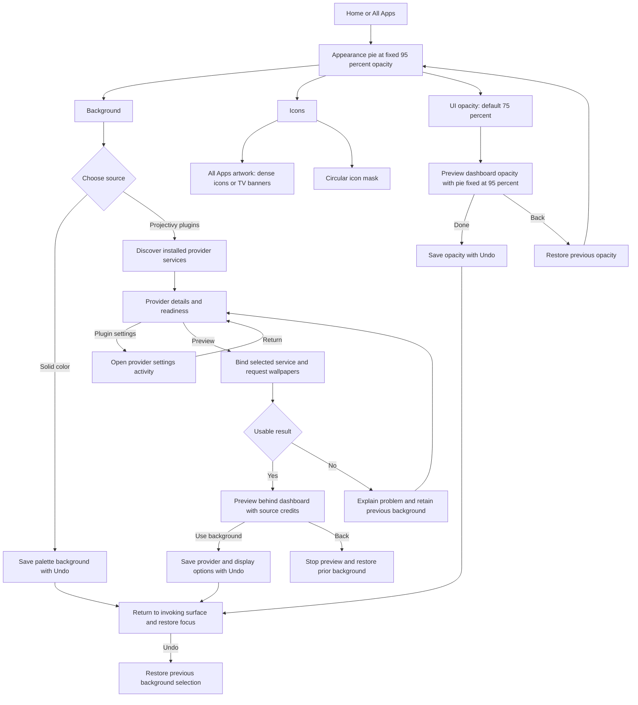

# Homeboard TV as a host for Projectivy wallpaper plugins

**Status: implemented in feature/projectivy-wallpaper-host; implemented; fixture and launcher UI checks passed; final real-plugin check in progress · 16 November 2026**

Make Homeboard TV a compatible host for existing Projectivy wallpaper-provider
plugins. Will installs a provider APK, selects it in Homeboard, and sees its
output behind the native dashboard and All Apps. Plugins remain separate Android
apps; Projectivy itself is not required. Homeboard keeps its Java launcher and
native widgets, with a small host implementation around the public API.

The compatibility target is **Projectivy wallpaper-provider API v1**, pinned to
[`60ec7b4306ab16dac83ea10ed9b81f5670b51ee3`](https://github.com/spocky/projectivy-plugin-wallpaper-provider/tree/60ec7b4306ab16dac83ea10ed9b81f5670b51ee3).
This is a specific interoperability requirement, not a general legacy layer.
There is no evidence here of a general API for third-party interactive dashboard
widgets. Wallpaper remains behind Homeboard's own focusable controls.

## How this fits the dashboard

Homeboard currently exposes palette backgrounds rather than a wallpaper system.
Build the background surface as a small Homeboard capability, with solid color
and Projectivy providers as its initial source choices. This gives the dashboard
a reusable wallpaper foundation while providers supply the actual content.
Local image selection could use the same surface later; it is not a prerequisite.

Compose the screen in this order, from back to front: palette fallback,
provider wallpaper, adjustable dimming, native widgets and app favorites,
focus decoration, then menus and Undo. An empty Home can show just the background
without adding a compulsory widget. Home and All Apps share one background
session so moving between them does not reset playback.

| Part | Fit with Homeboard | Boundary |
|---|---|---|
| Wallpapers and video | Supply the full-screen visual background under our grid. | The provider returns media descriptions, not embedded Android views. |
| Native widgets | Air-quality cards keep their own data, sizes, placement and actions. | Wallpaper information cannot automatically become a grid widget. |
| App focus events | Send real app title, package and artwork colors as Will navigates favorites or All Apps. | Widget/menu focus does not pretend to be an app or program. |
| Idle events | Allow a provider to change its background when Homeboard is visible but inactive. | Hiding dashboard panels for a full-screen scene would be a separate Homeboard feature; the provider cannot hide them. |
| Plugin settings | Open the installed provider's configuration activity and refresh when it returns. | Homeboard owns source selection, dimming, rotation and fallback; the provider owns its content settings. |
| Cache and updates | Keep navigation smooth while providers fetch new content, with refresh after configuration changes. | Timer batch lifetime and visible wallpaper rotation remain separate. |
| Wallpaper links | Offer an explicit action in background details to open the supplied destination. | Backgrounds do not take D-pad focus or intercept widget/app activation. |
| Now playing | Later allow providers to react to real media metadata. | Requires a real media-session integration; this interface does not supply music playback or media cards. |
| Program focus | Later send events when real movie/episode/program cards receive focus. | The plugin API does not populate those cards or supply a recommendation feed. |
| Preference methods | Provide a possible later route for explicit provider-settings export/import. | They do not manage Homeboard layouts, credentials or a shared dashboard settings format. |

A weather provider can draw its own conditions or forecast into an image behind
our widgets, but those pixels have no grid placement or remote interaction.
For structured, interactive information, keep using native dashboard cards.
There is no layout/safe-zone negotiation in the public wallpaper contract:
providers that draw text may require their own placement settings, a clearer
background, or more empty space in Homeboard's grid.

The useful first combination is an existing wallpaper provider plus our native
air-quality card and favorites. This reuses the provider ecosystem without making
Homeboard's dashboard layout or data model depend on Projectivy.

## Screens and remote workflow

Use **Home settings → Appearance → Background**, keeping Palette as a separate
appearance control. Background offers **Solid color** and **Projectivy plugins**.
The existing palette is the default and fallback. The provider screen lists
installed services, their app names and readiness. Unsupported API versions and
providers whose requested events are unavailable show a specific reason.
No automatic installer, account setup or Projectivy Premium dependency is added.

Selecting a provider opens its detail screen, with **Preview**, **Plugin settings**,
**Use background** and **Back**. Preview renders behind a miniature dashboard and
reports loading, unavailable media or unavailable event sources in ordinary terms.
**Use background** is enabled only after a usable preview. Merely browsing the list
or previewing a source does not replace the saved selection. Back restores the
previous background, stops preview playback and returns focus to the selected row.

Use background saves one undoable Homeboard setting change and returns to the
invoking Home or All Apps surface. **Undo** restores the previous host selection
and display settings; it cannot undo changes made inside another app's settings.
Opening Plugin settings launches that provider's exported settings activity;
returning refreshes discovery and requests a fresh preview. Show missing settings
as unavailable without blocking a provider that needs no configuration.

The first UI exposes a rotation interval (default 15 minutes) and a dimming control
(default 35%) on the detail screen. These are Homeboard settings, separate from
provider cache expiry. Keep the dashboard preview visible while adjusting them.
Use the existing solid palette as the backing color and preserve widget contrast.
Show title/author/source information in background details. If `actionUri` exists,
offer an explicit **Open wallpaper link** there; no wallpaper steals OK or D-pad
input from Homeboard tiles. Resolve a link only after that action is chosen.

## UI opacity in the Appearance pie menu

Ship **Home settings → Appearance → UI opacity** with the first wallpaper-host
milestone. Default the dashboard UI to **75% opacity**. This controls Home and
All Apps UI elements, including widgets, app tiles and dashboard controls;
the wallpaper and its separate dimming control are unaffected.
**Pie menus always use 95% opacity**, including the Appearance pie and opacity
adjustment pie, regardless of the saved dashboard value. Apply that fixed value
when rendering pie menus; it is not another adjustable setting.

Show the current percentage on the Appearance choice. The adjustment pie uses
**Up: +5%**, **Down: −5%**, **Left: Reset to 75%**, **Right: 100%**, and
**Center/OK: Done**. Clamp values to 0–100%. Preview each change immediately on
the dashboard behind the pie while the pie itself stays at 95%. Done persists
one undoable appearance change and returns to the invoking surface; Back cancels
the draft and restores the preceding opacity. Merely opening the control creates
no change. Undo restores the previous dashboard opacity without altering the
wallpaper, palette, provider configuration or fixed pie opacity.

Apply alpha once per UI rendering group rather than multiplying it through
nested views. Keep pie menus on an independent overlay outside the dashboard
alpha group so a dashboard at 0% cannot hide the controls needed to restore it.
The appearance-entry remote action must remain reachable even at 0%, and the
Undo recovery control uses the independent overlay. Pie menu opacity must stay
95% during transitions and previews as well as after saving or restarting.
Persist a global `uiOpacityPercent` integer in Homeboard appearance settings,
validated to 0–100 with 75 as the default when absent. This applies with both
solid backgrounds and plugin wallpapers and is independent of provider selection.

## All Apps density and Icons grouping

Use the same UI opacity on Home and All Apps, with pie menus independently fixed
at 95%. Default new layouts to the dense icon grid. At a typical 960 × 540 dp TV
viewport, aim for nine columns and four rows (36 apps per page), compared with
eight TV banners. Size the grid from the viewport and fit the artwork, label and
focus ring within each cell. Preserve an explicitly saved banner choice; the
All Apps artwork control lets Will switch existing layouts to dense icons.

Keep Appearance at four compass choices: **Background**, **Palette**, **Icons**,
and **UI opacity**. Put **All Apps artwork** and **Circular icon mask** inside
**Icons**. Circular icons are an icon choice and do not get a separate top-level
Appearance entry. Artwork and shape changes preserve app order, selection and
saved Home widgets, and retain focus on the chosen app's resulting page.

## Choice and action flow

## Verified public contract

The [API sources](https://github.com/spocky/projectivy-plugin-wallpaper-provider/tree/60ec7b4306ab16dac83ea10ed9b81f5670b51ee3/api/src/main)
and [sample manifest](https://github.com/spocky/projectivy-plugin-wallpaper-provider/blob/60ec7b4306ab16dac83ea10ed9b81f5670b51ee3/sample/src/main/AndroidManifest.xml)
define the following host requirements. These are public-contract facts; the
implementation choices in subsequent sections are Homeboard proposals.

| Area | Contract to preserve |
|---|---|
| Discovery | Service action `tv.projectivy.plugin.WALLPAPER_PROVIDER`; exported Android service. |
| Service metadata | `apiVersion`, `uuid`, `name`, `settingsActivity`, `itemsCacheDurationMillis`, `updateMode`; resource-valued metadata occurs in the sample. |
| Binder interface | `IWallpaperProviderService` in `tv.projectivy.plugin.wallpaperprovider.api`; synchronous `getWallpapers(Event)`, `getPreferences()` and `setPreferences(String)`. |
| Wallpaper object | `uri`, `type`, `displayMode`, nullable `title`, `source`, `author`, `actionUri`; exact parcel encoding matters. |
| Media types | IMAGE=0, DRAWABLE=1, ANIMATED_DRAWABLE=2, LOTTIE=3, VIDEO=4, COLOR=5. |
| Display modes | DEFAULT=0, CROP=1, STRETCH=2, BLUR=3, FIT_CENTER=4, FIT_CENTER_BLURRED_BG=5. |
| Events | TIME_ELAPSED=1, NOW_PLAYING_CHANGED=2, CARD_FOCUSED=4, PROGRAM_CARD_FOCUSED=8, LAUNCHER_IDLE_MODE_CHANGED=16. `updateMode` combines these bits. |
| Refresh broadcast | `tv.projectivy.plugin.action.WALLPAPER_PROVIDER_UPDATED`, mandatory UUID extra `tv.projectivy.plugin.extra.PROVIDER_ID`, optional reason extra `tv.projectivy.plugin.extra.UPDATE_REASON`; preferences changed=1, data changed=2. |

The [sample service](https://github.com/spocky/projectivy-plugin-wallpaper-provider/blob/60ec7b4306ab16dac83ea10ed9b81f5670b51ee3/sample/src/main/java/tv/projectivy/plugin/wallpaperprovider/sample/WallpaperProviderService.kt)
returns examples of all six types, including resources belonging to the plugin
APK. An empty result means keep the current wallpaper. The
[provider documentation](https://github.com/spocky/projectivy-plugin-wallpaper-provider/blob/60ec7b4306ab16dac83ea10ed9b81f5670b51ee3/README.md)
distinguishes timer batches cached for `itemsCacheDurationMillis` from dynamic
event requests, which bypass that batch cache. Rotation among a valid timer batch
must not call the plugin each time.

## Compatibility milestones

| Capability | First usable milestone | Broader compatibility milestone |
|---|---|---|
| API transport and discovery | Exact v1 Binder and parcel classes, metadata, package visibility, settings activity and refresh broadcast | Same pinned contract; future API versions require a deliberate review. |
| UI opacity | Appearance pie setting, dashboard default 75%, pie menus fixed at 95%, preview/Done/Back/Undo | Same behavior for solid, still and motion backgrounds. |
| Static rendering | COLOR, IMAGE and DRAWABLE, including plugin resources | Keep support and regression coverage. |
| Motion | Show unsupported-item reason and retain usable static items; label support as partial | VIDEO, ANIMATED_DRAWABLE and LOTTIE with lifecycle and reduced-motion behavior. |
| Display modes | Implement all six for static output; define DEFAULT as Homeboard's crop policy | Verify modes across motion renderers, documenting device/codec limits. |
| Timer | Initial request, bounded batch cache, expiry and independent rotation | Same behavior through process recreation and package updates. |
| App focus | CardFocused for actual app tiles on Home and All Apps, with title, package and light/dark artwork colors | Verify fast navigation and focus restoration with real plugins. |
| Idle | Define a launcher-visible inactivity state and emit enter/exit; suspend when Homeboard is hidden | Validate interaction with menus, settings, media and Android sleep. |
| Now playing | Report unavailable; do not invent events | Add only with a real media-session source and an explicit user setup path if required. |
| Program focus | Report unavailable because Homeboard has no program-card surface | Add only alongside actual program cards; no fake app-to-program mapping. |
| Provider preferences | Settings remain owned by plugin; bind methods available for contract checks | Export/import is a separate opt-in feature if later needed; never import or reset automatically. |

A provider requesting an unavailable event is marked **Partial support**, with the
missing capability named. A timer-capable provider may still be previewed and used
with that limitation visible. A provider with no usable trigger is unavailable.
A successful bind alone is not evidence that a plugin works. Publish a tested
provider/version matrix and describe the host as supporting tested wallpaper
plugins, rather than claiming universal Projectivy compatibility.

## Host architecture and source changes

`MainActivity` currently paints the root with a palette and owns app focus,
menus and activity lifecycle. `HomeLayout` stores appearance alongside dashboard
configuration. Add a persistent wallpaper layer below tiles, app focus decoration
and menus. Palette changes update the fallback and foreground surfaces without
removing that layer; grid re-renders must not restart playback or fetch a new batch.

| Proposed component | Responsibility |
|---|---|
| `launcher/projectivy-api/` | Vendored AIDL, Kotlin parcel classes and consumer keep rules at the pinned revision, plus upstream license and provenance. |
| `ProjectivyProviderRegistry` | Query services with metadata, resolve resources in the provider package, validate version/UUID and settings component, reconcile package changes. |
| `ProjectivyWallpaperHost` | Bind only active/preview provider, schedule requests off the UI thread, track generations, cache batches and handle death/retry. |
| `ProjectivyEventMapper` | Translate actual app focus, timer and idle into unmodified API objects; dispatch only requested supported events. |
| `WallpaperSurface` | Decode and render media, apply display mode and dimming, retain last good output, stop motion when hidden. |
| Appearance UI rendering | Separate dashboard alpha from the pie overlay; persist global UI opacity and render all pie menus at a fixed 95%. |
| `BackgroundSettings` | Provider list, details, preview, apply/Undo and focus restoration using existing menu conventions. |
| `HomeLayout` extension | Store source kind, service component, UUID, rotation and dimming as one background setting; global UI opacity defaults to 75%, with pie opacity fixed at 95%. Never key providers by display name. |

Keep host code in Java. Import the upstream Kotlin parcel classes unchanged in a
small library module rather than hand-writing a Java approximation of Kotlin
Parcelize's wire representation. That introduces a scoped Kotlin/Parcelize build
dependency, not a dashboard framework or a rewrite. Before integration, verify an
explicit compiler/plugin version against the existing AGP 8.5.2, Gradle 8.9 and
container JDK 17; do not blindly copy upstream build versions or raise minSdk 26.
Enable AIDL in the module, retain original class/package names and R8 consumer
rules, and inspect a minified build as well as debug. Record source checksums and
license notices in project provenance and About/licenses when shipping copied code.
The upstream template's [license is Apache-2.0](https://github.com/spocky/projectivy-plugin-wallpaper-provider/blob/60ec7b4306ab16dac83ea10ed9b81f5670b51ee3/LICENSE).

Add an Android package-visibility query for the provider action. Resolve relative
settings activity names against the service package, and launch explicit
components. Validate exported status, enabled state and permissions before binding.
Keep duplicate UUID services distinct by component and surface a diagnostic rather
than choosing one arbitrarily. New package identity/signature changes invalidate
cached descriptors and require renewed selection where identity cannot be retained.

## Requests, caching and failure behavior

Use one selected provider and at most one outstanding request per binding. A
selection/preview generation accompanies each operation; late results from a
previous provider never paint the current Home. Coalesce rapid focus and update
signals to the latest state without blocking navigation. Dispatch a fresh current
state after foreground re-entry, and stop rotation and playback when hidden.
Opening provider settings suspends the preview session without losing its draft.

Use proposed starting limits of a five-second bind deadline, ten-second request
deadline and 1,000 returned items (matching Overflight). The implementation uses
no disk cache, limits image/animation inputs to 16 MiB, and decodes images for a
1920 × 1080 target. Tune them from Cast1 measurements. Decode to the displayed resolution,
close streams, cap download sizes and avoid preloading entire videos. Report
limits as host constraints. A Java Future timeout does not cancel a synchronous
Binder call: never create replacement threads repeatedly for a hung provider.
Quarantine that binding after deadline and retain a bounded worker budget;
if recovery requires reliable cancellation, isolate the Binder client in a
restartable Homeboard-owned process before claiming robust recovery. Never kill
or force-stop the provider app.

Expire timer batches using monotonic elapsed time in memory; refresh after host
process restart rather than trusting a persisted elapsed timestamp. Config/data
update broadcasts for the selected UUID invalidate the batch and request a refresh;
debounce these untrusted signals and treat them only as hints. Returning from
settings also refreshes, including plugins that target their broadcast specifically
to Projectivy's package. Recheck the calling assumptions in real provider code.
Do not impersonate `com.spocky.projengmenu` to satisfy a plugin's host check.

Empty or invalid lists retain the last good wallpaper. On first use with no valid
output, show the solid palette and a recoverable preview error. On death, removal,
permission loss or repeated failure, fall back immediately and offer Retry or
Choose background in settings; no repeated full-screen dialogs. A removed provider
leaves Homeboard usable on the palette and is shown as missing until changed.

Resolve `android.resource` URIs using the plugin's resources, not Homeboard's IDs.
Support `content` URIs only when accessible to the host, and distinguish inaccessible
local files from malformed data. Upgrade provider HTTP media URLs to HTTPS without a plaintext fallback. Support
HTTPS; allow local HTTP only through a
documented, deliberately scoped media policy after inspecting representative
plugins. Do not globally weaken network policy merely to pass a test. Resolve
links explicitly on user action and reject unintended intent components/grants.
Keep credentials and raw preference strings out of logs. No preference export or
backup feature is needed to display wallpapers.

Video is muted by default and never competes with another app's audio. Release
decoders/surfaces while hidden. Reduced motion pauses animation/video at a usable
still frame when available; otherwise use the palette. Respect the existing native
widget layout: the API exposes no dashboard geometry to providers. Document this
for backgrounds containing text or panels; do not promise automatic safe zones.

## Validation and acceptance

Use the official sample as the contract fixture and
[Overflight](https://github.com/spocky/projectivy-plugin-wallpaper-overflight) as a
real image/video provider. Pin their tested revisions, build versions and APK
hashes when implementation begins. Audit host-package checks and URI/permissions
assumptions first; a provider refusing other hosts is a documented incompatibility,
not a reason to change Homeboard's application ID.

- [x] Import the exact API and demonstrate cross-process calls with the fixture, including parcel round trips and minified keep rules.
- [ ] Discover both literal and resource-valued metadata, relative settings names, duplicate UUIDs, unsupported API versions and disabled services.
- [x] Default 75%, independent 95% pies, live preview, Done/Back/Undo passed device checks. Restart, 0% recovery and the full background matrix remain additional checks.
- [x] Preview/apply/Back/Undo passed with the color fixture in the actual launcher UI; IMAGE and DRAWABLE passed the host renderer probe.
- [ ] Verify timer-cache expiry, independent rotation, empty results, refresh hints, settings return and stale-result rejection with a deterministic provider fixture.
- [ ] Verify crashes, a deliberately hung call, malformed parcels/media, oversized results, package replacement/removal and host process recreation without losing Home navigation.
- [ ] Exercise all display modes and supported URI schemes with offline fixture media; verify attribution and explicit link opening.
- [ ] Demonstrate unmodified Overflight image output, then video output after the motion milestone; record any hard-coded Projectivy assumptions.
- [x] Verify mapped app-focus and idle events in the device probe; unavailable now-playing/program sources are exposed in provider readiness.
- [ ] Measure first frame, D-pad responsiveness, memory and decoder release on Cast1; proposed targets are a cached first frame within one second and no visible focus stalls relative to the palette baseline.
- [ ] Keep air-quality widgets, saved empty Home, All Apps, palette changes, menu readability, RTL and reduced motion working over plugin backgrounds.
- [ ] Finish the six-media-type sample matrix before describing media support as complete; record codec and event-source limitations separately.

Run compilation, fixtures, tests, lint and packaging only through the build container:
`task check`, `task build`, `task fixture`, and the appropriate containerized API
instrumentation task added with the fixture. Do not run Gradle or ADB on the host.
For device sessions, follow the [coordinator workflow](../how-to/chromecast.md):
`task chromecast:devices`, `task chromecast:queue`, one complete coordinator-owned
job, `task chromecast:watch`, then `task chromecast:evidence`. Use `task deploy`
for every new Homeboard APK so its version advances. Include fixture/plugin APKs
and evidence steps in the complete job. Keep iterative work on Cast1 until Will
says Homeboard is usable; preserve app data and do not change default Home merely
to install a build. This planning task does not deploy anything.

## Dated agenda

### 16 November 2026

- [x] Inspect the public v1 API, sample, license and Homeboard integration points.
- [x] Define the host scope, screen mockups, workflow and compatibility milestones.
- [x] Implement the host and Appearance controls in the dedicated worktree.

### Implementation and validation on 16 November 2026

- [x] Prove the unchanged API module and cross-process calls in the device fixture.
- [x] Add discovery, static background rendering, preview/apply/Undo, Appearance UI opacity (75% default, pies fixed at 95%) and lifecycle/failure handling. Device checks are recorded separately.
- [ ] Validate the still-image milestone on Cast1 and record tested provider versions.

### After the still-image milestone — conditional work

- [x] Add video, animated drawable and Lottie renderers with bounded resources.
- [ ] Measure long-running motion performance and the complete display-mode matrix.
- [ ] Complete the media/display-mode matrix and publish compatibility details in the project how-to.
- [ ] Add now-playing or program events only when corresponding Homeboard features supply real data.

Implementation can proceed in these stages without a server, a Projectivy install,
or changes to existing provider APKs. Providers that require their original host
remain explicitly unsupported until an interoperable upstream change exists.

## Implementation record

Worktree: `/home/will/homeboard-tv-projectivy`, branch
`feature/projectivy-wallpaper-host`. Container validation and numbered Cast1
evidence are recorded as they complete in
[the testing record](../testing/2026-11-16-projectivy-plugin-host.md).
The [how-to](../how-to/projectivy-wallpapers.md) specifies the implemented behavior
and current media/event limitations. The provider fixture is bundled only into
debug builds and runs in a separate process; it requires no disposable app install.

Final source includes UI opacity (75% default, pies fixed at 95%), dense All Apps
and Icons grouping. Build 0.1.9 passed the offline six-media-type probe and actual
Appearance checks on Cast1. Build 0.1.10 adds the provider-options Back-navigation
correction; its install completed successfully after the coordinator recovered from a socket outage. See the
testing record for frozen APK hashes, receipts and remaining verification.

The full provider preview/options/Back/apply/Undo workflow passed on build 0.1.10
in J‑70428b927d44. Its coordinator deployment was subsequently confirmed successful
and healthy. A quiet Overflight retry produced an explicit no-usable-media result;
this is retained as an open real-provider check, not a successful compatibility claim.

Overflight's failed 0.1.10 preview was traced through Background details to plain
HTTP video URLs rejected before playback. The public default feed contains Apple
CDN HTTP links. The next build attempts their HTTPS equivalents while preserving
encoded paths/queries and keeping cleartext disabled. Dedicated URL-policy tests
cover the conversion, explicit port 80, accessible Android URIs and rejected schemes.

Build 0.1.12 narrows the media exception to Overflight's two public Apple CDN
hosts. The feed's HTTP Aerials paths on sylvan.apple.com and /us/r1000 paths on
a1.phobos.apple.com are accepted without credentials; Android network policy
allows cleartext only for those exact domains. Other HTTP media is attempted over
HTTPS, and TLS failures never trigger a downgrade. This replaces the earlier
HTTPS-only assumption after real-plugin testing established the requirement.
Video readiness now waits for Android's first-frame rendering signal, with a
separate startup deadline, so header preparation alone cannot count as playback.
