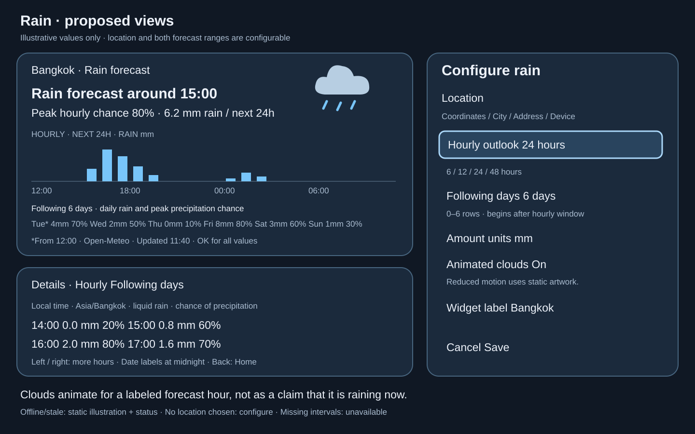
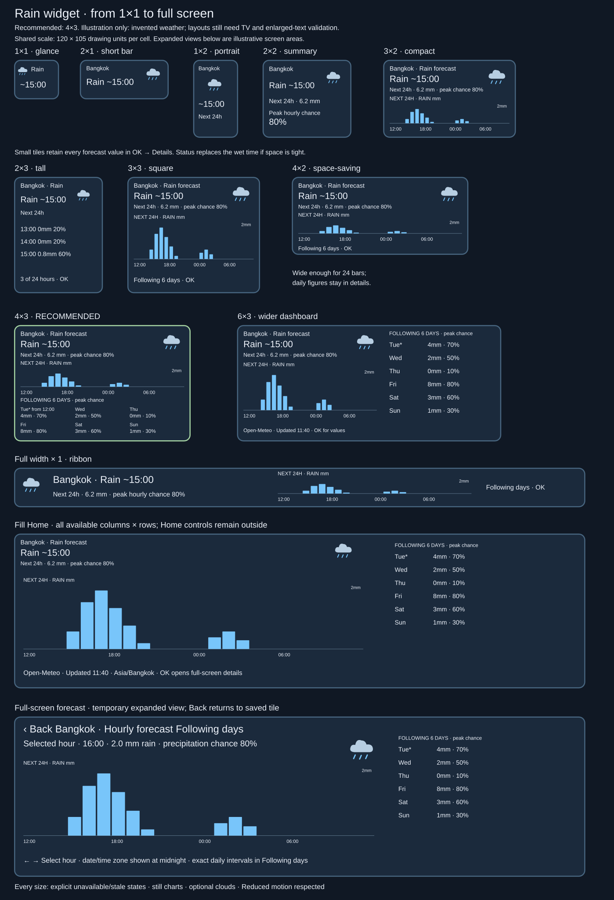
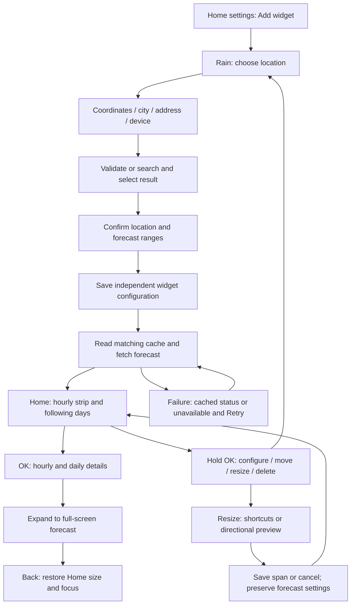

# Rain widget: hourly outlook and the following days

**Status: implemented · container checks and packaging passed · Cast1 deployment queued for connection recovery · 16 November 2026.**

Add a native rain widget using a chosen location and online forecast data. Default
to **the next 24 hours by hour, then the following six days by day**. Make both
ranges configurable. Add animated rain clouds when the forecast calls for them.
Will approved implementation on 16 November 2026. Native code is now in place;
see the validation record below for verified behavior and remaining checks.

## What the widget answers

**Proposed first-page follow-up:** [Rain and a bounded Favorites widget](2026-11-16-first-page-rain-and-favorites-container.md)
places Rain on page 1 alongside one resizable, internally scrolling Favorites
container. That layout change awaits approval and is not part of the current APK.

“When is rain forecast, how likely is it, and how much?” Show location, forecast
period, precipitation chance and rain amount together. Forecasts describe a model
grid near the selected location, rather than a measurement at the house.

The mockup uses invented forecast values and Bangkok as an example, not Will's
actual location. Cloud artwork is an original design inspired by the idea of
weather animation, without copying Google's artwork.

## Forecast layout

- **Home card:** location name, next wet hourly interval, maximum precipitation
  chance across the selected hourly window, and expected liquid rain total for
  that window. Label the probability explicitly as **Peak hourly chance**; it is
  not the probability that rain occurs at any time across the whole window.
- **Hourly strip, when space permits:** the next 24 complete forecast hours by default. Bars show
  rain amount in mm; probability is a separate labeled percentage. Show readable
  time ticks, a visible scale and gaps for missing values. At narrow sizes show
  a smaller labeled preview and “OK for all 24 hours”. The smallest tiles are
  summaries; every hourly value remains available in details.
- **Following days:** six daily summaries after the hourly window ends. Each
  shows weekday/date, expected rain total and peak hourly precipitation chance.
  Show a concise daily strip or rows when space permits; details exposes every
  value even when the Home tile has room only for a summary.
- **OK opens details:** separate Hourly and Following days views. Remote left/right
  pages through readable groups of hourly values; each hour retains its timestamp,
  amount and probability. Show dates at midnight and the location's time zone.
- **Hold OK:** existing widget actions, including Configure, Move, Resize and
  Delete. Keep existing focus, palette, independent opacity and Undo conventions.

Define the two ranges without double counting. Hourly starts at the next whole
hour in the location's time zone. Following days starts at the end of that hourly
window: its first row covers the remainder of that local calendar day, if any,
and is labeled **From HH:mm**. Subsequent rows cover full local calendar days.
Thus 24 hours plus six following daily rows covers roughly seven days; no hour
belongs to both views. Details states the exact start/end of every daily row.
Use actual timestamp intervals through daylight-saving changes.

## Sizes: 1×1 through full screen

**Recommended default: 4 columns × 3 rows (4×3).** This gives the hourly chart and
all six following-day summaries separate, readable areas while leaving room on
Home for air quality, calendar and favorite apps. A **4×2** tile is the recommended
space-saving alternative, with the six daily values in details. These are design
recommendations to verify on Cast1, rather than device-validated dimensions.

Sizes below mean **columns × rows** of the user's existing Home grid, not pixels.
The grid varies with screen density, app artwork, configured rows/columns and text
size. Select the actual content layout from measured usable width and height:
the same cell span on a denser grid may need a simpler layout. Never shrink type
to squeeze in the more detailed variant. Use 18sp for primary weather text and
16sp for supporting labels as initial minimum targets, respecting Android font
scaling. Large values can grow with available space.

| Span / shape | Home content | Animation and what opens with OK |
|---|---|---|
| **1×1 · glance** | Tiny cloud beside “Rain”; next wet time, e.g. “~15:00”. A dry tile reads “Dry / next 24h”. If even two lines cannot fit, use one accessible cloud/time summary. | Small cloud with a few drops, no drifting background. OK opens complete hourly/daily details with location. |
| **2×1 · short bar** | Short location name; “Rain ~15:00”; peak hourly chance with its window if it fits. No chart or daily strip. | Cloud at one end; OK opens details. |
| **1×2 · narrow portrait** | Short location, cloud, wet time and hourly-window label stacked vertically. No narrow chart or unlabeled percentage. | Cloud in its own small area; OK opens details. |
| **2×2 · small square** | Location, next wet time, “Next 24h” total and labeled peak hourly chance. No chart by default. | Compact cloud beside the headline; OK opens both forecast views. |
| **3×2 · compact landscape** | Summary plus a 24-hour rain silhouette with sparse time ticks and amount scale. Percentages and the six daily rows stay in details. | Cloud in header; chart remains still. |
| **2×3 · tall** | Summary and a vertical preview of the next three hourly intervals, each with time, amount and chance. Explicit “3 of 24 hours · OK for more”. No implied three-hour horizon. | Small header cloud; OK opens all hours and following days. |
| **4×2 · wide / space-saving choice** | Summary plus full-window 24-bar amount chart and sparse time ticks; “Following 6 days · OK”. No tiny daily text. | Cloud at header edge; OK opens details, remembering the chosen section. |
| **3×3 · square** | Summary, compact full-window hourly chart and “Following 6 days · OK”. Use available height for legible labels, rather than crowding in daily figures. | Header cloud; OK opens both forecast views. |
| **4×3 · recommended** | Location/headline, total and peak hourly chance, full-window hourly amount chart, then six daily summaries in **two rows of three**. Each daily item has date, amount and peak chance; partial-day item includes its start time. | Cloud in a reserved header area. OK opens exact values; hourly percentages remain in details. |
| **6×3 or wider landscape** | Hourly chart on the left, six following-day rows on the right. More time labels and space for freshness/source. Hourly percentages still use details unless they fit legibly. | A larger cloud stays within the summary area; no rain over text. |
| **Full width × 1 row · ribbon** | Location, next wet time, total and peak hourly chance laid out horizontally; add an hourly preview only after those fit. Following days stay in details. Width cannot compensate for insufficient chart height. | Small cloud; no full-height illustration. |
| **Full Home area · all columns × all rows** | The expanded landscape composition fills the available Home grid, with a 24-hour chart, six daily rows, exact periods, freshness and attribution. Home controls keep their space. | Illustration can grow, with the same particle cap. OK opens the full-screen forecast view. |
| **Full-screen forecast view** | Uses the screen's safe area. Header has location, exact coverage and Back. Hourly chart and following-day panel share the screen; a focused hour exposes amount/chance in large text. On short screens, Hourly / Following days tabs preserve readability. | Illustration remains beside the summary. Back restores the previous Home tile, size and focus. |

### Reflow and interaction rules

- **Show less before making text smaller.** Keep status first, next wet time
  second, then period, location, amount/chance, chart and following-day values as
  space allows. A shortened location uses ellipsis; details and accessibility
  retain the complete name. Do not truncate a number, unit, time or forecast period.
- **1×1 is deliberately a glance tile.** Its accessible description includes
  location, period, amount, probability, freshness and “OK for details”. An omitted
  location or source is available in the first details screen. Never put all 24
  hourly numbers and six daily forecasts into a thumbnail.
- **Errors override decoration at every size.** Use short visible “Set location”,
  “Loading”, “Stale”, “Offline” or “Unavailable” states; 1×1 uses the state and an
  icon instead of a forecast time when both cannot fit. Details explains recovery.
  Stale cached rain must not appear as an unqualified fresh forecast.
- A compact chart covers the **entire configured hourly window**, even when time
  ticks are sparse. Do not merge 24 hourly bars into unlabeled multi-hour buckets.
  If individual bars cannot remain distinct, omit the chart. At 48 hours, use
  labeled 24-hour pages in details and only render all 48 bars on Home if they fit.
- For the recommended tile, six daily items use a two-by-three layout; if labels
  or scaled fonts do not fit, switch to the square/compact layout with an explicit
  “Following 6 days · OK”. If fewer days are configured, reclaim their area; if
  zero, remove that section. Never drop days without indicating where to find them.
- Base reflow on independent width **and** height budgets, accounting for padding,
  focus clearance, font scale, dates and translated labels. Short-wide and tall-
  narrow tiles have their own compositions. Do not scale a screenshot of a large
  card down to 1×1. The gallery shows composition, not production font metrics.
- Home remains one focus target per widget. Charts and daily cells are passive
  there, so D-pad navigation still moves between widgets. In details, left/right
  chooses an hour or page; the Following days section exposes each daily interval.
  Back returns to the original widget focus. No auto-rotating pages or carousels.
- In details offer **Expand to full screen** when not already expanded. This is
  temporary and does not resize the saved Home tile. Resizing to **Fill Home**
  explicitly saves the current grid's maximum span; existing Resize/Undo handles
  returning to the previous span. A later grid change clamps it to available cells.

### Adding, resizing and choosing a default

Offer **4×3 · Recommended**, **4×2 · Compact**, **2×2 · Summary**, **1×1 · Glance**
and **Fill Home** as size shortcuts; retain directional Resize for every supported
span between 1×1 and the available grid bounds. Preview the actual composition,
including its “OK for more” affordance, before saving. Presets must save exact
spans rather than using generic Small/Medium/Large sizes whose geometry changes.

On Add, request 4×3 if the current grid supports it. On a two-row grid request
4×2, and on a narrower available grid choose the largest fitting compact span;
state the selected span and preview it. Use the existing placement/page rules
instead of shrinking the tile simply because other widgets occupy the first page.
Changing size preserves location, units, forecast ranges and animation preference.
Recommend 4×3 in the size picker even after the user chooses a different size.

### Size acceptance matrix

Verify all tabled shapes plus **3×1, 1×3, 5×2 and 5×3** to exercise intermediate
reflow. Capture 1×1, 2×2, 4×2, recommended 4×3, a tall tile, Fill Home and full-screen
details on Cast1. Use English/Thai, default/enlarged text, long location names,
midnight/DST dates, mm/inches, 6/24/48 hourly horizons and 0/1/6 following days.
Check fresh rain, dry, mixed precipitation, missing hours, loading, stale, offline
and unconfigured states. No clipping, overlapping focus outlines or unreadable
labels; exact hourly/daily values remain reachable at every size. Verify animated
and Reduced motion states at 1×1, 4×3 and full screen, including D-pad responsiveness.

Use “Rain forecast around 15:00” for the first hourly interval with at least
0.1 mm liquid rain. Never promise minute-level arrival or say “raining now” from
hourly model data. If all valid hours are below that threshold, say “No rain
forecast in the next 24 hours” (using the configured range). If coverage is
incomplete, say “Forecast incomplete” rather than claiming dry weather.

## Configuration

Each widget instance saves its own choices. Defaults are proposals for approval.

| Setting | Default | Choices |
|---|---|---|
| Location | Choose location | Coordinates; city; address; optional device location |
| Hourly outlook | 24 hours | 6, 12, 24 or 48 hours |
| Following daily rows | 6 days | 0–6 days, beginning after the hourly window |
| Amount units | Millimetres | mm or inches |
| Animation | On | On or Off; global Reduced motion always overrides On |
| Home size | 4×3 where supported | 1×1 through Fill Home; shortcuts and directional Resize |
| Widget label | Resolved location name | Optional short custom name |

Always retain amount and chance in details. Chart density adapts to widget size;
configuration changes the forecast window, not font size. Changing location or
configuration supports Undo. Cancel/Back leaves saved settings untouched.

### Location entry

1. **Coordinates:** separate latitude and longitude fields, with decimal and
   signed numeric input. Validate finite values and bounds of ±90/±180. Accept
   pasted coordinate pairs as a convenience if straightforward.
2. **City:** explicit Search submits to Open-Meteo geocoding. Show matching city,
   region and country; the user selects and confirms one. Never silently pick the
   first ambiguous result.
3. **Address:** use Android's platform Geocoder on a background worker, with an
   explicit Search button and a confirmation showing resolved address and
   coordinates. Its backend is device-dependent: verify availability and real
   street-address resolution on Cast1 before considering this path complete.
   Open-Meteo's city/postcode search is not a street-address geocoder. If the TV
   lacks a backend or finds nothing, offer city/coordinates and a clear explanation.
   A dependable replacement address provider remains an explicit implementation
   decision if that device check fails; do not silently drop address support or
   add a paid/account-backed service without review.
4. **Device location:** reuse the launcher's location request facility only when
   chosen. Permission denial or unavailable location returns to the other choices.
   Do not assume the TV has GPS or infer Will's location from this repository.

Save the confirmed coordinates and display label locally. Geocode only on explicit
search, not on each weather refresh. Tell the user in the location form that search
text is sent to the selected lookup service and forecast requests send coordinates
to Open-Meteo. Keep real addresses and coordinates out of repository fixtures,
logs and shared screenshots. No household credentials or API keys in source.

## Animated rain clouds

- Draw a small original cloud and rain illustration with native vector/canvas
  shapes. A gentle cloud drift and falling drops accompany forecast wet hours;
  drop density reflects forecast rain amount. Show a quiet cloud/dry illustration
  for dry periods and a neutral illustration when data is missing.
- On Home, illustrate the earliest wet hour in the selected window and label it
  with its time; on hourly details, illustrate the focused hour. Future rain must
  not look like a claim about current conditions.
- Rain probability remains a number; low probability is not presented as certain
  rain. Animate only with valid, fresh forecast values. No lightning effects or
  storm claims derived from rain amount alone.
- Pause animation when off-screen, the menu obscures the card, or the activity
  pauses. Honor the per-widget toggle and global Reduced motion. Use a bounded
  low-cost draw loop (target 20–30 fps) and a fixed particle count; verify smooth
  remote navigation on Cast1. No flashes, sound or animation over chart labels.
- Offline/stale data uses static artwork and a visible status. The static state
  conveys the same information and has an accessible text description.

## Data source and meaning

Use the [Open-Meteo Weather Forecast API](https://open-meteo.com/en/docs) directly
over HTTPS. Its hourly fields provide rain, showers and precipitation probability.
Request `rain`, `showers`, `precipitation_probability` and `snowfall`; use liquid
rain = rain + showers, and retain the provider's documented hourly accumulation
intervals. Probability is for **precipitation**, which can include snow: label it
that way in details and surface snow/mixed precipitation when applicable instead
of relabeling every precipitation event as rain.

Request enough forecast days for both configured windows, including a partial
first day (up to 10 calendar days for 48 hours plus six following rows). Request
`timezone=auto` and epoch timestamps; retain the returned IANA zone. Aggregate
daily rows from the same hourly samples, summing amounts and taking the maximum
hourly probability. Do not add probabilities. Missing constituent hours make a
daily total incomplete, not zero. Validate provider units, timestamps and ranges.

[City search](https://open-meteo.com/en/docs/geocoding-api) uses GeoNames-backed
Open-Meteo geocoding. [Android Geocoder](https://developer.android.com/reference/android/location/Geocoder)
is the proposed address path, with the availability check described above.

Show Open-Meteo attribution on the card/details and appropriate GeoNames credit
for city lookup. The [free service terms](https://open-meteo.com/en/terms) permit
personal non-commercial use and require attribution under CC BY 4.0. Recheck terms
before any commercial distribution. No backend, dashboard engine or new account
is required for the forecast and city/coordinate paths.

## Refresh and failure behavior

- Fetch immediately after confirming a location. While visible, refresh at most
  once per 30 minutes; manual Refresh has a short cooldown. Deduplicate simultaneous
  requests for identical coordinates, settings and forecast ranges.
- Cache a bounded forecast snapshot keyed by confirmed coordinates, units and
  coverage, with fetch time and forecast timestamps. Read cache on launch; advance
  the displayed windows as time passes rather than keeping yesterday's hours.
- Show Updated time separately from forecast period. Mark snapshots older than
  90 minutes **Stale**. On failure retain valid cached values with **Offline / last
  updated…**. Expired/missing intervals display unavailable, never fabricated dry
  bars. No matching cache means **Forecast unavailable · Retry**.
- Use timeouts, response-size limits and retry backoff. Cancel obsolete requests
  when location changes; reject late responses for a previous configuration.
  Stop refresh and animation work when inactive. Location changes cannot show
  another location's forecast under the new label.

## Workflow

## Implementation and acceptance

1. Verify platform address geocoding on Cast1 through a complete coordinator job;
   record whether an alternative provider decision is needed. Probe public forecast
   and city responses with generic locations, then lock the field semantics.
2. Add a Java forecast model/client, per-widget location/configuration/cache, a
   native rain card and paged details. Integrate Add widget, lifecycle, Undo,
   layout persistence and English/Thai resources. Preserve calendar work already
   in progress and existing air/widget behavior.
3. Test parsing, nulls, invalid coordinates, ambiguous/no lookup results, DST,
   hourly/daily boundaries, non-overlap, daily aggregation, units, stale/cache
   isolation, cancellation and configuration persistence in the build container.
4. Run `task check`, `task build` and `task bundle`. Complete the size acceptance
   matrix from 1×1 to full screen, including the recommended 4×3 and intermediate
   wide/tall layouts, all 24 hourly values, six following rows, configurable
   horizons, offline recovery, animation toggles and Reduced motion.
5. Coordinate one deployment owner across worktrees, combine intended features,
   compare version codes, then use `task deploy DEVICE=chromecast-test-01` for a
   newly numbered frozen APK. Preserve installed data/settings; let the coordinator
   defer foreground checks during personal use. No raw ADB or default Home change.
6. Inspect coordinator screenshots and record actual live-data, focus, address
   lookup and animation results. A screenshot establishes appearance; a recording
   or supported frame evidence is needed to establish animation behavior.

**Out of scope for this first version:** radar maps, minute-by-minute rain arrival,
push alerts, scheduled scenes, weather wallpaper, paid services and a custom bridge.

## Implementation record

The Java implementation adds `RainSettings`, `RainForecast`, `RainClient`,
`RainWidgetController` and `RainWidgetView`. Home layout snapshots include separate
settings and exact spans for each rain widget, so configuration, resize and delete
use existing Undo. Add through **Home settings → Widgets / Restore → Add widget →
Rain**. OK opens details; hold OK offers configuration and layout actions.

The card chooses its composition from measured width/height and sp text metrics.
4×3 remains the recommended shortcut; 4×2, 2×2, 1×1 and Fill Home are also offered.
Shortcuts enter the existing resize preview: OK saves and Back cancels. Dense grids
and enlarged text can fall back to a simpler composition at the same span. The
recommended card uses two lines per daily item when they fit, with partial-day
start time in its date line. The full-screen details view uses a chart/summary
beside a paged hourly table or daily table. Six hours are listed per hourly page.

Clouds use native shapes with a bounded 3–8 drop count and a 20 fps draw schedule;
actual rain amount selects drop density. Reduced motion, stale data, menus and
activity/window visibility stop animation. Lookups are explicit, and late forecast
responses cannot overwrite a changed location. Address lookup uses the platform
backend; its availability still requires device evidence.

The forecast parser converts the provider's preceding-hour end timestamps to
interval starts before selecting the next complete hours. Daily aggregation uses
the same samples, with no overlap and real time-zone day lengths. Invalid/missing
values remain unknown; incomplete daily totals display unavailable.

The final **0.1.22** candidate passed **402 JVM tests**, six calendar-pipeline
checks, parity for 442 English/Thai resources, Android lint (zero errors), debug APK
assembly and release bundle packaging. A container smoke check verified the live
forecast schema (264 hours) and city lookup (five candidates) for a generic location.

Cast1 job `J‑0e6901c495ce` is queued because the coordinator cannot complete the
TV's secure handshake; reconnect job `J‑fe0ef60a1030` failed. Installation, device
screenshots, street-address backend availability, animation recording and the
broader enlarged-text/state matrix remain unverified. The frozen APK and recovery
evidence are described in [the rain validation record](../testing/2026-11-16-rain-widget.md).

## Automatic location update · November 17

The [device-location update](2026-11-17-rain-default-device-location.md) makes
unconfigured Rain widgets use an existing foreground location grant automatically.
Manual places remain fixed; Location → Device location · Automatic restores the
automatic source. Device fix/cache refreshes do not enter layout Undo.
