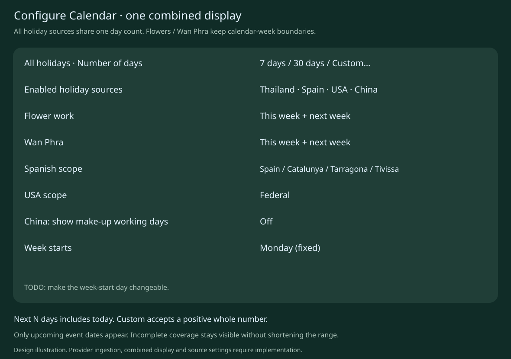
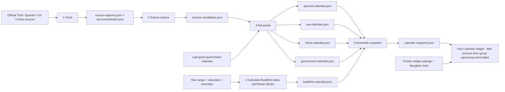
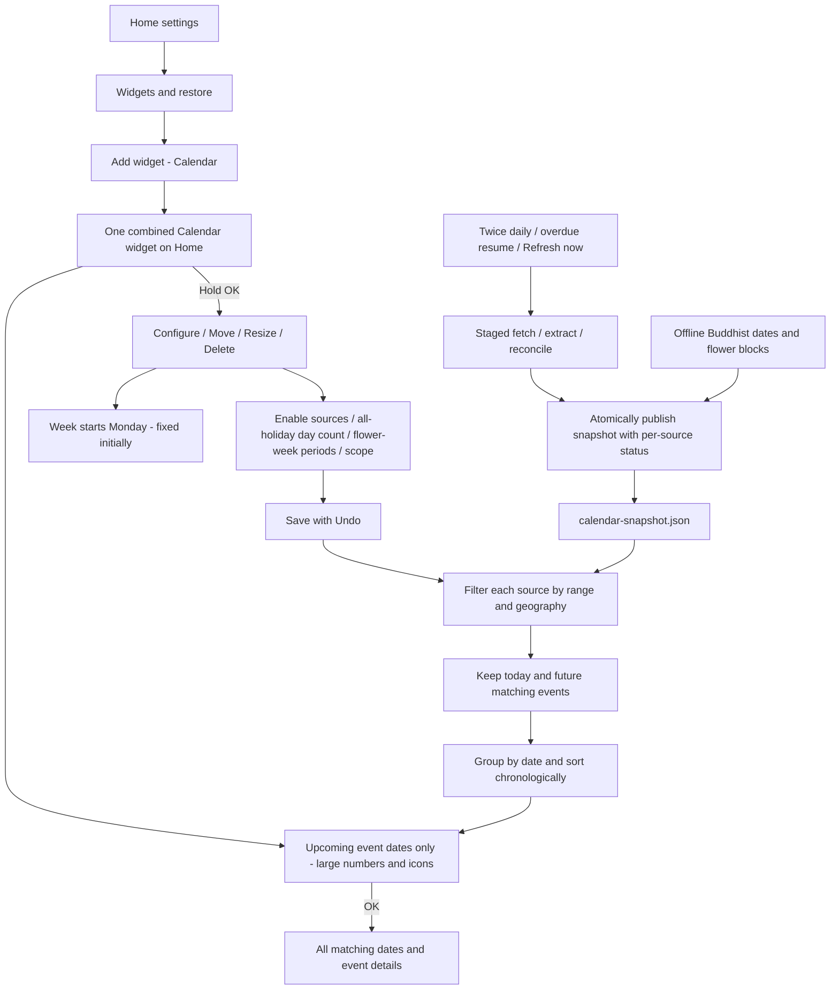

# Multi-source holiday and Buddhist flower-work calendar

**Status: combined Calendar widget and persisted 7/30/custom lookahead implemented against reviewed offline provider JSON; live ingestion and lunar calculator remain pending · 16 November 2026**

**19 November update:** the client-side calculator and persistent holiday updater
are implemented in the [Wan Phra workstream](2026-11-19-client-side-wan-phra.md)
and [offline-update workstream](2026-11-19-offline-holiday-updates.md).
The “pending” descriptions below preserve the original 16 November baseline;
current behavior, supported years and source limits are in the
[calendar-data guide](../how-to/calendar-data.md) and
[verification record](../testing/2026-11-19-calendar-data.md).

Add **one native Calendar display widget** through **Home settings → Widgets &
restore → Add widget → Calendar**. It combines enabled Thai government, flower
work, Wan Phra, Spanish, US and mainland China holiday sources. These are inputs to one display, not
separate widget types. Keep the air widget and app favorites. Government closures
require live checks twice daily; Buddhist dates are calculated offline. The
separate single-date prototypes have been replaced by this combined display.
See the [calendar how-to](../how-to/calendar.md) for controls and current data limits.

## One widget, upcoming event dates only


Render a chronological sequence of compact date cards with large day numbers,
month/year and event icons. Include **only today and future dates that have at
least one matching event in an enabled source's configured range**. Ordinary
empty days are omitted. Week boundaries determine filtering; they do not create
weekday columns or separate week grids. Past days are omitted even if they fall
inside the current calendar week.

Filter each source by its applicable range setting and geographic scope, union the matching
dates, then group all matching events on the same date into **one date card**.
For example, a selling day that is also Wan Phra gets flower and Buddha icons on
one card. A date shared by multiple countries
also stays one card, with every matching country represented. An event outside its own source's range is excluded
even if another source puts that date on screen. Sort by civil date, preserving
source-local all-day dates and explicit timezone context in details.

Keep cards dense and readable inside this single widget. Resize changes the
number of visible cards, with explicit paging/overflow when needed. OK exposes
all matching dates and their details, without an arbitrary first-six limit.
Lengthy names, preparation/selling schedules, scope and provenance belong behind
OK. No date cards appear solely to communicate freshness or empty coverage;
those messages live in the widget's compact status area. Known empty covered
ranges say **No upcoming events in the selected ranges**. Missing/stale coverage
is labeled separately and must not be mistaken for verified absence of events.

### Flag-color top and bottom edges

Reuse the country stripe treatment already used in the user's calendars:

- [Passport calendar builder](/home/will/docs/scripts/build-passport-travel-calendar.py:104)
  uses country styling from the shared trip-calendar renderer.
- [Shared flag-stripe definitions](/home/will/trip/kayaktrip/render.py:411) and
  [calendar edge styling](/home/will/trip/kayaktrip/render.py:839) define the
  reference proportions and colors. The existing reference uses a bottom band;
  this widget applies the same treatment to **top and bottom** card edges.
- Thailand: left-to-right **red / white / blue / white / red**, widths
  **1:1:2:1:1**, colors `#a51931`, `#ffffff`, `#2d2a4a`.
- Spain: left-to-right **red / yellow / red**, widths **1:2:1**, colors
  `#aa151b`, `#f1bf00`, `#aa151b`.

- USA: flag-derived **red / white / blue** accents, colors `#b22234`,
  `#ffffff`, `#3c3b6e`. The existing trip renderer falls back to a solid red US
  edge; extending that to a red/white/blue stripe cue is a new choice for this
  widget, not a claim that the reference already draws it. No tiny stars needed.
- China: reuse the trip renderer's **gold `#ffde00` edge on a red `#de2910`
  header/footer accent**. This is its small-scale flag cue; stars are omitted.
  Keep the interior palette readable rather than filling the entire card red.

For one-country dates, use that country's pattern on both edges. For the
existing Thai/Spanish pair retain Thai top and Spanish bottom. With US/China
sources, use a fixed **TH, ES, US, CN** ordering: two countries take the top and
bottom respectively; three or four countries split the two edges into clearly
separated country segments in that order (first two on top, remainder below).
Keep segment widths sufficient to recognize the pattern and list all country
codes in the accessible description/details. The assignment must not depend on
fetch order or silently drop a third or fourth country. Include a labeled
multi-country example in visual verification before implementation is accepted.
Flower work and Wan Phra use Thai bands and retain flower/Buddha icons. Spanish
regional/provincial/municipal events use Spanish bands, with exact scope in
labels/details. Colors follow matching events, not device location.

Keep the card interior readable in the chosen palette, preserve rounded corners,
focus clearance and fully opaque content when background opacity is reduced.
Draw the bands natively; no emoji-font dependence or separate flag icon is
needed to identify country. Icons and accessible text retain event meaning;
color alone must not identify an event or source. No runtime dependency on the
external docs/trip repositories is introduced by this visual reference.

## Source period settings and Monday weeks



**Hold OK → Configure → Sources & ranges** configures the feeds of this one
Calendar widget. Persist enabled sources, shared holiday lookahead, flower/Buddhist
week periods and geographic scope with
layout Undo. They select from the same JSON snapshot; changing a display range
does not require a different source fetch.

| Input group | Range setting | Boundary rule |
|---|---|---|
| **All holidays**: Thai government, Spanish, US and China | **Next N days**, default **30** | One shared number of days for every enabled holiday provider; today through today + N − 1, inclusive, using the provider/reference civil-date rules below. |
| Flower work | **This week + next week** | Current Monday through following Sunday in Bangkok time, intersected with today onward. Include every matching preparation/selling day. |
| Wan Phra | **This week + next week** | The same complete-week boundaries, intersected with today onward; include observance dates. |

**Configure → Sources & ranges → All holidays → Number of days** offers quick
choices **7 days**, **30 days**, and **Custom…**. Custom opens a numeric input on
the TV and accepts a positive whole number of days, not just those two presets.
Persist it as `holidayLookaheadDays` (integer, default 30) in the private widget
settings with Undo. Save applies the number to **all enabled holiday sources**;
Back cancels an edit. Do not add separate fixed 30-day controls to each country.
Show the selected value as **All holidays · Next N days** in settings and in the
widget's compact range label. This is a count of calendar dates, including today:
7 means today through day +6; 30 means today through day +29.

Validate blank, zero, negative, fractional, malformed and overflowing input before
saving. Do not silently round or clamp an entry. If a requested window exceeds
verified provider coverage, retain the requested setting and show that provider's
partial/unknown coverage; do not shorten the period and call it complete. Changing
the display number re-filters the snapshot without requiring a network request.
Keep source timezone, observed-day links, geographic restrictions and independent
freshness rules intact. China working-day events, when enabled, use this same
lookahead. Source enable/disable and scope remain independent of the shared count.

Flower/Wan Phra keep **This week / Next week / This week + next week** as their
separate week choices. Changing holiday lookahead must not convert them into a
rolling day count or alter their Monday boundaries. Do not replace these
week modes with a rolling 14-day window. On Sunday 22 November 2026, current and
next week have boundaries **16–29 November**, but only event dates **22–29
November** are eligible because this is an upcoming display. On Monday 23
November the boundaries advance to **23 November–6 December**. Do not retain
past event cards from the earlier part of the week.

Show **Week starts · Monday (fixed)** in this widget's settings. Selecting it
explains the boundary rule; it is not editable initially and does not follow the
TV locale implicitly. **TODO: make the week-start preference changeable**,
persisting it with Undo and applying it consistently to source filtering and
range labels. This does not imply adding empty calendar-grid cells.

Include work days intersecting the selected range even when their Wan Phra
anchor lies beyond its last Sunday: for example, preparation on 29 November for
Wan Phra on 2 December still appears in the 16–29 November window. Coverage must
include those adjoining anchors. Show stale/partial source status independently;
a failed government refresh must not remove valid Buddhist event cards.

The combined event-only display, persisted range settings, fixed Monday setting
and flag edges are implemented. They currently consume reviewed offline JSON;
live retrieval and the validated lunar calculator remain open items.

## Calendar meanings

**Government holidays** lists reviewed government-office holidays, including
the original holiday and explicit substitute dates. It excludes bank-only Labour
Day, employer-specific leave, embassy-local holidays and school closures.
Nationwide is the default scope; a Bangkok option includes a separately labeled
Bangkok-only government closure. Include each matching holiday in the selected source range. Never promise that
a particular office is open on a day without a listed closure.

**Flower work source** uses locally calculated **Wan Phra (วันพระ)** dates, checked
against published calendars. Wan Kon is the
preceding day. The confirmed work template, anchored to each Wan Phra date D, is:

| Relative dates | Display |
|---|---|
| D−3 and D−2 | Making flowers · busy, somewhat available |
| D−1 and D | Selling flowers · mostly unavailable |
| 11:00–16:00 on each selling day | Approximate break; retain the selling-day context |

At exactly 11:00 the break starts; at 16:00 the selling-day status resumes.
For the public-calendar example D = 17 November 2026, preparation is 14–15 and
selling is 16–17 November. The other confirmed November dates are 3, 9 and 24.
These are not assumed to close government offices. Days outside a work block produce no flower event card. No availability outside
these blocks is inferred.
The person-specific widget label is editable and stored only in private device
preferences through the layout snapshot; do not put a household name in source,
screenshots committed to the repository, recipes or public documentation.

**Wan Phra** is an observance source in the same Calendar widget, without
inferring availability or government closures. It shares the flower source's
dates/calculator; matching dates carry a Buddha icon alongside any other events.

## Wan Phra algorithm: Thai lunisolar civil calendar

Use **Suriyayatra / Chulasakarat calendar arithmetic**, then select the Buddhist
observance days. A floating-point astronomical Moon-phase model or a repeated
7-day interval is not the calendar algorithm. A Gregorian/Buddhist solar year
offset is not sufficient either: the Chulasakarat year has its own new-year
boundary.

Reference implementation to evaluate and port narrowly to Java:
[pythaidate by Mark Hollow](https://github.com/hmmbug/pythaidate), pinned at
`f526c4d9d9ee2a854bf790aaf6d6ee6db90f3f25` (verified using GitHub's commit API).
Use its `CsDate` civil-lunisolar path, not its separate `PakDate` / Pakkhakhananaa
calendar. The candidate is an implementation reference, not itself an official
calendar authority. Validate against the published calendar actually used here.
Preserve its [MIT notice](https://github.com/hmmbug/pythaidate/blob/f526c4d9d9ee2a854bf790aaf6d6ee6db90f3f25/LICENSE.txt)
if code is adapted, and record imported files and hashes. No Python, Dart or Go
runtime is needed in the APK.

### Calculation steps

1. Convert the current instant to its **Asia/Bangkok civil date**. Convert that
   date to an integer Julian day number; use local calendar arithmetic, not a
   UTC timestamp truncated to a day.
2. Find the Chulasakarat year and its day offset from the epoch. The reference
   epoch JDN is 1,954,167. At the start of Chulasakarat year `y`, calculate:

   ```text
   H = floor((292207*y + 373) / 800) + 1
   K = 800 - ((292207*y + 373) mod 800)
   Q = floor((11*H + 650) / 692)
   A = (11*H + 650) mod 692
   T = (Q + H) mod 30
   ```

   `H` is the epoch-day count (*horakhun*), `K` the solar remainder
   (*kammacapon*), `A` the lunar remainder (*avoman*), and `T` the *tithi*.
   Preserve the reference's zero-remainder normalization (`A = 0` becomes 692,
   with the corresponding tithi correction), integer division and epoch rules.
3. Determine the year type: ordinary **354 days**; leap day (**athikawan**,
   355 days, added in lunar month 7); or leap month (**athikamas**, 384 days,
   repeating month 8). The initial tests use `T < 6` or `T > 24` for a leap-month
   candidate, with the `T = 25` / next-year `T = 5` exception. The solar leap
   test is `K <= 207`; avoman limits of 126 or 137 determine a leap-day candidate.
4. Apply the complete adjacent-year reconciliation, including a five-year
   window. A Thai lunar year does not receive both intercalations: move a
   coincident leap day according to the calendar's new-year weekday continuity.
   Preserve the boundary/offset and 800-year correction rules. The initial
   tests alone are **not** a complete implementation.
5. Resolve the date through the year-type month-length sequence to get lunar
   month, waxing/waning half, and day within that half. Ordinary months alternate
   29/30 days, with the leap-day and repeated-month exceptions above.
6. A date is Wan Phra when it is **waxing day 8**, **waxing day 15**,
   **waning day 8**, or the **last waning day** (14 or 15 according to the actual
   month). Equivalently, the 1-based day of the whole lunar month is 8, 15, 23,
   or its final day. Deduplicate when selecting dates.
7. Derive Wan Kon as `D−1`; flower preparation as `D−3..D−2`; selling as
   `D−1..D`. Apply the confirmed approximate `[11:00, 16:00)` break on both
   selling days in Bangkok time.

Implementation references:
[year classification](https://github.com/hmmbug/pythaidate/blob/f526c4d9d9ee2a854bf790aaf6d6ee6db90f3f25/pythaidate/lsyear.py),
[conversion and reconciliation](https://github.com/hmmbug/pythaidate/blob/f526c4d9d9ee2a854bf790aaf6d6ee6db90f3f25/pythaidate/csdate.py),
[constants](https://github.com/hmmbug/pythaidate/blob/f526c4d9d9ee2a854bf790aaf6d6ee6db90f3f25/pythaidate/constants.py).

Keep the reviewed 49-date 2026 list as an **independent regression fixture** and
bootstrap while the algorithm is being validated, rather than an annually
downloaded dependency. Require exact agreement with 3, 9, 17 and 24 November
2026, not just approximate lunar phases. Test normal, leap-day and leap-month
years against independently published dates, month/year transitions, repeated
month 8, Bangkok midnight and the reference's boundary corrections. Agree and
document a validated year range before extrapolating beyond it; local arithmetic
being possible does not make an unvalidated result authoritative. Any sourced
calendar correction must be an explicit, dated override, never an unexplained
one-day shift or a hidden switch to a different sect's reckoning.

## Spanish holiday provider: Spain → Catalunya → Tarragona province → Tivissa

Confirmed scope: national holidays applicable in Spain, Catalunya regional
holidays, **any explicitly province-wide Tarragona holidays/closures**, and
Tivissa municipal holidays. Tarragona is the province in this configuration;
Tarragona city's local holidays are not Tivissa holidays. Keep all geographic
layers in the event model, including the province layer even if a particular
year has no separate province-wide holidays.

Official inputs:

- **Spain:** BOE's annual national/autonomous-community labour holiday calendar:
  [2026 resolution BOE-A-2025-21667](https://www.boe.es/diario_boe/txt.php?id=BOE-A-2025-21667)
  and [2027 resolution BOE-A-2026-21254](https://www.boe.es/diario_boe/txt.php?id=BOE-A-2026-21254).
  Parse the applicability table and substitution notes, not just a flat list of
  nominal national dates. Do not add an observed holiday from another region to
  Catalunya automatically.
- **Catalunya:** Generalitat's [official labour calendar](https://treball.gencat.cat/ca/ambits/relacions_laborals/ci/calendari_laboral/index.html)
  and associated DOGC orders, amendments and official open-data distribution.
- **Tivissa:** Generalitat's [official local-holiday dataset](https://treball.gencat.cat/ca/informacio/dades-obertes/dg-de-relacions-laborals-treball-autonom-seguretat-i-salut-laboral/calendari-festes-locals-catalunya/index.html),
  also [catalogued on Spain's official data portal](https://datos.gob.es/es/catalogo/a09002970-calendario-de-fiestas-locales-en-catalunya),
  identifies dataset `b4eh-r8up`. Verify its live JSON fields, pagination, update
  timestamps and municipality identifiers before enabling ingestion. The official
  [Tivissa calendar view](https://ocupacio.extranet.gencat.cat/treball_clt/festesMapa.do?any=2026&codiP=1028&oper=View&preAction=selMapaCat&tipusSeleccio=poblacio)
  provides a cross-check. Preserve distinct population-centre exceptions instead
  of pooling every date listed under the municipality.
- **Tarragona province and local amendments:** use the [official BOPT](https://aplicacions.dipta.cat/bopt/web/)
  and relevant Generalitat/municipal notices for explicitly applicable decisions.
  A notice merely being published in BOPT does **not** make it province-wide.
  A Diputació staff holiday or office closure applies to that institution unless
  the decision explicitly extends its scope. No separate province-wide date is
  asserted by this plan without a specific authoritative notice.

Widget configuration identifies **Spain · Catalunya · Tarragona province ·
Tivissa** and lets the source layers be enabled/disabled per instance. Include
applicable national, regional, province-wide and municipal events by default.
Deduplicate the same holiday across BOE/Generalitat/local sources while retaining
all provenance and scope labels. Use Spanish flag-color card edges for Spanish public
holidays; show Catalunya/province/Tivissa scope in the date details. These events
share the calendar renderer and final snapshot with the Thai providers.

Distinguish a public/labour holiday, an administrative non-working day for legal
period calculations, an office-specific closure and a cultural festival. Do not
infer that every Spanish office or business closes, or treat a festival programme
as a statutory holiday. Preserve original Catalan/Spanish titles and optional
translated display names without changing the event identity.

Use source-local, all-day civil dates with `Europe/Madrid` for the confirmed
Catalunya/Tivissa location, including daylight-saving changes. Do not convert
Spanish midnight into a different displayed holiday date in Bangkok. A combined
multi-country view must state its reference timezone; Buddhist work phases and
week boundaries remain Bangkok-based. Track national/regional/provincial/local
coverage independently: missing next-year Tivissa dates are **not yet published /
not verified**, not an invitation to repeat this year's municipal holidays.

The renderer now displays the reviewed 2026 Spanish provider, including Tivissa
centre dates verified through the official dataset (INE 43150, pedania 000).
Live refresh and further-year/local coverage remain pending.

## USA holiday provider

Add **USA holidays** as an enabled source in the same Calendar widget, using the shared
**All holidays · Next N days** setting (default 30). Initial scope is **federal holidays**, pending any requested
state/city scope; no state or local selection has been supplied. Do not infer a
US location from unrelated project or travel documents.

Primary source: the [US Office of Personnel Management federal holiday calendar](https://www.opm.gov/policy-data-oversight/pay-leave/federal-holidays/).
Use the published year schedules and associated notes; preserve actual holiday
dates, observed dates and their relationship. Label the latter **Observed** and
deduplicate only when actual and observed dates coincide. Dates across a December/
January year boundary require the adjoining year's schedule. The source's
[federal holiday work-schedule guidance](https://www.opm.gov/policy-data-oversight/pay-leave/pay-administration/fact-sheets/holidays-work-schedules-and-pay/)
explains scope and exceptions; do not treat a federal employee schedule as a
promise that every private business, bank, embassy or state office closes.
Regional/office-specific dates such as applicable inauguration arrangements must
retain their restriction rather than becoming universal US dates.

Keep US events as **date-only civil dates**. Federal scope spans multiple US
timezones; it does not imply that the user selected Washington, DC. For the
initial nationwide view, use the Calendar widget's explicitly labeled reference
date (default Asia/Bangkok) to choose the upcoming N-date window, while retaining
US holiday date labels unchanged. If a US locality is later selected, use its
IANA timezone for local range boundaries, including daylight-saving changes.
Do not model the country as one fixed UTC offset or convert holiday midnight
into a different date in Bangkok.

Planned stages fetch/capture the official schedules, extract normalized federal
records, reconcile them into `usa-calendar.json`, and merge that provider into
`calendar-snapshot.json`. Retain coverage year, source URL, actual/observed link,
check times and independent stale/partial status. Test observed-day substitutions,
weekend actual dates, adjacent years, multiple-country dates and unselected
state/local exclusions. Official publisher content was verified in research;
transport/parser contracts remain to be implemented and tested.

## China holiday provider

Add **China holidays** to the same display, using the shared
**All holidays · Next N days** setting (default 30).
Starting scope is **mainland China**, using **Asia/Shanghai** civil dates.
Hong Kong, Macao and Taiwan calendars are not inferred from this source; adding
any of those requires its own explicit provider/scope.

Use the **State Council General Office's annual holiday-arrangement notices**
and their official amendments. Verified official examples:

- [2026 notice republished by Beijing's government](https://www.beijing.gov.cn/zhengce/zhengcefagui/202511/t20251104_4258873.html).
- [2027 notice republished on the Ministry of Human Resources and Social Security's China Employment site](https://chinajob.mohrss.gov.cn/h5/c/2026-11-09/635850.shtml).
  The original State Council decision is dated 5 November 2026; this republication
  is dated 9 November. Store both dates separately. Direct retrieval of the
  central gov.cn 2027 URL returned HTTP 403 in research; do not count that as a
  successful live check. A verified official republication can supply the notice,
  with the original issuer and republication URL retained.

China sometimes combines holiday days and shifted days off into longer breaks,
then designates specific Saturdays/Sundays as working days. The verified 2026
notice, for example, gives 1–3 January off and explicitly designates Sunday
4 January as working. Capture the **complete published holiday period**, not
just an astronomical date for Lunar New Year, and preserve the distinct
adjustments. Do not calculate the holiday/working schedule solely from lunar
arithmetic, weekends or another country's Chinese New Year calendar.

Normalize `publicHoliday`, `adjustedDayOff` (where explicitly distinguishable)
and `makeUpWorkingDay` separately, preserving the notice's wording and effective
ranges. If the notice only states a combined period, retain that period without
inventing its internal legal classification. Link each working-day adjustment
to its announcement and associated holiday block when specified.

Under **Configure → Sources & ranges → China**, add **Show make-up working days ·
Off**. They are parsed and retained in JSON, but appear in the widget only if
this setting is enabled. When enabled, label them **Working day**, use a distinct
work/briefcase cue and retain China flag-color edges. They must never look like
a holiday/closure. Ordinary working days or weekends without explicit events
still produce no cards. This proposed default keeps the requested holiday view
focused while preserving the source facts.

Reconcile this source into `china-calendar.json`, with its own coverage, revision
history and freshness, then merge into the final snapshot. Test multi-day
period expansion into daily cards, working-weekend exclusions/default toggle,
overlapping notices, amendments, year crossings, missing next-year notices and
shared dates with other countries. Reviewed 2026–2027 US/China provider data is included in the display;
live US/China retrieval is not implemented yet.

## Staged programs with JSON handoffs

**Implemented offline handoff:** `task calendar:normalize` expands reviewed facts
into six provider files; `task calendar:assemble` validates and atomically writes
the native widget snapshot; `task calendar:check` tests replay and failed-update
retention. These two programs use Python stdlib in the build image, with no Python
runtime in the APK. They do not implement live capture/extraction or the lunar
calculator. The larger live-stage contracts below remain the target design.


**Recommended architecture: split the data pipeline into independently runnable
stages; let the single native Calendar widget consume one validated snapshot.** This isolates
fragile website retrieval/parsing from calendar arithmetic and presentation.
Saved intermediate files make failures inspectable and reproducible, allow parser
fixes to replay captured input without hitting the source again, and give each
stage an independent test contract. The flower/Buddhist branch remains usable
when any network holiday provider fails. All sources share the final data contract and feed the combined event-only
Calendar widget above.

Each stage must have an independent command-line entry point runnable in the
build container, with explicit input/output file arguments and a reusable Java
module. Android background work invokes the same modules and persists their
JSON handoffs in private app storage. No Python runtime, server, separate Android
app or always-running service is required. A hosted updater is a possible later
execution location only if direct retrieval proves inadequate; this plan does
not assume hosting exists. Stage boundaries are real file contracts, rather
than just helper functions inside a single opaque program.

| Program/stage | Inputs | JSON output | Responsibility |
|---|---|---|---|
| 1. Fetch official sources | Thai, Spanish, US and China source configurations, discovery checkpoints and conditional-request caches | `source-captures.json` and content-addressed `documents/<sha256>.json` | Discover/paginate Thai annual/emergency notices and Spanish BOE/Generalitat/BOPT/local records, US OPM schedules and China State Council notices; capture response bodies and retrieval evidence. No closure interpretation. |
| 2. Extract provider records | Fetch manifest and captured documents | `closure-candidates.json` | Source-specific parsing into dated candidate decisions, scope, exceptions and provenance. Explicitly identify ambiguous or unrecognized notices. No final calendar replacement. |
| 3. Reconcile provider calendars | Candidates, last-good provider calendars and source/check status | `government-calendar.json`, `spanish-calendar.json`, `usa-calendar.json`, `china-calendar.json` | Validate facts, deduplicate, apply amendments/cancellations, preserve unaffected cached events and report coverage/freshness. Never infer a closure from weather alone. |
| 4. Calculate Buddhist calendar and flower blocks | Requested year range, validated calculator version and explicit sourced overrides | `buddhist-calendar.json` | Offline Suriyayatra calculation of Wan Phra, Wan Kon and preparation/selling date blocks. Keep the published 2026 dates as independent regression fixtures. |
| 5. Assemble widget snapshot | Thai government, Spanish, US, China and Buddhist calendars | `calendar-snapshot.json` | Validate all provider branches and assemble the bounded, presentation-independent data contract consumed by the TV. Preserve separate branch freshness/coverage. |



### JSON contracts and validation

- Every output includes `schemaVersion`, `stage`, `runId`, UTC `generatedAt`,
  input hashes, producer/parser/calculator version, stage outcome and diagnostics.
  Calendar contracts declare source-local timezones (`Asia/Bangkok` or
  `Europe/Madrid`, `Asia/Shanghai`, or an explicitly chosen widget/US-locality
  reference for the US provider) and explicit coverage dates.
  Store civil event dates as ISO `YYYY-MM-DD`; publication/check times are ISO
  instants with offsets. Do not mix Buddhist-era years with Gregorian years in
  normalized dates. Unsupported schema versions fail explicitly; no speculative
  compatibility layer.
- Fetch manifests record source ID, requested/final URL, fetched time, HTTP status,
  content type, body hash, conditional-request metadata, discovered document IDs,
  pagination checkpoint and whether the required overlap was completely read.
  Document JSON envelopes contain the response body as a JSON string for decoded
  text, or base64 for binary material, with its encoding and raw-byte hash.
  Preserve the original evidence locally with retention/size bounds. Do not
  commit full copyrighted articles as public fixtures; use normalized facts and
  small permitted excerpts for repository tests.
- Candidate decisions retain document references and field provenance: issuer,
  published/updated times, effective dates, government-office scope, named areas,
  exclusions/service exceptions, decision type and amendment/cancellation target.
  Unknown scope, uncertain date or unsupported wording is a diagnostic requiring
  review, not an invented nationwide closure. Classify irrelevant notices
  separately from unparsed possible closure notices.
- The reconciled government file retains stable event IDs, provenance,
  revision/withdrawal history and per-source last attempt, last successful check,
  completeness and error state. A document disappearing from a listing is not a
  cancellation. A successful fetch or empty candidate array is not proof of a
  complete check. Successfully rechecking an unchanged document can advance its
  verified check time; an HTTP-200 challenge or parse failure cannot.
- Buddhist output declares its validated year range, calculator identity,
  overrides and regression evidence. Emit dated Wan Phra anchors, Wan Kon and
  flower preparation/selling ranges with anchor IDs. Range generation includes
  enough adjoining dates to resolve work blocks crossing a year boundary. Dates
  outside validated coverage remain unavailable rather than approximate.
- The final snapshot preserves independent `government`, `spanish`, `usa`, `china` and `buddhist` sections,
  source links, source-issued timestamps and branch status. Spanish events retain
  country, autonomous-community, province, municipality and any office restriction
  separately from the publishing authority; a national event is applicable at
  each included lower level unless its published applicability says otherwise. A broken government
  refresh may produce a new snapshot with **cached government events marked
  stale/partial** plus valid Buddhist dates. It may not erase known closures or
  mark government checks fresh merely because the Buddhist branch succeeded.
  Invalid final output retains the previous complete snapshot.
- Bound file sizes/counts and validate types, required fields, date ranges,
  source references and input hashes before consuming a handoff. Write temporary
  files, validate, then atomically rename. Publish one immutable run directory
  and update the active-snapshot pointer only after assembly succeeds, so readers
  cannot mix files from different runs. Do not execute content from JSON.
- Each command supports replay from saved inputs, deterministic event output for
  identical inputs, structured diagnostics and exit codes distinguishing success,
  partial result and failure. Attempt times belong to run metadata, rather than
  changing event identities. Stage reruns never require re-fetching unless fetch
  is the stage explicitly requested.

### Runtime and privacy

At 06:00 and 18:00 Bangkok time, on overdue resume, or on Refresh now, Android
runs stages 1–3 and then stage 5. Stage 4 runs without networking when coverage
needs extending or the validated calculator/overrides change; its existing good
output can be reused on government-only refreshes. The coordinator of the run
records failures and publishes branch status without moving remote focus.
Standby timing limitations still apply; show overdue/partial checks honestly.

The Calendar widget reads `calendar-snapshot.json` and combine it with private instance
settings, period/week preferences and the appropriate source-local clock. Determining the current approximate
11:00–16:00 selling-day break stays local at render/refresh time; it does not
require regenerating the data files every minute. Private labels, household
names, chosen widgets and layout never enter shared data outputs. Government
scope filtering remains local, using the explicit geographic scope in events. US/China
source enables, the shared holiday lookahead, week periods and the optional China working-day toggle are also
private widget settings, not shared provider output.

The current `thai-calendar.json` asset and in-app date model are an offline
prototype, not these completed stage contracts. Replace their loading path with
the validated final snapshot when the stages are implemented; retain reviewed
fixture facts without adding a compatibility layer for the prototype format.

### Implementation order

1. Define JSON schemas, shared validators, command input/output conventions and
   small synthetic fixtures, including national, regional and withdrawn closures.
2. Implement stages 1–3 independently, using the verified September flood notice
   as a factual regression case. Verify discovery pagination, modifications,
   partial-source behavior and parser replay before claiming live completeness.
3. Implement/validate stage 4 against the independent 2026 calendar and additional
   normal/leap-year fixtures; generate adjoining-year work blocks.
4. Implement stage 5 and switch the dashboard to one Calendar widget consuming its snapshot,
   preserving private settings, Move, Resize, Delete and Undo.
5. Add background/manual scheduling, atomic publication, recovery and on-device
   verification. Test each stage alone and the full pipeline in containers before
   the next newly numbered coordinator deployment.

## Government closures: live official data, twice daily

The static annual asset is a **bootstrap/cache fallback**, not the complete
closure service. Special government closures can be announced after the annual
calendar, including emergency/weather-related changes. Rechecking only a bank
calendar, or calculating a religious holiday, does not satisfy this requirement.

- Target checks at **06:00 and 18:00 Asia/Bangkok**, approximately 12 hours apart,
  including background work when the TV permits it. Android/standby scheduling
  is inexact: retain the last-success timestamp, catch up when the app resumes
  after a missed window, and show an overdue state rather than claiming a check
  happened. Do not launch the UI to refresh.
- Also provide **Refresh now** for government sources in the Calendar widget. Refresh updates the
  card's data without moving focus, changing Home membership or altering the
  independently calculated flower calendar.
- Select and verify authoritative sources covering **both the annual calendar
  and new closure announcements**. Cabinet/official government announcements
  establish a national closure; ministry, provincial or individual-office
  announcements may establish a narrower closure. A weather warning alone is
  not evidence that an office closed.
- Preserve effective date/range, announcement timestamp, issuer, affected area
  and office scope, source URL, amendment/cancellation and date of last check.
  Do not silently turn a local closure, work-from-home instruction or service
  exception into a national government holiday. Scope filtering must keep a
  national closure visible for every relevant location.
- Fetch over HTTPS with bounds, timeouts and backoff. Validate a complete update
  before replacing the last-good cache. Persist the source-issued content and
  **last successful check** separately from the last attempt and calendar year.
  An unchanged but successfully checked feed advances freshness; a failed fetch,
  TLS error, changed HTML or parse failure does not.
- Show **last successful check**, **source/scope**, and **stale/offline/update
  overdue** state on the card/details. Failure must not erase a known closure
  or turn uncertain data into an “offices open” assertion.
- For a newly announced closure that predates the next scheduled check, a
  twice-daily poll inherently has a detection delay. Make Refresh now readily
  available; do not claim real-time alerting or guaranteed completeness.

**Emergency announcement publisher selected: Thai Government spokesperson news.**
Monitor [official spokesperson announcements](https://www.thaigov.go.th/th/news?category=2628),
with [Government PRD reporting](https://thailand.prd.go.th/en/content/category/detail/id/48/iid/545500)
as corroboration. This source actually carries emergency closure decisions rather
than just the annual calendar: the [27 September 2026 announcement](https://www.thaigov.go.th/th/news/169370)
created closures on **28–29 September** because of flooding, limited to **Bangkok,
Nonthaburi, Pathum Thani and Samut Prakan**. Online services and essential or
prescheduled services have exceptions; banks, private businesses and hospitals
are not automatically closed by that announcement. Retain these qualifications.

The article was directly retrievable over verified HTTPS as server-rendered HTML
on 16 November. It contains the issue timestamp and the actual dated decision.
This verifies the publisher and a real emergency-closure record. It does **not**
establish a structured closure API: extraction, pagination/backfill, notice
amendments and safe ambiguous-notice handling still need implementation and tests.
A successful download alone must not manufacture a closure or claim a complete
check. Review this requirement before enabling a live-success indicator.

The [PRD feed catalog](https://www.thailand.go.th/rss) advertises RSS and JSON,
including `https://www.thailand.go.th/issue-rss-json?hl=th` and `?hl=en`.
Although searchable copies expose posts with article bodies and created/updated
timestamps, direct retrieval returned HTTP 200 containing a 212-byte Incapsula
JavaScript challenge, **not JSON**. Do not select these as the only native-app
feed or count that response as a successful check. The default indexed JSON
response also contains only five posts; it cannot establish twice-daily coverage
without verified pagination. See the [source investigation](../investigations/2026-11-16-emergency-government-closure-sources.md).

Annual-source retrieval remains separate: Cabinet annual-page requests returned
HTTP 403 and the Ministry of Interior calendar failed TLS verification. Do not
disable TLS verification, silently substitute a bank feed, or label an annual-page
fetch as a successful emergency-announcement check. If direct retrieval cannot meet
the ingestion contract, moving the staged programs to a hosted updater requires
an explicit hosting/maintenance design; the JSON contracts remain the same.

The current bounded 2026 asset may support local development, but shipping only
that asset would **not** meet the twice-daily closure-update requirement. Missing
coverage must remain visible as **Calendar update needed**. The flower calculator
has its own validation range and does not inherit government-source staleness.

Reviewed sources:

- [Cabinet Secretariat: government holidays 2026](https://www.soc.go.th/?p=33672).
- [Ministry of Interior: upcoming government holidays](https://smoi.moi.go.th/calendar),
  confirming 5, 7, 10 and 31 December 2026. The Cabinet page itself returned 403
  during direct retrieval; corroborate entries with the sources below.
- [BOT 2026 calendar](https://www.bot.or.th/en/financial-institutions-holiday.html)
  cross-checks shared dates; its bank-only dates are not government closures.
- [Updated Royal Ploughing date, government university announcement](https://capr.tsu.ac.th/upload/files/1777604073_b167d9d87f9f076c.pdf):
  13 May 2026, correcting an earlier 11 May listing.
- [BOT report of the Cabinet's Bangkok-only 16 October closure](https://www.bot.or.th/content/dam/bot/documents/th/news-and-media/news/2026/news-20260609.pdf).
- [Government-hosted Buddhist calendar 2026](https://dopasakonnakhon.go.th/home/wp-content/uploads/2025/11/1111.pdf).
- [DMC temple calendar 2026](https://www.dmc.tv/article/5453) supplies dated Wan
  Phra entries, cross-checked against the confirmed November examples. It also
  lists Buddhist Lent on 30 July; that is a government holiday, not an additional
  weekly Wan Phra anchor. Store 49 Wan Phra dates, not every religious event.

## Remote flow



Back returns through the same-window menu tree. Source configuration offers Thai
Nationwide/Bangkok scope, Spanish geographic layers, US federal scope, mainland
China scope, a shared holiday lookahead and flower/Buddhist week periods. China has an optional working-day toggle.
The widget shows fixed Monday week starts and country flag-color card edges.
Flower offsets and the approximate break use the confirmed template; arbitrary
schedule shifts, availability synchronization and reminders remain later work.

## Verification

Container verification passed: 394 JVM tests (including 14 combined-calendar
tests) and six Python JSON-pipeline tests, zero failures; Android lint and debug APK packaging passed. This validates the
current offline UI prototype, not the proposed staged pipeline.

The combined UI runs from six reviewed offline providers, with an explicit
“Offline dates” cue. APK **0.1.21** was installed and hash-verified on Cast1; coordinator job
`J‑2715b06a214b` succeeded. Inspected captures confirm the combined cards,
7/30 switching, custom editor cancellation, Monday explanation, event details
and visual grid selectors. See the [validation record](../testing/2026-11-16-calendar-and-grid.md)
for earlier failed attempts and remaining review limits.
The mockup above is a design illustration, not a device screenshot. The lunar
calculator, twice-daily government ingestion and private-label editor remain
separate open items below.


- [x] Prototype the reviewed 2026 bootstrap and Bangkok date model. The separate
  source widgets are superseded by the combined design. The calendar tests cover confirmed anchors,
  both break boundaries, event-date selection, midnight, scope, substitutes,
  invalid input, independent settings and snapshot restoration.
- [ ] Validate and implement the pinned Suriyayatra civil-calendar algorithm;
  preserve license/provenance if code is ported. Confirm the supported year range.
- [x] Identify an official publisher with a real emergency-closure announcement.
- [x] Replace separate source widgets with one Calendar display, shared holiday lookahead, flower/Buddhist week
  periods and source scope, upcoming-only filtering, grouped date cards and explicit paging.
- [x] Implement Thai/Spanish/US/China flag-color edges and deterministic
  mixed-country segments.
- [ ] Visually verify three- and four-country cards and larger accessibility text on TV.
- [x] Implement configurable N-day holiday and Monday-week source windows, current/future
  intersection and full-period coverage checks without rendering empty dates.
- [ ] Add Spanish BOE/Generalitat/Tivissa inputs and explicit Tarragona-province
  scope; verify official transports and merge provider JSON with independent status.
- [x] Test shared holidayLookaheadDays persistence/Undo, 7/30/custom choices,
  invalid numeric input, inclusive boundaries and source coverage gaps; verify
  changing holiday days leaves flower/Buddhist week boundaries unchanged.
- [ ] Add OPM federal schedules and official China holiday-arrangement notices
  as independently validated JSON providers with private source/range settings.
- [x] Test US observed versus actual dates, year crossings and restricted scope;
  China full holiday periods, amendments and make-up working-day toggle default Off.
- [ ] Test Tarragona city exclusion, actual province-wide inclusion, institution-only
  closures, duplicate holidays, regional substitutions and missing local-year data.
- [ ] Define and validate all staged JSON contracts and independently runnable
  commands; implement replay, provenance, partial results and atomic publication.
- [ ] Verify complete annual and emergency ingestion contracts, pagination and amendments.
- [ ] Implement twice-daily, overdue-resume and manual closure checks, atomic
  cache updates, amendments/cancellations and visible per-source freshness.
- [ ] Test newly added national and local closures, withdrawn/changed notices,
  work-from-home versus closed offices, unchanged feeds, offline/TLS/parser
  failures, stale cache, missed sleep windows and independent flower calculation.
- [x] Prototype compact date rendering and widget lifecycle actions.
- [x] Integrate the single combined Calendar widget and remove separate provider
  choices from Add widget; preserve Move, Resize, Delete and Undo.
- [ ] Add the optional private-label editor and verify the complete remote flow on TV.
- [ ] Test all four November anchors, day-before/preparation offsets, both break
  boundaries, Bangkok dates across UTC midnight, explicit substitutes, bank-only
  exclusions, regional scope, coverage edges and year-crossing work blocks.
- [x] Pass container tests, lint and debug APK packaging.
- [x] Deploy a fresh version on Cast1 through the coordinator and inspect actual
  combined event cards, flag bands, source ranges and details; record execution separately from
  visual acceptance and leave household labels out of exported screenshots.

## TODO

- [ ] Make the start of the week changeable per widget. Monday is fixed initially;
  future changes must update source boundaries, labels and details together
  and participate in persisted settings and Undo.
- [ ] Verify Sunday-to-Monday rollover, month/year-crossing full weeks, past
  day exclusion in the current week, inclusive 7-day, 30-day and custom-day limits and flower blocks whose
  anchors sit just outside the selected display window.
