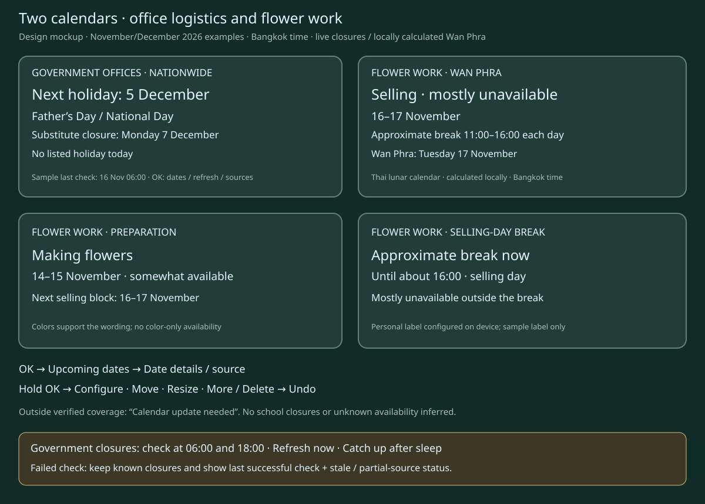
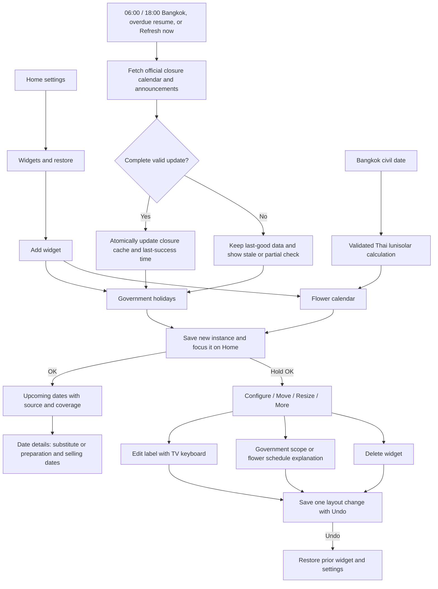

# Government-office holidays and Buddhist flower-work calendar

**Status: revised design; local date/card prototype started, calculator validation and live government-source selection pending · 16 November 2026**

Add two independent native widgets through **Home settings → Widgets & restore
→ Add widget**: **Government holidays** and **Flower calendar**. Keep the air
widget and app favorites. Wan Phra and derived flower-work dates should be
calculated on-device without network access. Government closures require live
checks twice daily, plus cached dates for offline use. No location permission or
household account is required. The source integration remains to be verified;
do not describe the current local prototype as a working live closure service.

## Mockups



The cards use the existing palette, focus treatment, per-widget sizing, Move,
Delete and Undo. One-row cards show a compact summary; larger cards show the next
date and explanation. Full details remain available with OK. Examples are for
November/December 2026 in Asia/Bangkok; they are design illustrations.

## Two distinct meanings

**Government holidays** lists reviewed government-office holidays, including
the original holiday and explicit substitute dates. It excludes bank-only Labour
Day, employer-specific leave, embassy-local holidays and school closures.
Nationwide is the default scope; a Bangkok option includes a separately labeled
Bangkok-only government closure. A weekday without a listed holiday says **No
listed holiday today**, not a promise that a particular office is open. Standard
weekend closure is identified separately.

**Flower calendar** uses locally calculated **Wan Phra (วันพระ)** dates, checked
against published calendars. Wan Kon is the
preceding day. The confirmed work template, anchored to each Wan Phra date D, is:

| Relative dates | Display |
|---|---|
| D−3 and D−2 | Making flowers · busy, somewhat available |
| D−1 and D | Selling flowers · mostly unavailable |
| 11:00–16:00 on each selling day | Approximate break; retain the selling-day context |

At exactly 11:00 the break starts; at 16:00 the selling-day status resumes.
For the public-calendar example D = 17 November 2026, preparation is 14–15 and
selling is 16–17 November. The other confirmed November dates are 3, 9 and 24.
These are not assumed to close government offices. Days outside a work block
say **No flower-work block today**, not that someone has no other commitments.
The person-specific widget label is editable and stored only in private device
preferences through the layout snapshot; do not put a household name in source,
screenshots committed to the repository, recipes or public documentation.

## Wan Phra algorithm: Thai lunisolar civil calendar

Use **Suriyayatra / Chulasakarat calendar arithmetic**, then select the Buddhist
observance days. A floating-point astronomical Moon-phase model or a repeated
7-day interval is not the calendar algorithm. A Gregorian/Buddhist solar year
offset is not sufficient either: the Chulasakarat year has its own new-year
boundary.

Reference implementation to evaluate and port narrowly to Java:
[pythaidate by Mark Hollow](https://github.com/hmmbug/pythaidate), pinned at
`f526c4d9d9ee2a854bf790aaf6d6ee6db90f3f25` (verified using GitHub's commit API).
Use its `CsDate` civil-lunisolar path, not its separate `PakDate` / Pakkhakhananaa
calendar. The candidate is an implementation reference, not itself an official
calendar authority. Validate against the published calendar actually used here.
Preserve its [MIT notice](https://github.com/hmmbug/pythaidate/blob/f526c4d9d9ee2a854bf790aaf6d6ee6db90f3f25/LICENSE.txt)
if code is adapted, and record imported files and hashes. No Python, Dart or Go
runtime is needed in the APK.

### Calculation steps

1. Convert the current instant to its **Asia/Bangkok civil date**. Convert that
   date to an integer Julian day number; use local calendar arithmetic, not a
   UTC timestamp truncated to a day.
2. Find the Chulasakarat year and its day offset from the epoch. The reference
   epoch JDN is 1,954,167. At the start of Chulasakarat year `y`, calculate:

   ```text
   H = floor((292207*y + 373) / 800) + 1
   K = 800 - ((292207*y + 373) mod 800)
   Q = floor((11*H + 650) / 692)
   A = (11*H + 650) mod 692
   T = (Q + H) mod 30
   ```

   `H` is the epoch-day count (*horakhun*), `K` the solar remainder
   (*kammacapon*), `A` the lunar remainder (*avoman*), and `T` the *tithi*.
   Preserve the reference's zero-remainder normalization (`A = 0` becomes 692,
   with the corresponding tithi correction), integer division and epoch rules.
3. Determine the year type: ordinary **354 days**; leap day (**athikawan**,
   355 days, added in lunar month 7); or leap month (**athikamas**, 384 days,
   repeating month 8). The initial tests use `T < 6` or `T > 24` for a leap-month
   candidate, with the `T = 25` / next-year `T = 5` exception. The solar leap
   test is `K <= 207`; avoman limits of 126 or 137 determine a leap-day candidate.
4. Apply the complete adjacent-year reconciliation, including a five-year
   window. A Thai lunar year does not receive both intercalations: move a
   coincident leap day according to the calendar's new-year weekday continuity.
   Preserve the boundary/offset and 800-year correction rules. The initial
   tests alone are **not** a complete implementation.
5. Resolve the date through the year-type month-length sequence to get lunar
   month, waxing/waning half, and day within that half. Ordinary months alternate
   29/30 days, with the leap-day and repeated-month exceptions above.
6. A date is Wan Phra when it is **waxing day 8**, **waxing day 15**,
   **waning day 8**, or the **last waning day** (14 or 15 according to the actual
   month). Equivalently, the 1-based day of the whole lunar month is 8, 15, 23,
   or its final day. Deduplicate when selecting dates.
7. Derive Wan Kon as `D−1`; flower preparation as `D−3..D−2`; selling as
   `D−1..D`. Apply the confirmed approximate `[11:00, 16:00)` break on both
   selling days in Bangkok time.

Implementation references:
[year classification](https://github.com/hmmbug/pythaidate/blob/f526c4d9d9ee2a854bf790aaf6d6ee6db90f3f25/pythaidate/lsyear.py),
[conversion and reconciliation](https://github.com/hmmbug/pythaidate/blob/f526c4d9d9ee2a854bf790aaf6d6ee6db90f3f25/pythaidate/csdate.py),
[constants](https://github.com/hmmbug/pythaidate/blob/f526c4d9d9ee2a854bf790aaf6d6ee6db90f3f25/pythaidate/constants.py).

Keep the reviewed 49-date 2026 list as an **independent regression fixture** and
bootstrap while the algorithm is being validated, rather than an annually
downloaded dependency. Require exact agreement with 3, 9, 17 and 24 November
2026, not just approximate lunar phases. Test normal, leap-day and leap-month
years against independently published dates, month/year transitions, repeated
month 8, Bangkok midnight and the reference's boundary corrections. Agree and
document a validated year range before extrapolating beyond it; local arithmetic
being possible does not make an unvalidated result authoritative. Any sourced
calendar correction must be an explicit, dated override, never an unexplained
one-day shift or a hidden switch to a different sect's reckoning.

## Government closures: live official data, twice daily

The static annual asset is a **bootstrap/cache fallback**, not the complete
closure service. Special government closures can be announced after the annual
calendar, including emergency/weather-related changes. Rechecking only a bank
calendar, or calculating a religious holiday, does not satisfy this requirement.

- Target checks at **06:00 and 18:00 Asia/Bangkok**, approximately 12 hours apart,
  including background work when the TV permits it. Android/standby scheduling
  is inexact: retain the last-success timestamp, catch up when the app resumes
  after a missed window, and show an overdue state rather than claiming a check
  happened. Do not launch the UI to refresh.
- Also provide **Refresh now** on the government widget. Refresh updates the
  card's data without moving focus, changing Home membership or altering the
  independently calculated flower calendar.
- Select and verify authoritative sources covering **both the annual calendar
  and new closure announcements**. Cabinet/official government announcements
  establish a national closure; ministry, provincial or individual-office
  announcements may establish a narrower closure. A weather warning alone is
  not evidence that an office closed.
- Preserve effective date/range, announcement timestamp, issuer, affected area
  and office scope, source URL, amendment/cancellation and date of last check.
  Do not silently turn a local closure, work-from-home instruction or service
  exception into a national government holiday. Scope filtering must keep a
  national closure visible for every relevant location.
- Fetch over HTTPS with bounds, timeouts and backoff. Validate a complete update
  before replacing the last-good cache. Persist the source-issued content and
  **last successful check** separately from the last attempt and calendar year.
  An unchanged but successfully checked feed advances freshness; a failed fetch,
  TLS error, changed HTML or parse failure does not.
- Show **last successful check**, **source/scope**, and **stale/offline/update
  overdue** state on the card/details. Failure must not erase a known closure
  or turn uncertain data into an “offices open” assertion.
- For a newly announced closure that predates the next scheduled check, a
  twice-daily poll inherently has a detection delay. Make Refresh now readily
  available; do not claim real-time alerting or guaranteed completeness.

**Source-selection acceptance remains open.** Research found annual Cabinet and
Ministry of Interior calendars, but has not established a machine-readable feed
that reliably includes emergency closures, amendments and geographic scope.
The Cabinet annual page returned HTTP 403 during direct retrieval; a Ministry
of Interior calendar fetch failed TLS certificate verification. Do not disable
TLS verification, silently substitute a bank feed, or label an annual-page fetch
as a successful emergency-announcement check. If multiple sources are needed,
define which coverage each supplies and surface a partial check as partial.
An optional small adapter is justified only if direct, reviewed source parsing
cannot meet this requirement; its host, maintenance and publication would need
to be designed before deployment, not assumed to exist.

The current bounded 2026 asset may support local development, but shipping only
that asset would **not** meet the twice-daily closure-update requirement. Missing
coverage must remain visible as **Calendar update needed**. The flower calculator
has its own validation range and does not inherit government-source staleness.

Reviewed sources:

- [Cabinet Secretariat: government holidays 2026](https://www.soc.go.th/?p=33672).
- [Ministry of Interior: upcoming government holidays](https://smoi.moi.go.th/calendar),
  confirming 5, 7, 10 and 31 December 2026. The Cabinet page itself returned 403
  during direct retrieval; corroborate entries with the sources below.
- [BOT 2026 calendar](https://www.bot.or.th/en/financial-institutions-holiday.html)
  cross-checks shared dates; its bank-only dates are not government closures.
- [Updated Royal Ploughing date, government university announcement](https://capr.tsu.ac.th/upload/files/1777604073_b167d9d87f9f076c.pdf):
  13 May 2026, correcting an earlier 11 May listing.
- [BOT report of the Cabinet's Bangkok-only 16 October closure](https://www.bot.or.th/content/dam/bot/documents/th/news-and-media/news/2026/news-20260609.pdf).
- [Government-hosted Buddhist calendar 2026](https://dopasakonnakhon.go.th/home/wp-content/uploads/2025/11/1111.pdf).
- [DMC temple calendar 2026](https://www.dmc.tv/article/5453) supplies dated Wan
  Phra entries, cross-checked against the confirmed November examples. It also
  lists Buddhist Lent on 30 July; that is a government holiday, not an additional
  weekly Wan Phra anchor. Store 49 Wan Phra dates, not every religious event.

## Remote flow



Back cancels label edits and returns through the same-window menu tree.
Government configuration offers Nationwide/Bangkok scope. Both widget types
offer English/Thai holiday names and source information. Flower-work offsets
and approximate break are the confirmed template in this first implementation;
arbitrary shifts, exceptions, availability synchronization and reminders are later
work, not silently inferred features.

## Verification

- [ ] Implement and validate the sourced bootstrap/fixtures, timezone-aware date
  model and separate government/flower presentation.
- [ ] Validate and implement the pinned Suriyayatra civil-calendar algorithm;
  preserve license/provenance if code is ported. Confirm the supported year range.
- [ ] Verify annual and emergency government-closure sources and source contracts.
- [ ] Implement twice-daily, overdue-resume and manual closure checks, atomic
  cache updates, amendments/cancellations and visible per-source freshness.
- [ ] Test newly added national and local closures, withdrawn/changed notices,
  work-from-home versus closed offices, unchanged feeds, offline/TLS/parser
  failures, stale cache, missed sleep windows and independent flower calculation.
- [ ] Integrate add, independent configuration, sizing, move, deletion and Undo
  without changing existing Home membership or wallpaper state.
- [ ] Test all four November anchors, day-before/preparation offsets, both break
  boundaries, Bangkok dates across UTC midnight, explicit substitutes, bank-only
  exclusions, regional scope, coverage edges and year-crossing work blocks.
- [ ] Pass container tests, lint and debug APK packaging.
- [ ] Deploy a fresh version on Cast1 through the coordinator and inspect actual
  government/flower cards and date details; record execution separately from
  visual acceptance and leave household labels out of exported screenshots.
