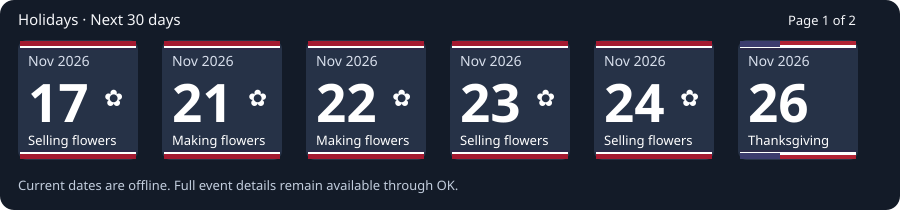
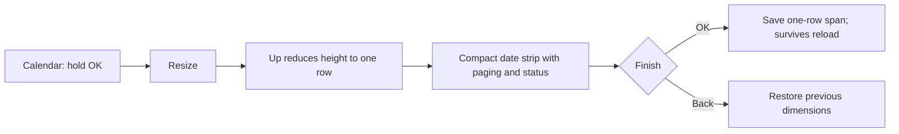

# Calendar one-row resize

The calendar currently clamps both dimensions to two cells in the remote resize
handler and in persisted layout validation. Will needs a one-row calendar.

- [x] Share a minimum span of **2 columns × 1 row** between resizing and saved
  layout validation. Preserve the existing default size and saved larger sizes.
- [x] Use a compact horizontal strip when the available height is below 190 dp:
  one heading with page count, square date cards, and one status footer. Keep
  the date number, icons, flag bands, month/year and one readable event label;
  full schedules and additional events remain available through date details.
- [x] Preserve paging, source ranges, empty/incomplete/offline states and the
  normal layout at taller sizes. Resize Save/Cancel/Undo remain unchanged.
- [x] Test persistence and packing at one-row sizes and bounded card geometry.
  Run container checks and build; install the same frozen build on both TVs.
- [x] Verify actual resize and compact rendering on Cast1 through coordinator ownership.

Build 0.1.27 is installed on both TVs. Container checks and actual TV acceptance
are tracked in the [validation record](../testing/2026-11-17-calendar-one-row.md).
