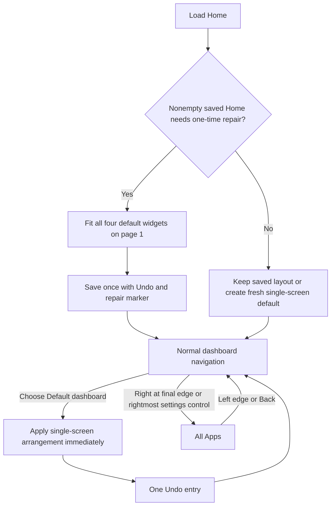

# Single-screen default dashboard and reliable All Apps navigation

Status: corrected in 0.1.32, installed on both TVs. The actual Cast1 dashboard,
Right to All Apps and Back are verified. This supersedes the previous two-page
fallback and confirmation preview for Default dashboard. See the
[validation record](../testing/2026-11-17-default-dashboard.md) for exact evidence
and the inconclusive extended isolated regression.

## Required behavior

Rain, Calendar, Air quality and Favorites belong together on one Home screen.
Right must reach All Apps from the dashboard, from either settings-row path and
from empty Home. Choosing Default dashboard must not leave the user in a hidden
confirmation mode.

A read-only coordinator capture of Cast1 showed the reported failure: the TV was
on Default dashboard preview, page 2 of 2. The earlier placement split the four
cards on grids shorter than four rows, while the preview handler consumed Right
at its last page. A separate header branch also ignored Right on populated Home.
The former isolated test used a four-row grid and did not cover those states.

## Corrected layout

Use a two-by-two composition on every supported grid. Split the available rows
between upper and lower halves, even when the grid has only two or three rows.
Row spans are grid units, not a reason to move a card to another screen. Rain and
Calendar occupy the upper half; Air quality and Favorites occupy the lower half.

| Logical grid | Upper/lower row spans | Placement |
|---|---|---|
| 8×2 or 10×2 | 1 / 1 | Four cards on page 1 |
| 8×3 or 10×3 | 1 / 2 | Four cards on page 1 |
| 8×4 or 10×4 | 2 / 2 | Four cards on page 1 |
| Taller supported grids | Balanced halves | Four cards on page 1 |

Keep readable native summaries and show detail through the widgets' detail flows.
Favorites still scrolls inside its rectangle, with wedges and no scrollbars.
Preserve existing location, forecast ranges, calendar settings, air source/station,
favorite order, wallpaper, appearance, language and hidden-app settings. The
native Air card currently defaults to automatic local model data; model and
station measurement bases remain labeled separately.

## Applying the dashboard

**Home settings → Widgets / Restore → Default dashboard** applies the arrangement
immediately as one Undoable edit. There is no extra OK-to-save preview. If several
Rain or Air instances exist, keep the explicit instance selection; retain extra
instances instead of deleting data.

On this corrective update, arrange an existing nonempty Home once so Will sees
the requested four-widget screen without discovering another menu action. Reuse
the first existing Rain/Air instance and create missing types. Record one Undo
entry and remember that this repair was applied, so later user changes and Undo
are respected on subsequent launches. Keep deliberately saved empty Home empty.
Fresh installs use the same single-screen factory.

Additional user-created widget instances are retained; their existing placement
is not permission to silently delete them. The four default types must not spill
onto another page.

## Navigation

- Right from a widget with no neighbor advances normally and then opens All Apps.
- Right from Device settings advances Home/All Apps regardless of whether widgets
  are present. Home settings → Right still reaches Device settings first.
- An Undo control does not trap Right on Home; the same page-advance action applies.
- The separate Rain/Favorites arrangement preview remains cancelable. Right at
  its final page cancels the uncommitted preview and opens All Apps, rather than
  silently swallowing the key. Default dashboard no longer enters that mode.
- Empty canvas, intermediate blank pages and returning from All Apps retain their
  existing finite navigation. Menus and move/resize retain their own controls.

## Acceptance

Container checks cover four cards on page 1 for 4/6/8/10/12 columns and two through
seven rows; preserve configuration, deterministic placement and Undo state.

The native isolated acceptance must deliberately use a **two-row grid**, verify
all four resolved cells are on page 1, apply Default dashboard without any extra
confirmation, use Right from a populated settings row, and exercise Right while
Undo has focus. It must also cover the older Rain/Favorites preview's final-edge
exit, empty canvas, blank intermediate pages and return from All Apps. Inspect
screenshots of both the two-row and four-row compositions and the All Apps screen.

Use coordinator-owned Cast1 sessions without resetting household settings.
Deploy a newly numbered frozen APK to both Cast1 and Cast2 through task deploy,
retaining Personal use and separating installed-hash proof from deferred launch
acceptance. Keep the [validation record](../testing/2026-11-17-default-dashboard.md)
current with actual results and limitations.
