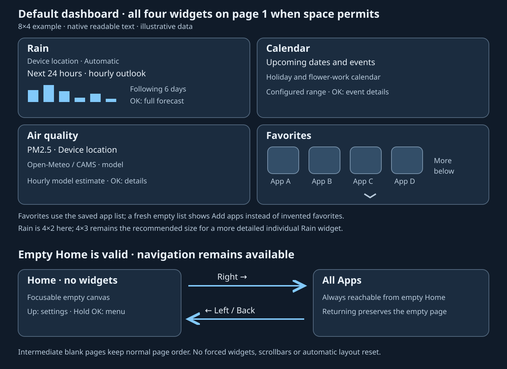
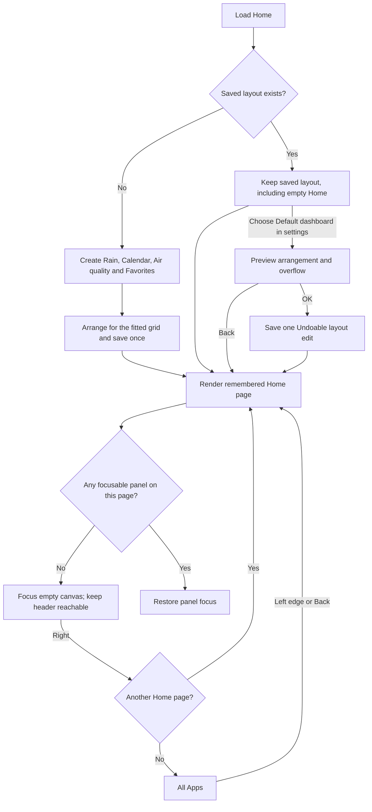

# Default dashboard and reliable navigation from empty Home pages

Status: implemented; 0.1.30 installed on both TVs. Native acceptance is in progress; see the [validation record](../testing/2026-11-17-default-dashboard.md).

## Outcome

Right must reach All Apps even when the current Home page has no widgets. A new
default dashboard includes **Rain, Calendar, Air quality and Favorites**. An empty
Home remains a valid saved choice; repairing navigation must not refill it.

## Existing behavior and likely cause

`HomeLayout.firstRun()` currently creates only Air quality. Activity startup then
runs a separate one-time Rain/Favorites arrangement, which does not provide a
complete four-widget dashboard.

`buildHome()` creates the two settings buttons, then returns early for an entirely
empty widget list. `restoreFocus()` falls back to Device settings when no widget
on the current page can take focus. In `navigate()`, Device settings handles Left
and Down but returns without acting on Right. Home settings moves Right to Device
settings, where another Right is likewise swallowed. Thus the later no-current-
widget branch that calls `showApps()` is unreachable from that focus state.

The same focus trap can affect a blank page within a nonempty layout, deletion of
the last tile, relaunch with stale saved focus, and returning from All Apps.
Confirm these exact paths with an owned device reproduction before closing the bug.

## Navigation contract

| Starting point | Right | Left / Back |
|---|---|---|
| Empty Home canvas, only Home page | Open All Apps immediately | Stay on Home |
| Empty intermediate Home page | Advance to the next Home page; after the final Home page, open All Apps | Previous Home page when one exists |
| Home settings button on an empty page | Move focus to Device settings | Retain existing header behavior |
| Device settings button on an empty page | Advance to the next Home page or All Apps | Move focus to Home settings |
| All Apps left edge | Existing behavior | Return to the remembered Home page, including an empty one |
| All Apps with no visible apps | Remain usable; settings still reachable | Return to Home |

Give the empty canvas a stable focus target. Up reaches the settings controls;
Down from the header returns to that canvas when there is no tile to focus.
Short OK on an empty canvas does nothing; hold OK / Menu opens Home settings.
Avoid presenting it as a widget or adding an extra tile to an intentionally empty
page. Keep a meaningful accessibility description for the empty focus surface.

Determine emptiness from the **current page's resolved cells**, not just
`layout.widgets.isEmpty()`. Do not treat a focusable Favorites opener with no
favorite apps as an empty Home page: it is still a widget with its own navigation.
A panel disappearing because an app is unavailable must not leave stale focus.

Share one page-advance decision between the canvas and the rightmost header
button. Handle direction on key-down only, retaining normal bounded key-repeat
behavior. Key-up must not produce a second transition. Keep menus, move/resize,
Favorites internal scrolling, Undo focus and modal dialogs ahead of ordinary page
navigation so their controls keep working.

## New default dashboard

Recommend a balanced **two-by-two dashboard** when at least eight columns and four
rows fit. All four widgets start on page 1; each can subsequently be moved,
resized or removed. Keep the user's fitted grid and readable text sizes.

| Fitted grid example | Rain | Calendar | Air quality | Favorites |
|---|---|---|---|---|
| **8×4 · compact default** | 4×2, upper left | 4×2, upper right | 4×2, lower left | 4×2, lower right |
| 10×4 or wider | 4×2, upper left | Remaining columns ×2, upper right | 4×2, lower left | Remaining columns ×2, lower right |
| 4–7 columns, at least 4 rows | Left half ×2 | Right half ×2 | Left half ×2 below | Right half ×2 below |
| Fewer than 4 fitted rows, or accessibility text cannot fit | Put Rain and Favorites on page 1; Calendar and Air quality follow on the next page using readable spans. Page navigation remains available from every page. | | | |

On grids taller than four rows, use a balanced upper/lower division rather than
leaving an unnecessary empty band. Clamp spans to the actual fitted grid and
widget minimums. The examples illustrate arrangements, not a command to force
extra rows or columns on a TV that cannot fit them.

Rain's standalone detail recommendation remains **4×3**. This dashboard deliberately
uses the supported **4×2 compact view** to keep four widgets together; full hourly
and daily figures remain available with OK. The preview must describe that choice.
Never silently shrink an existing user's Rain widget to apply this default.

Default data and behavior:

- **Rain:** Device location · Automatic, next 24 hours by hour and following six
  days. Use an existing permission grant; otherwise show Allow location without a
  startup permission dialog. Preserve units, labels and animation on reused widgets.
- **Calendar:** Existing reviewed calendar data and default ranges. A compact
  event list/summary opens details with OK. Keep the recently implemented one-row
  option available for later user resizing; do not force one row here.
- **Air quality:** Existing public AirBKK feed, with Lumpini Park as the documented
  station default for a newly created card. Label the station explicitly; do not
  imply it is inferred from Rain's location. Preserve the station on a reused card.
- **Favorites:** One bounded container, preserving the saved app list/order. With
  no favorites, show a readable Add apps action that opens All Apps. Never
  automatically favorite every installed app. Overflow uses wedges, no scrollbars.

Reserve panel padding for headers, app labels, focus rings and overflow wedges.
Check the default's actual painted content at TV scale; a rectangle fitting in the
grid does not establish that its text fits.

## Fresh installs and existing dashboards

Use one default-dashboard factory/placement policy instead of composing Air-only
first run with the separate startup Rain/Favorites rearrangement. Initialize the
four widget instances and Favorites-container mode together, then position them
once the effective grid dimensions are known. Save the resolved layout once.

Apply automatically **only when no saved dashboard exists**. A saved empty layout
is intentional and must stay empty after an update or restart. Keep the existing
unreadable-layout backup/error handling; corrupt JSON is not permission to replace
a person's layout with defaults. Remove the unconditional startup arrangement
path from normal saved-layout loading so it cannot undermine those rules.

Add **Home settings → Widgets / Restore → Default dashboard** for existing users,
including Will's current installation. Show a preview with the four panels and
any pagination before applying:

1. Reuse an existing instance of each requested widget where unambiguous. If
   multiple Rain or Air cards exist, let the user choose the instance for the
   default page. Preserve its source/configuration and keep other instances on
   subsequent pages rather than deleting them.
2. Create only missing widgets. Keep the favorite apps/order and their artwork
   preference. Preserve unrelated widgets, moving overflow deterministically to
   later Home pages, with those moves shown in the preview.
3. OK applies the arrangement as one Undoable edit; Back leaves the saved layout
   untouched. Undo restores placement, widgets and their settings together.

This is an arrangement preset, not a factory reset. Preserve wallpaper/provider,
opacity, palette, language, hidden apps, All Apps order and device permissions.
Ordinary future launches do not reapply the preset or undo later customizations.

## Workflow

## Implementation scope

1. Reproduce the empty-page trap; separate page-navigation decisions from widget
   focus lookup and fix the empty canvas/rightmost-header paths together.
2. Add the four-widget factory and grid-aware default arrangement to `HomeLayout`
   (or a small pure placement helper). Keep placement deterministic and avoid a
   new saved-layout compatibility layer.
3. Wire first-run creation and the explicit Default dashboard preview/Undo flow;
   replace the conflicting startup-only Rain/Favorites arrangement behavior.
4. Add English/Thai labels, empty-canvas accessibility text and the Favorites
   Add apps action if the current empty-container rendering is not usable.
5. Update quick start, default-layout mockups and device validation records.

## Acceptance and deployment

Automated checks must cover:

- Empty initial Home, saved empty Home, removal of the last widget, empty
  intermediate pages, stale widget/header focus and returning from All Apps.
- Right from the empty canvas and from both header buttons; no double navigation
  on key-up. Header settings, Menu/hold OK and existing move/resize/Undo/Favorites
  routing continue working.
- Exactly one of each default widget, no invented favorite apps, nonoverlapping
  deterministic placement and bounded spans across 4/6/8/10/12-column grids,
  two-row/taller screens and accessibility text sizes.
- Saved layouts remain unchanged on startup. Preset apply/cancel/Undo preserve
  widget settings, additional instances, favorite order and unrelated preferences.

Run the relevant tests plus `task check` and `task build` in the build container.
Verify the actual four-panel composition and remote navigation in coordinator-owned
Cast1 sessions using isolated layouts: delete all panels, Right to All Apps, return
Left/Back, open settings, apply the default, cancel its preview, and Undo after apply.
Include a reproducible blank intermediate-page case and visible screenshots of
readable panel headers, app labels and wedges. No app-data clearing is needed.

After implementation is approved, use `task deploy` to advance the APK number and
install one identical frozen APK on **Cast1 and Cast2**, preserving app data. The
coordinator admits background installation during Personal use and defers
foreground acceptance as required. Record installed hashes and distinguish
installation from launch/visual verification. Do not change the default Home app.

## Implementation progress

The new first-run factory creates all four widgets; saved-layout loading no longer
runs the startup-only Rain/Favorites arrangement. Explicit preset application
reuses instances, preserves settings and extras, previews pages, supports Cancel
and writes one Undoable edit on apply. Leaving the activity cancels an uncommitted
preview. Empty pages now receive canvas focus; their page-advance policy is shared
with the rightmost header button and normal Home edge navigation. English/Thai
resources and isolated native key-routing/preview/Undo acceptance were added.
