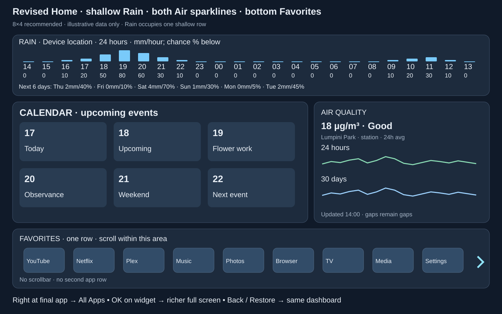
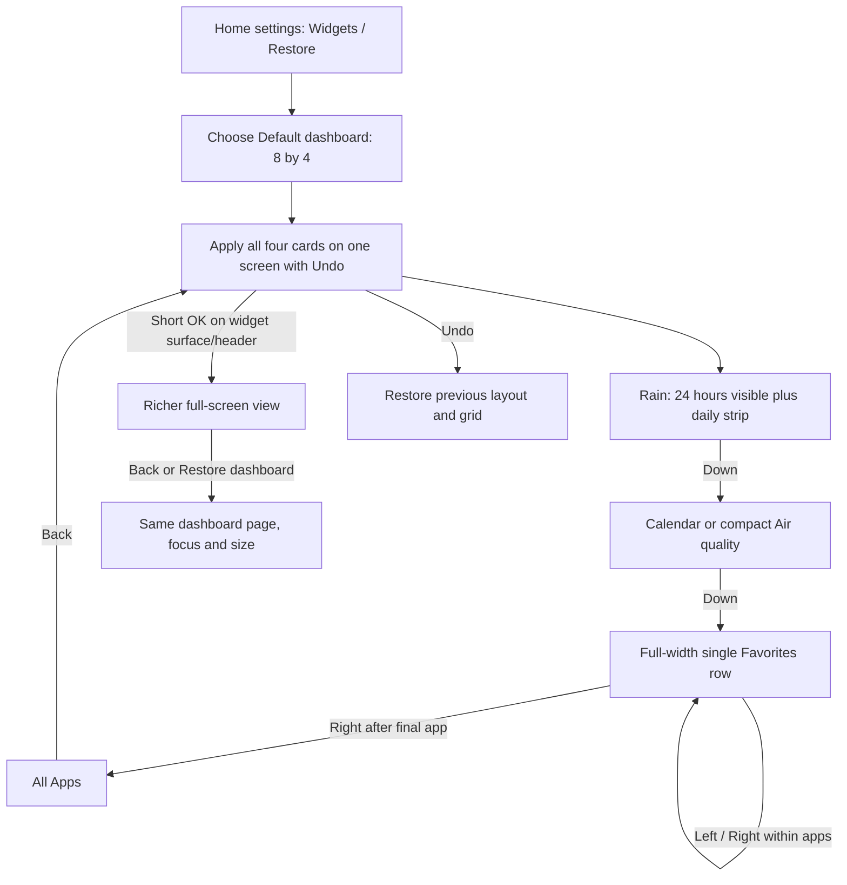

# Default dashboard: 24 hourly rain intervals and a bottom Favorites row

Status: implemented and installed as **0.1.35** on both TVs. The actual Cast1
layout and navigation are verified; Cast2 preset application is queued during
Personal use. Larger-text and narrow-width device acceptance remain pending; see the
[implementation record](../testing/2026-11-17-hourly-dashboard.md).

## Requested result

See rain **by the hour for the next 24 hours directly on Home**, give air quality
a smaller rectangle **with both 24-hour and 30-day sparklines**, and put Favorites in **one full-width row at the bottom**.
Rain, Calendar, Air quality and Favorites remain together on one screen. This
supersedes the equal-quadrant arrangement in the
[previous default dashboard plan](2026-11-17-default-dashboard-and-empty-page-navigation.md).

## Recommended layout

Use an **8-column × 4-row** default composition within the existing TV-safe content
area. The settings/header and outer Home footer remain outside these four rows.

| Widget | Size | Position | Purpose |
|---|---|---|---|
| Rain | 8×1 | Top, full width | A shallow hourly timeline and compact six-day outlook. |
| Calendar | 5×2 | Middle left | Existing event-only dates, with room for readable labels. |
| Air quality | 3×2 | Middle right | Current reading plus **24-hour and 30-day sparklines**. |
| Favorites | 8×1 | Bottom, full width | Exactly one horizontally scrolling row of apps. |

Rain uses **one quarter of the dashboard height**, rather than half. Calendar and
Air quality share the two-row middle band. Air quality uses **three sixteenths of
the dashboard area**, smaller than the original quarter-screen card but large
enough for both useful traces. Keep its reading, metadata and sparklines tightly
grouped; do not leave a large unused chart area. Native theme, wallpaper opacity
and focus treatment remain.

The drawing is a composition mockup with **illustrative data**, not a weather
report or a promise that a particular count of app icons fits every text size.

## Rain: genuinely hourly on the dashboard

- Default to **24 consecutive hourly forecast intervals**, starting with the
  current forecast hour. Show every hour label, the date change at midnight and
  location time zone. Do not substitute a total, a three-hour preview, or just
  four widely spaced time labels for the requested hourly presentation.
- Use 24 aligned amount bars with an explicit amount unit/scale, and an aligned
  probability strip labeled **chance %**. Each hour has a visible chance value;
  zero, unknown and missing coverage must be visually distinct. Amount and
  probability stay separate. Exact amount and interval remain available in the
  richer full-screen view.
- On a sufficiently wide TV show one 24-column timeline. When measured text no
  longer fits, use **two compact stacked 12-hour timelines**, each with its own hour
  labels and aligned chance strip. All 24 hours stay visible together; do not
  hide the second half behind scrolling or tiny text. Keep the default chart
  shallow: a short header, low amount bars, hour labels and chance values. Daily
  summaries use a single concise strip. Remove decorative height before taking
  space from the other widgets. The stacked fallback must be measured against
  the available height; if it needs more room at larger text, borrow only the
  required height from the middle band rather than reverting to a half-screen
  Rain panel. Keep Favorites one row and both Air sparklines visible.
- Show the **following six daily forecasts** in a compact secondary strip inside
  Rain, with date, amount and chance. Retain the existing definition of the
  following forecast windows, including explicit partial-day boundaries. Allocate
  space for those labels without displacing the 24-hour chart. On constrained
  displays the strip may show dates and rain cues, with exact daily values in
  full screen; label that clearly. The 24 hourly intervals have priority.
- Preserve existing automatic device location and permission handling, fixed
  location overrides, units, freshness/source labels, cached/error states and
  reduced-motion-aware animated rain clouds. Animation stays clear of the data.
- The **new default** uses 24 hours and six following days. Keep both configurable.
  Reapplying a layout preserves an existing instance's deliberately configured
  range; do not silently reset it. A previously configured shorter range remains
  visibly labeled and can be changed through Rain settings.

The existing renderer already draws hourly bars but ordinarily labels only two
to four time ticks. This plan requires a new dense hourly presentation, not just
a wider container or a different fetch count. Coordinate it with the
[full-screen rain amount/probability work](2026-11-17-widget-full-screen.md).

## Air quality: smaller, useful at a glance

The **3×2 card must show both labeled sparklines directly on Home**:

- **24 hours:** recent trend for the selected source/station.
- **30 days:** longer trend for that same source/station.

These are required content, not optional space-dependent decoration. Place a
compact current PM2.5 value/unit and condition above the two shallow, full-width
traces. Retain a concise location/station label and source/basis/update status.
Keep model estimates and station measurements explicitly distinguished, including
a station's 24-hour average basis. Preserve condition-colored traces and truthful
coverage/gap indications. Do not fill gaps with fabricated data, mix stations or
sources in a trace, or treat missing history as a flat zero. If history is absent,
show an explicit unavailable/loading message in that trace's place.

Fit the card to this content, with modest padding and no empty decorative panel.
The full-screen history view adds detail; it does not replace either dashboard
sparkline.

Short OK opens the richer nearby-station map/history presentation specified by
the full-screen plan. Back or **Restore dashboard** returns to this same small
card, preserving page, focus, dimensions and configuration.

## Favorites: a real single row

The container spans the entire bottom content width; apps never wrap into a
second row. Preserve app identities, order and compact artwork preferences. Size
the row for icon/banner artwork, readable labels and focus halo without clipping.
Scroll horizontally **inside the container** as more favorites are selected.

Use left/right wedges only when additional favorites exist in that direction.
Never display a scrollbar. At the final favorite, Right exits to **All Apps**;
it must not leave an inert boundary. On returning, retain the selected app and
internal scroll position. Up returns to the nearest middle-band widget. Back from
an app child reaches the Favorites header, whose short OK opens the richer
Favorites browser; short OK on an app still launches it. Long OK retains the
existing app/widget actions.

## Sizing, applying and preserving edits

The new preset explicitly selects an **8×4 Home grid** and the spans above as a
single Undoable operation. This is necessary because an existing two-row grid
cannot express a top chart, middle band and bottom row. The menu description
must say **8×4 · hourly rain · bottom Favorites row** before activation. Undo
restores the original grid as well as positions and sizes. Do not silently change
the saved grid when merely launching the app or opening a widget.

Fresh installs use this arrangement. Existing installs retain their current
layout until **Home settings → Widgets / Restore → Default dashboard** is chosen.
That action applies immediately with Undo, without a confirmation-preview trap.
For Will's acceptance session, apply it through that real menu so the TV actually
shows the approved composition. Preserve all favorite apps and widget settings;
retain additional instances without deleting them. No automatic migration should
repeatedly overwrite subsequent manual changes. Deliberately empty Home stays
empty until the preset is selected.

The 8×4 grid is a logical placement system, not permission to shrink fonts. Measure
actual content at supported display sizes and larger text. Use the two-by-twelve
rain fallback when needed; account for both Air sparklines, Calendar, source labels and Favorites
artwork before accepting the composition. A custom grid/resize remains available
after applying the preset, using normal adaptive widget behavior. An arbitrarily
small manually resized Rain card may use a glance view; the recommended default
must show all 24 hourly intervals.

## Navigation and workflow

Keep Right-to-All-Apps working at other dashboard edges and the settings row,
including an empty Home. Expanded widgets retain their own focus boundaries;
their Right key must not enter All Apps. Restore must also work from empty/error
full-screen views. The other widgets' richer presentations remain governed by
the [all-widget full-screen plan](2026-11-17-widget-full-screen.md).

## Implementation and acceptance after approval

1. Update the default factory/preset, the preset description and Undo snapshot to
   include the grid choice. Remove reliance on equal upper/lower quadrants.
2. Implement the hourly labels and separate chance strip, including 24-column and
   two-by-twelve presentations. Keep request/cache/configuration behavior intact.
3. Make the Air card compact at 3×2 with both labeled history traces and verify the single-row Favorites overflow,
   edge exit and focus restoration against the new placement.
4. Run meaningful container checks through `task check`: preset geometry/no overlap,
   all four on page 1, complete Undo, retained settings/favorites, midnight and
   missing hourly data, and the 24-hour presentation's range boundaries. Check
   English/Thai strings, large text and reduced motion.
5. Deploy a newly numbered frozen APK to **both Cast1 and Cast2** using `task deploy`.
   Use coordinator-owned Cast1 foreground acceptance; let the coordinator defer
   foreground checks during Personal use while still allowing background installs.
6. Capture the actual applied dashboard and inspect readability: all 24 hour labels
   and chance values visible, all four cards on one page, compact Air with no unused
   chart area, **both 24-hour and 30-day Air sparklines visible**, Calendar labels
   readable and Favorites exactly one full-width row. Rain should occupy only the
   shallow top band at normal text size. Check trace gaps and missing history too.
   Check 720p/1080p-equivalent layouts and larger text with both chart arrangements.
7. Add enough favorites to overflow. Verify wedges, internal horizontal scrolling,
   Right to All Apps, Back restoring selection, and widget expansion/restoration.
   Check Undo restores the prior grid/layout and all nine existing favorites survive.
   Record installation hash proof separately from foreground acceptance evidence.

Implementation and actual device evidence are recorded in the linked validation
record, including any remaining readability limitations.
