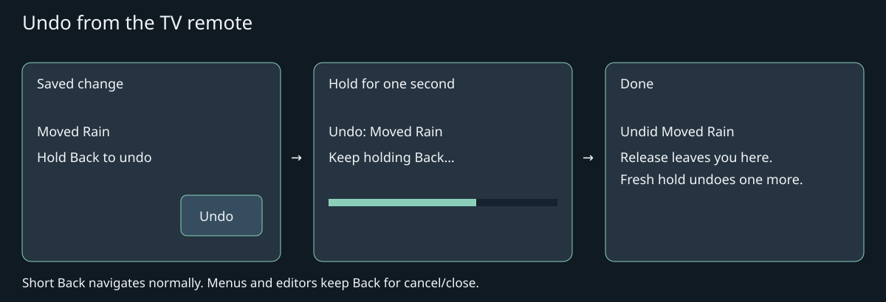
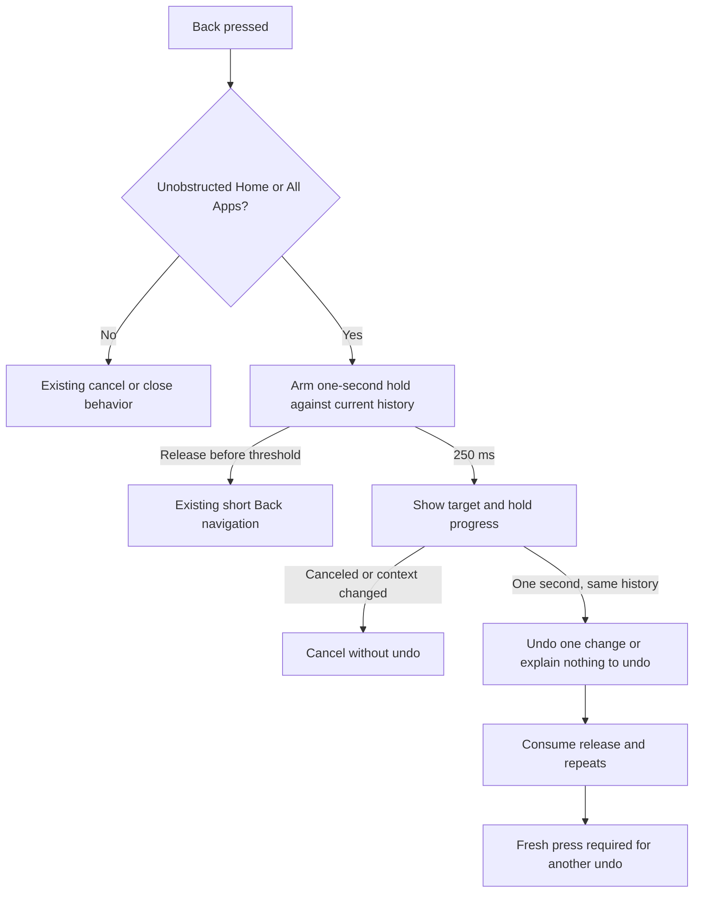

# Hold Back to undo on TV

Status: implemented in 0.1.55; Cast1 native and coordinator-delivered Back-hold checks passed. Cast2 installation is queued pending connection. See the [testing record](../testing/2026-11-18-hold-back-undo-and-widget-opacity.md).

Will proposed holding Back after the existing Undo banner proved unclear, and asked for this plan and implementation.

On Home and All Apps, hold **Back for one second** to undo exactly one saved
Homeboard change. A short press keeps its existing navigation behavior. Holding
longer or receiving key repeats must not undo more changes. Release after undo
must not navigate Back as well; another undo requires a fresh press.

Every saved change displays its name and **Hold Back to undo**. After 250 ms of a
hold, show its target and progress toward one second. Completion shows **Undid
[change]**. When nothing is saved, show a clear no-changes message and consume the
long press. A completed Undo shows confirmation, without an inactive Undo button.
Keep the clickable Undo button as an alternative, with a visible focus state.
The ordinary banner stays 20 seconds and pauses dismissal while its button is
focused. Down can reach that button from the end of Home, All Apps, or an empty
surface; Up/Back return to content. Undo history remains in Homeboard Settings.

The shortcut applies only to the unobstructed launcher surfaces, including when
the Undo button has focus. Editors, menus, widget full screen, move/resize,
temporary previews, pairing and Android dialogs retain their existing Back
cancel/close behavior. Leaving the activity, losing window focus, canceled input
or another key cancels a pending hold. Menus show a close-editor hint rather than advertising a shortcut that is inactive
inside the editor. A canceled release remains consumed across recreation.
The pending hold binds to the existing
Undo-history snapshot; it cannot undo a newer change that arrived mid-hold.
Phone Apply/Undo sees the launcher as busy during the gesture. No new Undo storage
format, permanent remote mapping, Android system action or Redo workflow is added.

Use a small pure gesture state machine for monotonic timing, repeats, cancellation,
snapshot invalidation and release consumption. Connect it to the existing atomic
Undo operation and native Handler, banner and lifecycle. Keep English/Thai copy
in parity. Tests cover short Back, one undo per hold, no history, changed history,
focus loss and editor exclusion, plus actual saved state restoration and release
behavior on Cast1. Run checks and deploy one newly numbered frozen APK to both TVs
through the coordinator; keep Cast2 installation and deferred foreground checks
separate.
