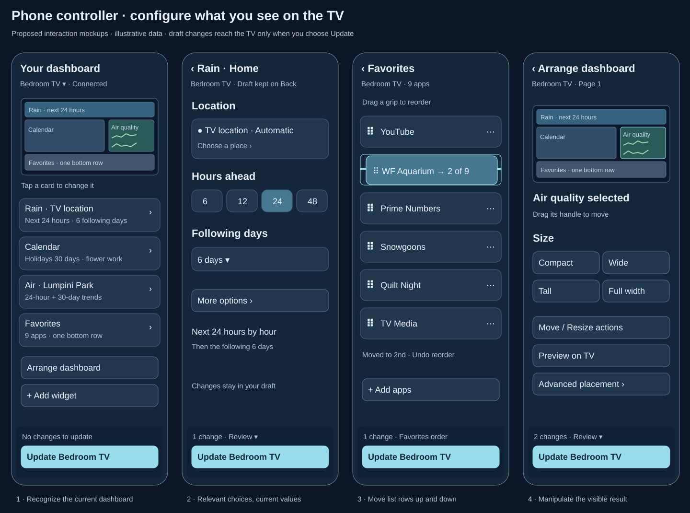
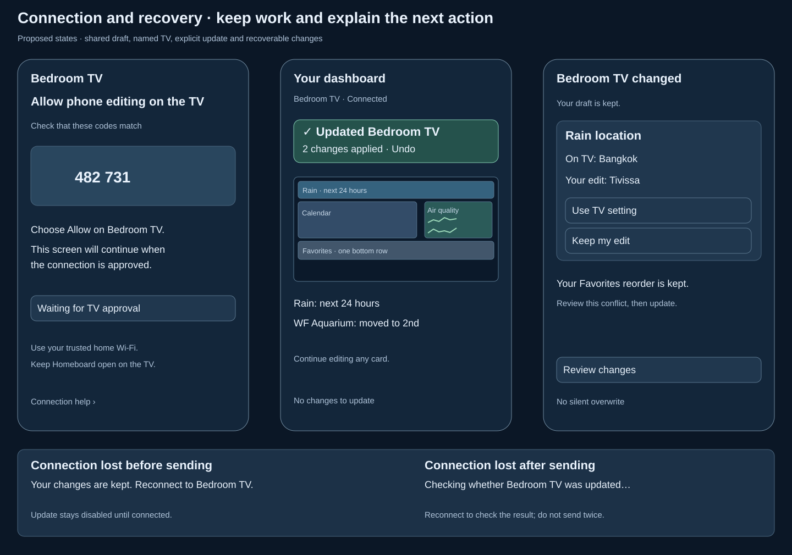
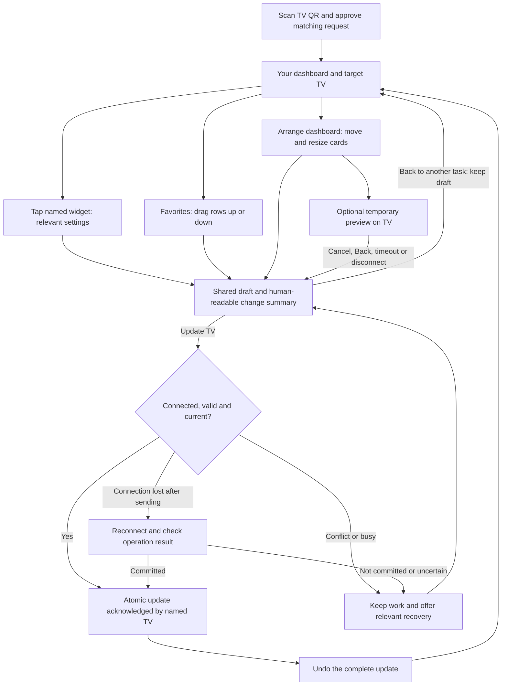

# Phone controller: Alan Cooper goal-directed design review

Status: approved and implemented; combined validation and deployment are in progress. This revises the interaction design in the
[phone widget editor plan](2026-11-17-phone-widget-editor.md), retaining its local
pairing, transactional Apply, conflict protection and Undo foundations.

## Design position

Help the person **make the TV show what they want, then get back to watching it**.
The phone controller should present the TV's dashboard and understandable choices,
with implementation details behind Advanced.

Cooper describes personas and scenarios as tools for evaluating whether a design
achieves the user's goals. Goodwin describes translating observed behaviors and
goals into scenarios and an interaction framework. This review applies those
ideas to Homeboard; the concrete screen recommendations below are our design
judgments, not quotations or a claim of a completed ethnographic study.
[Alan Cooper interview](https://uxpod.com/episodes/personas-and-outrageous-software-an-interview-with-alan-cooper.html),
[Kim Goodwin interview](https://articles.centercentre.com/goal_directed_design/).

Use the same goal-directed filter already applied to
[Homeboard's TV menus](2026-11-15-menu-redesign.md), adapted to touch and a nearby
phone. The TV's no-scrolling menu rule does not require squeezing phone forms into
one screen; use ordinary vertical phone scrolling with concise sections.

## Working behavior model and evidence

Primary working profile: a household dashboard owner, represented by Will's
observed requests, adjusting Homeboard from the sofa with a phone and looking at
the TV for the result. This is a provisional behavior model, not a researched
persona representing every future customer. Do not invent demographic details.

Observed goals from this conversation:

- See rain by hour for the next 24 hours and the following six days.
- Keep air quality compact while retaining its 24-hour and 30-day sparklines.
- Keep Favorites in one full-width bottom row, with overflow inside the widget.
- Keep all four default widgets together and retain access to All Apps.
- Configure widgets from the phone, with **direct manipulation to move list
  elements up and down**.

Design assumptions to validate: short, occasional changes are more common than
rebuilding the whole dashboard; recognizing a card is easier than choosing an
internal widget identifier; seeing the target TV and effect reduces uncertainty.
A technically experienced owner still benefits from a clear primary path.

## Audit of the installed editor

Review basis: current `editor.js`, `editor.css`, the phone how-to and saved browser
captures. The installed implementation has useful transactional foundations, but
its presentation reflects its configuration schema.

| Current behavior | Goal-directed decision |
|---|---|
| Four Add buttons precede existing widgets. | Start with the current dashboard; place **Add widget** after existing content. |
| A selector exposes `rain · widget:rain` and similar identifiers. | Show **Rain · Device location** or a user label with current range; tap the card or named row. Keep internal IDs out of ordinary screens. |
| Every widget form begins with page, column, row, width and height. | Open that widget's useful settings first. Put spatial editing in **Arrange dashboard**, with exact values under Advanced. |
| Widgets, Layout, Favorites and Changes are equal top-level tabs. | One dashboard overview leads to task pages. Review changes inline beside the shared update action. |
| Favorites has a search/checkbox list plus repeated Move up/down buttons. | Use a directly reorderable selected-app list; add apps in a separate picker and retain accessible move actions. |
| Place search asks the person to choose city versus address lookup first. | One **Find a place** search; show named results and coordinates as confirmation, with the lookup distinction only when it resolves an actual failure. |
| Raw provider values or setting keys can appear in review. | Summarize outcomes: **Rain: next 24 hours**, **Air quality: Bang Na station**, **YouTube moved to 2nd**. |
| Saved state, connection state, Apply result and countdown compete for attention. | Keep target TV, connection and pending changes distinct; show a countdown only near expiry. |
| “Reload saved settings” also retains a draft, while “Discard” terminology appears elsewhere. | Use explicit **Discard my changes** for discarding and **Refresh from TV** for reading latest settings. Explain retained work in recovery screens. |
| Multiple always-available session/preview actions compete with Apply. | One persistent primary **Update TV**. Put TV preview beside the arrangement, and session controls in the target-TV menu. |

## Recommended screens

Mockups use illustrative data and describe the implemented interaction framework;
they are not device screenshots. The small dashboard is a geometry preview, not a live
video feed or a guarantee of exact native text rendering.

### 1. Your dashboard

After pairing, open **Bedroom TV**, with a compact **Connected** status and a small
TV-shaped overview. Each card has a recognizable icon, plain name and useful
summary. Include matching tappable rows below the diagram when a scaled card is
smaller than a comfortable target; overlapping invisible targets are not acceptable.

Example rows:

- **Rain · Device location** — Next 24 hours · 6 following days.
- **Calendar** — Holidays 30 days · Flower work this week + next.
- **Air quality · Lumpini Park** — Station reading · 24-hour + 30-day trends.
- **Favorites** — 9 apps · One bottom row.

Tap a card or row to edit that instance. Offer **Arrange dashboard** and then
**Add widget** below the current content. A second Rain card gets a distinguishing
user label/location; rename is available without exposing a storage key.

The TV name remains visible while editing. Changing TV requires pairing with the
other TV; a draft is never silently retargeted. A target menu offers **Connect
another TV**, connection help and **Done editing**. The application does not claim
to discover every TV automatically.

### 2. Rain, Calendar and Air: useful choices first

Each task page has Back, widget name, current summary and relevant controls.
Back returns to the overview, keeping the draft and scroll position.

| Task | Primary controls | Secondary controls |
|---|---|---|
| Adjust Rain | Location; **Next 24 hours** with 6/12/24/48-hour choices; **Following 6 days** with supported day choices. | Units, animation, label and fixed coordinates under More options. |
| Adjust Calendar | Enabled calendars and holiday lookahead; flower/Buddhist week ranges where relevant. | Time zone, names and jurisdiction details, grouped under the appropriate source. |
| Adjust Air quality | Plain-language source choice and selected station/place; preserve the two dashboard sparklines. | Source explanation, exact coordinates and existing supported options. |

Use current values as defaults, not placeholder examples. **TV location** always
means the TV's permitted location. **Choose a place** offers one city/address input,
named results and a confirmation of the selected place. Support the existing
provider/geocoder limitations with useful fallback copy: **Address search is
unavailable on this TV. Try a city or enter coordinates.** No phone geolocation
button is promised by this local HTTP design.

Source distinctions remain visible when they affect interpretation: station
measurements and model estimates are not interchangeable. Prefer **Nearby model
estimate** and **AirBKK station**, with concise explanatory detail. Do not invent
controls for unsupported histories or source options.

### 3. Favorites: move rows directly up and down

**Direct manipulation is the primary way to reorder an ordered list.** This is
Will's explicit addition to the plan, not an optional future enhancement.

- Show the current selected apps in their TV order, with app icon, readable name
  and a visible drag grip. Include one concise **Drag to reorder** instruction.
- Press and drag the grip to lift a row; show a clear insertion marker and space
  where it will land. Neighbors shift as the insertion point moves. Releasing
  drops it into the draft order. A simple tap opens app choices/details and does
  not reorder. Movement must pass a small threshold before a drag starts.
- Allow long lists to scroll vertically with normal touch scrolling. During a
  deliberate drag, scroll near the top/bottom edge with bounded speed. Keep the
  dragged item and destination visible. A canceled pointer/gesture returns to
  the pre-drag order.
- Keep identity attached to the app, not its old list index. Selection, labels,
  event handlers and any open row actions must still refer to the same app after
  reordering. Preserve saved unavailable entries until explicitly removed.
- After dropping, announce **YouTube moved to 2 of 9** for assistive technology
  and show a small **Undo reorder** action for that draft edit. Do not create TV
  Undo entries for every pointer movement.
- Retain **Move up**, **Move down**, and **Move to beginning/end** in a row's
  accessible action menu. Keyboard and screen-reader users must achieve the same
  order without dragging. Keep boundary actions disabled with clear names.
- **Add apps** opens a searchable picker with selected state and an **Add selected
  apps** action. Returning preserves list position. Removing an app edits Favorites;
  it never uninstalls the app. App Info/package identifiers are unnecessary in
  the ordinary ordering list unless two names would otherwise be ambiguous.
- All reordering remains a draft until **Update TV**. One update can include
  Favorites ordering together with Rain, Calendar, Air or layout changes.

Use this row-reordering interaction for any other **explicitly ordered list**
introduced into the controller. The dashboard overview's list reflects spatial
placement; arrange actual cards in the spatial editor below. Do not create an
“order” control whose only effect is rearranging the editor while the TV stays
unchanged.

### 4. Arrange dashboard: manipulate the result

Show the TV's landscape composition with named widget rectangles. Drag a handle
to move a card; tap to select it and expose meaningful size choices such as
**Compact**, **Wide**, **Tall** and **Full width**, when supported by that widget.
Show the resulting rectangle immediately. Provide explicit accessible Move and
Resize controls as an alternative to gestures.

Snap to valid positions and show occupied cells while moving. A blocked destination
must be visibly blocked before release. Canceling a drag restores the prior draft
placement. Do not silently push another widget onto a second page. When resizing
requires more room, show the consequence and an intentional placement choice.

Use **Page 1**, **Page 2**, and so on. Exact grid, row, column and cell-span controls
remain under **Advanced placement**, with one-based user labels and a deliberate
conversion to the existing zero-based API. The primary flow does not require grid
arithmetic. Advanced values still use native minimum sizes and validation.

Keep **Use recommended layout** as a secondary action with a clear effect summary:
Rain across the top, Calendar beside Air quality with both sparklines, Favorites
across the bottom, all on one screen. It edits the draft; Update TV applies it.
Additional instances remain available for intentional placement and are never
silently deleted. **Preview on TV** belongs here, clearly temporary and cancelable.

## State, update and recovery

### One draft, one meaningful update

A single draft spans all task pages. Keep one primary **Update TV** action, named
for the current TV where space permits, and a nearby **3 changes** summary. Count
meaningful changes, not pointer movements or JSON fields. Expand an inline list
of outcomes; do not force a separate Changes tab or confirmation wizard for an
ordinary edit. One Apply remains one atomic transaction and one TV Undo entry.

Do not use **Save Rain** while silently committing pending Favorites changes too.
When several parts changed, the action and review must make the full scope clear.
The update action is disabled when nothing changed, a field is invalid or the
connection is unavailable; show the reason beside the relevant control.

Show a brief **Updating Bedroom TV…**, then **Updated Bedroom TV · Undo** only on
acknowledgement. The same visible wording is used across widget and layout tasks.
A successful Undo restores the entire update, with revision protection against
later TV edits. Keep an in-progress update unambiguous when navigating within
its task; prevent double submission.

**Discard my changes** intentionally returns the draft to the last acknowledged
TV state. Preserve explicit recovery copies separately from the active draft so
Restore cannot unexpectedly overwrite new work. Back within the editor preserves
the draft without confirmation. **Done editing** ends access; if work is unsaved,
explain **Draft kept in this tab** and provide an explicit Discard option rather
than silently dropping it or pretending it was applied.

### Exceptions should explain the next useful action

| Situation | Phone behavior |
|---|---|
| Awaiting approval | **Allow phone editing on Bedroom TV. Check code 482 731.** Keep the matching request visible on the TV. |
| TV busy in a menu, Move/Resize or expanded widget | **Finish the current action on Bedroom TV, then Update TV. Your changes are kept.** Preview and update cannot dismiss that workflow. |
| Another TV/phone edit changed settings | **Bedroom TV changed while you were editing.** Show relevant differences in plain language. Keep the local draft and latest TV snapshot. |
| Changes do not overlap | Rebase only the person's edited values onto the latest snapshot, present the updated summary, and require the ordinary explicit Update TV. No automatic write. |
| The same setting changed in both places | Offer **Use TV setting** or **Keep my edit** for that conflict. If a card was removed/recreated or identity is uncertain, require an explicit add/remove choice; do not resurrect it silently. |
| Connection lost before Update | **Disconnected. Your changes are kept. Reconnect to Bedroom TV.** Editing the draft may continue, with update disabled. |
| Connection lost after Update was sent | **Checking whether Bedroom TV was updated…** Reconcile the operation ID after reconnecting; never report success or failure from a timeout alone. |
| Session expires or the TV leaves Homeboard | Keep the draft and show the specific reconnection instruction; no raw revision, token or transport error in the main message. |
| Place lookup fails | Keep the query and current place; offer Retry, city search or exact coordinates as applicable. |

Show connection detail and trusted-home-network information on the pairing/help
screen. Technical diagnostics may be expandable; HTTP jargon, request IDs and
revision numbers are not the main recovery instructions. The underlying local
HTTP security boundary and temporary TV approval do not change with this redesign.

## Technical changes needed after approval

1. Replace the tab/form-first shell with overview and task routes. Preserve task,
   selected instance, scroll position and one draft across phone Back/Forward.
2. Use display names and summaries in UI; retain stable IDs only internally.
   Bind drafts and pending operation IDs to an authenticated stable TV identifier,
   separate from its changeable friendly name. Never persist pairing credentials.
3. Implement one reusable ordered-list drag controller with touch/pointer cancel,
   edge scrolling, stable keys, keyboard/screen-reader actions and local draft Undo.
4. Implement spatial placement feedback, safe snapping and accessible movement;
   keep exact placement in Advanced. Validate native minimum dimensions before
   presenting a drop/resize as accepted.
5. Add readable semantic diffs, local validation and a unified action/status model.
   Compute drag/typing dirty state without destroying focus or rebuilding the whole
   form on every edit. Move UI copy into a complete English/Thai catalog.
6. Add explicit connection/update/reconciliation states. Preserve the original
   base snapshot for three-way comparison; carry the latest revision into the
   eventual atomic update. Treat ambiguous instance identities conservatively.
7. Reuse existing server authentication, typed configuration validation, revision
   checks, durable operation receipts and composite Undo. Change the API only where
   stable TV identity or clearer error categories are needed. No speculative legacy
   protocol layer is required for this development-stage editor.

This is a configuration-controller redesign. Widget full-screen content and
Back/Restore dashboard behavior on the TV remain governed by the
[full-screen widget contract](2026-11-17-widget-full-screen.md). Phone arrangement
must not alter a widget's saved size simply because someone inspected its detail.

## Acceptance: run the scenarios, not a feature inventory

| Scenario | Observable result |
|---|---|
| Change rain outlook | From the overview, open Rain, choose 24 hours and six following days, Update TV. No internal ID or placement arithmetic is needed; native TV shows all 24 hours. |
| Change one of two Rain cards | Distinguishing label/location makes the correct instance obvious; only that card changes. |
| Reorder Favorites | Drag the last app to second place, with edge scrolling if required, then Update TV. The actual bottom row follows that order; all nine existing favorites survive. |
| Accessible reorder | Achieve the same order using keyboard and screen-reader row actions. Announce the new position and retain the same selected app. |
| Cancel a drag | Pointer cancel, interruption or dropping outside a valid region restores the pre-drag draft order/geometry and does not touch the TV. |
| Make a card smaller | Use Arrange and a named size. Preview communicates the result and blocked positions. Air retains both sparklines in the recommended default. |
| Edit several widgets | Rain and Favorites changes appear in one readable summary and one atomic update. Undo restores both together. |
| Native remote edit meanwhile | Untouched values come from the latest TV state; actual conflicts are named and resolved explicitly. No silent overwrite or blind resurrection. |
| Lose the connection after Update | Keep the operation ID and show a truthful checking state; reconcile once without duplicate updates or Undo entries. |
| Leave and return | Task navigation keeps the draft, selection and scroll; session reconnection remains required when access expires. |
| Empty Home / full-screen widget | Empty Home still reaches All Apps. Expanded widget/Move/menu workflows cannot be overwritten by phone Update or Preview. |

Normal-path targets: after connection, changing Rain's hour range needs only
opening Rain, choosing the range and Update TV; reordering one favorite needs
opening Favorites, one drag and Update TV. These are design targets to observe,
not claims that current timed usability measurements exist.

Use at least 44×44 CSS-pixel touch targets, visible labels, sufficient contrast,
reduced-motion support and 200% text checks without horizontal overflow. Drag
feedback may animate briefly but must work with animation disabled. Verify safe
area/keyboard clearance around the primary action and that it never hides the
focused field. Do not rely on long press or dragging as the only way to act.

Run browser and repository checks in containers. Verify native integration on
Cast1 through the coordinator, and **a real separate phone on the home LAN** for
pairing and the actual update. Existing native HTTP and emulated-browser passes
do not close the external-phone acceptance gap recorded for 0.1.40. Include an
Android phone; verify iPhone Safari when an appropriate device is available and
label it untested otherwise. Record screenshots of overview, widget task, reorder,
layout, acknowledged update and recovery states.

After implementation, deploy one newly numbered frozen APK to both Cast1 and
Cast2 with `task deploy`, preserving data/settings and Personal use. Separate
installed-hash proof from foreground/device acceptance. Update the phone how-to,
original editor plan and validation record to describe the final interaction.
