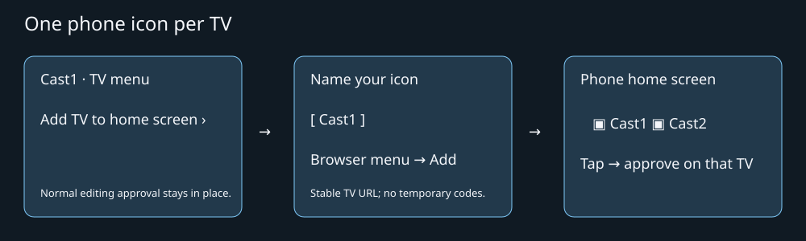

# A phone home-screen icon for each TV

Status: implemented and installed in 0.1.52 on Cast1 and Cast2. Browser and native HTTP checks passed; physical phone home-screen creation remains a browser action.

Offer **Add TV to home screen** in the phone controller's TV menu. Show the TV,
let the user name its icon (for example Cast1 or Cast2), and prepare a stable URL
bound to that TV's installation ID. Keep invitation fragments and session tokens
out of the shortcut. Publish TV-specific page titles, icon metadata and a web
manifest. Use the browser's own Add to Home Screen action; the app cannot silently
place icons on a phone.

The shortcut opens the same TV and still requires its normal approval. A mismatch
in TV identity must stop pairing. Keep the listener foreground-only: if editing
has stopped, first open Configure from phone on that TV, then reopen the icon.
If DHCP changes its IP address, scan the current QR code and recreate the icon.
Do not imply background discovery, an always-running service, permanent editing
access, or offline editing.

Android Chrome: menu → Install and create shortcut → Create shortcut → Add.
iPhone Safari: Share → Add to Home Screen → Add.

Validate independent TV names/URLs, absence of invitation/token in saved URLs,
identity mismatch rejection, escaping of labels, reconnect after a new session,
and browser interaction in Chromium and WebKit. Physical home-screen creation
requires the browser's own UI and is a separate acceptance check.
