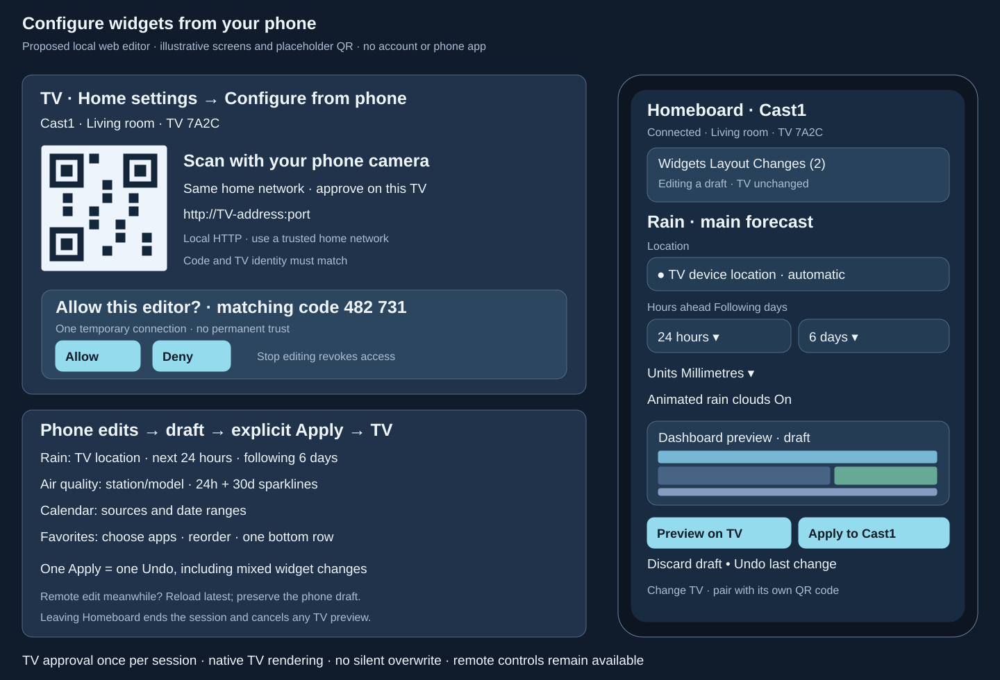
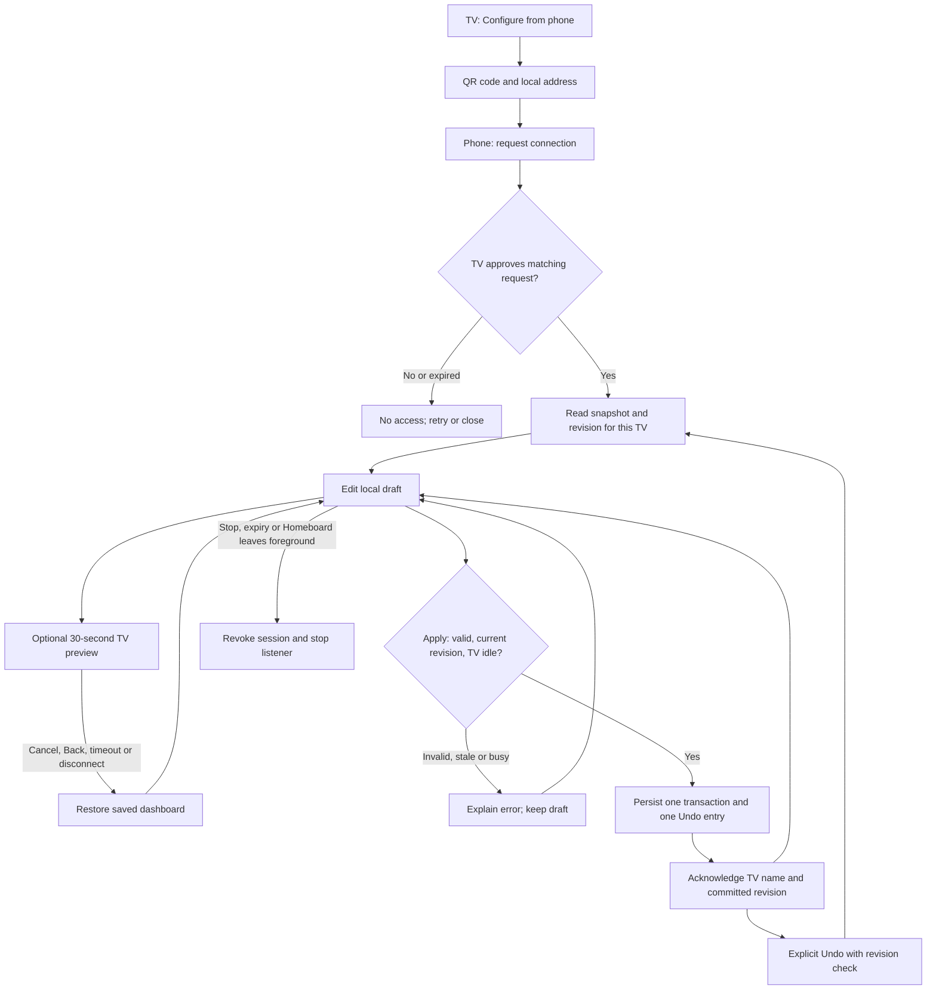

# Configure Homeboard widgets from a phone

The implemented interaction design is now the
[dashboard-first controller redesign](2026-11-17-phone-editor-goal-directed-design.md),
deployed as 0.1.47. It replaces the original tab/selector presentation while
retaining this plan’s temporary pairing, strict validation and transactional
Apply/Undo foundation. See the [current validation record](../testing/2026-11-17-phone-controller-design.md).

Status: implemented and deployed as **0.1.40** to both TVs. Android HTTP pairing,
mixed Apply/Undo and TV preview passed on Cast1; Chromium/WebKit UI checks passed.
External physical-phone LAN acceptance is still unverified. See the
[validation record](../testing/2026-11-17-phone-widget-editor.md) and
[phone editor how-to](../how-to/phone-widget-editor.md).

## Recommendation

Host a small phone-friendly web editor **inside Homeboard on the TV**. Open
**Home settings → Configure from phone**, scan its QR code, approve the connection
on the TV, then edit widgets in the phone's browser. The phone and TV must have
local network connectivity. No phone app, account, cloud relay or separate server
is required. Existing TV controls remain available.

This selects the local web editor from the discussed options. A companion app,
hosted remote editor and configuration-file transfer are not prerequisites.

The mockup uses example names and a placeholder QR illustration. It is not a live
pairing link. A phone preview is a schematic of saved widget geometry and draft
changes; the native TV renderer remains the authority for exact appearance.

## First version: what can be edited

| Area | Phone controls |
|---|---|
| Dashboard | Add/remove widget instances, rename supported labels, select page, move/resize within the logical grid, choose the default preset, and review the resulting arrangement. Offer drag handles **and** explicit position/size controls. |
| Rain | Automatic **TV device location** or fixed city/address/coordinates, display label, next-hour range, following-day count, units and cloud animation. Show selected place and coordinates before Apply. |
| Calendar | Existing source/jurisdiction toggles, shared holiday lookahead and independent flower/Buddhist week ranges. Keep the same valid options as the TV. |
| Air quality | Existing automatic/fixed location and source/station choices per instance. Preserve current source/basis labels and the dashboard's 24-hour/30-day sparklines. Expose only settings already supported by the TV controller. |
| Favorites | Choose from the TV's available app catalog, search by readable name, reorder with drag or Move up/down, and choose existing compact artwork settings. Removing a favorite does not uninstall its app. |
| Changes | Local draft, schematic preview, optional temporary Preview on TV, explicit Apply, Discard and normal Undo. |

Operate on the selected widget **instance**, not just its type. Editing one Rain
or Air card must not change another. Available-app selection comes from the TV;
the phone's installed apps are irrelevant. Preserve unavailable saved favorites
as visibly unavailable entries until the user explicitly removes them.

Do not duplicate every Home/device setting into this first editor. Wallpaper
provider management, Android permissions, app launch/uninstall, remote key
injection and system settings are outside this widget-configuration scope.

**Location meaning:** Automatic still means the TV's permitted location, not the
phone's. Entering a fixed address uses the existing lookup path on the TV. Do not
promise a browser “Use my phone location” button on the local HTTP editor:
browser geolocation requires a secure context. A phone-location handoff would be
a separate, explicit feature with its own transport/permission design.
[Browser geolocation requirements](https://developer.mozilla.org/en-US/docs/Web/API/Geolocation/getCurrentPosition).

## Pairing and connection lifetime

1. On the TV, choose **Configure from phone**. Show the TV's friendly name,
   short unique identifier, QR code, readable local URL, **Stop editing** and a
   brief “Same home network” hint. Restore the prior dashboard page/focus when
   dismissing the pairing overlay; keep the editing session active until stopped
   or expired. Show a small **Phone editor connected** status while active.
2. Scan the QR. The phone initially shows the TV name and **Waiting for TV
   approval**. The TV presents **Allow this editor?**, a matching connection code,
   and Allow/Deny. Approve this connection once, not every Apply.
3. A manual URL entry path shows the same matching-code approval on the TV.
   Merely knowing the address never grants configuration access. Pending requests
   expire after two minutes and are rate-limited.
4. The approved phone gets a temporary session for that TV. Default expiry is
   **15 minutes without activity**, with visible remaining time near expiry.
   Stop editing immediately revokes access. Pairing does not grant permanent
   trust or an indefinitely running network service.
5. Homeboard must remain in the foreground for this first version. Opening another
   app, sleeping, losing the network, stopping the editor or process death ends
   the session and cancels any TV preview. The phone keeps its unsaved draft but
   disables Apply until reconnection and a fresh conflict check. It cannot wake
   the TV or bring Homeboard to the front.

Use the Activity lifecycle to bound the listener, callbacks and preview cleanup;
do not add an always-on background service just for settings.
[Android Activity lifecycle](https://developer.android.com/guide/components/activities/activity-lifecycle).

For Cast1 and Cast2, keep a clear TV name/identifier in the editor header and every
Apply result. A **Change TV** action requires pairing with the other TV's QR/URL;
it never silently retargets an open draft. First version does not promise browser
LAN discovery or a cross-origin list of every TV. Copying settings between TVs can
follow later with explicit handling of app identities and instance differences.

## Edit, preview, apply and Undo

The TV returns a typed configuration snapshot, current revision, supported control
options and app catalog. Edits change a phone-side draft; ordinary typing does
not repeatedly update the TV or create Undo entries. Validate fields on the phone
for useful feedback and validate the complete change again on the TV.

**Preview on phone** is local and free of side effects. **Preview on TV** is a
separate explicit action: render the draft geometry temporarily with a visible Preview /
Back cancels banner, a 30-second timeout and the current native layout. It writes
no settings and adds no Undo entry. Phone Cancel, TV Back, timeout, lost connection
or leaving Homeboard restores the exact original view. Rate-limit previews;
location/provider requests are bounded. Rain/Air preview tiles show proposed
configuration rather than fetching draft-location data; actual forecasts refresh
on Apply. This keeps preview entirely out of saved-location data caches.

**Apply** submits the draft, its base revision and a unique operation ID. A valid
change commits all affected widget configuration as one transaction and **one
Undo entry**, then returns the committed revision and refreshed snapshot. Preserve
favorite order, extra widget instances and unrelated household preferences.
Reject invalid geometry/overlaps with field-level errors rather than placing a
widget on an unexpected extra page. Choosing Default dashboard remains an
explicit preset that can change the grid; summarize that change before Apply.

Show **Applied to Cast1** only after the TV acknowledges the persisted result.
If the connection drops after submission, show **Checking whether Apply finished**
and reconcile by operation ID after reconnecting; do not blindly create a second
transaction or falsely label it failed. Unchanged Apply creates no Undo entry.

Both the TV and phone expose Undo through the existing global history. The phone
shows the action it will undo, such as **Undo phone changes to Rain and Favorites**.
Require the expected current revision before Undo so a later remote edit cannot
be undone accidentally by a stale phone screen. Restore every component of a
multi-widget change, including Air's separately stored settings and grid choice.

If TV controls or another editor change settings meanwhile, show **Settings changed
on the TV**. Offer Reload latest or retain the local draft for review; never silently
overwrite. V1 uses one active editing phone per TV. A second connection can replace
it only after explicit TV approval, revoking the previous session.

When the TV is in a menu, move/resize, an uncommitted preview or expanded widget,
the editor may read/edit its local draft but Apply/Preview returns **Finish the
current TV action first**. Do not dismiss a TV workflow or invalidate an expanded
view's original page/focus/size restoration. Applying on ordinary Home preserves
page and focus where the target survives; if deleted, focus a predictable neighbor.
All Apps navigation and intentionally empty Home must continue to work.

## Local transport and implementation boundary

Bundle small responsive HTML/CSS/JavaScript assets in the APK; no CDN, hosted
editor or runtime web framework is needed. Keep native Java rendering and widget
controllers. A bounded embedded HTTP server serves those assets and a narrow
configuration API from one local interface/port while explicitly enabled. Prefer
a maintained small server library after a dependency/license review over building
a general-purpose HTTP parser. The implementation pins NanoHTTPD core 2.3.1 (Modified BSD) with explicit
connection/body/thread limits and same-origin/session enforcement. This is an
established small core rather than a claim of frequent upstream releases.

Use a QR URL containing a high-entropy one-use invitation in its **fragment**,
not a reusable credential in a query string. Remove the fragment after exchange.
After TV approval, use a separate short-lived session token held in the browser
tab. Do not persist it as permanent browser trust, put it into logs or include it
in exported settings. Only minimal pairing status is public before authentication;
widget configuration, coordinates and the app catalog require approval.

Serve UI and API from the same origin, check Host/Origin and session on every
mutation, reject cross-origin requests and never enable wildcard CORS. Use JSON
mutation requests with an authenticated header, bounded bodies, allowlisted fields,
request timeouts and a small worker pool. Escape user/app labels as text. Expose
neither arbitrary preference access nor filesystem/shell/device-control endpoints.

**V1 transport choice:** local HTTP on a trusted home network, with temporary TV
approval. It is not encrypted against other devices on that network. Show a short
trusted-network notice in the pairing UI; do not claim pairing provides transport
encryption. Do not add certificate-warning installation steps or public-network
exposure to this initial flow. Encrypted remote access is a different design.

QR/address access is the primary path; optional mDNS discovery is later. Update
the displayed address after network changes and revoke the old session. Diagnose
unreachable TV, guest-network isolation, denied browser local-network access and
expired sessions separately from invalid widget settings. Check Android LAN
permission requirements for the app's target SDK: Android documents incoming TCP
connections as affected, with enforcement for apps targeting API 37 or higher.
Do not request future permissions unconditionally on today's target.
[Android local-network permissions](https://developer.android.com/privacy-and-security/local-network-permission).

### Configuration model and transactional persistence

`HomeLayout` currently serializes Rain, Calendar, favorites, spans and positions;
`MainActivity.save()` and `undoThrough()` own layout Undo. Air configuration has
separate controller snapshots/preferences and a separate Undo kind. A phone
transaction cannot safely be implemented as several unrelated calls to `save()`.

Introduce a small shared configuration repository/command layer used by **both
TV and phone**. It produces an aggregate snapshot with per-instance Air settings,
validates supported typed changes, serializes commits on the main/UI owner and
increments a durable revision for every relevant TV/phone mutation and Undo.
Exclude fetched forecasts/history, credentials, navigation-only state and transient
Android permission grants from editable snapshots.

Use an aggregate before/after transaction and composite Undo. If existing separate
stores remain, add a durable commit journal and crash recovery so restart cannot
leave half of a phone change applied. Do not expose a success response before
durable persistence. Preserve current saved settings in any necessary storage
conversion; no speculative compatibility API is needed for an unreleased editor.
Keep a bounded persisted operation-result ledger for retry reconciliation without
retaining pairing credentials.

Suggested boundaries: `PhoneEditorSession`, embedded-server adapter,
`WidgetConfigurationRepository`, typed validator/transaction and bundled web UI.
Use simple requests plus bounded status polling for v1; WebSockets and a bridge
are unnecessary. Blocking network work stays off the UI thread; applying native
state and rendering returns to the UI thread. Cancel pending lookups on session end.

## Implementation sequence after approval

1. Add the aggregate snapshot, revision checking, transactional persistence and
   composite Undo; route existing TV mutations through that shared path.
2. Implement explicit TV enable/pair/deny/stop UI and bounded listener lifecycle,
   with QR/address fallback, session expiry and no-access-before-approval behavior.
3. Build phone forms for every existing widget instance, favorites selection/order
   and layout controls, with accessible touch targets, visible TV identity,
   English/Thai strings and draft/apply/error state.
4. Add schematic phone preview, native timed TV preview, conflict handling and
   operation-result reconciliation. Preserve expanded-widget restoration.
5. Run container checks; deploy a newly numbered identical frozen APK to both TVs
   through `task deploy`. One deployment owner coordinates any parallel work.
6. Use coordinator-owned Cast1 and phone-browser acceptance sessions; submit
   background installs to both TVs even during Personal use and let the coordinator
   defer foreground work. Never change a default Home app or use raw ADB to test.

## Acceptance and evidence

- QR and manual-address pairing work on a real phone; denial, expired invitations,
  replacement phone, Stop editing and network changes revoke the correct sessions.
  Verify Android Chrome and iPhone Safari where devices are available; record
  untested browsers rather than implying support from desktop screenshots alone.
- All four widget types can be configured and their actual TV result captured.
  Test multiple Rain/Air instances, TV automatic-location semantics, fixed address
  lookup failures, Calendar ranges, favorite overflow/order and compact artwork.
- Default-preset layout remains one screen: all 24 hourly intervals, both Air
  sparklines and one full-width Favorites row. Phone resizing does not alter the
  meaning of short OK/full-screen content or Back/Restore dashboard.
- One Apply creates one complete Undo entry; mixed Rain/Air/layout changes restore
  together. Test persistence failure and process death between separate-store
  writes, duplicate Apply, lost acknowledgement and restart reconciliation.
- A remote TV edit after the phone snapshot causes a conflict; reload is safe.
  Busy menus/move/full-screen views cannot be overwritten. Empty Home still reaches
  All Apps; focus and browsing position survive Apply and preview cancellation.
- Timed TV preview reverts on timeout, Back, disconnect, app exit and process restart
  without saved changes, Undo spam or contamination of saved-location data caches.
- Unauthenticated, expired, wrong-origin/Host and malformed requests cannot read
  private settings or mutate state. Test escaped labels, request limits and listener
  teardown. Core editor assets load with the internet unavailable; provider lookup
  failures remain ordinary field errors.
- Capture TV pairing/approval, phone forms/review, actual updated dashboard, Undo,
  conflict and disconnected states. Record source revision, frozen APK hash,
  coordinator jobs, installed-hash proof and foreground acceptance separately.

Approval covers this local, temporary-session editor design. No phone application,
cloud service, always-on listener or remote administration is being introduced by
the plan itself.
