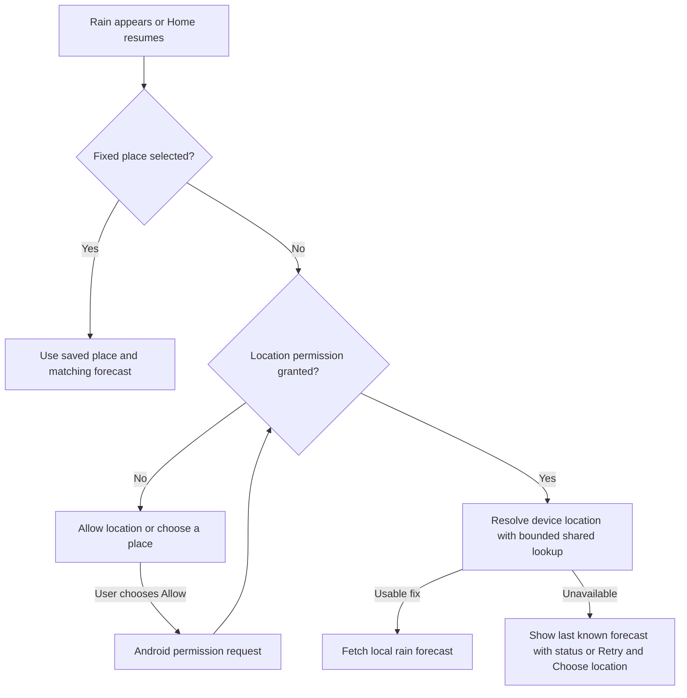

# Rain: use the granted device location by default

Status: implemented and container-verified; 0.1.26 installed on Cast1. Cast2 installation is blocked by coordinator ownership parsing; see the [validation record](../testing/2026-11-17-rain-device-location.md).

## Intended behavior

An unconfigured Rain widget should automatically use the TV's device location when Homeboard already has location permission. Will has granted that permission, installed Homeboard on Cast2 and run it. Rain should therefore show the local forecast without requiring another location selection or coordinate confirmation.

Use the location supplied by Android's enabled location providers, including the device's Google-backed location service when exposed through those providers. Permission alone does not guarantee a location fix. Do not describe the result as coming from Google unless that is established on the device. Start with the existing native location integration; no Google account, API key or new Play Services dependency is proposed.

Keep the next 24 hours by hour and following six days, units, animation, label and sizing unchanged.

## Current implementation and cause

`RainSettings` stores coordinates but no automatic/fixed source choice. `RainWidgetController.refresh()` returns immediately when coordinates are absent. Device location is available only through Location → Device location, which then requires confirmation and saves a fixed coordinate snapshot.

Rain already shares `MainActivity.requestAirLocation()` with air quality. That helper checks permissions, reads enabled providers through `LocationManager`, accepts a recent last-known fix and otherwise waits up to 15 seconds. Its in-memory cache is returned before checking permission, and simultaneous callers can initiate separate lookups. Automatic Rain use needs a permission-first, shared, bounded lookup rather than simply invoking the menu flow on every refresh.

## Location choice

| Mode | Behavior |
|---|---|
| **Device location — automatic (default)** | Resolve location when Rain becomes visible, use an existing permission grant immediately and refresh the forecast for the resolved coordinates. |
| City / address / coordinates | Save an explicit fixed place; automatic updates never replace it. |

For saved widgets without a source field: absent coordinates means automatic; valid saved coordinates remain a fixed place. This preserves an intentional selection without inventing its origin. A saved display name is not reliable evidence that coordinates originally came from the device. The location menu allows switching any widget back to automatic.

Selecting automatic saves the source choice and starts resolution immediately, without a second coordinate confirmation. Selecting a manual place keeps the existing result confirmation. Source changes participate in layout Undo. Automatically resolved fixes and forecast caches stay outside layout Undo so ordinary refreshes do not create edit history or revert unrelated settings.

## Permission and lifecycle

- Check coarse/fine permission before using even an in-memory device fix. Approximate location is sufficient.
- With permission already granted, resolve automatically without a permission dialog or setup modal.
- Without permission, show a compact “Allow location” state. OK requests permission; city, address and coordinates remain available. Do not prompt repeatedly on Home startup, refresh or denial.
- Resume after an external permission grant should retry automatically. Revocation stops automatic coordinate use and displays the permission state; manually configured places continue working.
- Share one in-flight device lookup across Rain and air-quality callers. Keep lookup timeout at 15 seconds and release listeners on completion, timeout and activity destruction. Ignore callbacks for removed widgets or changed location modes.
- Resolve only while the app/widget is active. Use the existing 15-minute memory-cache and six-hour last-known-fix limits, validating finite, in-range coordinates and nonnegative fix age. Do not continually reset the original fix timestamp.
- Recheck on foreground resume and at most once per 15 minutes while visible. A failed lookup retries no more often than once per minute while active; explicit Retry may start another bounded attempt. No background-location permission or continuous tracking.

## Forecast and failure handling

Persist the last successful automatic fix separately with its source timestamp. A saved fix within six hours can provide the forecast while a fresh lookup is attempted. Beyond that age, an existing forecast may remain visibly marked as the last known location; do not silently request a new forecast for an expired fix. With no usable fix, show “Location unavailable” and Retry / Choose location.

Provider disabled, missing provider, timeout and denied permission are distinct from a weather network failure. Do not substitute Bangkok, an IP-derived city or a default coordinate. Reverse geocoding is optional for a friendly place label and must never block weather retrieval. “Device location” is sufficient; retain any user-defined label.

Normalize automatic coordinates to three decimal places for stable forecast/cache keys, avoiding requests caused by sub-grid location jitter. Discard results from an earlier location generation after switching places. Keep the existing weather refresh interval, network backoff and matching-location forecast cache; never show a different place's forecast under the current label.

The existing weather provider receives the resolved coordinates to return the forecast. Keep that explanation accessible in location settings, and update English and Thai copy together. No location history or additional analytics.

## Workflow



## TV mockups

Recommended 4×3 widget, with no additional setup after an existing permission grant:

```text
┌─────────────────────────────────────┐
│ Rain · Device location              │
│ Finding your location…              │
│                                     │
│  Then: rain timing + hourly chart    │
│  and the following six days          │
└─────────────────────────────────────┘
```

Location menu and unavailable state:

```text
Location                            Rain · Device location
● Device location — automatic       Location unavailable
○ City                              OK: Retry
○ Street address                    Hold OK: Choose location
○ Coordinates
```

At 1×1 show a compact location/loading/unavailable label; OK opens the available action. Larger sizes show the explanation without a modal appearing on Home entry. Preserve remote focus and never add a scrollbar.

## Implementation scope

1. Add automatic/fixed location source serialization and an effective-location model separate from user settings; preserve explicit saved places.
2. Refactor the existing Activity location helper into a permission-aware shared request path with cancellation and bounded retries. Keep the air-quality manual flow working.
3. Connect automatic resolution to Rain startup/resume/refresh and source changes, with generation checks and per-location cache ownership.
4. Update location menu order, loading/permission/error states, small-widget rendering, privacy explanation and English/Thai resources.
5. Update the Rain plan, quick start and validation record with the resulting behavior and verified limits.

## Acceptance and validation

Container tests should cover default automatic mode, saved fixed places, source switching and Undo, coarse-only permission, revoked permission with a cached fix, expired/future timestamps, timeout, deduplicated callers, retry bounds, disposal and late callbacks. Verify that a new location invalidates earlier requests and that cached weather cannot cross places. Run `task check` and `task build`; inspect all affected sizes and language resource parity.

Through coordinator-owned sessions on Cast2, verify the existing-grant path: launch with the unconfigured Rain widget and observe location resolution followed by a populated hourly/day forecast without selecting a location. Check manual override, return to automatic, relaunch persistence and 1×1 / 4×3 / full-screen states. Verify unavailable/denied cases with controlled fixtures rather than changing shared TV security or location settings. Record actual provider/fix availability separately from simulated behavior.

If deployment is requested, use `task deploy` with a new version code, preserving app data/settings and Personal use. Follow the coordinator's admission decisions and export evidence. Do not claim device acceptance from container tests alone.


## Implementation notes

Automatic/fixed source is now explicit. Device fixes live in a separate RainLocation
cache and do not enter layout Undo. The native Activity lookup checks permission
before reading its cache, coalesces callers and releases listeners on pause/destroy.
Rain automatically resolves an existing grant and offers permission or retry on OK.
The bilingual location menu starts with Automatic. Existing fixed places remain
fixed; empty widgets use the new default.

The debug-only RainAutoProbeActivity exercises the real provider and Rain renderer
with isolated settings, including 4×3, 1×1, Fill Home and fixed/automatic transitions.
Its result distinguishes a real provider fix from an unavailable provider; synthetic
coordinates are used only for its explicitly labeled Madrid fixed-place stage.

Will subsequently requested both Cast1 and Cast2 for every working build. The deploy
workflow now freezes once and submits both target installs before following them.
