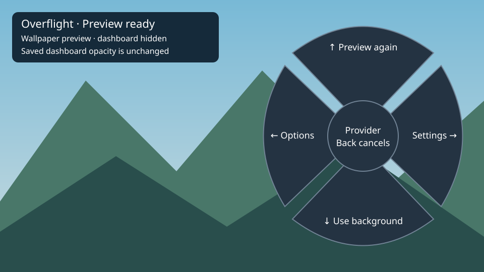
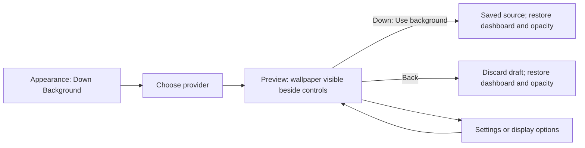

# Visible wallpaper preview

The provider reports a rendered frame while Homeboard's dashboard tint, widgets
and menu scrim still obscure it. Preview must expose the actual wallpaper without
saving an opacity or layout change.

During a provider preview, hide the dashboard and its palette backdrop, remove the
full-screen menu scrim and place the existing directional controls on the right.
Keep the left half available for the media, with a small readable status caption.
Keep wallpaper dimming as configured. Apply and cancel restore the dashboard and
its saved opacity; Back discards the source draft. Provider settings, rotation and
dimming retain their current navigation. No preview flag is persisted.

Appearance directions: Up opens Icons, Right opens Palette, Down opens Background,
Left opens UI opacity. Home and All Apps use the same mapping.

Acceptance: exercise the real menus on Home and All Apps; preview at 100% saved
opacity must show offline media with no dashboard or full-screen scrim. Verify
directional controls fit inside the right half, saved opacity remains 100%, and
Back/apply restore dashboard visibility. Repeat with unmodified Overflight on
Cast1 in HD/SDR; inspect the actual image as well as first-frame readiness.
