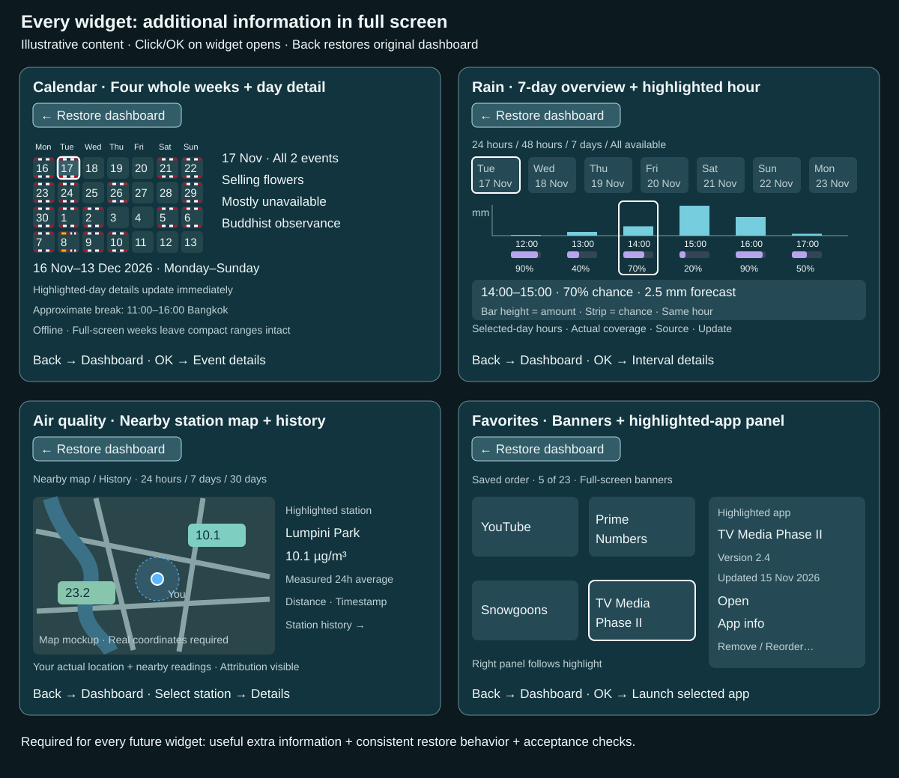
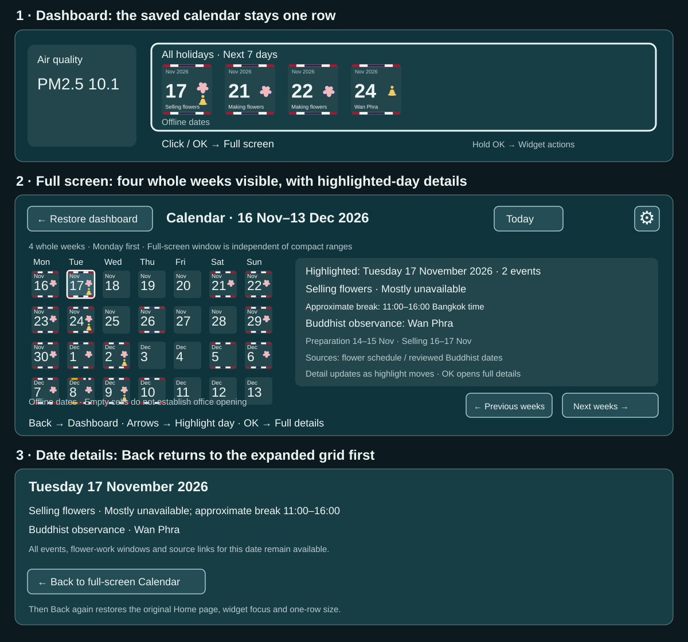
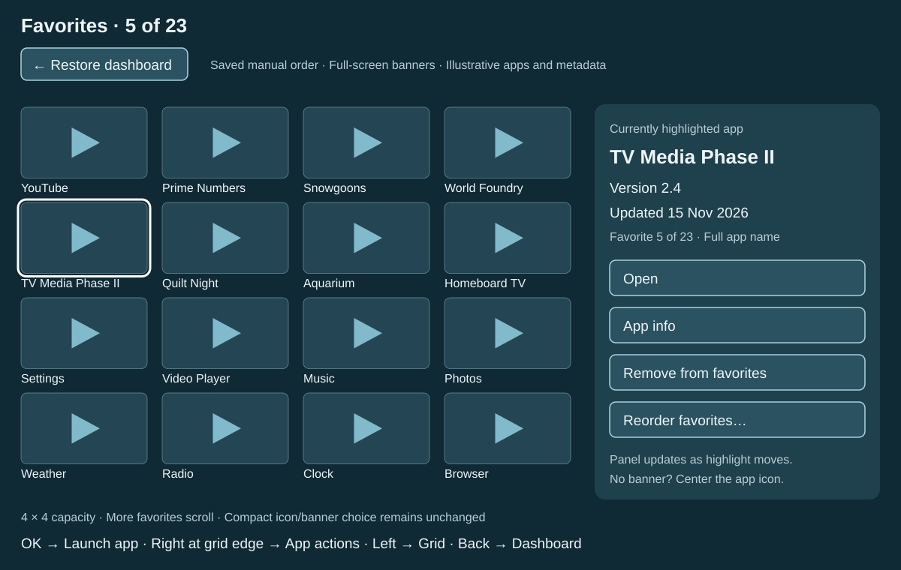
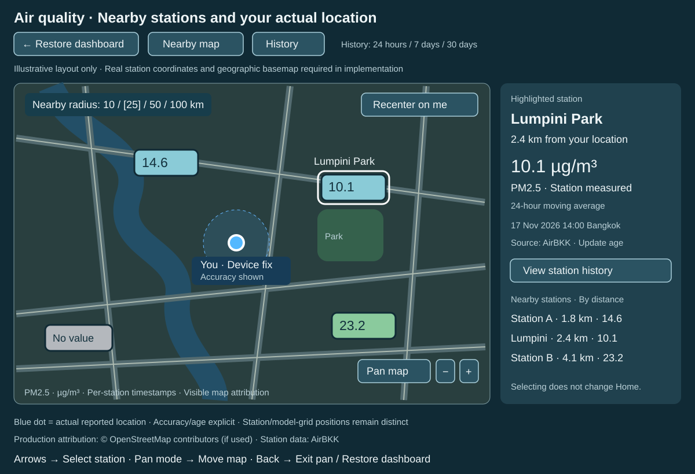
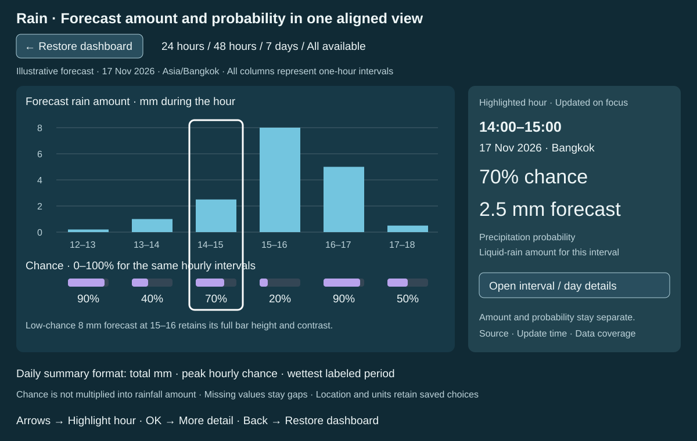
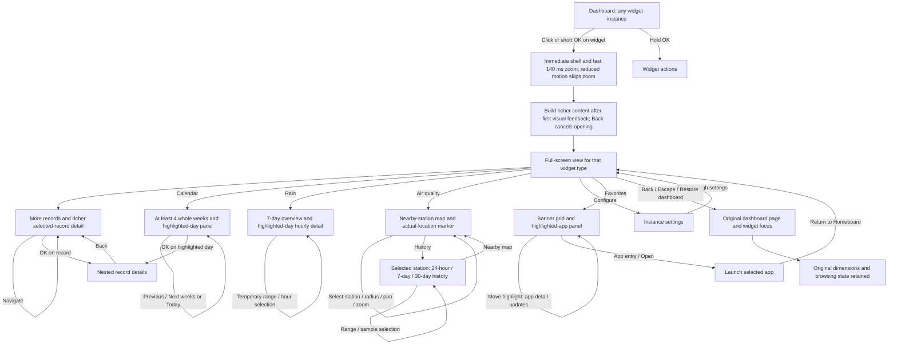

# Every widget: full-screen detail and dashboard restoration

**Status: implemented; 0.1.36 is installed on both TVs, with core Cast1 acceptance and a denser full-screen Favorites grid.**
See the [validation record](../testing/2026-11-17-widget-full-screen.md) for exact
evidence and remaining acceptance limits. Will requires every current and future widget
type to open a useful full-screen view with more data and/or more detailed data.
This covers Calendar, Rain, air quality and Favorites, including every configured
instance, and extends to [World clock](2026-11-17-world-clock-widget.md). It
supersedes the earlier Calendar-only scope.

## Product requirement

**Click or short OK on a widget opens its full-screen view. Back restores the
dashboard.** Show more records, finer time resolution, complete labels, charts with
values, or selected-item detail appropriate to the widget. Enlarging the dashboard
drawing alone does not meet this requirement.

Every expanded view has a visible **Restore dashboard** button and persistent Back
hint. Escape also restores on a keyboard. Restore retains the originating Home page,
widget focus, dimensions and position. Browsing adds no layout changes or Undo
entries. Back from nested detail/settings returns one level first.

This is permanent for new widget types. A new type is incomplete until its compact
and expanded content, useful additional information, controls, empty/error states
and restoration have been specified and verified.

### Fast opening feedback

Short OK/click immediately shows the shared header, Restore dashboard action and
loading body. The shell zooms from 92% to full size in 140 ms, anchored toward
the originating widget. Construct the richer content after that short transition
so synchronous view creation does not block the first feedback or freeze the zoom.
Use the existing localized loading label until content is mounted; network-backed
views then retain their own loading states. There is no artificial network wait.
Reduced motion and Android-disabled animations skip the zoom. Recreation and
return from Configure do not replay it. Back/Restore during opening cancels pending
construction and restores the original dashboard normally.

Acceptance: open each type, repeat open/Back, press Back during opening, use
Configure/return and recreate while loading; verify original page/focus/size and
selection. Check Reduced motion and Android-disabled animations. A recording is
needed to establish animation timing/smoothness; static captures only prove the
resulting full-screen content.

Implemented in **0.1.42**, installed on both TVs. Cast1 recording verifies visible
zoom, shell-before-content, all four expanded views and restoration; see the
[zoom validation record](../testing/2026-11-17-widget-zoom.md) for evidence and
the remaining timing, accessibility and lifecycle checks.

## Screen mockups

The first drawing shows each widget's richer full-screen content. The Calendar
example shows expansion and nested detail. Use dense layouts within TV-safe margins,
with readable text. Reflow for larger text rather than shrinking it to fit more data.

## What full screen adds

| Widget | Dashboard summary | Required full-screen information |
|---|---|---|
| Calendar | Event-only square dates, icons, flag bands and short labels. | At least **four complete Monday–Sunday weeks visible together** (7 columns × at least 4 rows), including days with no events, plus a persistent highlighted-day detail pane. Show complete event names, every event on that date, country/jurisdiction, holiday/observance/working-day type, flower availability and preparation/selling windows, source attribution and coverage/offline status. Highlight changes update the pane immediately; OK opens longer details and source links. |
| Rain | Clouds, rain timing and a compact forecast. | Seven-day overview plus a highlighted-day hourly chart/table. Temporary 24-hour / 48-hour / 7-day / All available browsing exposes the forecast already fetched, independently of compact ranges. Show exact intervals, amount/unit, separate probability, snowfall when supplied, source/update/coverage and immediate selected-hour details. Open full screen directly. |
| Air quality | PM2.5, condition and small trend lines. | Open on a **geographic map of nearby monitoring stations**, their measurements and **Will's actual device-reported location**. Station selection updates distance, timestamp, measurement basis and details. A History tab retains 24-hour / 7-day / 30-day browsing for the selected station or separately labeled model source. |
| Favorites | Bounded app panel with shortened labels. | Dense **banner grid on the left and persistent selected-app detail panel on the right**. More apps, full highlighted-app name, version, last update and Open / App info / Remove from favorites actions. Full-screen banners are independent of compact artwork. Retain app order, scrolling and launch/return selection. |
| [World clock](2026-11-17-world-clock-widget.md) | Adaptive local-time cards with shared city colors, date and primary place. | Exact selected-place date/time, named zone, current offset, reference difference and next offset transition; a shared 24-hour duration comparison and an offline world map. Uses the same restore, state and lifecycle contract. See its separate mockups and validation record. |

Use existing models and available records. Missing values remain missing. Expansion
does not imply a new provider, live holiday feed or unavailable history. Full-screen
range controls are temporary and can expose more available data than the compact
widget. Calendar and Rain must not pre-filter their expanded data through compact
range settings. All compact widget settings remain unchanged when restoring.
Configure remains available for deliberate setting changes. Buddhist observances
do not imply government offices are closed.

### Calendar: at least four whole weeks plus highlighted-day details

Show **all seven days of at least four complete Monday–Sunday weeks simultaneously**,
with weekday headings and visible month/year boundaries. This means at least 28
day cells on the screen alongside a persistent detail pane; four weeks spread
across pages does not satisfy the requirement. Show more whole weeks if space and
readability permit. Keep day cells square and dense. The dashboard retains its
event-only date strip; full screen includes ordinary days so the week structure
is visible.

On first opening, start with the Monday of the current week and highlight today.
If opening from a compact page anchored on a later date, start with that date's
Monday and highlight that date. Include earlier days in the first week as context.
For example, highlighting **17 November 2026** opens **16 November–13 December**:
four complete weeks, even if the compact widget is set to 7 days or This week.

Full-screen event lookup uses the entire displayed week window for **every enabled
Calendar source**, retaining source/jurisdiction toggles. Do not apply compact
7/30-day or flower/Buddhist week filters first: that would hide events in the
additional weeks. Query the same provider snapshot with an explicit temporary
start/end window. Browsing full-screen weeks must not change saved day-count/week
settings or add Undo entries.

Previous/Next browse adjacent blocks of complete weeks; Today returns to the
current week and highlights today. D-pad Left/Right moves one day and Up/Down
moves one week, with header access from the top row. Crossing a block edge reveals
the adjacent block. Keep the highlighted date and detail pane synchronized for
both remote and pointer input. A click selects/highlights a day; OK or activating
the selected day opens its longer details.

The detail pane updates **as soon as the highlight moves**, without requiring OK.
It shows the complete weekday/date and all events and practical details listed
below. An ordinary day shows **No events in enabled sources** when supported by
the snapshot; unavailable/out-of-coverage days show **Coverage unavailable** instead.
Offline and incomplete status remain explicit. Neither an empty cell nor missing
data means government offices are open. Every day remains selectable, including
days with no events and dates beyond provider coverage.

Keep at least four whole weeks visible with the highlighted-day pane on the target
TV, including at larger text sizes. Reflow the pane below the grid if needed and
page its long content instead of reducing the number of visible weeks. Test actual
readability at the device's supported display size.

### Calendar detail priority

Keep square date cards, large numbers, flower/Buddha icons and flag bands. The
selected-date pane shows weekday/full date and all matching events with wrapped
names, then practical information:

- Preparation: **busy, somewhat available**, preparation dates and associated observance.
- Selling: **mostly unavailable**, selling dates and the approximate **11:00–16:00
  Bangkok-time break**, clearly labeled as approximate.
- Holidays: country, applicable jurisdiction and actual/observed/working-day type.
- Data: source names/links, coverage and explicit offline/incomplete status.

Crowded dates show an event count/overflow cue. Every event is accessible in the
pane or nested details; the compact card's one-label limit must not hide events
from full screen. Larger-text layouts can put the detail pane below the grid.
Provide explicit focusable paging for long details.

### Review of the other widget types

The initial plan was too restrictive for Rain: full screen was limited to the
compact forecast window. Broaden expanded browsing while preserving saved compact
settings. Air quality adds a nearby-station map with the actual location marked,
plus intermediate history ranges and exact sample inspection. Favorites adds a
different composition and app details rather than a timeframe.

| Local implementation evidence | What the expanded view can expose |
|---|---|
| [RainClient](../../launcher/app/src/main/java/com/gathin/tvhome/RainClient.java) requests `past_days=1` and `forecast_days=10`; [RainSettings](../../launcher/app/src/main/java/com/gathin/tvhome/RainSettings.java) limits compact hourly choices to 6/12/24/48 and following rows to 0–6. | Browse the returned future intervals beyond compact settings. The request is not a guarantee of ten complete future days; derive actual coverage from returned timestamps. |
| [RainForecast](../../launcher/app/src/main/java/com/gathin/tvhome/RainForecast.java) contains hourly amounts/probabilities and constructs following-day periods after the compact hourly window. | Add explicit day/range queries to the same samples for expanded calendar-day browsing. Keep the existing non-overlapping compact Hourly / Following days semantics. |
| [AirQualityHistory](../../launcher/app/src/main/java/com/gathin/tvhome/AirQualityHistory.java) stores at most 720 timestamped samples; [AirQualityCard](../../launcher/app/src/main/java/com/gathin/tvhome/AirQualityCard.java) requests/backfills history and currently draws 24-hour/30-day previews. | Expose 24-hour / 7-day / 30-day elapsed-time filters, exact points and gaps. A 720-sample limit does not establish 30 days of complete coverage. |
| Public POST to the [AirBKK feed](https://official.airbkk.com/airbkk/Api), inspected 17 November 2026, returned 86 records with `MeasIndex`, `Lat`, `Long`, `DateTime`, `Area`, `District`, `PM2.5` and other measurement fields. The current app picks from five fixed IDs. | Parse a dynamic station catalog and all returned measurements needed for the map. Use actual coordinates and timestamps rather than positioning a five-station illustration. This live response establishes available fields, not worldwide station coverage. |
| [BannerAppTile](../../launcher/app/src/main/java/com/gathin/tvhome/BannerAppTile.java) already supports 16:9 banners and icon fallback; [FavoritesWidgetView](../../launcher/app/src/main/java/com/gathin/tvhome/FavoritesWidgetView.java) supports bounded app browsing. | Reuse artwork/browsing for a full-screen banner grid and add selected-app metadata/actions. This requires more than resizing the existing Favorites browser. |

The Rain/history/Favorites findings are from source inspection. The AirBKK catalog
also has a fresh public-response inspection; map rendering and location handling
have not received device validation.
The public response and inspection metadata are preserved locally under
`artifacts/reviews/2026-11-17-air-quality-map/`; all 86 records in that response
had valid latitude/longitude pairs. No device location was collected for this review.

### Rain: broader forecast with highlighted-day/hour details

Default to **seven calendar-day summaries**, starting today, and the highlighted
day's hourly amounts/probabilities alongside or below. Highlight today initially;
focus the next future interval. Show the remainder of today as partial with exact
start/end times. Focus changes update the detail panel immediately; OK can open a
full-day table. Keep dates/time zone explicit across midnight and daylight-saving
changes.

Offer temporary **24 hours / 48 hours / 7 days / All available** controls. All
available uses the response's actual future coverage, up to the currently requested
ten calendar days; label the exact end date/time. Day browsing stays available
even if the compact widget has zero following days. Include a visible Reset to
today/next interval control. Browsing these windows does not save RainSettings.

Show rain amount and probability separately. Day summaries may show total amount,
peak hourly chance, first/last forecast wet interval and coverage count. Label peak
hourly chance precisely; it is not the probability of any rain across the day.
Missing hours mean incomplete, not zero rain. Past model intervals are not observed
weather; a historical rain/accuracy view would require separate data work.
Keep the selected location, units, forecast source and last update visible. Changing
timeframe never changes location or starts a separate request when cached data fits.

#### Approved trial: amount bars and an aligned probability strip

Will selected this approach for the implementation trial on 17 November 2026.
The amount/probability trial is implemented and its first TV capture is reviewed.

- **Bar height represents forecast rain amount**, with an amount axis and explicit
  mm/in units. A substantial forecast amount keeps its full bar height and contrast
  even when probability is low.
- **A separate probability strip sits directly below the bars**, with one cell per
  identical hourly interval. Each cell has a small horizontal percentage meter;
  numeric percentages appear where readable. Keep a visible Chance legend and
  0–100% interpretation. Probability does not change amount-bar height or opacity.
- Highlighting an hour selects its amount bar, probability cell and table row
  together. Immediately show **14:00–15:00 · 70% chance · 2.5 mm forecast**, with
  date/time zone and exact values available in the detail pane. Click/OK opens the
  existing deeper interval/day detail. The 70% is not a probability of exactly
  2.5 mm, and 2.5 mm is not labeled “if it rains.”
- Where a compact widget can fit a useful chart, use the same bar/strip language.
  Small glance widgets retain a readable summary; full screen exposes the complete
  chart and individual intervals without squeezing text into the Home tile.
- Daily summaries combine **forecast total + peak hourly chance + timing**, for
  example **6 mm total · peak hourly chance 80% · wettest 3 hours 15:00–18:00**.
  Derive the labeled wettest period from complete hourly amount intervals; do not
  invent timing when coverage is missing. Peak hourly chance remains distinct from
  an overall probability of rain at any point during the day.
- Do not multiply chance by forecast amount to produce “expected rainfall,” a
  replacement amount, or a blended score. The provider documents amount and
  probability separately; it does not establish that the amount is conditional on
  precipitation occurring. Keep the two measurements independently inspectable.
- Preserve independent missing values: a missing amount is a chart gap, while a
  supplied probability can still be shown, and vice versa. Zero, missing, stale and
  unavailable remain distinguishable. Use labels/focus outlines as well as color.

Provider interpretation: [Open-Meteo hourly definitions](https://open-meteo.com/en/docs#hourly-parameter-definition)
define probability for precipitation exceeding 0.1 mm in the hour, and rain/showers
as hourly accumulations. Align both to the same start/end interval. In mixed weather,
label precipitation probability accurately rather than claiming a liquid-only rain
probability; keep snowfall separate from liquid-rain amount.

### Air quality: nearby stations on a map, actual location and history

**Open on Nearby map.** A real geographic basemap occupies most of the screen, with
measurement markers at nearby monitoring stations and a clearly different **You**
marker at Will's actual device-reported location. A station list/detail pane follows
the highlighted marker. Keep **Nearby map / History** tabs and Restore dashboard
visible. The dedicated mockup is schematic; implementation must use real station
coordinates and geographic map data.

#### Location and nearby scope

- Use the shared Android device-location flow, including permission handling,
  age/accuracy checks and refresh. Center on a valid recent fix. Display its accuracy
  circle when supplied and distinguish approximate or last-known location with age.
- Never substitute the selected station, model-grid center, manually configured
  forecast coordinates or inferred IP city for the actual-location marker. Manual
  coordinates can be a clearly labeled **Reference location**, with no claim that
  they are Will's current location. A missing fix has a visible retry/location action.
- Start with stations within **25 km** of the location; offer temporary
  **10 / 25 / 50 / 100 km** radius controls and Recenter on me. Sort the companion
  list by distance and fit the initial viewport to the location and nearby results.
  Do not zoom out to distant Bangkok stations merely to fill an empty local view.
- Use the catalog's actual geographic coverage. Outside supported coverage, say
  **No supported station data here** and retain the actual-location map; do not
  invent nearby monitors or present a model estimate as a physical station.
  Additional regional station providers require verification before claiming support.

#### Station measurements and navigation

- Show PM2.5 values with **µg/m³**, station name and a condition color on map markers.
  Provide text/icon cues too. Distinguish stale/unavailable values instead of
  displaying an old reading as fresh. Keep each station's own measurement timestamp.
- Highlighting a marker or list row updates the other and immediately shows full
  station name, distance, district/area, value/unit, source, time zone, timestamp,
  age and measurement basis. Retain AirBKK's measured 24-hour-average labeling.
  Secondary measurements such as PM10 can appear only after their units and
  averaging basis are verified; the feed's mere presence is not enough.
- Dense/overlapping stations group at low zoom, with an explicit station count and
  a selectable list. Zooming separates them; grouping must not invent an average
  station measurement. A geographic gradient/heatmap is outside this first view.
- The remote normally selects stations in the list and their synchronized markers.
  A visible **Pan map** mode uses D-pad movement, with explicit Zoom − / + controls;
  Back exits pan mode before restoring the dashboard. Pointer input supports marker
  selection, pan and zoom. Recenter preserves selection where it remains in range.
- Selecting stations is temporary browsing. It must not silently replace the compact
  widget's configured station/model source. History opens the highlighted station;
  any intentional saved source change goes through Configure and normal Undo.
- Fetch the station feed once and share its snapshot/catalog across markers and
  widget instances. Validate unique IDs, coordinate bounds, numeric values and
  timestamps; keep bad records from crashing the map. Fetch station history lazily
  for the selected station, with bounded caching rather than all-station backfills.

#### Geographic map delivery

Use a small native map surface with a replaceable tile-provider boundary, real
geographic projection and bounded viewport requests/cache. The initial candidate
is OpenStreetMap standard raster tiles, subject to its
[tile usage policy](https://operations.osmfoundation.org/policies/tiles/) checked
17 November 2026: visible map attribution, identifying app User-Agent, caching that
honors server headers, and no bulk/background prefetch. Finalize and validate the
provider before implementation; avoid household API keys or an embedded credential.

Show **© OpenStreetMap contributors** with the basemap when that provider is used,
plus separate AirBKK/source attribution. Request only visible map tiles and keep
device coordinates out of request logs. If tiles fail, preserve station data and
any usable cached map with an explicit map status; do not label a decorative
background as a functioning geographic map. Location, tile loading and station-data
loading have independent status/retry states.

#### History and precise samples

The History tab defaults to a **7-day overview** with **24 hours / 7 days / 30 days**
selectors and a persistent highlighted-sample pane. Retain the selected station
between map and history. A separately labeled model view can inspect the configured
model history; its grid location remains distinct from the actual-location marker.
Hourly sample mode preserves each timestamp;
day overview can show min/max of available published values and sample count, with
OK drilling into that day's points. Do not describe the min/max of reported
24-hour moving averages as a new daily AQI or instantaneous pollution measurement.

Anchor trailing windows to the current time, retaining stale-data/update indicators.
Show actual oldest/newest sample and missing intervals; do not fill a chart's empty
time span by stretching old samples or connecting across gaps. Retain selected
timestamp when switching ranges where possible. No beyond-30-day history or
air-quality forecast tab is promised. Nearby stations compare their latest reported
measurements, with timestamps and measurement basis visible; coverage may be much
shorter than the selected history range.

Show exact PM2.5/unit/time, applicable condition, source and station/model location.
Measured AirBKK 24-hour averages and model estimates keep their distinct labels and
histories. Use the source location's zone and retain it in expanded model metadata
instead of guessing from the TV's zone. Selecting a day/sample updates details
without extra OK presses. Ranges and selections do not change source configuration
or Undo history.

### Favorites: banner grid with a right-hand app panel

Will's chosen composition is a **dense banner grid on the left, app details on the
right**. Use roughly two-thirds / one-third of the usable width as a starting point.
At normal 1080p text size, target **four columns and four visible rows (16 slots)**
where measured bounds permit; Will requested greater density than the initial
nine-slot layout. Derive columns and row height from usable width/height and font
scale, and reflow for larger text. This is capacity, not a cap on the favorites
list; additional apps scroll, and existing apps are never added just to fill slots.
Keep 16:9 artwork
and clear focus. Apps without banners use a centered icon on the same plate. This
full-screen presentation uses banners even if compact Favorites uses small icons;
opening it never changes the compact artwork setting.

The right panel follows the **currently highlighted app immediately**, showing its
full readable name, available version and last-update date from installed package
metadata. Add **Open**, **App info** and **Remove from favorites** actions. Technical
package/activity identifiers belong in App info or a distinguishing detail when
two entries would otherwise be ambiguous. Missing metadata stays unavailable;
do not invent store descriptions, publisher names or screenshots.

OK on a banner launches that app; Right from the grid's last column reaches the
selected app's actions; Left returns to the same banner. Keep the panel bound to
that selection while its actions have focus. Back restores the dashboard from the
expanded root, including when an action has focus. Returning from a launched app
or Android App info restores full-screen selection and scroll position where the
coordinator-supported workflow can verify it. Explicit removal/reorder keeps the
normal Undo behavior; ordinary browsing does not change favorite order.

Additional useful ideas, with scope made explicit:

- **Include:** position/count such as “5 of 23”; persistent return focus; clear
  unavailable-app state; full name wrapping in the detail panel.
- **Include:** a clear Reorder action that enters the existing explicit reorder
  workflow rather than accidentally moving apps during ordinary navigation.
- **Optional later:** temporary A–Z jump/filter for long lists, cleared on exit and
  leaving saved order unchanged. Keep manual order as the default.
- **Optional later:** more appearance choices for the expanded browser after the
  banner-plus-details baseline is accepted.

Favorites has no intrinsic timeframe. Recent-use lists, “last played” values or
store descriptions require new metadata/tracking and are outside this baseline.

## Controls and restoration

| View | Input | Result |
|---|---|---|
| Dashboard widget surface/header | Click / short OK | Open that instance's full-screen content. |
| Dashboard widget | Hold OK | Existing widget actions; releasing the hold must not also expand. |
| Favorites child app, dashboard or expanded | Click / short OK | Launch the explicitly selected app. Favorites header/container opens full screen. App and widget activation have distinct hit targets. |
| Expanded widget | D-pad / pointer | Navigate records, charts, apps and controls; update selected-record detail immediately and keep focus within the view. |
| Selected record | Click / short OK | Deeper details where useful; Favorites entries launch their app. |
| Expanded widget | Previous / Next, tabs or data controls | Browse data; disable unavailable actions and retain selection where possible. |
| Expanded widget | Configure | Instance settings; returning retains full screen. Explicit edits keep normal persistence and Undo. |
| Nested detail/settings | Back | Return one level, retaining selection and browsing position. |
| Expanded root | Back / Escape / Restore dashboard | Restore original Home page, widget focus, size and position. |

OK remains available for inspecting records and activating entries, so it is not a
global restore toggle. The restore button stays visible in empty/error states. Up
from the first content row reaches the header; Down returns to the last selection.
Directional boundaries never enter All Apps. Page crossing preserves chronological
or app order and handles incomplete rows. Favorites child hold opens app actions;
widget actions belong to its header.

## Workflow

## Implementation approach

1. **Mandatory widget presentation contract.** Each type supplies compact content,
   meaningful full-screen content, instance identity, selection/browsing state and
   lifecycle callbacks. One expansion host owns the header, restore action, Back
   stack and focus boundaries. Controllers own data/details. Use a small native
   Java contract and explicit registrations; a plugin framework is unnecessary.
2. **Consistent activation.** Replace Calendar and air-quality action-menu activation
   with expansion. Rain opens its richer full-screen content directly. Favorites
   header/container opens the full browser; children retain app launch/actions.
   Handle expanded input before dashboard/menu input. Prevent duplicate openings
   and short clicks after long OK. Move/Resize/Delete remain dashboard actions.
3. **Richer bodies.** Reuse models, charts, card drawing and app browsing. Calendar
   needs a seven-column grid with at least four complete visible weeks, highlighted
   day hit targets, a persistent detail pane and per-date details. Add a snapshot
   query accepting the full-screen date window independently of compact range
   filters, including per-day coverage and empty states. Air quality needs a dynamic
   station catalog, validated coordinates, fresh device location, map projection/
   tiles/markers, nearby filtering and selected-station history with labeled values.
   Preserve actual fix, configured reference and model grid as separate identities.
   Rain needs linked interval chart/table
   selection and explicit day/range queries independent of compact settings.
   Favorites needs a banner grid, right-hand app panel and installed-app metadata.
   Share data with compact views, avoiding duplicate fetches/timers.
4. **Identity-based navigation.** Track the originating widget instance, Home
   page/focus, selected date/timestamp/app and prior browsing state. Capacities differ:
   preserve record identity rather than a page number. Data changes select the nearest
   remaining record; removed apps/instances fall back safely. Settings-triggered
   rendering retains expansion and updates the correct instance. Restore the compact
   browsing state where it still exists.
5. **Temporary state.** Open/close and browsing do not save spans or enter Undo.
   Restore expansion/selection across recreation using activity instance state;
   fresh launches start at Home. App launch/return retains expanded Favorites state
   during the session. Suspend work when hidden; release listeners/timers on close.
6. **Accessible data states.** Support loading, empty, stale/offline, incomplete,
   unavailable and error states as applicable, always with restoration available.
   Respect palette, opacity, language, larger text and Reduced motion. Localize labels,
   use accessible records and 24-hour times with the relevant zone. Keep cached data
   visible during refresh failures.

## Current and future widget completion gate

Contributor instructions require this behavior and link this plan. Implementation
must enumerate every registered widget type in a contract check: each supplies an
expanded presentation. A compact-only type cannot be added to the widget picker.
Do not fall back to a stretched compact view or generic action menu. The contract
check establishes type coverage; per-widget content acceptance establishes useful
additional information.

Every future widget plan must specify compact versus expanded information, added
records/detail, input targets, nested Back behavior, data/error states and dashboard
restoration tests. For time-based data, specify the expanded default timeframe,
available range controls, actual coverage limits and independence from compact
range settings. Mockups must include its expanded presentation.

## Implementation and acceptance checklist

- [x] Inspect all four widget types and revise scope, content matrix, mockups,
  workflow and contributor requirement for every current/future type.
- [x] Add shared expansion host and mandatory per-type contract/coverage check.
- [x] Calendar: at least four complete visible Monday–Sunday weeks, independent
  temporary event window, highlighted-day pane, all events and flower availability.
- [x] Rain: independent 7-day/available browsing, amount bars plus aligned probability
  strip, synchronized day/hour detail, exact partial-day boundaries and cached
  coverage without saving compact settings.
- [x] Air quality: actual-location marker/accuracy, nearby station catalog and
  measurements on a real map, radius/pan/zoom/selection, provider attribution and
  selected-station 24-hour/7-day/30-day history with coverage/basis labels.
- [x] Favorites: banner grid, right-hand highlighted-app panel, metadata/actions,
  explicit reorder and app return state independent of compact artwork.
- [ ] Container tests: restoration, identity anchoring, data changes, multiple
  instances, incomplete pages, empty/errors and recreation. Browsing must leave
  saved dimensions and Undo unchanged.
- [ ] Run `task check`, then `task deploy` for one newly numbered frozen APK on
  both TVs. Cast1 remains the foreground acceptance target.
- [ ] Coordinator-owned Cast1 sessions: click/short OK, hold OK, navigation,
  immediate record details, nested Back, Configure return, Restore dashboard,
  repeated open/close and Favorites launch/return where supported.
- [ ] Compare compact/expanded captures for **each type**: demonstrate the additional
  data/detail above, readable dense content, data status and reachable controls in
  English/Thai with larger text. Check empty/incomplete and multi-page results.
- [ ] Calendar acceptance: show 28 or more day cells and the highlighted-day detail
  pane together; test month/year boundaries, ordinary days, coverage gaps, Today,
  adjacent-week blocks and immediate detail updates. With compact set to 7 days/
  This week, prove covered events in weeks 3–4 still appear in full screen and
  saved compact settings remain unchanged after restoring.
- [ ] Verify Calendar 8×1 and other sizes return unchanged to their original page,
  focus and browsing state; verify isolation between configured instances.
- [ ] Rain acceptance: compact 6 hours / 0 following days still opens seven-day
  browsing with actual coverage shown; select a day/hour, change expanded range,
  restore and prove compact ranges stayed unchanged. Test incomplete/final days.
- [ ] Rain chart trial: compare high-chance/small-amount, low-chance/large-amount and
  high-chance/large-amount cases. Check aligned intervals, independent missing
  values, readable legends/units, highlighted exact values, mm/in conversion and
  daily total/peak-hourly-chance/timing labels. Confirm probability never scales or
  fades amount bars and no multiplied “expected amount” is shown.
- [ ] Air acceptance: 24-hour/7-day/30-day selection with sparse and stale records,
  exact highlighted values, separate model/station histories and correct local
  times. Prove sample-count capacity is never presented as complete coverage.
- [ ] Air map acceptance: verify actual station coordinates/measurements against
  the provider, distance/radius calculations, actual-location versus model-grid
  distinction, accuracy/stale fix/missing permission, marker/list synchronization,
  grouping, pan/zoom/Back and map/history return. Exercise no nearby coverage,
  invalid station records, tile failure, stale readings and source attribution.
  Prove map browsing leaves the compact configured source/location unchanged.
- [ ] Favorites acceptance: compact icons still open full-screen banners; moving
  highlight updates the right pane, actions target that app, absent metadata is
  handled, explicit edits support Undo, and launch/return restores selection.
- [ ] Record per-type evidence/limits; update widget creation guidance, how-tos
  and quick start. Completion requires every registered type; World clock follows
  this contract with its own plan and validation record.

Implementation and deployment are now authorized. Per-type code and core TV
acceptance are recorded above; unchecked items retain their specific acceptance
requirements rather than implying every edge case has been exercised on a TV.
